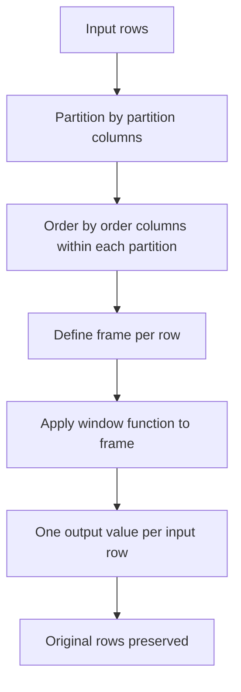
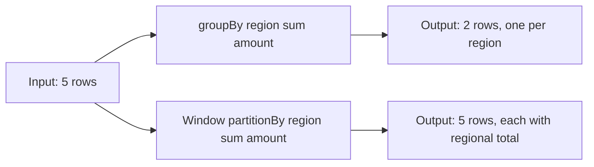
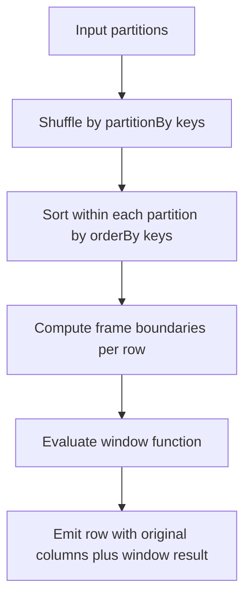

# 2.2.1 What is a Window Function in PySpark?

A window function computes a value for each row using a set of related rows called a window. Unlike `groupBy` aggregation, it does not collapse rows. Every input row produces exactly one output row.



### Core concept

| Aspect | Behavior |
|---|---|
| Row count | Same as input. No rows collapsed |
| Window scope | A subset of rows related to the current row |
| Defined by | `Window.partitionBy(...).orderBy(...)` plus optional frame |
| Evaluated per row | Each row sees its own frame |
| Requires shuffle | Yes, by partition columns |
| Requires sort | Yes, by order columns within each partition |
| Typical use | Running totals, ranks, previous or next values, moving averages |

### Window specification components

| Component | Purpose | Example |
|---|---|---|
| `partitionBy` | Split rows into independent groups | `Window.partitionBy("region")` |
| `orderBy` | Order rows within each partition | `Window.partitionBy("region").orderBy("date")` |
| Frame clause | Limit rows considered per row | `.rowsBetween(-2, 0)` |
| Frame type | `rows` counts physical rows, `range` counts value ranges | `.rangeBetween(-7, 0)` on a date column |

### Window function categories

| Category | Functions | Behavior |
|---|---|---|
| Ranking | `row_number`, `rank`, `dense_rank`, `ntile`, `percent_rank`, `cume_dist` | Assign a rank or bucket per row within the partition |
| Analytic | `lag`, `lead`, `first_value`, `last_value`, `nth_value` | Access another row in the window |
| Aggregate | `sum`, `avg`, `min`, `max`, `count` | Aggregate over the frame |

### GroupBy vs window function

| Topic | `groupBy().agg()` | Window function |
|---|---|---|
| Output rows | One per group | One per input row |
| Original columns | Lost unless aggregated | Preserved |
| Shuffle | Yes, by group key | Yes, by partition key |
| Sort | Not required | Required if `orderBy` is used |
| Typical use | Summary tables | Per-row context, running metrics, ranks |



### Default frame behavior

| Window spec | Default frame |
|---|---|
| `partitionBy` only, no `orderBy` | Whole partition |
| `partitionBy` and `orderBy` | `RANGE BETWEEN UNBOUNDED PRECEDING AND CURRENT ROW` |
| Explicit `rowsBetween` | As specified |
| Explicit `rangeBetween` | As specified |

The default frame with `orderBy` is cumulative. A running total is the default behavior, not an explicit frame.

### Basic examples

PySpark:

```python
from pyspark.sql import Window
from pyspark.sql.functions import col, row_number, sum, lag

# Rank rows within each region by amount
w_rank = Window.partitionBy("region").orderBy(col("amount").desc())
df.withColumn("rn", row_number().over(w_rank))

# Running total per region ordered by date
w_running = Window.partitionBy("region").orderBy("date")
df.withColumn("running_total", sum("amount").over(w_running))

# Previous row value per region
w_lag = Window.partitionBy("region").orderBy("date")
df.withColumn("prev_amount", lag("amount", 1).over(w_lag))

# Moving average over the last 3 rows
w_moving = Window.partitionBy("region").orderBy("date").rowsBetween(-2, 0)
df.withColumn("ma3", avg("amount").over(w_moving))
```

SQL:

```sql
SELECT
  region, date, amount,
  row_number() OVER (PARTITION BY region ORDER BY amount DESC) AS rn,
  sum(amount) OVER (PARTITION BY region ORDER BY date) AS running_total,
  lag(amount, 1) OVER (PARTITION BY region ORDER BY date) AS prev_amount
FROM sales;
```

### Frame clause reference

| Frame | Meaning |
|---|---|
| `rowsBetween(Window.unboundedPreceding, Window.currentRow)` | All rows from start to current |
| `rowsBetween(-2, 0)` | Current row and two before |
| `rowsBetween(0, 2)` | Current row and two after |
| `rowsBetween(Window.unboundedPreceding, Window.unboundedFollowing)` | Whole partition |
| `rangeBetween(-7, 0)` | Rows whose order value is within 7 units before current |

`rows` counts physical rows. `range` counts value distance on the order column. `range` requires exactly one order column of numeric or date type.

### Null handling

| Function | Null behavior |
|---|---|
| `row_number` | Assigns a number to every row, including nulls |
| `rank`, `dense_rank` | Nulls order together based on `orderBy` null placement |
| `lag`, `lead` | Returns null when the target row is out of frame |
| `first_value`, `last_value` | Returns null if the first or last value is null |
| `sum`, `avg` | Ignore nulls. Return null when no non-null values exist |
| `count(col)` | Counts non-null values only |
| `count("*")` | Counts all rows |

### Execution model



| Step | Cost |
|---|---|
| Shuffle | Network and disk, scales with row count and partition cardinality |
| Sort | CPU and spill, scales with partition size |
| Frame evaluation | Cheap for ranking. Cumulative aggregates are incremental |

### Performance notes

- Window functions are expensive because they require a shuffle and a sort. Use only when the result needs per-row context.
- Partition by a column with reasonable cardinality. Too few partitions means large sorts. Too many partitions means many small tasks and overhead.
- Avoid wide partitions. A single hot partition key causes skew and long tasks.
- The default cumulative frame is efficient for running aggregates. Explicit `rowsBetween(-n, 0)` is still incremental. A frame that looks forward to `unboundedFollowing` forces buffering the whole partition.
- `row_number` and `rank` are cheap per row. `lag` and `lead` are cheap. Aggregates over a growing frame are incremental.
- Multiple window functions with the same `partitionBy` and `orderBy` can often share one shuffle and sort. Spark does not always reuse the window. Check the plan.
- Use `rowsBetween` instead of `rangeBetween` when possible. `range` requires value comparison and can be slower.
- Filter before the window. A window function runs after the filter in the plan, so fewer rows means less shuffle and sort.
- Prefer `groupBy` when you do not need per-row output. Window functions are not a replacement for aggregation.

### Common pitfalls

| Pitfall | Effect | Fix |
|---|---|---|
| Expecting one row per group | One row per input row | Use `groupBy` for summary output |
| Forgetting `orderBy` with a cumulative aggregate | Frame becomes whole partition, not running | Add `orderBy` or an explicit frame |
| Assuming `rangeBetween` counts rows | It counts value distance | Use `rowsBetween` for row counts |
| Partitioning by a high cardinality column | Many small partitions, overhead | Partition by the business group |
| Partitioning by a low cardinality column | Huge partitions, skew | Add a second partition column or pre aggregate |
| Using a window when `groupBy` works | Unnecessary shuffle and sort | Use `groupBy` for aggregates without per-row context |
| Multiple windows with different specs | Multiple shuffles and sorts | Align `partitionBy` and `orderBy` where possible |
| `last_value` with default frame | Returns the current row, not the last row of the partition | Use `rowsBetween(unboundedPreceding, unboundedFollowing)` |
| Null ordering surprises | Ranks differ from expectation | Use `asc_nulls_last()` or `desc_nulls_first()` |

### End to end example

```python
from pyspark.sql import SparkSession, Window
from pyspark.sql.functions import col, row_number, sum, avg, lag

spark = SparkSession.builder.getOrCreate()

df = spark.createDataFrame(
    [
        ("East", "2024-01-01", 100),
        ("East", "2024-01-02", 150),
        ("East", "2024-01-03", 120),
        ("West", "2024-01-01", 80),
        ("West", "2024-01-02", 95),
    ],
    ["region", "date", "amount"]
)

w_rank = Window.partitionBy("region").orderBy(col("amount").desc())
w_run  = Window.partitionBy("region").orderBy("date")
w_ma3  = Window.partitionBy("region").orderBy("date").rowsBetween(-2, 0)

out = (
    df
    .withColumn("rank_by_amount", row_number().over(w_rank))
    .withColumn("running_total", sum("amount").over(w_run))
    .withColumn("prev_amount", lag("amount", 1).over(w_run))
    .withColumn("ma3", avg("amount").over(w_ma3))
)

out.show()
```

| region | date | amount | rank_by_amount | running_total | prev_amount | ma3 |
|---|---|---|---|---|---|---|
| East | 2024-01-01 | 100 | 3 | 100 | null | 100.0 |
| East | 2024-01-02 | 150 | 1 | 250 | 100 | 125.0 |
| East | 2024-01-03 | 120 | 2 | 370 | 150 | 123.33 |
| West | 2024-01-01 | 80 | 2 | 80 | null | 80.0 |
| West | 2024-01-02 | 95 | 1 | 175 | 80 | 87.5 |

### Summary

- A window function computes a value per row over a related set of rows.
- It preserves row count. `groupBy` collapses rows. `window` does not.
- Defined by `partitionBy`, `orderBy`, and an optional frame.
- Categories are ranking, analytic, and aggregate.
- Execution requires a shuffle and a sort, so use it when per-row context is needed.
- Align window specifications to reuse shuffles and sorts.
- Filter before the window. Keep partitions balanced. Prefer `groupBy` when per-row output is not required.
