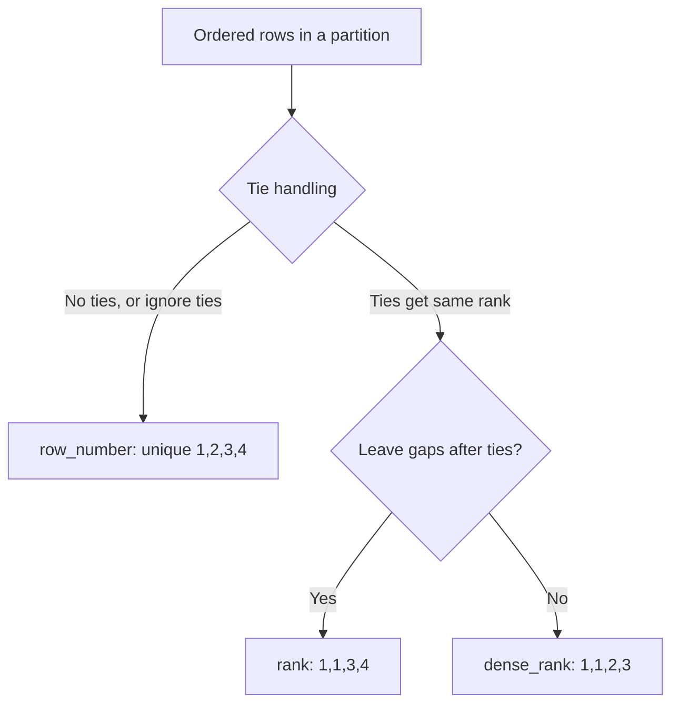

# 2.2.2 Explain the difference between row_number(), rank(), and dense_rank().

All three are ranking window functions. They differ only in how they treat ties. `row_number` always assigns a unique number. `rank` assigns the same rank to ties and then leaves gaps. `dense_rank` assigns the same rank to ties and does not leave gaps.



### Core definitions

| Function | Tie behavior | Gaps after ties | Output sequence example |
|---|---|---|---|
| `row_number()` | Ties get different numbers | Not applicable | `1, 2, 3, 4` |
| `rank()` | Ties get the same rank | Yes, rank jumps | `1, 1, 3, 4` |
| `dense_rank()` | Ties get the same rank | No, ranks are consecutive | `1, 1, 2, 3` |

### Behavior table with tied values

Assume rows ordered by `amount` descending within one partition.

| amount | row_number | rank | dense_rank |
|---|---|---|---|
| 100 | 1 | 1 | 1 |
| 100 | 2 | 1 | 1 |
| 90 | 3 | 3 | 2 |
| 80 | 4 | 4 | 3 |
| 80 | 5 | 4 | 3 |
| 70 | 6 | 6 | 4 |

Key observations:

- `row_number` never repeats a number. Tied rows get arbitrary distinct numbers.
- `rank` repeats `1` for the two `100` rows, then jumps to `3`. The gap size equals the number of tied rows minus one.
- `dense_rank` repeats `1` for the two `100` rows, then continues at `2`. No gap.

### Determinism

| Function | Deterministic result | Why |
|---|---|---|
| `row_number()` | No, unless `orderBy` uniquely identifies rows | Ties are broken arbitrarily |
| `rank()` | Yes, rank value is determined by the order key | Tied rows share the same rank |
| `dense_rank()` | Yes, rank value is determined by the order key | Tied rows share the same rank |

For `row_number` to be deterministic, add a tiebreaker column to `orderBy`.

```python
from pyspark.sql import Window
from pyspark.sql.functions import col, row_number

w = Window.partitionBy("region").orderBy(col("amount").desc(), col("id").asc())
df.withColumn("rn", row_number().over(w))
```

Without a tiebreaker, reruns and repartitions can produce different `row_number` assignments.

### PySpark syntax

```python
from pyspark.sql import Window
from pyspark.sql.functions import col, row_number, rank, dense_rank

w = Window.partitionBy("region").orderBy(col("amount").desc())

out = (
    df
    .withColumn("rn", row_number().over(w))
    .withColumn("rk", rank().over(w))
    .withColumn("dr", dense_rank().over(w))
)
```

### SQL syntax

```sql
SELECT
  region, amount,
  row_number() OVER (PARTITION BY region ORDER BY amount DESC) AS rn,
  rank()       OVER (PARTITION BY region ORDER BY amount DESC) AS rk,
  dense_rank() OVER (PARTITION BY region ORDER BY amount DESC) AS dr
FROM sales;
```

### When to use each

| Need | Function | Reason |
|---|---|---|
| Pick exactly one row per group | `row_number()` | Guarantees one row per number. Filter `rn = 1` |
| Deduplicate with a deterministic survivor | `row_number()` with a tiebreaker | Deterministic row selection |
| Pagination | `row_number()` | Unique and sequential |
| Top N including ties | `rank()` or `dense_rank()` | Ties included at the boundary |
| Top N with exactly N rows | `row_number()` | Ties are broken arbitrarily to force N rows |
| Rank with competition style gaps | `rank()` | `1, 1, 3` reflects skipped positions |
| Dense ordering without gaps | `dense_rank()` | `1, 1, 2` for consecutive categories |
| Find the Nth distinct value | `dense_rank()` | No gaps, so `dr = N` is the Nth distinct value |

### Common pattern: top 1 per group

```python
from pyspark.sql import Window
from pyspark.sql.functions import col, row_number

w = Window.partitionBy("region").orderBy(col("amount").desc(), col("id").asc())
top1 = df.withColumn("rn", row_number().over(w)).filter(col("rn") == 1).drop("rn")
```

| Approach | Rows returned per group | Deterministic |
|---|---|---|
| `row_number` filter `rn = 1` | Exactly 1 | Yes, with a tiebreaker in `orderBy` |
| `rank` filter `rk = 1` | 1 or more if ties | Yes |
| `dense_rank` filter `dr = 1` | 1 or more if ties | Yes |

### Common pattern: top N including ties

```python
topN = df.withColumn("rk", rank().over(w)).filter(col("rk") <= 3)
```

If two rows tie at rank 3, both are kept. The result can have more than 3 rows. This is often the business requirement for leaderboards.

### Null ordering matters

All three functions respect null ordering in `orderBy`. Use `asc_nulls_last`, `desc_nulls_first`, and similar to make null placement explicit.

```python
from pyspark.sql.functions import col, desc_nulls_last

w = Window.partitionBy("region").orderBy(desc_nulls_last("amount"))
```

| Order spec | Null placement |
|---|---|
| `col("amount").asc()` | Nulls first in Spark by default |
| `col("amount").desc()` | Nulls last in Spark by default |
| `asc_nulls_last("amount")` | Nulls last explicitly |
| `desc_nulls_first("amount")` | Nulls first explicitly |

Null placement changes which row gets `row_number = 1` and which rows share a `rank`. Make it explicit when nulls exist.

### Performance notes

- All three require a shuffle by `partitionBy` and a sort by `orderBy`.
- `row_number` is the cheapest. It only needs a counter per partition.
- `rank` and `dense_rank` need to compare the current row to the previous row to detect ties. Slightly more work but still cheap.
- The shuffle and sort dominate the cost, not the ranking logic.
- Align `partitionBy` and `orderBy` across multiple ranking functions to reuse the same shuffle and sort. Check the plan for repeated `Window` nodes.
- `rank` with many ties can produce more output rows after filtering by rank threshold. Account for this in downstream volume estimates.

### Common pitfalls

| Pitfall | Effect | Fix |
|---|---|---|
| Using `row_number` when ties must be preserved | Ties are broken arbitrarily | Use `rank` or `dense_rank` |
| Using `rank` when exactly N rows are needed | Ties produce more than N rows | Use `row_number` with a tiebreaker |
| Using `dense_rank` for pagination | Page sizes are not fixed because ties share ranks | Use `row_number` |
| No tiebreaker in `row_number` | Non deterministic output | Add a unique column to `orderBy` |
| Expecting `rank` without gaps | Gaps appear after ties | Use `dense_rank` |
| Expecting `dense_rank` to reflect competition rank | It has no gaps | Use `rank` |
| Null ordering not specified | Ranks shift unexpectedly | Use `asc_nulls_last` or `desc_nulls_first` |
| Multiple windows with different specs | Multiple shuffles and sorts | Align the window specs |
| Using a window when `groupBy` works | Unnecessary shuffle and sort | Use `groupBy` for aggregates without per-row ranks |

### End to end example

```python
from pyspark.sql import SparkSession, Window
from pyspark.sql.functions import col, row_number, rank, dense_rank

spark = SparkSession.builder.getOrCreate()

df = spark.createDataFrame(
    [
        ("East", "a", 100),
        ("East", "b", 100),
        ("East", "c", 90),
        ("East", "d", 80),
        ("East", "e", 80),
        ("West", "f", 70),
    ],
    ["region", "id", "amount"]
)

w = Window.partitionBy("region").orderBy(col("amount").desc(), col("id").asc())

out = (
    df
    .withColumn("rn", row_number().over(w))
    .withColumn("rk", rank().over(w))
    .withColumn("dr", dense_rank().over(w))
)

out.show()
```

| region | id | amount | rn | rk | dr |
|---|---|---|---|---|---|
| East | a | 100 | 1 | 1 | 1 |
| East | b | 100 | 2 | 1 | 1 |
| East | c | 90 | 3 | 3 | 2 |
| East | d | 80 | 4 | 4 | 3 |
| East | e | 80 | 5 | 4 | 3 |
| West | f | 70 | 1 | 1 | 1 |

The `rn` column is unique because `id` is in the `orderBy`. Without `id`, `rn` for rows a and b could be `1, 2` or `2, 1` across runs.

### Summary

- `row_number` assigns unique sequential numbers. Ties are broken arbitrarily unless a tiebreaker is added.
- `rank` assigns the same rank to ties and leaves gaps. It reflects competition ranking.
- `dense_rank` assigns the same rank to ties and leaves no gaps. It reflects dense ordering.
- Use `row_number` for exactly N rows and deterministic dedup with a tiebreaker.
- Use `rank` for leaderboards where ties should be kept.
- Use `dense_rank` for consecutive category numbering or finding the Nth distinct value.
- All three are shuffle and sort bound. Align window specs to avoid repeated shuffles.
- Null ordering changes results. Make it explicit.
