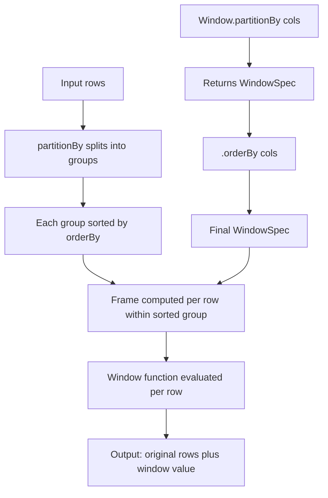
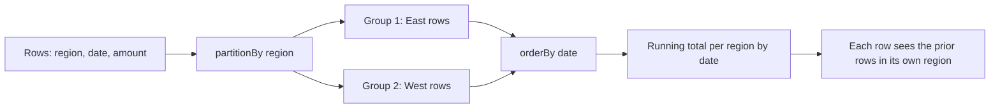

# 2.2.3 How do you use Window.partitionBy() and Window.orderBy()?

A `WindowSpec` is built by chaining these two methods. `partitionBy` splits rows into independent groups. `orderBy` sorts rows within each group. Together they define the window that every row sees when a window function runs.



### Construction

| Step | Method | Returns | Required |
|---|---|---|---|
| Start | `Window.partitionBy("a", "b")` | `WindowSpec` with partitioning | No, but usually needed |
| Chain | `.orderBy(col("ts").desc())` | `WindowSpec` with ordering | No, but required for ranking and cumulative functions |
| Chain | `.rowsBetween(...)` or `.rangeBetween(...)` | `WindowSpec` with explicit frame | No |
| Apply | `func().over(windowSpec)` | Column expression | Yes |

```python
from pyspark.sql import Window
from pyspark.sql.functions import col, row_number, sum

w = Window.partitionBy("region").orderBy(col("date").asc())
df.withColumn("rn", row_number().over(w))
df.withColumn("running_total", sum("amount").over(w))
```

### `partitionBy` semantics

| Aspect | Behavior |
|---|---|
| Rows with same partition key | Share the same window |
| Rows with different partition key | Never see each other |
| Shuffle | Yes, rows are redistributed by partition key |
| Empty args | Whole DataFrame is one partition. Expensive for large data |
| Null values in partition key | Treated as one group, all nulls together |
| Column expression | Accepts `col("x")`, not only string names |

| Signature | Result |
|---|---|
| `Window.partitionBy("a")` | One window per distinct value of `a` |
| `Window.partitionBy("a", "b")` | One window per combination of `a` and `b` |
| `Window.partitionBy(col("a"), col("b"))` | Same as above, expression form |
| `Window.partitionBy()` | Single global partition. Avoid on large data |

### `orderBy` semantics

| Aspect | Behavior |
|---|---|
| Sort scope | Within each partition, not the whole DataFrame |
| Default direction | Ascending |
| Null placement | Ascending puts nulls first, descending puts nulls last in Spark |
| Multiple columns | Evaluated left to right, first column is primary |
| Ties | Broken by the next column in `orderBy`, or arbitrary if none |
| Column expression | Accepts `col("x").desc()`, `asc_nulls_last("x")`, and so on |
| Without partitionBy | Sorts whole DataFrame in one partition. Very expensive |

| Signature | Result |
|---|---|
| `orderBy("ts")` | Ascending by `ts` within each partition |
| `orderBy(col("ts").desc())` | Descending |
| `orderBy(col("ts").desc(), col("id").asc())` | Descending by `ts`, ties broken by `id` ascending |
| `orderBy(desc_nulls_last("ts"))` | Descending, nulls last explicitly |

### Combined behavior

| Combination | Window scope | Frame default |
|---|---|---|
| `partitionBy` only | Whole partition | Whole partition |
| `orderBy` only | Whole DataFrame | Whole DataFrame with sort |
| `partitionBy` and `orderBy` | Each partition, sorted | `RANGE BETWEEN UNBOUNDED PRECEDING AND CURRENT ROW` |
| `partitionBy`, `orderBy`, explicit frame | Each partition, sorted, frame bounded | As specified |

The default frame with `orderBy` is cumulative. A plain `sum("amount").over(w)` with `orderBy` produces a running total, not a partition total.

### Why both matter together



Without `partitionBy`, `orderBy` alone makes every row see every prior row in the whole DataFrame. Without `orderBy`, `partitionBy` alone makes every row see its entire partition. The two together produce the standard per-group, per-row context.

### Frame selection

| Need | Frame |
|---|---|
| Running total to current row | Default with `orderBy` |
| Whole partition total on every row | `rowsBetween(unboundedPreceding, unboundedFollowing)` |
| Moving average of last 3 rows | `rowsBetween(-2, 0)` |
| Next 2 rows included | `rowsBetween(0, 2)` |
| Value range, e.g. last 7 days | `rangeBetween(-7, 0)` on a date or numeric column |

```python
from pyspark.sql import Window
from pyspark.sql.functions import col, sum, avg

w_partition_total = (
    Window.partitionBy("region")
          .rowsBetween(Window.unboundedPreceding, Window.unboundedFollowing)
)

w_moving = (
    Window.partitionBy("region")
          .orderBy("date")
          .rowsBetween(-2, 0)
)

df.withColumn("region_total", sum("amount").over(w_partition_total))
df.withColumn("ma3", avg("amount").over(w_moving))
```

### Reuse of window specs

| Pattern | Reuse |
|---|---|
| Same `partitionBy` and `orderBy` | Define once, pass to many functions |
| Same `partitionBy`, different `orderBy` | Two specs, two shuffles and sorts |
| Same `partitionBy`, different frame | Two specs, Spark may share the shuffle but sort differently |
| Different `partitionBy` | Two independent shuffles |

```python
w_base = Window.partitionBy("region").orderBy("date")
w_alt  = Window.partitionBy("region").orderBy(col("amount").desc())

out = (
    df
    .withColumn("running",   sum("amount").over(w_base))
    .withColumn("prev",      lag("amount", 1).over(w_base))
    .withColumn("rank_amt",  row_number().over(w_alt))
)
```

`w_base` is reused for two functions. `w_alt` adds a second sort. Check the plan for multiple `Window` nodes that could be consolidated.

### Null handling in orderBy

| Spec | Null placement |
|---|---|
| `col("x").asc()` | Nulls first in Spark |
| `col("x").desc()` | Nulls last in Spark |
| `asc_nulls_first("x")` | Nulls first explicitly |
| `asc_nulls_last("x")` | Nulls last explicitly |
| `desc_nulls_first("x")` | Nulls first explicitly |
| `desc_nulls_last("x")` | Nulls last explicitly |

```python
from pyspark.sql.functions import col, asc_nulls_last, desc_nulls_last

w = Window.partitionBy("region").orderBy(desc_nulls_last("amount"))
```

Null placement decides which row gets `row_number = 1` and which rows share a `rank`. Make it explicit when nulls exist.

### SQL equivalent

```sql
SELECT
  region, date, amount,
  sum(amount) OVER (PARTITION BY region ORDER BY date) AS running_total,
  sum(amount) OVER (PARTITION BY region) AS region_total,
  row_number() OVER (PARTITION BY region ORDER BY amount DESC) AS rn
FROM sales;
```

| SQL clause | PySpark equivalent |
|---|---|
| `PARTITION BY region` | `Window.partitionBy("region")` |
| `ORDER BY date` | `.orderBy("date")` |
| `ROWS BETWEEN -2 PRECEDING AND CURRENT ROW` | `.rowsBetween(-2, 0)` |
| `RANGE BETWEEN 7 PRECEDING AND CURRENT ROW` | `.rangeBetween(-7, 0)` |

### Performance notes

- `partitionBy` triggers a shuffle. Cost scales with row count and partition cardinality.
- `orderBy` triggers a sort within each partition. Cost scales with partition size and spill.
- Partition by a column with reasonable cardinality. Low cardinality creates huge partitions and skew. High cardinality creates many small tasks and overhead.
- Avoid `Window.partitionBy()` with no arguments. Every row goes to one partition. One task processes the whole DataFrame.
- Avoid `orderBy` without `partitionBy` for the same reason. All rows are sorted in one partition.
- Align window specs across functions. Two different `partitionBy` means two shuffles.
- The default cumulative frame is efficient. A frame that looks forward to `unboundedFollowing` forces buffering the whole partition in memory.
- Filter before the window. The plan applies the filter before the window node, so fewer rows means less shuffle and sort.
- Prefer `rowsBetween` over `rangeBetween` when possible. `rangeBetween` compares values and is slower.

### Common pitfalls

| Pitfall | Effect | Fix |
|---|---|---|
| Using `orderBy` without `partitionBy` | Whole DataFrame sorted in one partition | Add `partitionBy` or use a different approach |
| Using `partitionBy` with no args | One task for all data | Partition by a real column |
| Forgetting that `orderBy` changes the default frame | Gets cumulative, not partition total | Use explicit frame or drop `orderBy` |
| Partitioning by a high cardinality column | Many tiny partitions, high overhead | Use a lower cardinality key |
| Partitioning by a low cardinality column | Huge partition, long task | Add a second partition column |
| Not setting null ordering | Ranks and order shift unexpectedly | Use `asc_nulls_last` or similar |
| Using non-unique `orderBy` with `row_number` | Non deterministic output | Add a unique tiebreaker |
| Multiple windows with different specs | Multiple shuffles and sorts | Align specs where possible |
| Window after a wide join | Window runs on exploded rows | Window before the join or pre aggregate |
| Expecting `partitionBy` to preserve row order in output | Output order is not guaranteed | `orderBy` on the final DataFrame if order matters |

### End to end example

```python
from pyspark.sql import SparkSession, Window
from pyspark.sql.functions import col, desc_nulls_last, row_number, sum, avg, lag

spark = SparkSession.builder.getOrCreate()

df = spark.createDataFrame(
    [
        ("East", "2024-01-01", 100),
        ("East", "2024-01-02", 150),
        ("East", "2024-01-03", 120),
        ("West", "2024-01-01", 80),
        ("West", "2024-01-02", 95),
        ("West", "2024-01-03", None),
    ],
    ["region", "date", "amount"]
)

w_run = Window.partitionBy("region").orderBy("date")
w_tot = (
    Window.partitionBy("region")
          .rowsBetween(Window.unboundedPreceding, Window.unboundedFollowing)
)
w_rank = Window.partitionBy("region").orderBy(desc_nulls_last("amount"))

out = (
    df
    .withColumn("running_total", sum("amount").over(w_run))
    .withColumn("region_total",  sum("amount").over(w_tot))
    .withColumn("prev_amount",   lag("amount", 1).over(w_run))
    .withColumn("rank_amt",      row_number().over(w_rank))
)

out.show()
```

| region | date | amount | running_total | region_total | prev_amount | rank_amt |
|---|---|---|---|---|---|---|
| East | 2024-01-01 | 100 | 100 | 370 | null | 3 |
| East | 2024-01-02 | 150 | 250 | 370 | 100 | 1 |
| East | 2024-01-03 | 120 | 370 | 370 | 150 | 2 |
| West | 2024-01-01 | 80 | 80 | 175 | null | 3 |
| West | 2024-01-02 | 95 | 175 | 175 | 80 | 2 |
| West | 2024-01-03 | null | 175 | 175 | 95 | 1 |

`running_total` is cumulative because `w_run` has `orderBy` and no explicit frame. `region_total` is the whole partition total because `w_tot` uses `unboundedFollowing`. `rank_amt` ranks with nulls last, so the null `amount` row ranks first within West.

### Summary

- `Window.partitionBy` splits rows into groups. Rows in different groups never interact.
- `Window.orderBy` sorts rows within each group. Required for ranking, cumulative aggregates, and `lag` or `lead`.
- Combined, they define the window every row sees.
- `orderBy` changes the default frame to cumulative. Use an explicit frame for partition totals or moving windows.
- Partition by a balanced cardinality key. Avoid empty `partitionBy` and `orderBy` without partitioning.
- Make null ordering explicit when nulls exist.
- Align window specs across functions to reuse shuffles and sorts.
- Filter before the window. The window runs on whatever rows remain.
