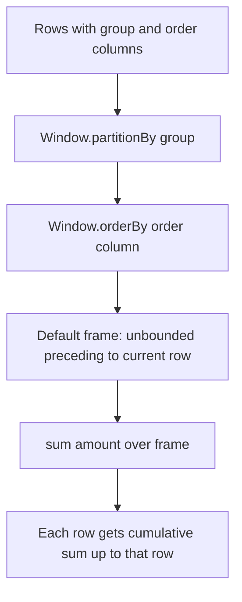

# 2.2.4 How do you calculate a running total using a Window Function?

Use `sum(column).over(windowSpec)` where the window spec has `partitionBy` for the group and `orderBy` for the sequence. The default frame with `orderBy` is cumulative, so `sum` becomes a running total.



### Core pattern

| Component | Purpose |
|---|---|
| `partitionBy` | Restarts the running total for each group |
| `orderBy` | Defines the sequence of accumulation |
| `sum` | The aggregate that accumulates |
| Default frame | `RANGE BETWEEN UNBOUNDED PRECEDING AND CURRENT ROW` |

### PySpark example

```python
from pyspark.sql import Window
from pyspark.sql.functions import col, sum

w = Window.partitionBy("region").orderBy("date")

out = df.withColumn("running_total", sum("amount").over(w))
```

### SQL example

```sql
SELECT
  region,
  date,
  amount,
  sum(amount) OVER (
    PARTITION BY region
    ORDER BY date
  ) AS running_total
FROM sales;
```

### Default frame behavior

| Window spec | Frame | Running total behavior |
|---|---|---|
| `partitionBy` only | Whole partition | Partition total on every row, not running |
| `partitionBy` and `orderBy` | `RANGE` from start to current | Cumulative, includes all rows with the same order value |
| `partitionBy`, `orderBy`, `rowsBetween(unboundedPreceding, currentRow)` | `ROWS` from start to current | Strict row-by-row cumulative, ties broken by physical order |

The default with `orderBy` is `RANGE`, not `ROWS`. If the order column has ties, all tied rows are included in each other's running total.

### RANGE versus ROWS for ties

| Order column values | `RANGE` default | `ROWS` explicit |
|---|---|---|
| `1, 2, 3` | `1, 3, 6` | `1, 3, 6` |
| `1, 1, 2` | `2, 2, 4` | `1, 2, 4` |
| `1, 1, 1, 2` | `3, 3, 3, 6` | `1, 2, 3, 6` |

Use `rowsBetween` when you need a strict row-by-row cumulative total regardless of ties.

```python
from pyspark.sql import Window
from pyspark.sql.functions import sum

w_rows = (
    Window.partitionBy("region")
          .orderBy("date")
          .rowsBetween(Window.unboundedPreceding, Window.currentRow)
)

df.withColumn("running_total", sum("amount").over(w_rows))
```

### Deterministic order

| Approach | Deterministic |
|---|---|
| `orderBy("date")` with duplicate dates | No, tie order is arbitrary |
| `orderBy("date", "id")` | Yes, if `id` is unique |
| `orderBy("date")` plus `rowsBetween` | No, tie order still arbitrary |
| `orderBy("date", "id")` plus `rowsBetween` | Yes |

Add a unique tiebreaker column to `orderBy` when the running total must be reproducible.

### Null handling

| Case | Behavior |
|---|---|
| Null in `amount` | `sum` ignores it. Running total continues from prior non-null values |
| All prior amounts null | `sum` returns `null` until a non-null value appears |
| Null in `orderBy` column | Sorted according to null ordering spec |
| Want null as zero | Wrap with `coalesce(sum("amount").over(w), lit(0))` |

```python
from pyspark.sql.functions import coalesce, lit, sum

df.withColumn("running_total", coalesce(sum("amount").over(w), lit(0)))
```

### Running total across the whole DataFrame

Omit `partitionBy` to get one running total across all rows. This is expensive because all rows go to one partition and must be sorted.

```python
w_global = Window.orderBy("date").rowsBetween(Window.unboundedPreceding, Window.currentRow)
df.withColumn("running_total", sum("amount").over(w_global))
```

Use only for small data or when a global cumulative is truly required.

### Multiple groups and ordering columns

| Requirement | Window spec |
|---|---|
| Running total per region | `partitionBy("region").orderBy("date")` |
| Running total per region and product | `partitionBy("region", "product").orderBy("date")` |
| Running total per region, ordered by date then id | `partitionBy("region").orderBy("date", "id")` |
| Running count instead of sum | `count("*").over(w)` |
| Running average | `avg("amount").over(w)` |

### Performance notes

- Window with `partitionBy` and `orderBy` requires a shuffle and a sort. Cost scales with row count and partition size.
- Partition by a balanced cardinality column. Low cardinality creates huge partitions and skew. High cardinality creates many small tasks.
- The default cumulative frame is efficient. It accumulates incrementally. A frame that looks forward to `unboundedFollowing` forces buffering the whole partition.
- `rowsBetween` is cheaper than `rangeBetween` because it does not compare order values.
- Filter before the window. The plan applies filters before the window node, so fewer rows means less shuffle and sort.
- Multiple window functions with the same spec reuse the same shuffle and sort. Align specs where possible.
- Avoid `partitionBy` with no arguments and `orderBy` without `partitionBy` on large data. Both route all rows to one task.

### Common pitfalls

| Pitfall | Effect | Fix |
|---|---|---|
| Omitting `orderBy` | Gets partition total, not running total | Add `orderBy` |
| Relying on default `RANGE` with ties | Tied rows include each other in the running total | Use `rowsBetween` for strict row-by-row |
| No tiebreaker in `orderBy` | Non deterministic running total | Add a unique column to `orderBy` |
| Null amounts produce null running total until first non-null | Unexpected nulls | `coalesce` to 0 if needed |
| Using `partitionBy` with no args | One task for all rows | Partition by a real group column |
| Window after a wide join | Runs on exploded rows | Window before the join or pre aggregate |
| Multiple different window specs | Multiple shuffles and sorts | Align specs where possible |
| Forgetting that output row order is not guaranteed | Running total values are correct but rows unsorted | `orderBy` on the final DataFrame if order matters |

### End to end example

```python
from pyspark.sql import SparkSession, Window
from pyspark.sql.functions import col, sum

spark = SparkSession.builder.getOrCreate()

df = spark.createDataFrame(
    [
        ("East", "2024-01-01", 100),
        ("East", "2024-01-02", 150),
        ("East", "2024-01-02", 50),
        ("East", "2024-01-03", 120),
        ("West", "2024-01-01", 80),
        ("West", "2024-01-02", 95),
    ],
    ["region", "date", "amount"]
)

w_range = Window.partitionBy("region").orderBy("date")
w_rows  = Window.partitionBy("region").orderBy("date", "amount").rowsBetween(
    Window.unboundedPreceding, Window.currentRow
)

out = (
    df
    .withColumn("running_range", sum("amount").over(w_range))
    .withColumn("running_rows",  sum("amount").over(w_rows))
)

out.show()
```

| region | date | amount | running_range | running_rows |
|---|---|---|---|---|
| East | 2024-01-01 | 100 | 100 | 100 |
| East | 2024-01-02 | 150 | 300 | 250 |
| East | 2024-01-02 | 50 | 300 | 300 |
| East | 2024-01-03 | 120 | 420 | 420 |
| West | 2024-01-01 | 80 | 80 | 80 |
| West | 2024-01-02 | 95 | 175 | 175 |

`running_range` includes both Jan 02 rows in each other's total because they share the same order value. `running_rows` orders ties by `amount` and accumulates strictly row by row.

### Summary

- Use `sum("amount").over(Window.partitionBy(...).orderBy(...))`.
- Default frame with `orderBy` is `RANGE` from start to current. Ties are included together.
- Use `rowsBetween(Window.unboundedPreceding, Window.currentRow)` for strict row-by-row accumulation.
- Add a unique tiebreaker to `orderBy` for deterministic results.
- Handle nulls with `coalesce` if zero is the business meaning.
- Partition by a balanced group key. Avoid global windows on large data.
- Filter before the window. Align window specs to reuse shuffles and sorts.
