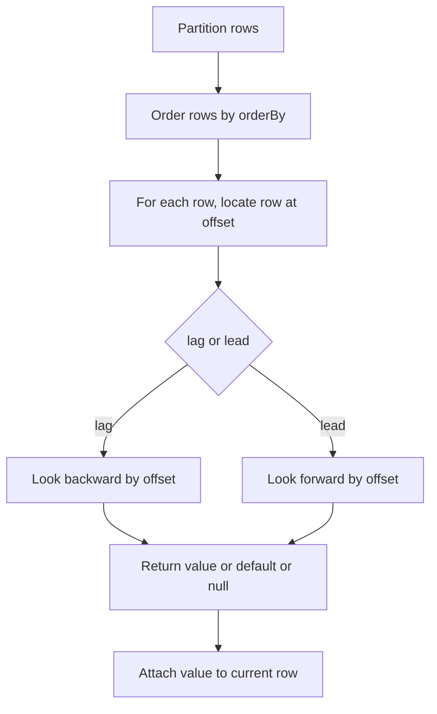

# 2.2.5 What do the lead() and lag() functions do?

`lag()` returns a value from an earlier row in the window. `lead()` returns a value from a later row. Both are analytic window functions. They do not change row count.



### Core behavior

| Function | Direction | Default offset | Out of window result |
|---|---|---|---|
| `lag(col, offset, default)` | Backward | 1 | `default` if supplied, else `null` |
| `lead(col, offset, default)` | Forward | 1 | `default` if supplied, else `null` |
| Negative offset | Reverses direction | N/A | `lag(col, -1)` acts like `lead(col, 1)` |

### Signature

| API | Form |
|---|---|
| PySpark | `lag(col("x"), offset, default).over(w)` |
| PySpark | `lead(col("x"), offset, default).over(w)` |
| SQL | `lag(x, offset, default) OVER (...)` |
| SQL | `lead(x, offset, default) OVER (...)` |

`offset` and `default` are optional. Default offset is 1. Default value is `null`.

### Basic example

```python
from pyspark.sql import Window
from pyspark.sql.functions import col, lag, lead

w = Window.partitionBy("region").orderBy("date")

out = (
    df
    .withColumn("prev_amount", lag("amount", 1).over(w))
    .withColumn("next_amount", lead("amount", 1).over(w))
)
```

### SQL example

```sql
SELECT
  region,
  date,
  amount,
  lag(amount, 1) OVER (PARTITION BY region ORDER BY date) AS prev_amount,
  lead(amount, 1) OVER (PARTITION BY region ORDER BY date) AS next_amount
FROM sales;
```

### Behavior table

Assume rows ordered by date within one region.

| date | amount | lag 1 | lead 1 | lag 2 | lead 2 |
|---|---|---|---|---|---|
| 2024-01-01 | 100 | null | 150 | null | 120 |
| 2024-01-02 | 150 | 100 | 120 | null | null |
| 2024-01-03 | 120 | 150 | null | 100 | null |

### Default value

Use the third argument to replace the out of window null.

```python
from pyspark.sql.functions import lag, lead, lit

df.withColumn("prev_amount", lag("amount", 1, lit(0)).over(w))
df.withColumn("next_amount", lead("amount", 1, lit(0)).over(w))
```

| Case | No default | Default `0` |
|---|---|---|
| First row, `lag` | `null` | `0` |
| Last row, `lead` | `null` | `0` |
| Offset beyond partition size | `null` | `0` |

The default must match the column type or be castable to it.

### Common uses

| Use case | Function | Pattern |
|---|---|---|
| Previous value per group | `lag` | `lag("amount", 1).over(w)` |
| Next value per group | `lead` | `lead("amount", 1).over(w)` |
| Difference from previous row | `lag` | `col("amount") - lag("amount", 1).over(w)` |
| Percent change | `lag` | `(col("amount") - lag("amount", 1).over(w)) / lag("amount", 1).over(w)` |
| Session gap detection | `lag` | `datediff(col("ts"), lag("ts", 1).over(w)) > threshold` |
| Detect status change | `lag` | `col("status") != lag("status", 1).over(w)` |
| Next event time | `lead` | `lead("ts", 1).over(w)` |
| Time until next event | `lead` | `lead("ts", 1).over(w) - col("ts")` |
| Fill missing values from neighbors | `lag` or `lead` | `coalesce(col("x"), lag("x", 1).over(w), lead("x", 1).over(w))` |

### Difference from previous row

```python
from pyspark.sql.functions import col, lag

w = Window.partitionBy("region").orderBy("date")

out = df.withColumn(
    "delta",
    col("amount") - lag("amount", 1).over(w)
)
```

| date | amount | delta |
|---|---|---|
| 2024-01-01 | 100 | null |
| 2024-01-02 | 150 | 50 |
| 2024-01-03 | 120 | -30 |

The first row per partition has no previous row, so `delta` is `null`. Use `coalesce` if zero is the business default.

### Detecting changes

```python
from pyspark.sql.functions import col, lag, when, lit

w = Window.partitionBy("user_id").orderBy("ts")

out = df.withColumn(
    "is_new_session",
    when(
        lag("ts", 1).over(w).isNull()
        | (col("ts").cast("long") - lag("ts", 1).over(w).cast("long") > 1800),
        lit(True)
    ).otherwise(lit(False))
)
```

| user_id | ts | prev_ts | is_new_session |
|---|---|---|---|
| 1 | 10:00 | null | true |
| 1 | 10:15 | 10:00 | false |
| 1 | 11:30 | 10:15 | true |

### Order and partition rules

| Rule | Effect |
|---|---|
| `partitionBy` restarts the sequence | First row of each partition has no previous row for `lag` |
| `orderBy` defines direction | Without `orderBy`, behavior is not meaningful for `lag` or `lead` |
| Ties in `orderBy` | Row order among ties is arbitrary. Add a unique tiebreaker |
| No `partitionBy` | One sequence across all rows. Expensive on large data |
| Null in order column | Sorted by null ordering spec |

### Determinism

| Window spec | Deterministic |
|---|---|
| `partitionBy` plus `orderBy` with unique key | Yes |
| `partitionBy` plus `orderBy` with ties | No, tie order is arbitrary |
| `partitionBy` plus `orderBy` with tiebreaker | Yes |

Add a unique column to `orderBy` when the result must be reproducible.

### Null handling

| Case | Behavior |
|---|---|
| Null in the source column | `lag` and `lead` return `null` for that row |
| Null in the source at the target row | The returned value is `null` |
| Out of window | `default` if supplied, else `null` |
| Null `default` | Returns `null` |
| `ignoreNulls` option | SQL only in some versions. PySpark supports `lag(col, offset, default, True)` in Spark 3.5+ |

For SQL, `IGNORE NULLS` skips nulls when looking backward or forward.

```sql
SELECT
  lag(amount IGNORE NULLS) OVER (PARTITION BY region ORDER BY date) AS prev_non_null
FROM sales;
```

### Performance notes

- `lag` and `lead` require a shuffle by `partitionBy` and a sort by `orderBy`. Same cost as other window functions.
- They are cheap per row. The shuffle and sort dominate.
- Align window specs across multiple functions to reuse the same shuffle and sort.
- Filter before the window. Fewer rows means less shuffle and sort.
- Partition by a balanced cardinality column. Low cardinality creates skew. High cardinality creates many small tasks.
- Avoid `orderBy` without `partitionBy` on large data. All rows go to one partition.
- Repeated `lag` with the same offset and window is a common subexpression. Spark may not deduplicate it. Compute once and reference the column.

### Common pitfalls

| Pitfall | Effect | Fix |
|---|---|---|
| No `orderBy` | Undefined sequence | Always add `orderBy` |
| No `partitionBy` when per-group sequence is needed | Sequence continues across groups | Add `partitionBy` |
| Ties in `orderBy` | Non deterministic result | Add a unique tiebreaker |
| Expecting first row `lag` to be 0 | It is `null` | Use a default argument or `coalesce` |
| Default type mismatch | Error or cast | Cast the default to the column type |
| Using `lag` for difference without handling first row null | Null propagates to downstream logic | `coalesce` or filter |
| Multiple different window specs | Multiple shuffles | Align specs where possible |
| Window after a wide join | Runs on exploded rows | Window before the join or pre aggregate |
| Expecting output row order | Output order is not guaranteed | `orderBy` on the final DataFrame if order matters |

### End to end example

```python
from pyspark.sql import SparkSession, Window
from pyspark.sql.functions import col, lag, lead, coalesce, lit

spark = SparkSession.builder.getOrCreate()

df = spark.createDataFrame(
    [
        ("East", "2024-01-01", 100),
        ("East", "2024-01-02", 150),
        ("East", "2024-01-03", 120),
        ("West", "2024-01-01", 80),
        ("West", "2024-01-02", 95),
    ],
    ["region", "date", "amount"]
)

w = Window.partitionBy("region").orderBy("date")

out = (
    df
    .withColumn("prev_amount", lag("amount", 1).over(w))
    .withColumn("next_amount", lead("amount", 1).over(w))
    .withColumn("delta", col("amount") - lag("amount", 1).over(w))
    .withColumn("delta_safe", coalesce(col("amount") - lag("amount", 1).over(w), lit(0)))
)

out.show()
```

| region | date | amount | prev_amount | next_amount | delta | delta_safe |
|---|---|---|---|---|---|---|
| East | 2024-01-01 | 100 | null | 150 | null | 0 |
| East | 2024-01-02 | 150 | 100 | 120 | 50 | 50 |
| East | 2024-01-03 | 120 | 150 | null | -30 | -30 |
| West | 2024-01-01 | 80 | null | 95 | null | 0 |
| West | 2024-01-02 | 95 | 80 | null | 15 | 15 |

### Summary

- `lag` looks backward by an offset. `lead` looks forward by an offset.
- Default offset is 1. Default value is `null`.
- They do not change row count.
- `partitionBy` restarts the sequence. `orderBy` defines direction.
- Out of window rows return the default or `null`. Handle the first and last row per partition explicitly.
- Add a unique tiebreaker to `orderBy` for deterministic results.
- Align window specs to reuse shuffles and sorts. Filter before the window.
- Use `IGNORE NULLS` in SQL or the fourth argument in newer PySpark when nulls should be skipped.
