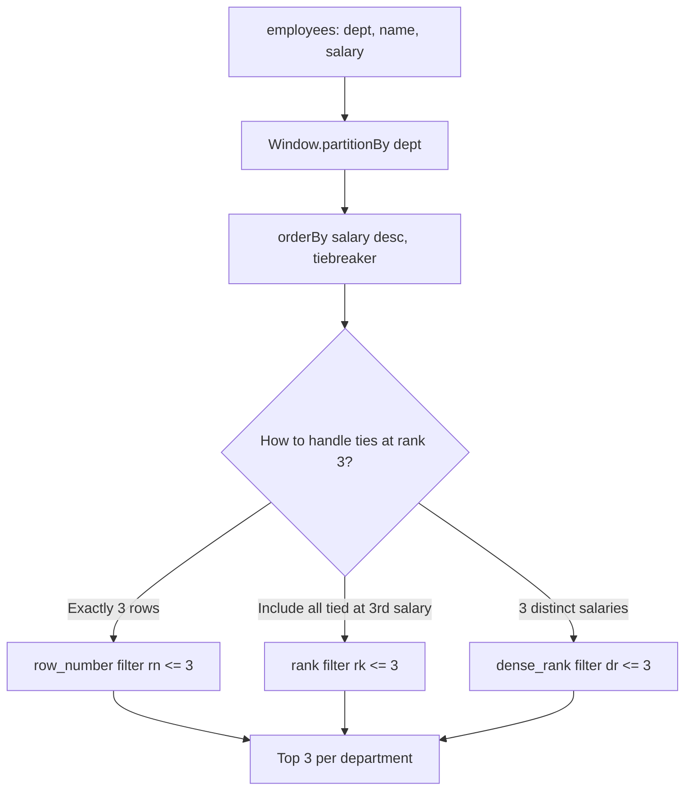

# 2.2.6 How do you find the top 3 highest-paid employees in each department?

Use `row_number()` partitioned by department and ordered by salary descending, then filter to rank 3 or less. The choice between `row_number`, `rank`, and `dense_rank` depends on how ties should be handled.



### PySpark

```python
from pyspark.sql import SparkSession, Window
from pyspark.sql.functions import col, row_number

spark = SparkSession.builder.getOrCreate()

df = spark.createDataFrame(
    [
        ("Eng", "alice", 200_000),
        ("Eng", "bob",   180_000),
        ("Eng", "carol", 180_000),
        ("Eng", "dave",  150_000),
        ("Sales", "eve",   120_000),
        ("Sales", "frank", 110_000),
        ("Sales", "grace", 100_000),
        ("Sales", "heidi",  90_000),
    ],
    ["department", "name", "salary"]
)

w = Window.partitionBy("department").orderBy(col("salary").desc(), col("name").asc())

top3 = (
    df.withColumn("rn", row_number().over(w))
      .filter(col("rn") <= 3)
      .drop("rn")
      .orderBy("department", col("salary").desc())
)

top3.show()
```

### Scala

```scala
import org.apache.spark.sql.expressions.Window
import org.apache.spark.sql.functions._

val w = Window.partitionBy("department").orderBy(col("salary").desc, col("name").asc)

val top3 = df
  .withColumn("rn", row_number().over(w))
  .filter(col("rn") <= 3)
  .drop("rn")
  .orderBy(col("department"), col("salary").desc)
```

### SQL

```sql
SELECT department, name, salary
FROM (
  SELECT
    department, name, salary,
    row_number() OVER (
      PARTITION BY department
      ORDER BY salary DESC, name ASC
    ) AS rn
  FROM employees
) x
WHERE rn <= 3
ORDER BY department, salary DESC;
```

### Choosing the ranking function

| Requirement | Function | Filter | Rows per department |
|---|---|---|---|
| Exactly 3 rows | `row_number()` | `rn <= 3` | Always 3 |
| Include all tied at 3rd salary | `rank()` | `rk <= 3` | 3 or more |
| 3 distinct salary levels | `dense_rank()` | `dr <= 3` | 3 or more if ties exist |

Assume Eng has salaries `200k, 180k, 180k, 180k, 150k`.

| Function | Eng result |
|---|---|
| `row_number` | 3 rows: 200k, 180k, 180k (one of the 180k ties is excluded) |
| `rank` | 4 rows: 200k, 180k, 180k, 180k (all tied at rank 2) |
| `dense_rank` | 3 rows: 200k, 180k, 180k (all 180k at rank 2) |

Pick based on the business meaning of "top 3". Most leaderboards want `rank` or `dense_rank` so ties are not silently cut.

### Tiebreaker

The window `orderBy` should include a unique column when `row_number` is used. Without it, ties are broken arbitrarily and results are not reproducible.

```python
w = Window.partitionBy("department").orderBy(
    col("salary").desc(),
    col("name").asc()
)
```

| Tiebreaker | Effect |
|---|---|
| `name` ascending | Alphabetical tiebreak, deterministic |
| `employee_id` ascending | Same, stable if names can repeat |
| `hire_date` ascending | Seniority tiebreak, common business rule |
| None | Arbitrary, not reproducible |

### Alternative without window function

A `groupBy` plus `collect_list` plus `slice` also works, but it is less flexible and forces the whole partition into one row.

```python
from pyspark.sql.functions import col, collect_list, sort_array, struct, slice

w = Window.partitionBy("department").orderBy(col("salary").desc())

top3 = (
    df.withColumn("ranked", struct("salary", "name"))
      .groupBy("department")
      .agg(sort_array(collect_list("ranked"), asc=False).alias("ranked_list"))
      .withColumn("top3", slice(col("ranked_list"), 1, 3))
      .select("department", "top3")
)
```

| Approach | Output shape | Cost |
|---|---|---|
| `row_number` filter | One row per employee | Shuffle and sort, cheap per row |
| `collect_list` and `slice` | One row per department, array of employees | Shuffle and sort, memory bound per partition |
| `groupBy` and `max` | Only the top 1 | Cheap |

Use the window function approach when the output must be one row per employee. Use `collect_list` when the output must be one row per department.

### Performance notes

- The window requires a shuffle by `department` and a sort by `salary` descending within each partition.
- Filter `rn <= 3` after the window, not before. The window must see all rows to compute ranks.
- If the dataset is very large and departments are few, most work happens in the sort. Consider pre-aggregating or sampling upstream if approximate results are acceptable.
- Partition by `department` only, not by `department` and a high cardinality column. That would fragment the ranking.
- If departments are skewed (one huge department, many tiny ones), the sort for the huge one dominates. Spark does not auto-split the sort. Consider salting or splitting the skew key if this is a problem.
- The `filter(rn <= 3)` reduces row count significantly before any downstream join or write.
- Reuse the same window spec for other top-N functions on the same partition key.

### Common pitfalls

| Pitfall | Effect | Fix |
|---|---|---|
| Using `row_number` without a tiebreaker | Non reproducible results | Add `name` or `employee_id` to `orderBy` |
| Using `row_number` when ties must be kept | Ties silently dropped | Use `rank` or `dense_rank` |
| Using `rank` when exactly 3 rows are needed | Returns more than 3 | Use `row_number` |
| Filtering before the window | The window cannot see excluded rows | Filter after the window |
| Forgetting `partitionBy` | Ranks the whole DataFrame, not per department | Add `partitionBy("department")` |
| Filtering by rank on the wrong column name | Type error or wrong filter | Check the alias used in `withColumn` |
| No final `orderBy` | Output rows in arbitrary order | `orderBy("department", col("salary").desc())` |
| Window after a wide join | Runs on exploded rows | Window before the join |
| Using `rank()` and filtering `rk <= 3` on huge tie groups | Returns many more rows than expected | Use `row_number` or `dense_rank` based on business rule |

### End to end example

```python
from pyspark.sql import SparkSession, Window
from pyspark.sql.functions import col, row_number, rank, dense_rank

spark = SparkSession.builder.getOrCreate()

df = spark.createDataFrame(
    [
        ("Eng",   "alice", 200_000),
        ("Eng",   "bob",   180_000),
        ("Eng",   "carol", 180_000),
        ("Eng",   "dave",  150_000),
        ("Sales", "eve",   120_000),
        ("Sales", "frank", 110_000),
        ("Sales", "grace", 100_000),
        ("Sales", "heidi",  90_000),
    ],
    ["department", "name", "salary"]
)

w = Window.partitionBy("department").orderBy(col("salary").desc(), col("name").asc())

out = (
    df
    .withColumn("rn", row_number().over(w))
    .withColumn("rk", rank().over(w))
    .withColumn("dr", dense_rank().over(w))
    .filter(col("rn") <= 3)
    .orderBy("department", col("salary").desc())
)

out.show()
```

| department | name | salary | rn | rk | dr |
|---|---|---|---|---|---|
| Eng | alice | 200000 | 1 | 1 | 1 |
| Eng | bob | 180000 | 2 | 2 | 2 |
| Eng | carol | 180000 | 3 | 2 | 2 |
| Sales | eve | 120000 | 1 | 1 | 1 |
| Sales | frank | 110000 | 2 | 2 | 2 |
| Sales | grace | 100000 | 3 | 3 | 3 |

`dave` is excluded because `row_number` breaks the tie at 180k by `name` and keeps only two of the tied employees. Using `rank().over(w) <= 3` would include `dave` as well, since `dave` has `rk = 4` but the two 180k employees have `rk = 2`. The choice matters.

### Summary

- Use `row_number()` partitioned by department, ordered by salary descending, and filter `rn <= 3`.
- Add a unique tiebreaker to `orderBy` for reproducible results.
- Use `rank()` when ties at the boundary must be included.
- Use `dense_rank()` when 3 distinct salary levels is the requirement.
- Filter after the window, not before.
- The window requires a shuffle and sort. Partition by department only.
- Add a final `orderBy` for readable output.
