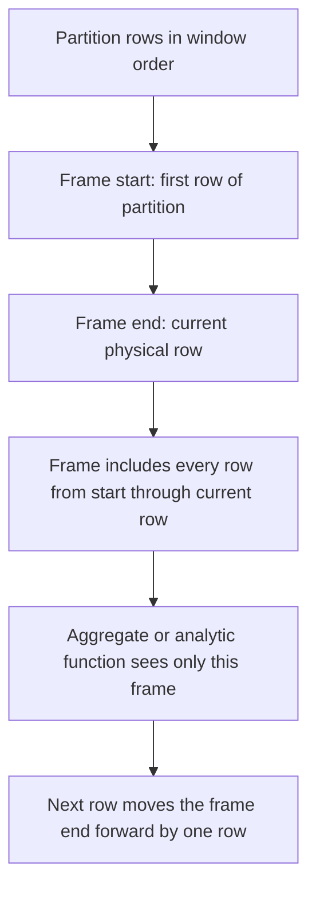

# 2.2.7 What is ROWS BETWEEN UNBOUNDED PRECEDING AND CURRENT ROW?

It is an explicit window frame clause. It tells Spark to give each row a frame that starts at the first row of its partition and ends at the current physical row. Rows after the current row are excluded.



### Meaning of each keyword

| Keyword | Meaning in a `ROWS` frame |
|---|---|
| `ROWS` | Count physical rows, not value ranges |
| `BETWEEN` | Frame has an explicit lower and upper boundary |
| `UNBOUNDED PRECEDING` | Start at the first row of the partition. No lower limit |
| `AND` | Separates lower and upper boundary |
| `CURRENT ROW` | End at the current physical row, inclusive |

The frame is inclusive on both ends. The current row is included. Every earlier row in the same partition is included. No later row is included.

### Syntax

PySpark:

```python
from pyspark.sql import Window
from pyspark.sql.functions import sum

w = (
    Window.partitionBy("region")
          .orderBy("date")
          .rowsBetween(Window.unboundedPreceding, Window.currentRow)
)

df.withColumn("running_total", sum("amount").over(w))
```

SQL:

```sql
SELECT
  region,
  date,
  amount,
  sum(amount) OVER (
    PARTITION BY region
    ORDER BY date
    ROWS BETWEEN UNBOUNDED PRECEDING AND CURRENT ROW
  ) AS running_total
FROM sales;
```

### What the frame includes

Assume one partition ordered by date.

| Row | date | amount | Frame rows for current row | `sum(amount)` over frame |
|---|---|---|---|---|
| 1 | 2024-01-01 | 100 | row 1 | 100 |
| 2 | 2024-01-02 | 150 | rows 1 to 2 | 250 |
| 3 | 2024-01-03 | 120 | rows 1 to 3 | 370 |
| 4 | 2024-01-04 | 80 | rows 1 to 4 | 450 |

The frame grows by one row per output row. This is the standard running total shape.

### `ROWS` versus `RANGE`

The difference appears when the order column has ties.

| Clause | Boundary meaning | Tie behavior |
|---|---|---|
| `ROWS BETWEEN UNBOUNDED PRECEDING AND CURRENT ROW` | Physical row position | Tied rows are processed one by one in physical order |
| `RANGE BETWEEN UNBOUNDED PRECEDING AND CURRENT ROW` | Value position | All rows tied with the current order value are included together |

Example with tied dates:

| date | amount | `ROWS` running total | `RANGE` running total |
|---|---|---|---|
| 2024-01-01 | 10 | 10 | 10 |
| 2024-01-02 | 20 | 30 | 60 |
| 2024-01-02 | 30 | 60 | 60 |
| 2024-01-03 | 40 | 100 | 100 |

With `ROWS`, the two Jan 02 rows get different running totals because the frame ends at the current physical row. With `RANGE`, both Jan 02 rows see all Jan 02 peers, so both get 60.

### Default frame when `ORDER BY` is present

Spark's default frame with `ORDER BY` is `RANGE BETWEEN UNBOUNDED PRECEDING AND CURRENT ROW`, not `ROWS`.

| Window spec | Default frame |
|---|---|
| `partitionBy` only, no `orderBy` | Whole partition |
| `partitionBy` and `orderBy` | `RANGE BETWEEN UNBOUNDED PRECEDING AND CURRENT ROW` |
| `partitionBy`, `orderBy`, explicit `rowsBetween` | The explicit `ROWS` frame |

Writing the `ROWS` clause explicitly changes tie handling. It forces physical row counting instead of value peer grouping.

### Determinism with ties

`ROWS` depends on physical row order within ties. That order is not guaranteed unless `orderBy` uniquely identifies rows.

```python
w = Window.partitionBy("region").orderBy("date", "id").rowsBetween(
    Window.unboundedPreceding, Window.currentRow
)
```

| Order spec | Deterministic running total |
|---|---|
| `orderBy("date")` with duplicate dates | No. Tied rows can swap |
| `orderBy("date", "id")` with unique `id` | Yes |
| `orderBy("date", "amount", "id")` | Yes, explicit tiebreak chain |

Add a unique tiebreaker when the running total must be reproducible.

### Functions affected by the frame

| Function type | Uses frame? |
|---|---|
| `sum`, `avg`, `min`, `max`, `count` | Yes |
| `first_value`, `last_value`, `nth_value` | Yes |
| `lag`, `lead` | No. Offset is independent of frame |
| `row_number`, `rank`, `dense_rank`, `ntile` | No. Ranking ignores frame |
| `percent_rank`, `cume_dist` | No |

The frame matters for aggregates and value functions. Ranking and offset functions ignore it.

### `last_value` warning

With this frame, `last_value` returns the current row value, not the last row of the partition.

| Function and frame | Result |
|---|---|
| `last_value(x)` over `ROWS UNBOUNDED PRECEDING AND CURRENT ROW` | Current row value |
| `last_value(x)` over `ROWS BETWEEN UNBOUNDED PRECEDING AND UNBOUNDED FOLLOWING` | Last row value in the partition |

Use `UNBOUNDED FOLLOWING` when the partition last value is needed.

### When to use it

| Need | Use this frame |
|---|---|
| Running total | Yes |
| Running count | Yes |
| Cumulative minimum or maximum | Yes |
| Moving average from start to current | Yes |
| Partition total on every row | No. Use `UNBOUNDED FOLLOWING` |
| Moving window of last N rows | No. Use `ROWS BETWEEN N PRECEDING AND CURRENT ROW` |
| Future rows included | No. Use `FOLLOWING` boundary |
| Whole partition on every row | No. Use `UNBOUNDED PRECEDING AND UNBOUNDED FOLLOWING` |

### Performance notes

- This frame is incremental for associative aggregates such as `sum` and `count`. Spark can update the aggregate as it moves down the partition.
- It does not need to buffer future rows. It only needs the running state and the current row.
- `ROWS` is generally cheaper than `RANGE` because it does not compare order values across peers.
- The shuffle by `partitionBy` and the sort by `orderBy` dominate the cost, not the frame arithmetic.
- Filter before the window. The plan applies filters before the window node, so fewer rows means less shuffle and sort.
- Partition by a balanced cardinality column. Low cardinality creates skew. High cardinality creates many small tasks.
- Avoid `orderBy` without `partitionBy` on large data. All rows go to one partition and one task.

### Common pitfalls

| Pitfall | Effect | Fix |
|---|---|---|
| Assuming the default frame is `ROWS` | Ties are included together by default | Write the `ROWS` clause explicitly |
| Using `ROWS` without a unique tiebreaker | Non deterministic results with ties | Add a unique column to `orderBy` |
| Using `ROWS` when tie peers must be grouped | Tied rows get different totals | Use `RANGE` |
| Using `RANGE` when strict row-by-row accumulation is needed | Tied rows get the same total | Use `ROWS` |
| Omitting `orderBy` | Current row is not well defined | Always order the window |
| Using `last_value` with this frame | Returns current row, not partition last | Use `UNBOUNDED FOLLOWING` |
| Expecting ranking functions to respect the frame | They ignore it | Frame only matters for aggregates and value functions |
| Window after a wide join | Runs on exploded rows | Window before the join or pre aggregate |
| Forgetting output order is not guaranteed | Rows are correct but unsorted | `orderBy` on the final DataFrame if order matters |

### End to end example

```python
from pyspark.sql import SparkSession, Window
from pyspark.sql.functions import col, sum

spark = SparkSession.builder.getOrCreate()

df = spark.createDataFrame(
    [
        ("East", "2024-01-01", 100),
        ("East", "2024-01-02", 150),
        ("East", "2024-01-02", 50),
        ("East", "2024-01-03", 120),
        ("West", "2024-01-01", 80),
        ("West", "2024-01-02", 95),
    ],
    ["region", "date", "amount"]
)

w_rows = (
    Window.partitionBy("region")
          .orderBy("date", "amount")
          .rowsBetween(Window.unboundedPreceding, Window.currentRow)
)

w_range = Window.partitionBy("region").orderBy("date")

out = (
    df
    .withColumn("running_rows",  sum("amount").over(w_rows))
    .withColumn("running_range", sum("amount").over(w_range))
)

out.show()
```

| region | date | amount | running_rows | running_range |
|---|---|---|---|---|
| East | 2024-01-01 | 100 | 100 | 100 |
| East | 2024-01-02 | 50 | 150 | 300 |
| East | 2024-01-02 | 150 | 300 | 300 |
| East | 2024-01-03 | 120 | 420 | 420 |
| West | 2024-01-01 | 80 | 80 | 80 |
| West | 2024-01-02 | 95 | 175 | 175 |

`running_rows` processes the two Jan 02 rows one by one because `amount` breaks the tie. `running_range` gives both Jan 02 rows the same total because they share the same order value.

### Summary

- `ROWS BETWEEN UNBOUNDED PRECEDING AND CURRENT ROW` is a physical row frame from partition start through the current row.
- It includes the current row and every earlier row. It excludes every later row.
- `ROWS` counts physical rows. `RANGE` groups tied order values.
- Spark's default with `ORDER BY` is `RANGE`, not `ROWS`.
- Add a unique tiebreaker to `orderBy` for deterministic results.
- The frame matters for aggregates and value functions. Ranking and offset functions ignore it.
- This frame is efficient for running totals and cumulative metrics.
- Filter before the window and partition by a balanced key.
