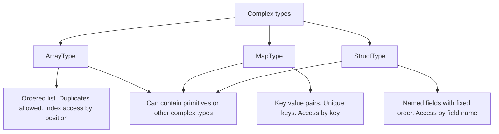

# 2.3.1 What are ArrayType, MapType, and StructType?

These are the three complex (nested) data types in Spark SQL. `ArrayType` holds an ordered list. `MapType` holds key value pairs. `StructType` holds a named record. They can nest inside each other to any depth.



### Core comparison

| Property | ArrayType | MapType | StructType |
|---|---|---|---|
| Shape | Ordered list | Key value collection | Named record |
| Duplicates | Allowed | Keys unique, values can repeat | Not applicable |
| Access | By 0 based index | By key | By field name |
| Order guarantees | Yes, insertion order preserved | No order guarantee | Yes, schema field order |
| Null elements | Allowed | Null keys not allowed. Null values allowed | Null fields allowed |
| SQL syntax | `ARRAY<elementType>` | `MAP<keyType, valueType>` | `STRUCT<name: type, ...>` |
| Constructor | `array(...)` | `map(...)`, `map_from_arrays` | `struct(...)`, `named_struct` |
| PySpark class | `ArrayType(elementType, containsNull)` | `MapType(keyType, valueType, valueContainsNull)` | `StructType([StructField(...)])` |

### ArrayType

An ordered sequence. Element type can be primitive or complex.

```python
from pyspark.sql.types import ArrayType, StringType, IntegerType

tags = ArrayType(StringType(), containsNull=True)
scores = ArrayType(IntegerType(), containsNull=False)
```

| Detail | Note |
|---|---|
| `containsNull` | Whether the array may contain null elements |
| Default nullability | `containsNull=True` if omitted |
| Nesting | `ArrayType(ArrayType(IntegerType()))` is valid |
| Empty array vs null array | Empty array is `[]`. Null array is `null`. Different values |

Common access and operation functions.

| Need | Function |
|---|---|
| Element by index | `col("a")[0]`, `element_at(col("a"), 1)` (1 based) |
| Length | `size(col("a"))` |
| Contains value | `array_contains(col("a"), lit("x"))` |
| Transform each element | `transform(col("a"), lambda x: ...)` |
| Filter elements | `filter(col("a"), lambda x: ...)` |
| Fold to scalar | `aggregate(col("a"), lit(0), lambda acc, x: acc + x)` |
| Distinct | `array_distinct(col("a"))` |
| Sort | `array_sort(col("a"))`, `sort_array(col("a"))` |
| Flatten nested | `flatten(col("a"))` |
| Concatenate | `concat(col("a"), col("b"))` |
| Explode to rows | `explode(col("a"))` |
| Any match | `exists(col("a"), lambda x: ...)` |
| All match | `forall(col("a"), lambda x: ...)` |

### MapType

A key value collection. Keys must be unique within a map. Keys cannot be null.

```python
from pyspark.sql.types import MapType, StringType, IntegerType

attrs = MapType(StringType(), StringType(), valueContainsNull=True)
counts = MapType(StringType(), IntegerType(), valueContainsNull=False)
```

| Detail | Note |
|---|---|
| `valueContainsNull` | Whether values may be null |
| Key nullability | Keys cannot be null |
| Duplicate keys | Not allowed. Last value wins on construction |
| Order | No guarantee. Do not rely on iteration order |
| Supported key types | Primitive types only. Not array, map, or struct |
| Nesting | Values can be any type, including complex types |

Common access and operation functions.

| Need | Function |
|---|---|
| Value by key | `col("m")["k"]`, `element_at(col("m"), "k")` |
| Safe access | `try_element_at(col("m"), "k")` (Spark 3.5+) |
| Keys array | `map_keys(col("m"))` |
| Values array | `map_values(col("m"))` |
| Entries as structs | `map_entries(col("m"))` |
| Contains key | `array_contains(map_keys(col("m")), lit("k"))` |
| Size | `size(col("m"))` |
| Build from arrays | `map_from_arrays(col("k"), col("v"))` |
| Merge maps | `map_concat(col("a"), col("b"))` |
| Filter entries | `map_filter(col("m"), lambda k, v: ...)` |
| Transform values | `map_zip_with` or `transform_values` |
| Explode to rows | `explode(col("m"))` |

### StructType

A record with named fields. This is what a DataFrame row schema is built from.

```python
from pyspark.sql.types import StructType, StructField, StringType, IntegerType

schema = StructType([
    StructField("name", StringType(), True),
    StructField("age", IntegerType(), True),
    StructField("city", StringType(), True),
])
```

| Detail | Note |
|---|---|
| Field order | Preserved. Affects `SELECT *` output |
| Field nullability | Per field, third argument to `StructField` |
| Field names | Must be unique within the struct |
| Nesting | Fields can be any type, including other structs |
| Flat row access | `df.select("info.name")` or `col("info").getField("name")` |

Common access and operation functions.

| Need | Function |
|---|---|
| Field by name | `col("s.field")`, `col("s")["field"]` |
| Field by name, explicit | `col("s").getField("field")` |
| Build struct | `struct(col("a"), col("b"))` |
| Build with names | `named_struct("a", col("x"), "b", col("y"))` |
| Explode fields to columns | `select("s.*")` |
| Merge structs | `struct` over all fields |
| Update one field | `struct` rebuild, or `withField` in Spark 3.5+ |
| Drop one field | `dropFields` in Spark 3.5+ |

### SQL type syntax

| Type | SQL declaration | Example literal |
|---|---|---|
| Array | `ARRAY<INT>` | `array(1, 2, 3)` |
| Map | `MAP<STRING, INT>` | `map('a', 1, 'b', 2)` |
| Struct | `STRUCT<name: STRING, age: INT>` | `named_struct('name', 'a', 'age', 1)` |

### Constructors

```python
from pyspark.sql.functions import array, map, struct, named_struct, lit, col

df.withColumn("tags",   array(lit("a"), lit("b")))
df.withColumn("attrs",  map(lit("k1"), lit(1), lit("k2"), lit(2)))
df.withColumn("info",   struct(col("name"), col("age")))
df.withColumn("info2",  named_struct(lit("name"), col("name"), lit("age"), col("age")))
```

| Constructor | Note |
|---|---|
| `array(...)` | Element types must be compatible. Spark promotes to a common type |
| `map(...)` | Alternating key, value, key, value. Key and value types must match across pairs |
| `struct(...)` | Field names come from column names |
| `named_struct(...)` | Explicit names. Useful when input column names differ |

### Nesting combinations

| Nested type | Example use |
|---|---|
| Array of structs | Line items: `ARRAY<STRUCT<sku: STRING, qty: INT>>` |
| Map of arrays | Per key list: `MAP<STRING, ARRAY<INT>>` |
| Struct with array field | Event with tags: `STRUCT<id: LONG, tags: ARRAY<STRING>>` |
| Array of arrays | Matrix rows: `ARRAY<ARRAY<DOUBLE>>` |
| Map of structs | Config: `MAP<STRING, STRUCT<a: INT, b: STRING>>` |

### Null behavior table

| Case | ArrayType | MapType | StructType |
|---|---|---|---|
| Whole value null | Possible | Possible | Possible |
| Empty value | `[]` | `{}` | Not applicable |
| Null element or value | Depends on `containsNull` or `valueContainsNull` | Values can be null. Keys cannot | Depends on field nullability |
| Null access | Returns `null` | Returns `null` | Returns `null` |
| Out of range index | Returns `null` | Not applicable | Not applicable |
| Missing key | Not applicable | Returns `null` | Not applicable |
| Missing field | Not applicable | Not applicable | Error at analysis time |

### Schema declaration in PySpark

```python
from pyspark.sql.types import (
    StructType, StructField, StringType, IntegerType, ArrayType, MapType
)

schema = StructType([
    StructField("id", IntegerType(), False),
    StructField("tags", ArrayType(StringType(), True), True),
    StructField("attrs", MapType(StringType(), StringType(), True), True),
    StructField("address", StructType([
        StructField("city", StringType(), True),
        StructField("zip", StringType(), True),
    ]), True),
])
```

| Rule | Note |
|---|---|
| Every field needs a name and type | No implicit inference if you build the schema manually |
| Nullability is per field | Third `StructField` argument. Defaults to `True` |
| Nested schemas are recursive | Struct fields can contain structs, arrays, maps |
| `containsNull` and `valueContainsNull` | Control nullability of elements and values, not the container itself |

### Reading and writing

| Format | Nested type support |
|---|---|
| Parquet | Full. Native nested columnar encoding |
| ORC | Full |
| JSON | Full. Nested objects map to structs, arrays to arrays |
| CSV | None. Nested types must be serialized to a string |
| Avro | Full. Maps to Avro records, arrays, maps |

Parquet is the natural choice for nested data. It reads only the nested fields referenced by the query, thanks to column pruning.

### Performance notes

- Nested types increase per row serialization cost. Wide nested rows slow down shuffle and sort.
- Parquet reads nested fields selectively. A query on `s.a` does not read `s.b`.
- Accessing a nested field in PySpark creates a projection. Repeated `col("s.f")` in different expressions is fine, but avoid rebuilding the struct.
- `explode` on an array multiplies row count. This is a narrow transformation but inflates downstream volume. Filter the array first with `filter`.
- Maps with high cardinality keys are expensive to serialize. Prefer arrays of structs when key count varies widely.
- Structs are cheap to access. They are just column prefixes in the plan.
- `getField` and dot access are equivalent. Prefer dot access for readability.
- Avoid deep nesting in shuffle keys. Serialization and comparison cost grows with depth.

### Common pitfalls

| Pitfall | Effect | Fix |
|---|---|---|
| Assuming map iteration order | Order is not guaranteed | `map_keys` then `array_sort` if order matters |
| Using a complex type as a map key | Not allowed | Use a primitive key and store the complex value |
| Forgetting `containsNull` | Unexpected null elements | Set explicitly |
| Comparing arrays with `==` | Works element by element, nulls are tricky | Use `array_equals` or compare sorted arrays |
| Accessing a missing struct field | Analysis error | Validate schema or use `getField` carefully |
| `explode` on null array | Row is dropped | Use `explode_outer` |
| CSV round trip of nested data | Data lost or flattened incorrectly | Use Parquet or JSON |
| Deep nesting in joins | Expensive shuffle serialization | Flatten before join |
| Assuming empty array equals null array | They are different values | Check with `size(col) == 0` vs `isNull` |
| Duplicate keys in `map(...)` | Last pair wins silently | Deduplicate before building the map |

### End to end example

```python
from pyspark.sql import SparkSession
from pyspark.sql.functions import (
    array, map, struct, named_struct, col, lit, element_at, size
)

spark = SparkSession.builder.getOrCreate()

df = spark.createDataFrame(
    [("alice", 30, ["a", "b"], {"k1": "v1"})],
    ["name", "age", "tags", "attrs"]
)

out = (
    df
    .withColumn("info", named_struct(
        lit("name"), col("name"),
        lit("age"),  col("age"),
    ))
    .withColumn("first_tag", element_at(col("tags"), 1))
    .withColumn("tag_count", size(col("tags")))
    .withColumn("k1", element_at(col("attrs"), "k1"))
)

out.show(truncate=False)
out.select("name", "info.name", "info.age").show()
```

| name | age | tags | attrs | info | first_tag | tag_count | k1 |
|---|---|---|---|---|---|---|---|
| alice | 30 | `["a","b"]` | `{"k1":"v1"}` | `{name: alice, age: 30}` | a | 2 | v1 |

### Summary

- `ArrayType` is an ordered list. Index access, `size`, `explode`, `transform`, `filter`, `aggregate`.
- `MapType` is a key value collection with unique, non-null keys. Access by key, `map_keys`, `map_values`, `map_entries`.
- `StructType` is a named record. Access by field name. It is the schema of every DataFrame row.
- All three can nest inside each other.
- Parquet is the natural format for nested data because it reads nested fields selectively.
- Guard against null elements, missing keys, and `explode` row multiplication.
- Prefer flat schemas for join keys and shuffle heavy paths.
