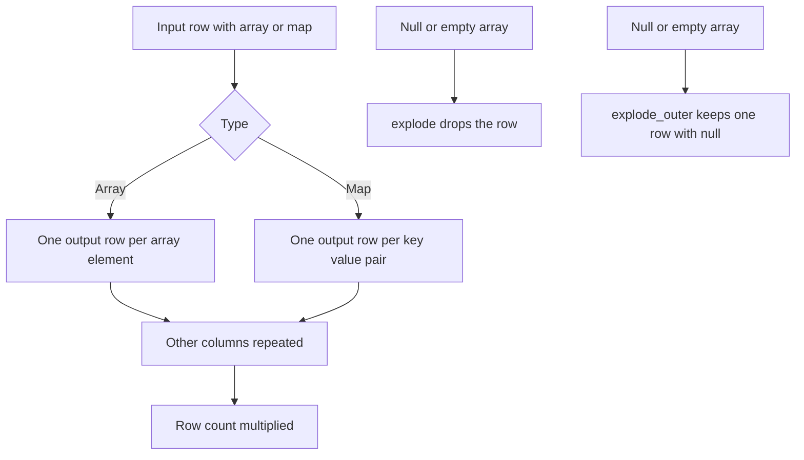

# 2.3.2 What does the explode() function do?

`explode()` takes a column containing an array or a map and returns one row per element. It multiplies row count. Other columns are duplicated for each exploded element.



### Variants

| Function | Input | Output columns | Null or empty input |
|---|---|---|---|
| `explode(col)` | Array | One column, one row per element | Row dropped |
| `explode(col)` | Map | Two columns, key and value | Row dropped |
| `explode_outer(col)` | Array or map | Same as explode | One row with nulls kept |
| `posexplode(col)` | Array | Position and value | Row dropped |
| `posexplode(col)` | Map | Position, key, value | Row dropped |
| `posexplode_outer(col)` | Array or map | Same as posexplode | One row with nulls kept |

### Array explode behavior

| Input array | `explode` rows | `explode_outer` rows |
|---|---|---|
| `[a, b, c]` | 3 rows: a, b, c | 3 rows: a, b, c |
| `[a]` | 1 row: a | 1 row: a |
| `[]` | 0 rows | 1 row: null |
| `null` | 0 rows | 1 row: null |
| `[a, null, b]` | 3 rows: a, null, b | 3 rows: a, null, b |

The null element inside an array is preserved. The null array itself is dropped by `explode`.

### Map explode behavior

| Input map | `explode` output |
|---|---|
| `{k1: v1, k2: v2}` | Two rows: `(k1, v1)`, `(k2, v2)` |
| `{}` | 0 rows |
| `null` | 0 rows |
| `{k1: null}` | One row: `(k1, null)` |

Map key order is not guaranteed. Do not rely on explode output order for maps.

### PySpark examples

Array explode:

```python
from pyspark.sql.functions import explode, explode_outer, posexplode, col

df.select("id", explode("tags").alias("tag"))

df.select("id", explode_outer("tags").alias("tag"))

df.select("id", posexplode("tags").alias("pos", "tag"))
```

Map explode:

```python
df.select("id", explode("attrs").alias("k", "v"))
```

SQL:

```sql
SELECT id, tag
FROM t LATERAL VIEW explode(tags) x AS tag;

SELECT id, k, v
FROM t LATERAL VIEW explode(attrs) x AS k, v;
```

Spark 3.0+ also supports `explode` in the `SELECT` list for some cases, but `LATERAL VIEW` is the portable SQL form.

### Row multiplication

| Input rows | Elements per row | Output rows |
|---|---|---|
| 1,000 | 3 | 3,000 |
| 1,000 | 100 | 100,000 |
| 1,000,000 | 5 | 5,000,000 |

Explode is a narrow transformation and does not shuffle by itself, but downstream joins, aggregations, and writes see the inflated row count.

### Combining with filter or transform

Filter the array before exploding to reduce rows.

```python
from pyspark.sql.functions import filter, col, explode

df.select("id", explode(filter(col("tags"), lambda x: x.isNotNull())).alias("tag"))
```

| Approach | Output rows |
|---|---|
| `explode(tags)` | All elements, including nulls |
| `explode(filter(tags, x -> x is not null))` | Non-null elements only |

### Explode then aggregate

Common pattern: explode an array, then group by the exploded value.

```python
from pyspark.sql.functions import explode, col

(df.select(explode("tags").alias("tag"))
   .groupBy("tag")
   .count())
```

This converts a list column into a frequency table. It requires a shuffle at the `groupBy`.

### Performance notes

- `explode` is native and codegen friendly. It does not need a UDF.
- It multiplies rows. Estimate output size before exploding wide arrays.
- Filter the array first with `filter` or `exists` to shrink the input.
- Select only needed columns before explode. Other columns are duplicated per output row.
- Explode before a join or aggregation multiplies the join or aggregate work. Explode after the join when possible.
- `explode_outer` keeps rows with null or empty arrays. Use it when the row must not disappear.
- Map explode produces two columns. Cast or rename immediately to avoid ambiguity.
- Exploding very large arrays can cause memory pressure in a single task. Consider splitting the array or using `explode` after repartitioning.
- Avoid exploding nested arrays without flattening first. `explode(explode(col))` in one select does not work as expected. Use two stages.

### Common pitfalls

| Pitfall | Effect | Fix |
|---|---|---|
| Using `explode` on a null array | Row silently dropped | Use `explode_outer` |
| Expecting empty array to produce a row | Zero rows | Use `explode_outer` |
| Assuming map explode order | Order not guaranteed | Sort after explode if order matters |
| Exploding before filtering | Extra rows processed | Filter the array first |
| Exploding a wide DataFrame | All columns duplicated | Select needed columns first |
| Exploding nested arrays in one step | Unexpected schema | Use two `explode` stages |
| Using explode in a `groupBy` key directly | Not allowed in some forms | Explode in a subquery or `LATERAL VIEW` |
| Forgetting row multiplication | Downstream volume surprise | Estimate rows before and after |
| Mixing `explode` with other generators in one select | Error in some versions | One generator per select, or use `LATERAL VIEW` |

### End to end example

```python
from pyspark.sql import SparkSession
from pyspark.sql.functions import explode, explode_outer, col

spark = SparkSession.builder.getOrCreate()

df = spark.createDataFrame(
    [
        (1, ["a", "b"]),
        (2, []),
        (3, None),
        (4, ["c", None]),
    ],
    ["id", "tags"]
)

exploded = df.select("id", explode("tags").alias("tag"))
outer    = df.select("id", explode_outer("tags").alias("tag"))

exploded.show()
outer.show()
```

| id | tags | `explode` output | `explode_outer` output |
|---|---|---|---|
| 1 | `[a,b]` | `(1,a)`, `(1,b)` | `(1,a)`, `(1,b)` |
| 2 | `[]` | no rows | `(2,null)` |
| 3 | null | no rows | `(3,null)` |
| 4 | `[c,null]` | `(4,c)`, `(4,null)` | `(4,c)`, `(4,null)` |

### Summary

- `explode` turns an array or map into one row per element or key value pair.
- It multiplies row count and duplicates other columns.
- `explode_outer` keeps rows with null or empty input.
- `posexplode` adds the position index.
- Map explode returns key and value columns. Order is not guaranteed.
- Filter and project before explode to control output volume.
- Avoid exploding before joins and aggregations unless necessary.
- Use `explode_outer` when rows must not disappear.
