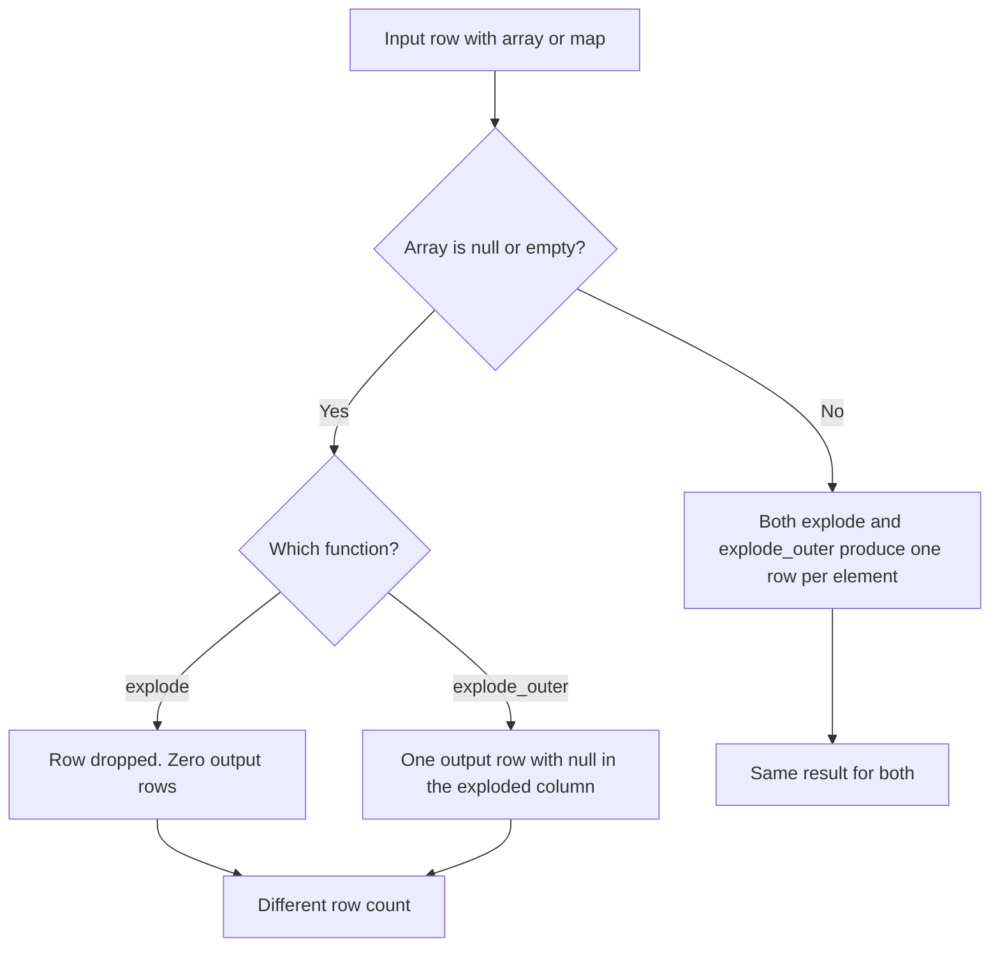

# 2.3.3 What is the difference between explode() and explode_outer()?

## 2.3.3 What is the difference between `explode()` and `explode_outer()`?

Both turn an array or map into multiple rows. The only difference is what happens when the input is null or empty. `explode` drops the row. `explode_outer` keeps one row with null output.



### Core comparison

| Aspect | `explode()` | `explode_outer()` |
|---|---|---|
| Normal array or map | One row per element | One row per element |
| Null input | Row dropped | One row with null output |
| Empty array `[]` | Row dropped | One row with null output |
| Empty map `{}` | Row dropped | One row with null output |
| Null elements inside a non-empty array | Preserved as null rows | Preserved as null rows |
| Output row count | At least 0 per input row | At least 1 per input row |
| Shuffle | None by itself | None by itself |
| Inner vs outer semantics | Inner join style | Left outer join style |

### Behavior table

| Input | `explode` output | `explode_outer` output |
|---|---|---|
| `[a, b]` | `(a)`, `(b)` | `(a)`, `(b)` |
| `[a]` | `(a)` | `(a)` |
| `[]` | no rows | `(null)` |
| `null` | no rows | `(null)` |
| `[a, null, b]` | `(a)`, `(null)`, `(b)` | `(a)`, `(null)`, `(b)` |
| `{k1: v1, k2: v2}` | `(k1, v1)`, `(k2, v2)` | `(k1, v1)`, `(k2, v2)` |
| `{}` | no rows | `(null, null)` |
| `null` map | no rows | `(null, null)` |
| `{k1: null}` | `(k1, null)` | `(k1, null)` |

The difference only appears for null or empty containers. Null elements inside a non-empty array behave the same in both.

### Row count example

| id | tags | `explode` rows | `explode_outer` rows |
|---|---|---|---|
| 1 | `[a, b]` | 2 | 2 |
| 2 | `[]` | 0 | 1 |
| 3 | `null` | 0 | 1 |
| 4 | `[c]` | 1 | 1 |

Total `explode` rows: 3. Total `explode_outer` rows: 5.

### PySpark

```python
from pyspark.sql import SparkSession
from pyspark.sql.functions import explode, explode_outer

spark = SparkSession.builder.getOrCreate()

df = spark.createDataFrame(
    [
        (1, ["a", "b"]),
        (2, []),
        (3, None),
    ],
    ["id", "tags"]
)

inner = df.select("id", explode("tags").alias("tag"))
outer = df.select("id", explode_outer("tags").alias("tag"))
```

| id | tags | inner rows | outer rows |
|---|---|---|---|
| 1 | `[a,b]` | `(1,a)`, `(1,b)` | `(1,a)`, `(1,b)` |
| 2 | `[]` | none | `(2,null)` |
| 3 | null | none | `(3,null)` |

### SQL

`LATERAL VIEW explode` is the standard form. `LATERAL VIEW OUTER explode` is the outer variant.

```sql
-- Inner: rows with null or empty arrays disappear
SELECT id, tag
FROM t LATERAL VIEW explode(tags) x AS tag;

-- Outer: rows with null or empty arrays are kept with null tag
SELECT id, tag
FROM t LATERAL VIEW OUTER explode(tags) x AS tag;
```

| SQL form | Semantics |
|---|---|
| `LATERAL VIEW explode(...)` | Inner |
| `LATERAL VIEW OUTER explode(...)` | Left outer |

### Related functions

| Function | Null or empty input | Adds position |
|---|---|---|
| `explode` | Dropped | No |
| `explode_outer` | Kept with null | No |
| `posexplode` | Dropped | Yes |
| `posexplode_outer` | Kept with null | Yes |

`posexplode` follows the same inner semantics as `explode`. `posexplode_outer` follows the same outer semantics as `explode_outer`.

### When to use each

| Need | Use |
|---|---|
| Every input row must appear in the output at least once | `explode_outer` |
| Row loss is acceptable when the array is empty or null | `explode` |
| Frequency tables where null arrays should be skipped | `explode` |
| Left join style expansion against another table | `explode_outer` |
| Counting rows per element and null containers must be visible | `explode_outer` |
| Deduplication or filtering where null containers are noise | `explode` |

The safe default depends on the business rule. If losing rows silently is a bug, use `explode_outer`. If null containers are meaningless and should not contribute, use `explode`.

### Performance notes

- Both are native and codegen friendly. No shuffle by themselves.
- `explode_outer` can produce more rows than `explode` because null and empty containers generate a row.
- The extra rows from `explode_outer` flow into downstream joins, aggregations, and writes. Account for this in volume estimates.
- Filter the array before exploding to reduce output in both variants.
- Select only the needed columns before explode. Other columns are duplicated per output row.
- Neither function has a meaningful performance advantage over the other. The choice is about correctness.

### Common pitfalls

| Pitfall | Effect | Fix |
|---|---|---|
| Using `explode` when null arrays matter | Rows silently disappear | Use `explode_outer` |
| Using `explode_outer` for frequency counts | Null rows inflate counts | Filter out null output or use `explode` |
| Assuming empty array produces a row in `explode` | Zero rows | Use `explode_outer` |
| Forgetting that `explode_outer` yields `(null, null)` for null maps | Two null columns downstream | Handle null key and value explicitly |
| Using `LATERAL VIEW explode` and expecting outer behavior | Rows with null arrays lost | Use `LATERAL VIEW OUTER explode` |
| Mixing inner and outer in the same pipeline | Inconsistent row counts | Choose one semantics per pipeline |
| Exploding before a join | Row multiplication, worse with outer | Explode after the join when possible |

### End to end example

```python
from pyspark.sql import SparkSession
from pyspark.sql.functions import explode, explode_outer, col

spark = SparkSession.builder.getOrCreate()

df = spark.createDataFrame(
    [
        (1, ["a", "b"]),
        (2, []),
        (3, None),
        (4, ["c", None]),
    ],
    ["id", "tags"]
)

inner = df.select("id", explode("tags").alias("tag"))
outer = df.select("id", explode_outer("tags").alias("tag"))

inner.show()
outer.show()
```

`inner` output:

| id | tag |
|---|---|
| 1 | a |
| 1 | b |
| 4 | c |
| 4 | null |

`outer` output:

| id | tag |
|---|---|
| 1 | a |
| 1 | b |
| 2 | null |
| 3 | null |
| 4 | c |
| 4 | null |

Rows 2 and 3 are missing from `inner` because their arrays are empty and null. `outer` keeps them with a null tag. Row 4 has a null element inside a non-empty array, and both functions preserve it.

### Summary

- `explode` drops rows with null or empty arrays and maps.
- `explode_outer` keeps those rows with null output values.
- They behave identically for non-empty containers, including null elements inside an array.
- Choose based on whether losing the row is acceptable.
- `LATERAL VIEW OUTER explode` is the SQL form of the outer variant.
- `posexplode` and `posexplode_outer` follow the same inner and outer semantics.
- Neither has a performance advantage. The choice is about correctness.
