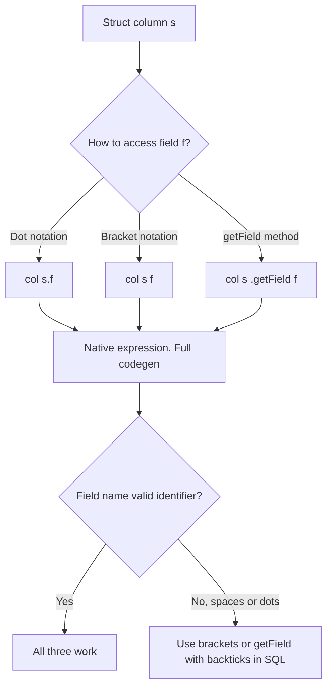

# 2.3.4 How do you query a specific field inside a Struct column?

Access a struct field with dot notation, bracket notation, or `getField()`. All three are native and codegen friendly. The right choice depends on whether the field name is static, contains special characters, or comes from a variable.



### Access methods

| Method | PySpark syntax | SQL syntax | Notes |
|---|---|---|---|
| Dot notation | `col("info.name")` | `info.name` | Simplest. Field name must be a valid identifier |
| Bracket notation | `col("info")["name"]` | `info['name']` | Works with special characters |
| `getField` | `col("info").getField("name")` | Not available | Explicit method. Works with special characters |
| `select` with dot | `df.select("info.name")` | `SELECT info.name` | String based column reference |
| `selectExpr` | `df.selectExpr("info.name")` | N/A | SQL expression in the DataFrame API |

### Basic examples

PySpark:

```python
from pyspark.sql.functions import col

# Dot notation
df.select(col("info.name").alias("name"))

# Bracket notation
df.select(col("info")["name"].alias("name"))

# getField
df.select(col("info").getField("name").alias("name"))

# String based select
df.select("info.name")

# selectExpr
df.selectExpr("info.name AS name")
```

SQL:

```sql
SELECT
  info.name       AS name,
  info['name']    AS name2
FROM t;
```

All five produce the same result.

### When to use which

| Situation | Use |
|---|---|
| Field name is a simple identifier | Dot notation `col("s.f")` |
| Field name has spaces or dots | `col("s").getField("field.name")` or `col("s")["field.name"]` |
| Field name comes from a variable | `col("s").getField(var_name)` or `col("s")[var_name]` |
| You want SQL-like readability | `selectExpr("s.f AS alias")` |
| Using `select` with strings | `df.select("s.f")` |
| Building a dynamic expression | `getField` or bracket notation with a `lit` or variable |

### Nested structs

Chain the access for deeper nesting.

```python
from pyspark.sql.functions import col

# Two levels
df.select(col("address.city"))

# Three levels
df.select(col("order.customer.address.city"))

# Mix dot and bracket
df.select(col("order.customer")["address"]["city"])

# getField chain
df.select(col("order").getField("customer").getField("address").getField("city"))
```

SQL:

```sql
SELECT order.customer.address.city FROM t;
```

| Depth | Dot notation | getField chain |
|---|---|---|
| 1 | `col("a.b")` | `col("a").getField("b")` |
| 2 | `col("a.b.c")` | `col("a").getField("b").getField("c")` |
| 3 | `col("a.b.c.d")` | Four `getField` calls |

Dot notation is shorter. `getField` is explicit and works with special characters at any level.

### Field names with special characters

Field names with spaces, dots, or hyphens break dot notation because the dot is parsed as a separator.

| Field name | Dot notation | Bracket notation | getField | SQL |
|---|---|---|---|---|
| `name` | `col("s.name")` | `col("s")["name"]` | `getField("name")` | `s.name` |
| `first name` | Broken | `col("s")["first name"]` | `getField("first name")` | ``s.`first name` `` |
| `a.b` | Ambiguous | `col("s")["a.b"]` | `getField("a.b")` | ``s.`a.b` `` |
| `1field` | Broken | `col("s")["1field"]` | `getField("1field")` | ``s.`1field` `` |

In PySpark, bracket notation and `getField` handle any field name. In SQL, backticks handle special characters.

### Dynamic field access

When the field name is a variable, dot notation cannot be used directly.

```python
from pyspark.sql.functions import col

field = "name"
df.select(col("info").getField(field).alias("value"))
df.select(col("info")[field].alias("value"))
```

| Approach | Works with variable field name |
|---|---|
| `col("info." + field)` | Yes, but fragile if the name has special characters |
| `col("info").getField(field)` | Yes, safe for any name |
| `col("info")[field]` | Yes, safe for any name |

### Select all fields of a struct

Use `.*` to flatten all fields into separate columns.

```python
df.select("info.*")
df.selectExpr("info.*")
```

```sql
SELECT info.* FROM t;
```

| Input struct | Output columns |
|---|---|
| `info: {name, age, city}` | `name`, `age`, `city` |

This is useful for flattening a struct into top level columns. It does not work with `col("info.*")`. Use `select("info.*")` or `selectExpr("info.*")`.

### Keep the parent and the field

Select both the struct and a field.

```python
df.select("info", col("info.name").alias("name"))
```

| info | name |
|---|---|
| `{name: alice, age: 30}` | alice |

### Filter on a struct field

```python
from pyspark.sql.functions import col

df.filter(col("info.age") > 18)
df.filter(col("info")["age"] > 18)
```

```sql
SELECT * FROM t WHERE info.age > 18;
```

Struct field access is a native expression, so filters on it are pushed down when the format supports it, such as Parquet with statistics on the nested field.

### Group by a struct field

```python
df.groupBy("info.city").count()
df.groupBy(col("info")["city"]).count()
```

```sql
SELECT info.city, count(*) FROM t GROUP BY info.city;
```

### Null handling

| Case | Result of `col("s.f")` |
|---|---|
| Struct is null | `null` |
| Struct is not null, field is null | `null` |
| Struct is not null, field is not null | Field value |
| Field does not exist in schema | Analysis error |

Accessing a field on a null struct returns null, not an error. This matches SQL null propagation.

```python
from pyspark.sql.functions import col, when, lit

df.withColumn(
    "name_or_default",
    when(col("info.name").isNull(), lit("UNKNOWN")).otherwise(col("info.name"))
)
```

### Assigning back to a struct

To update one field and keep the rest, rebuild the struct or use `withField` in Spark 3.5+.

```python
from pyspark.sql.functions import col, struct

# Rebuild: name updated, age and city preserved
df.withColumn(
    "info",
    struct(
        col("info.name").alias("name"),
        col("info.age").alias("age"),
        col("info.city").alias("city"),
    )
)
```

```python
# Spark 3.5+ withField
df.withColumn("info", col("info").withField("name", upper(col("info.name"))))
```

| Approach | Spark version | Note |
|---|---|---|
| Rebuild with `struct` | All | Verbose. Must list every field |
| `withField` | 3.5+ | Compact. Updates one field, keeps the rest |
| `dropFields` | 3.5+ | Removes a field, keeps the rest |

### Performance notes

- Struct field access is native and codegen friendly. No UDF, no shuffle.
- Parquet reads nested fields selectively. A query on `info.name` does not read `info.age` or `info.city`.
- Predicate pushdown works on struct fields in Parquet when statistics exist for the nested column.
- Repeated `col("info.f")` in multiple expressions is fine. The plan resolves it once.
- Rebuilding a struct with `struct(...)` creates a new object per row. Use `withField` when available.
- Flattening a struct with `select("info.*")` is cheap and often simplifies downstream logic.
- Deep nesting increases serialization cost. Flatten to top level columns before join or shuffle when possible.

### Common pitfalls

| Pitfall | Effect | Fix |
|---|---|---|
| Using dot notation with a field name containing a dot | Parsed as two nested fields | Use bracket notation or `getField` |
| Using `col("info.*")` | Not valid. Returns a weird column | Use `select("info.*")` or `selectExpr` |
| Accessing a field not in the schema | Analysis error | Validate the schema first |
| Assuming a null struct field access throws | Returns null silently | Add explicit null checks |
| Rebuilding the struct and dropping a field by mistake | Data loss in the struct | List all fields, or use `withField` |
| Using SQL dot notation with special characters without backticks | Parse error | Use backticks |
| Using a UDF to access a field | Slower, breaks codegen | Use native access |
| Flattening a very wide struct | Many output columns | Select only needed fields |
| Forgetting that `.*` flattens nested fields too | More columns than expected | Check the schema after flatten |

### End to end example

```python
from pyspark.sql import SparkSession
from pyspark.sql.functions import col, struct, named_struct

spark = SparkSession.builder.getOrCreate()

df = spark.createDataFrame(
    [
        (1, {"name": "alice", "age": 30, "address": {"city": "NYC", "zip": "10001"}}),
        (2, {"name": "bob",   "age": 25, "address": {"city": "LA",  "zip": "90001"}}),
        (3, None),
    ],
    ["id", "info"]
)

out = (
    df
    .withColumn("name",    col("info.name"))
    .withColumn("city",    col("info.address.city"))
    .withColumn("city_v2", col("info").getField("address").getField("city"))
    .withColumn("name_or_default",
                when(col("info.name").isNull(), "UNKNOWN").otherwise(col("info.name")))
)

out.show(truncate=False)
out.select("id", "info.*").show(truncate=False)
```

| id | info | name | city | city_v2 | name_or_default |
|---|---|---|---|---|---|
| 1 | `{name: alice, age: 30, address: {city: NYC, zip: 10001}}` | alice | NYC | NYC | alice |
| 2 | `{name: bob, age: 25, address: {city: LA, zip: 90001}}` | bob | LA | LA | bob |
| 3 | null | null | null | null | UNKNOWN |

Row 3 has a null struct. Every field access returns null, and `name_or_default` falls back to `UNKNOWN`.

### Summary

- Use `col("s.f")` for simple field names. It is the shortest form.
- Use `col("s").getField("f")` or `col("s")["f"]` for dynamic names or names with special characters.
- Use `select("s.*")` or `selectExpr("s.*")` to flatten a struct into top level columns.
- Chain access for nested structs: `col("a.b.c")`.
- Use backticks in SQL for special characters.
- Field access on a null struct returns null, not an error.
- Rebuild the struct with `struct(...)` or use `withField` in Spark 3.5+ to update a field.
- Struct access is native and codegen friendly. Parquet reads nested fields selectively.
- Flatten deeply nested structs before join and shuffle to reduce serialization cost.
