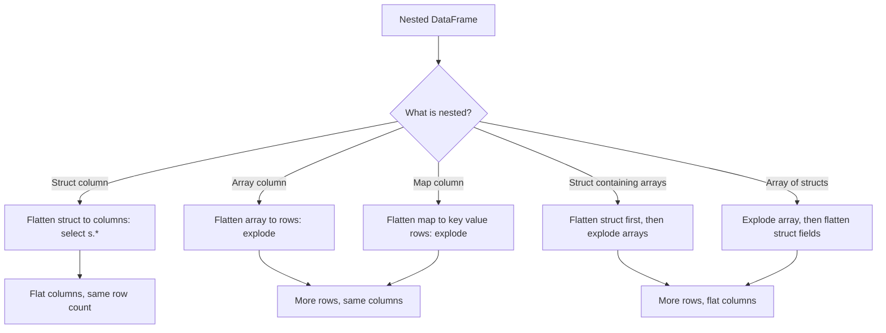

# 2.3.5 How do you flatten a nested DataFrame?

Flattening depends on what is nested. Structs flatten into columns with `select("s.*")`. Arrays flatten into rows with `explode()`. Maps flatten into key value rows with `explode()`. Deeply nested combinations need both, applied in the right order.



### Flatten types

| Nested shape | Goal | Method | Row count |
|---|---|---|---|
| Struct column | One column per field | `select("s.*")` | Unchanged |
| Struct in struct | Recursive column access | `select("a.b.*")` or chained dot | Unchanged |
| Array column | One row per element | `explode` | Multiplied |
| Array of arrays | One row per leaf | `explode` twice or `flatten` | Multiplied |
| Map column | One row per key value | `explode` | Multiplied |
| Array of structs | One row per element, fields as columns | `explode` then `select("col.*")` | Multiplied |
| Struct with array field | Flat columns plus exploded rows | `select` then `explode` | Multiplied |
| Map of arrays | Key, value element rows | `explode` map then `explode` array | Multiplied |

### Flatten a struct into columns

The most common case. `select("s.*")` expands every struct field into a top level column.

```python
from pyspark.sql import SparkSession

spark = SparkSession.builder.getOrCreate()

df = spark.createDataFrame(
    [(1, {"name": "alice", "age": 30, "city": "NYC"})],
    ["id", "info"]
)

flat = df.select("id", "info.*")
```

| id | info | flat result |
|---|---|---|
| 1 | `{name: alice, age: 30, city: NYC}` | `id=1, name=alice, age=30, city=NYC` |

| Approach | Note |
|---|---|
| `select("s.*")` | Flattens all fields |
| `select("s.a", "s.b")` | Selects specific fields |
| `selectExpr("s.*")` | SQL expression form |
| `select("s.*", "id")` | Keeps other columns |

### Flatten a nested struct

Chain the access for deeper nesting.

```python
df.select("id", "info.address.*")
```

| Before | After |
|---|---|
| `info: {name, age, address: {city, zip}}` | `name, age, city, zip` |

For mixed depth, select each level explicitly.

```python
df.select("id", "info.name", "info.address.city", "info.address.zip")
```

### Flatten an array into rows

`explode` turns each element into a row. Other columns are duplicated.

```python
from pyspark.sql.functions import explode, explode_outer

flat = df.select("id", explode("tags").alias("tag"))
```

| id | tags | flat result |
|---|---|---|
| 1 | `[a, b]` | `(1, a)`, `(1, b)` |
| 2 | `[]` | no rows |
| 3 | null | no rows |

Use `explode_outer` to keep rows with null or empty arrays.

```python
flat = df.select("id", explode_outer("tags").alias("tag"))
```

| id | tags | flat result |
|---|---|---|
| 1 | `[a, b]` | `(1, a)`, `(1, b)` |
| 2 | `[]` | `(2, null)` |
| 3 | null | `(3, null)` |

### Flatten an array of structs

Explode the array, then flatten the struct fields.

```python
from pyspark.sql.functions import explode, col

df.select("order_id", explode("items").alias("item")) \
  .select("order_id", "item.*")
```

| Before | After |
|---|---|
| `order_id: 1, items: [{sku: A, qty: 1}, {sku: B, qty: 2}]` | `(1, A, 1)`, `(1, B, 2)` |

This is the standard order line items pattern. The array becomes rows, the struct fields become columns.

### Flatten an array of arrays

Two approaches. `flatten` concatenates inner arrays first, then one `explode` produces the rows.

```python
from pyspark.sql.functions import flatten, explode

df.select("id", explode(flatten("matrix")).alias("value"))
```

Or explode twice. Each `explode` must be in its own `select`.

```python
from pyspark.sql.functions import explode, col

df.select("id", explode("matrix").alias("inner")) \
  .select("id", explode("inner").alias("value"))
```

| Approach | Stages | Note |
|---|---|---|
| `flatten` then `explode` | 1 | Cleaner. Concatenates all inner arrays |
| `explode` twice | 2 | Preserves inner array position if needed |
| `explode` twice in one select | Not allowed | Multiple generators in one select error |

### Flatten a map into rows

`explode` on a map produces two columns, key and value.

```python
from pyspark.sql.functions import explode

df.select("id", explode("attrs").alias("k", "v"))
```

| id | attrs | flat result |
|---|---|---|
| 1 | `{k1: v1, k2: v2}` | `(1, k1, v1)`, `(1, k2, v2)` |
| 2 | `{}` | no rows |
| 3 | null | no rows |

Order is not guaranteed. Sort after explode if order matters.

### Flatten a struct containing an array

Flatten the struct fields into columns and explode the array in the same select.

```python
from pyspark.sql.functions import explode, col

df.select("id", "info.name", explode("info.tags").alias("tag"))
```

| Before | After |
|---|---|
| `id: 1, info: {name: alice, tags: [a, b]}` | `(1, alice, a)`, `(1, alice, b)` |

This works because `info.name` is a scalar field and `explode("info.tags")` is the only generator in the select.

### Flatten a map of arrays

Explode the map first, then explode the value array.

```python
from pyspark.sql.functions import explode, col

df.select("id", explode("group_tags").alias("group", "tags")) \
  .select("id", "group", explode("tags").alias("tag"))
```

| Before | After |
|---|---|
| `{g1: [a, b], g2: [c]}` | `(g1, a)`, `(g1, b)`, `(g2, c)` |

Two stages. Each `explode` is in its own `select`.

### Flatten arbitrary depth with a loop

For schemas with unpredictable nesting, write a recursive flattener. It expands struct fields until none remain.

```python
from pyspark.sql import DataFrame
from pyspark.sql.functions import col
from pyspark.sql.types import StructType

def flatten_struct(df: DataFrame, prefix: str = "") -> DataFrame:
    fields = []
    for field in df.schema.fields:
        name = f"{prefix}{field.name}"
        if isinstance(field.dataType, StructType):
            for sub in field.dataType.fields:
                fields.append(col(f"`{field.name}`.`{sub.name}`").alias(f"{name}_{sub.name}"))
        else:
            fields.append(col(f"`{field.name}`").alias(name))
    return df.select(*fields)
```

| Step | Behavior |
|---|---|
| Iterate schema fields | Checks each field type |
| Struct field | Recursively expands its subfields |
| Scalar field | Keeps as is, aliased with prefix |
| Arrays | Left as is. Explode separately |

For deeper nesting, make it fully recursive. This adds complexity. Prefer explicit selects when the schema is known.

### Order of operations

| Nested shape | Correct order |
|---|---|
| Struct only | `select("s.*")` |
| Array only | `explode` |
| Array of structs | `explode` then `select("col.*")` |
| Struct with scalar and array fields | `select` scalar and `explode` array in one select |
| Map of arrays | `explode` map, then `explode` array |
| Array of arrays | `flatten` then `explode`, or `explode` twice |
| Array of structs containing arrays | `explode` outer array, `select("col.*")`, `explode` inner array |

Flattening an array before a struct is often wrong. Explode the array first, then flatten the struct fields of the exploded rows.

### Row count implications

| Operation | Row count effect |
|---|---|
| `select("s.*")` | Unchanged |
| `explode` array | Multiplied by array length |
| `explode_outer` array | Multiplied, plus one per null or empty array |
| `explode` map | Multiplied by map size |
| `flatten` array | Unchanged. Concatenates inner arrays |
| `explode(flatten(...))` | Multiplied by total element count |

Estimate output volume before flattening wide arrays. A million rows with 100 element arrays becomes 100 million rows.

### Performance notes

- Struct flattening is a projection. No shuffle. Native and codegen friendly.
- Array explode is a narrow transformation. No shuffle by itself, but it inflates downstream volume.
- Filter and project before explode to reduce output rows and columns.
- Select only the needed struct fields before explode. Unused fields are duplicated per output row.
- Parquet reads nested fields selectively. Flattening in the query does not read unused nested fields.
- Deeply nested structs increase per row serialization cost. Flatten before join and shuffle.
- Avoid UDFs for flattening. Native functions handle every struct, array, and map case.
- Multiple `explode` calls in one select error. Use separate `select` stages.
- `flatten` is cheaper than two `explode` stages when only the leaf values are needed.

### Common pitfalls

| Pitfall | Effect | Fix |
|---|---|---|
| `select("s.*")` after explode in one select | Multiple generator or ambiguous columns | Split into two `select` stages |
| Exploding before flattening the struct | Struct fields duplicated per row | Flatten struct first if fields are scalar |
| Two `explode` in one select | Analysis error | Use two `select` stages |
| Assuming map explode order | Order not guaranteed | Sort after explode if order matters |
| Forgetting row multiplication | Downstream volume surprise | Estimate rows before and after |
| Using `explode` on null arrays | Row dropped | Use `explode_outer` |
| Flattening deep nesting with a UDF | Slower, breaks codegen | Use native `select` and `explode` |
| Not prefixing flattened field names | Column name collisions | Alias with a prefix |
| Using `select("s.*")` and expecting parent struct | Parent struct is replaced | Select parent separately if needed |
| Dynamic schema with unexpected nesting | Hand written select breaks | Use a recursive flattener or validate the schema first |

### End to end example

```python
from pyspark.sql import SparkSession
from pyspark.sql.functions import explode, col

spark = SparkSession.builder.getOrCreate()

df = spark.createDataFrame(
    [
        (
            1,
            {"customer": {"name": "alice", "city": "NYC"}},
            [{"sku": "A", "qty": 1}, {"sku": "B", "qty": 2}],
        ),
        (
            2,
            {"customer": {"name": "bob", "city": "LA"}},
            [],
        ),
    ],
    ["order_id", "meta", "items"]
)

flat = (
    df
    .select("order_id", "meta.customer.*", explode("items").alias("item"))
    .select("order_id", "name", "city", "item.*")
)

flat.show()
```

| order_id | name | city | sku | qty |
|---|---|---|---|---|
| 1 | alice | NYC | A | 1 |
| 1 | alice | NYC | B | 2 |

Order 2 disappears because its `items` array is empty. Use `explode_outer` to keep it with null `sku` and `qty`.

### Summary

- Structs flatten to columns with `select("s.*")`. No row count change.
- Arrays flatten to rows with `explode` or `explode_outer`. Row count is multiplied.
- Maps flatten to key value rows with `explode`.
- Arrays of structs need `explode` then `select("col.*")`.
- Arrays of arrays use `flatten` then `explode`, or two `explode` stages.
- Multiple generators in one select error. Use separate stages.
- Filter and project before explode. Select only needed struct fields.
- Flatten deeply nested structs before join and shuffle to reduce serialization cost.
- Choose `explode_outer` when rows with null or empty arrays must not disappear.
