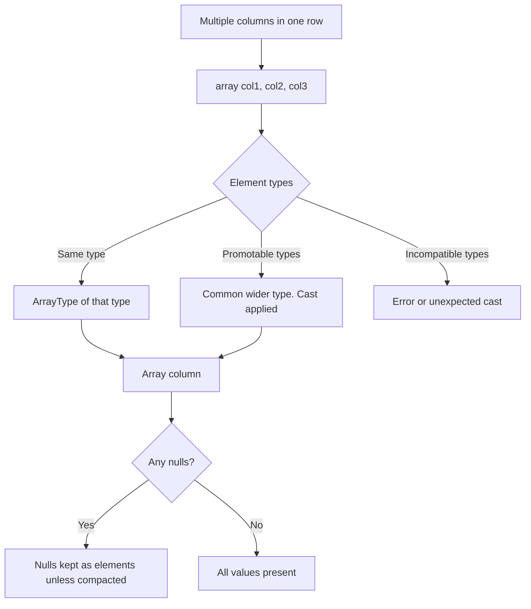

# 2.3.6 How do you create an array column from multiple existing columns?

## 2.3.6 How do you create an array column from multiple existing columns?

Use `array(col1, col2, ...)`. It builds an `ArrayType` value per row from the listed expressions. The element type is the common type of the inputs. Nulls are kept as array elements by default.



### Core function

| API | Form | Result |
|---|---|---|
| PySpark | `array(col("a"), col("b"), col("c"))` | `ArrayType` column |
| Scala | `array(col("a"), col("b"))` | `ArrayType` column |
| SQL | `array(a, b, c)` | `ArrayType` column |
| Literal mix | `array(col("a"), lit(0))` | Array with mixed literal and column |

### Basic example

```python
from pyspark.sql import SparkSession
from pyspark.sql.functions import array, col

spark = SparkSession.builder.getOrCreate()

df = spark.createDataFrame(
    [(1, 100, 200, 300)],
    ["id", "q1", "q2", "q3"]
)

out = df.withColumn("quarters", array(col("q1"), col("q2"), col("q3")))
```

| id | q1 | q2 | q3 | quarters |
|---|---|---|---|---|
| 1 | 100 | 200 | 300 | `[100, 200, 300]` |

### SQL

```sql
SELECT id, array(q1, q2, q3) AS quarters FROM t;
```

### Type handling

Spark computes a common type across all arguments and casts as needed.

| Input types | Result element type | Note |
|---|---|---|
| All `IntegerType` | `IntegerType` | No cast |
| `IntegerType` + `LongType` | `LongType` | Widening |
| `IntegerType` + `DoubleType` | `DoubleType` | Widening |
| `StringType` + `IntegerType` | Error or unexpected cast | Cast explicitly |
| `DateType` + `StringType` | Error | Cast the string to date first |
| All same complex type | That complex type | Arrays of structs work |

Cast explicitly when in doubt.

```python
from pyspark.sql.functions import array, col, lit

df.withColumn("mixed", array(col("int_col").cast("string"), col("str_col")))
df.withColumn("nums",  array(col("int_col").cast("double"), col("double_col")))
```

### Null handling

| Input | Result array |
|---|---|
| `a=1, b=2, c=3` | `[1, 2, 3]` |
| `a=1, b=null, c=3` | `[1, null, 3]` |
| `a=null, b=null, c=null` | `[null, null, null]` |
| All null, want empty array | Use `array_compact` (Spark 3.4+) |

Nulls are kept, not skipped. That is often the wrong default.

### Compact nulls out

`array_compact` removes null elements. Spark 3.4+.

```python
from pyspark.sql.functions import array, array_compact, col

df.withColumn("vals", array_compact(array(col("a"), col("b"), col("c"))))
```

| Input | `array(...)` | `array_compact(array(...))` |
|---|---|---|
| `1, null, 3` | `[1, null, 3]` | `[1, 3]` |
| `null, null, null` | `[null, null, null]` | `[]` |
| `1, 2, 3` | `[1, 2, 3]` | `[1, 2, 3]` |

For older Spark, use `filter(array(...), lambda x: x.isNotNull())`.

```python
from pyspark.sql.functions import array, col, filter

df.withColumn("vals", filter(array(col("a"), col("b")), lambda x: x.isNotNull()))
```

### Default values instead of nulls

Use `coalesce` before the array when null should become a default.

```python
from pyspark.sql.functions import array, coalesce, col, lit

df.withColumn("vals", array(
    coalesce(col("a"), lit(0)),
    coalesce(col("b"), lit(0)),
))
```

| Input | Result |
|---|---|
| `1, null` | `[1, 0]` |
| `null, null` | `[0, 0]` |

This keeps array length constant, which matters for positional access.

### Deduplicate and sort

Combine with array functions after construction.

```python
from pyspark.sql.functions import array, array_distinct, array_sort, array_compact, col

df.withColumn(
    "vals",
    array_sort(array_distinct(array_compact(array(col("a"), col("b"), col("c")))))
)
```

| Step | Effect |
|---|---|
| `array(...)` | Build from columns |
| `array_compact(...)` | Remove nulls |
| `array_distinct(...)` | Remove duplicates, order not guaranteed |
| `array_sort(...)` | Sort ascending, nulls last |

`array_distinct` does not preserve order. Always sort after dedupe if order matters.

### Array of structs from multiple columns

To keep column names inside the array, build structs.

```python
from pyspark.sql.functions import array, struct, col

df.withColumn(
    "pairs",
    array(
        struct(col("a").alias("name"), col("b").alias("value")),
        struct(col("c").alias("name"), col("d").alias("value")),
    )
)
```

| Input | Result |
|---|---|
| `a=1, b=10, c=2, d=20` | `[{name: 1, value: 10}, {name: 2, value: 20}]` |

Use this when the array needs typed named elements rather than an unlabeled list.

### Contrast with `collect_list`

`array()` builds an array from multiple columns in the same row. `collect_list` builds an array from multiple rows in a group.

| Need | Function | Scope |
|---|---|---|
| Combine columns in one row | `array(...)` | Row |
| Combine values across rows in a group | `collect_list(...)` | Group |
| Combine arrays element-wise | `arrays_zip`, `concat` | Row |
| Combine values across rows, keep duplicates | `collect_list` | Group |
| Combine values across rows, dedupe | `collect_set` | Group |

```python
from pyspark.sql.functions import collect_list, col

df.groupBy("id").agg(collect_list("value").alias("values"))
```

### Concatenating existing array columns

To combine array columns into one array, use `concat`.

```python
from pyspark.sql.functions import concat, col

df.withColumn("all_tags", concat(col("tags1"), col("tags2")))
```

| Function | Behavior |
|---|---|
| `array(a, b)` | Builds array from scalar columns |
| `concat(a, b)` | Joins array columns end to end |
| `array_union(a, b)` | Union of array columns, dedupes |
| `arrays_zip(a, b)` | Zips array columns into an array of structs |

### Performance notes

- `array()` is native and codegen friendly. No shuffle, no UDF.
- Element type promotion adds a cast per row when types differ. Cast explicitly once upstream instead of per row.
- `array_compact` and `array_distinct` scan the array per row. Cheap for small arrays, noticeable for large ones.
- `array_sort` is `O(n log n)` per row. Do not sort large arrays repeatedly in a chain.
- Avoid UDFs for building arrays. Native `array` handles every case.
- Building a wide array from 50 columns adds a wide output column per row. Consider an array of structs only when the schema is stable.
- `arrays_zip` is useful for parallel arrays that must stay aligned by position.

### Common pitfalls

| Pitfall | Effect | Fix |
|---|---|---|
| Assuming nulls are dropped | Array contains nulls | Use `array_compact` or `filter` |
| Mixing incompatible types | Error or silent cast | Cast to a common type explicitly |
| Confusing `array` with `collect_list` | Wrong scope | `array` is row level, `collect_list` is group level |
| Using `array_distinct` and expecting order | Order not guaranteed | `array_sort` after `array_distinct` |
| Building array of scalars and expecting names | No field names | Use `array(struct(...))` |
| Forgetting `coalesce` when fixed length is needed | Nulls break positional access | `coalesce` before `array` |
| Concatenating array columns with `array` | Nested array of arrays | Use `concat` for array columns |
| Using `array()` on a null scalar column | Null kept as element | `coalesce` or `array_compact` |

### End to end example

```python
from pyspark.sql import SparkSession
from pyspark.sql.functions import array, array_compact, array_distinct, array_sort, coalesce, col, lit

spark = SparkSession.builder.getOrCreate()

df = spark.createDataFrame(
    [(1, 10, 20, 10), (2, None, 30, 30), (3, None, None, None)],
    ["id", "a", "b", "c"]
)

raw     = df.withColumn("raw", array(col("a"), col("b"), col("c")))
compact = df.withColumn("compact", array_compact(array(col("a"), col("b"), col("c"))))
dedup   = df.withColumn("dedup", array_sort(array_distinct(array_compact(array(col("a"), col("b"), col("c"))))))
defaulted = df.withColumn("with_default", array(
    coalesce(col("a"), lit(0)),
    coalesce(col("b"), lit(0)),
    coalesce(col("c"), lit(0)),
))

dedup.show()
```

| id | a | b | c | raw | compact | dedup | with_default |
|---|---|---|---|---|---|---|---|
| 1 | 10 | 20 | 10 | `[10,20,10]` | `[10,20,10]` | `[10,20]` | `[10,20,10]` |
| 2 | null | 30 | 30 | `[null,30,30]` | `[30,30]` | `[30]` | `[0,30,30]` |
| 3 | null | null | null | `[null,null,null]` | `[]` | `[]` | `[0,0,0]` |

### Summary

- Use `array(col1, col2, ...)` to build an array from multiple columns in the same row.
- Element type is the common wider type. Cast explicitly when types differ.
- Nulls are kept by default. Use `array_compact` or `filter` to drop them.
- Use `coalesce` before `array` for a fixed length with defaults.
- Combine with `array_distinct` and `array_sort` for deduped, ordered arrays.
- Use `array(struct(...))` when elements need field names.
- Use `concat` for array columns, not `array`.
- Use `collect_list` for cross row arrays, not `array`.
- `array` is native and codegen friendly. Avoid UDFs.
