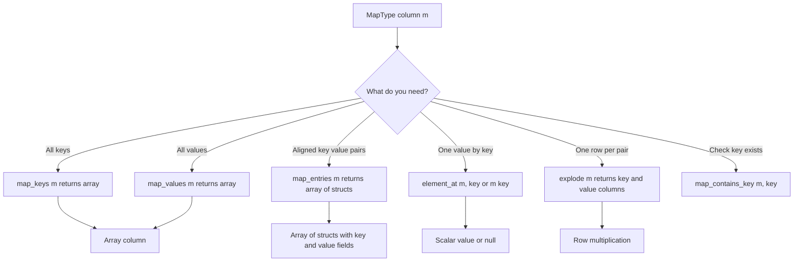

# 2.3.7 How do you extract the keys and values from a MapType column?

A `MapType` column holds key value pairs. Spark provides native functions to extract keys as an array, values as an array, entries as an array of structs, a single value by key, or rows via `explode`.



### Core functions

| Goal | PySpark | SQL | Return type |
|---|---|---|---|
| Keys array | `map_keys(col("m"))` | `map_keys(m)` | `ArrayType(keyType)` |
| Values array | `map_values(col("m"))` | `map_values(m)` | `ArrayType(valueType)` |
| Entries array | `map_entries(col("m"))` | `map_entries(m)` | `ArrayType(StructType(key, value))` |
| Value by key | `element_at(col("m"), "k")` | `element_at(m, 'k')` | `valueType` or null |
| Value by bracket | `col("m")["k"]` | `m['k']` | `valueType` or null |
| Key exists | `map_contains_key(col("m"), "k")` | `map_contains_key(m, 'k')` | Boolean |
| Explode to rows | `explode(col("m"))` | `LATERAL VIEW explode(m)` | Two columns key and value |

### Basic example

```python
from pyspark.sql import SparkSession
from pyspark.sql.functions import col, map_keys, map_values, map_entries, element_at, explode

spark = SparkSession.builder.getOrCreate()

df = spark.createDataFrame(
    [(1, {"a": 10, "b": 20})],
    ["id", "attrs"]
)

out = (
    df
    .withColumn("keys",    map_keys(col("attrs")))
    .withColumn("values",  map_values(col("attrs")))
    .withColumn("entries", map_entries(col("attrs")))
    .withColumn("a_val",   element_at(col("attrs"), "a"))
)
```

| id | attrs | keys | values | entries | a_val |
|---|---|---|---|---|---|
| 1 | `{a:10, b:20}` | `["a","b"]` | `[10,20]` | `[{key:a,value:10},{key:b,value:20}]` | 10 |

### SQL

```sql
SELECT
  id,
  map_keys(attrs)    AS keys,
  map_values(attrs)  AS values,
  map_entries(attrs) AS entries,
  element_at(attrs, 'a') AS a_val
FROM t;
```

### map_entries structure

`map_entries` returns an array of structs. Each struct has two fields: `key` and `value`.

| Access | Example |
|---|---|
| Whole entries array | `col("entries")` |
| First entry key | `col("entries")[0].key` |
| First entry value | `col("entries")[0].value` |
| Explode entries | `explode(col("entries"))` then access `.key` and `.value` |

```python
from pyspark.sql.functions import map_entries, col, explode

df.select(explode(map_entries(col("attrs"))).alias("e")) \
  .select(col("e.key").alias("k"), col("e.value").alias("v"))
```

### Explode map to rows

`explode` on a map produces two columns: key and value.

```python
df.select("id", explode("attrs").alias("k", "v"))
```

| id | k | v |
|---|---|---|
| 1 | a | 10 |
| 1 | b | 20 |

SQL:

```sql
SELECT id, k, v
FROM t LATERAL VIEW explode(attrs) x AS k, v;
```

`explode_outer` keeps rows with null or empty maps, producing one row with null key and value.

### Null and empty behavior

| Input | `map_keys` | `map_values` | `map_entries` | `element_at` | `explode` | `explode_outer` |
|---|---|---|---|---|---|---|
| `{a:1}` | `["a"]` | `[1]` | `[{key:a,value:1}]` | 1 | one row | one row |
| `{}` | `[]` | `[]` | `[]` | null | no rows | one row with nulls |
| null | null | null | null | null | no rows | one row with nulls |
| missing key | not applicable | not applicable | not applicable | null | not applicable | not applicable |

`element_at` returns null when the key is missing. It does not error.

### Check key existence

Use `map_contains_key` to avoid relying on null from `element_at`.

```python
from pyspark.sql.functions import map_contains_key, col

df.withColumn("has_a", map_contains_key(col("attrs"), "a"))
```

| attrs | has_a |
|---|---|
| `{a:1}` | true |
| `{b:2}` | false |
| `{}` | false |
| null | null |

### Aligned keys and values

`map_keys` and `map_values` do not guarantee matching order across separate calls. If keys and values must stay aligned, use `map_entries`.

| Need | Use |
|---|---|
| Keys only | `map_keys` |
| Values only | `map_values` |
| Aligned pairs | `map_entries` |
| Specific key | `element_at` |
| One row per pair | `explode` |

To sort entries by key:

```python
from pyspark.sql.functions import map_entries, array_sort, col

df.withColumn("sorted_entries", array_sort(map_entries(col("attrs")), lambda x, y: x["key"] < y["key"]))
```

### Extract multiple known keys as columns

When the key set is known and small, use `element_at` per key.

```python
from pyspark.sql.functions import element_at, col

df.select(
    "id",
    element_at(col("attrs"), "a").alias("a"),
    element_at(col("attrs"), "b").alias("b"),
)
```

This is cheaper than exploding and pivoting.

### Performance notes

- `map_keys`, `map_values`, `map_entries`, and `element_at` are native and codegen friendly. No shuffle, no UDF.
- Each call scans the map per row. For small maps this is cheap. For large maps, repeated calls add up.
- `explode` multiplies row count by map size. Estimate output volume before exploding.
- Filter the map before explode with `map_filter` to reduce rows.
- `element_at` for a single key is much cheaper than `explode` then filter.
- Map key order is not guaranteed. Do not rely on `map_keys` order.
- Avoid UDFs. Native functions cover every extraction case.

### Common pitfalls

| Pitfall | Effect | Fix |
|---|---|---|
| Assuming `map_keys` order matches `map_values` order | Misaligned pairs | Use `map_entries` for aligned pairs |
| Using `explode` on null map | Rows dropped | Use `explode_outer` |
| Forgetting that `element_at` returns null for missing key | Null propagates | Use `map_contains_key` or `coalesce` |
| Exploding a large map | Row explosion | Filter with `map_filter` first |
| Using `map_keys` then indexing | Order not guaranteed | Use `map_entries` or `element_at` |
| Treating empty map and null map the same | Different results for `explode` | Use `explode_outer` or check `size` |
| Using UDF for key extraction | Slower, breaks codegen | Use native functions |
| Building map with duplicate keys | Last value wins silently | Deduplicate before building |

### End to end example

```python
from pyspark.sql import SparkSession
from pyspark.sql.functions import (
    col, map_keys, map_values, map_entries, element_at, explode, map_contains_key
)

spark = SparkSession.builder.getOrCreate()

df = spark.createDataFrame(
    [
        (1, {"a": 10, "b": 20}),
        (2, {}),
        (3, None),
    ],
    ["id", "attrs"]
)

out = (
    df
    .withColumn("keys",   map_keys(col("attrs")))
    .withColumn("values", map_values(col("attrs")))
    .withColumn("has_a",  map_contains_key(col("attrs"), "a"))
    .withColumn("a_val",  element_at(col("attrs"), "a"))
)

out.show(truncate=False)
df.select("id", explode_outer("attrs").alias("k", "v")).show()
```

| id | attrs | keys | values | has_a | a_val |
|---|---|---|---|---|---|
| 1 | `{a:10,b:20}` | `["a","b"]` | `[10,20]` | true | 10 |
| 2 | `{}` | `[]` | `[]` | false | null |
| 3 | null | null | null | null | null |

Explode output with `explode_outer` keeps rows 2 and 3 with null key and value.

### Summary

- `map_keys` returns keys as an array.
- `map_values` returns values as an array.
- `map_entries` returns aligned key value structs. Use this when order alignment matters.
- `element_at` returns one value by key, or null if missing.
- `explode` turns a map into rows with key and value columns. `explode_outer` keeps null and empty maps.
- `map_contains_key` checks existence without null ambiguity.
- Map order is not guaranteed. Do not rely on it.
- Filter before explode. Use `element_at` for single keys. Avoid UDFs.
