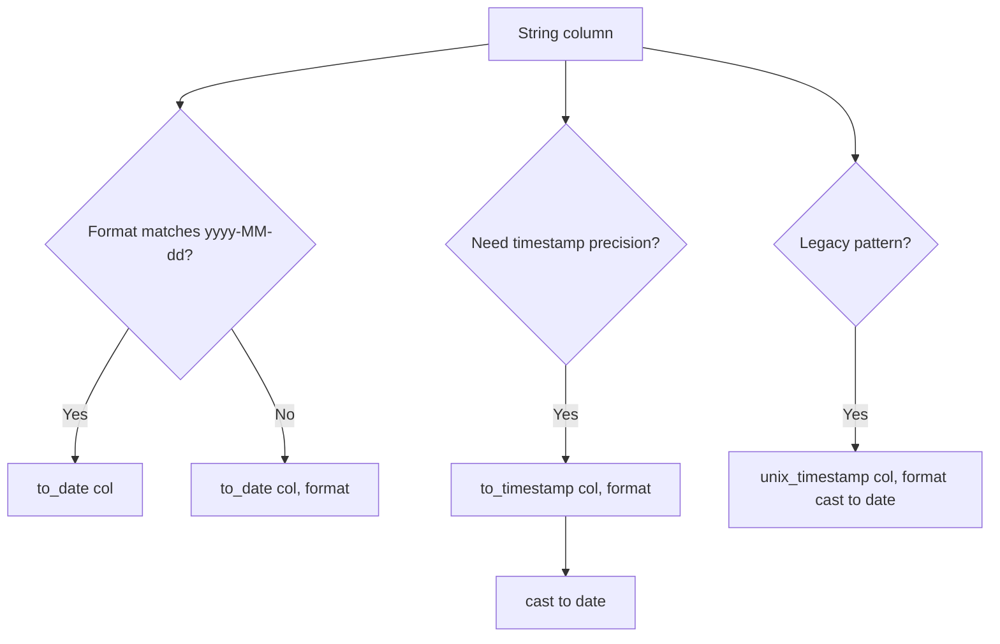

# 2.4.1 How do you convert a String column to a Date column?

Spark provides several built-in functions for this. The right choice depends on the input format, whether the string is standard or custom, and whether you need error tolerance.

### Conversion paths



### Main approaches

| Approach | Code | When to use |
|---|---|---|
| `to_date` default | `df.withColumn("d", to_date(col("s")))` | Input already in `yyyy-MM-dd` |
| `to_date` with format | `to_date(col("s"), "MM/dd/yyyy")` | Custom or non-ISO format |
| `to_timestamp` then cast | `to_timestamp(col("s"), fmt).cast("date")` | String carries time and timezone |
| `unix_timestamp` then cast | `unix_timestamp(col("s"), fmt).cast("date")` | Legacy or explicit epoch control |
| `cast` | `col("s").cast("date")` | Only when format is strictly ISO |

### `to_date` with a format string

This is the primary method. The format argument uses Java `SimpleDateFormat` patterns.

```scala
import org.apache.spark.sql.functions._

df.withColumn("order_date", to_date(col("order_date_str"), "yyyy-MM-dd"))
df.withColumn("order_date", to_date(col("order_date_str"), "MM/dd/yyyy"))
df.withColumn("order_date", to_date(col("order_date_str"), "dd-MMM-yyyy"))
```

- Returns `DateType`.
- Returns `null` when the string does not match the pattern (non-ANSI mode).
- Does not throw on bad input by default. Silent nulls are the most common surprise.

### `to_timestamp` then cast

Use this when the string includes a time component or a timezone offset and you want a clean date after truncation.

```scala
df.withColumn("d", to_timestamp(col("s"), "yyyy-MM-dd HH:mm:ss").cast("date"))
df.withColumn("d", to_timestamp(col("s"), "yyyy-MM-dd'T'HH:mm:ssXXX").cast("date"))
```

- `to_timestamp` returns `TimestampType`.
- The `cast` to `date` drops the time portion.
- Timezone conversion happens during the timestamp parse, so the resulting date can shift by a day if the source offset differs from the session timezone.

### `unix_timestamp` then cast

Older pattern. Still valid but `to_date` and `to_timestamp` are preferred in Spark 3.x.

```scala
df.withColumn("d", unix_timestamp(col("s"), "MM/dd/yyyy").cast("date"))
```

- `unix_timestamp` returns seconds since epoch as `LongType`.
- Returns `null` on parse failure.
- Casting `LongType` to `DateType` interprets the value as epoch seconds.
- Useful when you must combine parsing with numeric epoch math.

### Common format patterns

| Pattern | Example input | Notes |
|---|---|---|
| `yyyy-MM-dd` | `2024-03-15` | ISO, default for `to_date` |
| `MM/dd/yyyy` | `03/15/2024` | US style |
| `dd-MM-yyyy` | `15-03-2024` | EU style |
| `dd-MMM-yyyy` | `15-Mar-2024` | Month abbreviation, locale dependent |
| `yyyyMMdd` | `20240315` | Compact, common in file names |
| `yyyy-MM-dd HH:mm:ss` | `2024-03-15 14:30:00` | Use `to_timestamp` |
| `yyyy-MM-dd'T'HH:mm:ssXXX` | `2024-03-15T14:30:00+05:30` | ISO 8601 with offset |
| `yyyy-MM-dd HH:mm:ss.SSS` | `2024-03-15 14:30:00.123` | Millisecond precision |

### Format token reference

| Token | Meaning |
|---|---|
| `y` | Year |
| `M` | Month in year |
| `d` | Day in month |
| `H` | Hour 0 to 23 |
| `h` | Hour 1 to 12 |
| `m` | Minute |
| `s` | Second |
| `S` | Millisecond |
| `X` | Timezone offset, `Z` for ISO 8601 |

### Handling bad data

By default, Spark returns `null` on parse failure. That is fast but silent. Three ways to make it visible.

| Strategy | Implementation | Trade-off |
|---|---|---|
| Filter failures first | `df.filter(to_date(col("s"), fmt).isNotNull)` | Cheap, but drops rows silently |
| Count failures | Compare `df.count` with `df.filter(to_date(...).isNull).count` | Adds a pass over the data |
| ANSI mode | Set `spark.sql.ansi.enabled=true` | Parse failure throws an exception instead of returning null |
| `try_to_date` | `try_to_date(col("s"), fmt)` | Explicit null-returning variant, clear intent in code |

```scala
// Count how many rows will become null
val bad = df.filter(to_date(col("s"), "MM/dd/yyyy").isNull).count()
println(s"rows that will fail to parse: $bad")
```

### Timezone and locale pitfalls

- `to_date` with a format string is timezone-independent for date-only patterns. No shift occurs.
- `to_timestamp` parses into the session timezone (`spark.sql.session.timeZone`, default UTC). The resulting date can shift a day if the source has an offset and the session is in another zone.
- Month name parsing (`MMM`) depends on the JVM locale. On a cluster with mixed locales, results can differ. Set `spark.sql.parser.escapedStringLiterals` or use numeric month patterns to avoid this.
- `to_date` truncates at parse. It does not round. `2024-03-15 23:59:59` becomes `2024-03-15`.

### Type and nullability behavior

- `to_date` and `to_timestamp` return nullable columns by default, regardless of input nullability.
- Calling `to_date` on an already-date column is a no-op but still adds a projection.
- `cast("date")` on a string assumes ISO format and bypasses the explicit format argument. It is shorter but less explicit.
- Casting a malformed ISO string returns `null` in non-ANSI mode and throws `DateTimeException` in ANSI mode.

### End to end example

```scala
val df = Seq(
  ("2024-03-15", "03/15/2024", "2024-03-15 14:30:00"),
  ("2024-02-29", "02/29/2024", "2024-02-29 23:59:59"),
  ("not-a-date", "13/45/2024", "bad")
).toDF("iso", "us", "ts")

val out = df
  .withColumn("d_iso",   to_date(col("iso")))
  .withColumn("d_us",    to_date(col("us"), "MM/dd/yyyy"))
  .withColumn("d_from_ts", to_timestamp(col("ts"), "yyyy-MM-dd HH:mm:ss").cast("date"))

out.show()
```

Result: `d_iso` and `d_us` parse the first two rows and return `null` on the bad rows. `d_from_ts` does the same for the timestamp column.
