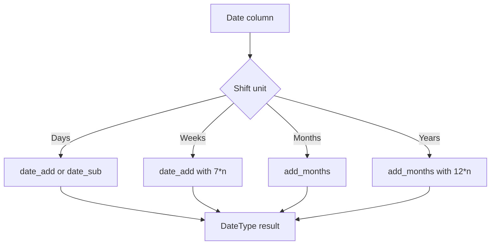

# 2.4.2 How do you add or subtract days from a date column?

Use `date_add` and `date_sub`. They operate on `DateType` and return `DateType`. For month or year shifts, use `add_months`.



### Core functions

| Goal | Scala DataFrame API | SQL |
|---|---|---|
| Add 1 day | `date_add(col("d"), 1)` | `date_add(d, 1)` |
| Subtract 1 day | `date_sub(col("d"), 1)` | `date_sub(d, 1)` |
| Add n days | `date_add(col("d"), n)` | `date_add(d, n)` |
| Subtract n days | `date_sub(col("d"), n)` | `date_sub(d, n)` |
| Subtract using negative | `date_add(col("d"), -n)` | `date_add(d, -n)` |
| Add weeks | `date_add(col("d"), 7 * n)` | `date_add(d, 7 * n)` |
| Add months | `add_months(col("d"), n)` | `add_months(d, n)` |
| Add years | `add_months(col("d"), 12 * n)` | `add_months(d, 12 * n)` |

### Examples

```scala
import org.apache.spark.sql.functions._

df.withColumn("plus_7", date_add(col("order_date"), 7))
  .withColumn("minus_7", date_sub(col("order_date"), 7))
  .withColumn("minus_7_alt", date_add(col("order_date"), -7))
  .withColumn("plus_30", date_add(col("order_date"), 30))
```

```sql
SELECT
  order_date,
  date_add(order_date, 7)  AS plus_7,
  date_sub(order_date, 7)  AS minus_7,
  date_add(order_date, -7) AS minus_7_alt
FROM orders;
```

### Interval syntax in Spark SQL

Spark SQL also accepts interval arithmetic for date expressions.

```sql
SELECT
  d + INTERVAL 7 DAY AS plus_7,
  d - INTERVAL 7 DAY AS minus_7
FROM t;
```

Use `date_add` and `date_sub` when you need the same code path in both DataFrame and SQL APIs. Interval syntax is convenient in SQL but less portable across engines.

### String input

If the column is a string, convert it to a date first. Do not call `date_add` on an unparsed string.

```scala
df.withColumn("d", to_date(col("date_str"), "yyyy-MM-dd"))
  .withColumn("plus_7", date_add(col("d"), 7))
```

### Behavior and pitfalls

| Topic | Behavior |
|---|---|
| Return type | `date_add` and `date_sub` return `DateType` |
| Null input | Returns `null` |
| Negative days | `date_add(d, -7)` subtracts 7 days |
| Negative in `date_sub` | `date_sub(d, -7)` adds 7 days |
| Timestamp input | `date_add` works at date granularity. It does not preserve the time portion |
| Time portion | For timestamp arithmetic, use timestamp functions or interval expressions, not `date_add` |
| Timezone | `DateType` has no timezone. Day arithmetic is calendar based |
| Month end | `date_add` is exact day arithmetic. `add_months` handles month end rules separately |
| Leap years | Day arithmetic is calendar aware. Adding 1 day to Feb 28, 2024 gives Feb 29, 2024 |
| DST | Date arithmetic is not affected by daylight saving time. Timestamp arithmetic can be |

### Day arithmetic versus month arithmetic

| Operation | Function | Example result |
|---|---|---|
| Add 1 calendar day | `date_add(d, 1)` | `2024-02-28` becomes `2024-02-29` |
| Add 1 month | `add_months(d, 1)` | `2024-01-31` becomes `2024-02-29` |
| Add 12 months | `add_months(d, 12)` | Same month and day next year, adjusted for leap years |
| Add 365 days | `date_add(d, 365)` | Exact day count, may differ from one calendar year |

Use `date_add` for fixed day offsets. Use `add_months` for calendar month or year offsets.
