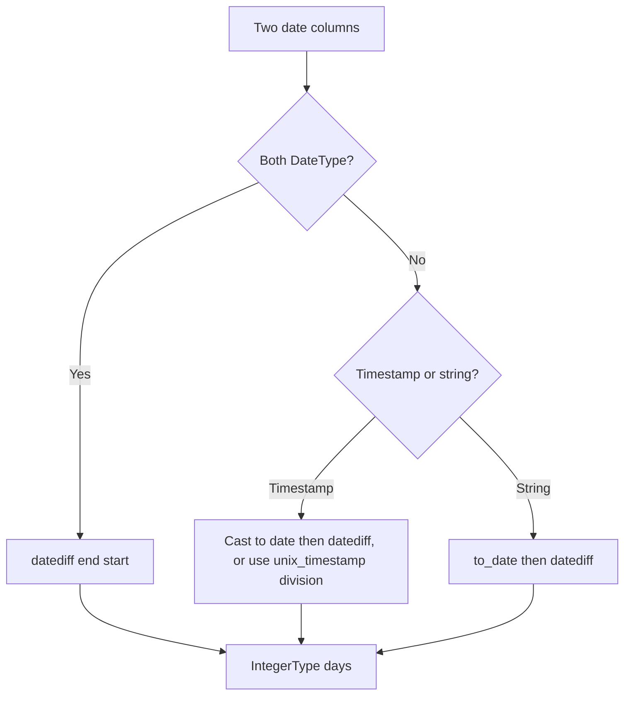

# 2.4.3 How do you calculate the difference in days between two date columns?

Use `datediff(end, start)`. It returns the number of days from `start` to `end` as an `IntegerType`. Order matters: `datediff(end, start)` is positive when `end` is later than `start`.



### Core function

| Call | Meaning | Sign |
|---|---|---|
| `datediff(col("end"), col("start"))` | Days from start to end | Positive if end is later |
| `datediff(col("start"), col("end"))` | Days from end to start | Positive if start is later |
| `datediff(lit(current_date()), col("start"))` | Age in days | Positive for past dates |

### Examples

```scala
import org.apache.spark.sql.functions._

df.withColumn("days_between", datediff(col("end_date"), col("start_date")))
  .withColumn("age_days", datediff(current_date(), col("start_date")))
```

```sql
SELECT
  start_date,
  end_date,
  datediff(end_date, start_date) AS days_between
FROM orders;
```

### Behavior and pitfalls

| Topic | Behavior |
|---|---|
| Return type | `IntegerType`. Not `LongType` |
| Null input | Returns `null` if either argument is `null` |
| Date arguments | Both arguments should be `DateType` |
| Timestamp arguments | `datediff` truncates to date. The time portion is ignored. 23:59 to 00:01 the next day is 1 day, not 0 |
| String arguments | Implicit cast may apply, but do not rely on it. Convert with `to_date` first |
| Sign | `datediff(a, b)` is `a - b` in days. Always confirm argument order |
| Timezone | `DateType` carries no timezone. Result is calendar based |
| DST | Not affected at date granularity. At timestamp granularity, a day can be 23 or 25 hours |
| Overflow | Very distant dates can overflow `Int`. Rare in practice |

### Timestamp precision

`datediff` on timestamps drops the time. If you need fractional days or hour-level precision, compute from epoch seconds.

```scala
val seconds = unix_timestamp(col("end_ts")) - unix_timestamp(col("start_ts"))
df.withColumn("days_frac", seconds / 86400.0)
  .withColumn("days_int", floor(seconds / 86400.0).cast("int"))
```

| Goal | Method | Result type |
|---|---|---|
| Whole calendar days | `datediff(end, start)` | `IntegerType` |
| Whole elapsed 24h periods | `floor((unix_timestamp(end) - unix_timestamp(start)) / 86400)` | `IntegerType` |
| Fractional days | `(unix_timestamp(end) - unix_timestamp(start)) / 86400.0` | `DoubleType` |
| Hours | `/ 3600` | `DoubleType` |

Calendar days and elapsed 24h periods differ across DST boundaries and when times of day differ. Pick based on the business rule.

### Months and years

`datediff` is day based only. For month differences use `months_between`.

```scala
df.withColumn("months", months_between(col("end"), col("start")))
  .withColumn("months_int", months_between(col("end"), col("start")).cast("int"))
  .withColumn("years", months_between(col("end"), col("start")) / 12)
```

| Function | Returns | Notes |
|---|---|---|
| `datediff(end, start)` | Days as integer | Truncates time portion |
| `months_between(end, start)` | Months as double | Fractional. Accounts for day of month |
| `months_between(end, start, roundOff)` | Months as double | `roundOff=true` rounds to whole months |

### End to end example

```scala
val df = Seq(
  ("2024-01-01", "2024-01-31"),
  ("2024-02-28", "2024-03-01"),
  ("2024-01-31", "2024-02-29"),
  (null,         "2024-03-01")
).toDF("start_str", "end_str")

val out = df
  .withColumn("start_d", to_date(col("start_str")))
  .withColumn("end_d",   to_date(col("end_str")))
  .withColumn("days",    datediff(col("end_d"), col("start_d")))

out.show()
```

| start_d | end_d | days |
|---|---|---|
| 2024-01-01 | 2024-01-31 | 30 |
| 2024-02-28 | 2024-03-01 | 2 |
| 2024-01-31 | 2024-02-29 | 29 |
| null | 2024-03-01 | null |

### Performance notes

- `datediff` is a cheap in-memory operation. No shuffle, no IO.
- It does not benefit from partitioning. It runs per row in the projection.
- Avoid wrapping it in UDFs. Native function is vectorized under codegen. A UDF breaks codegen and adds serialization cost.
- If you filter on the result, the filter runs after the projection. Push filters on the source columns where possible.
