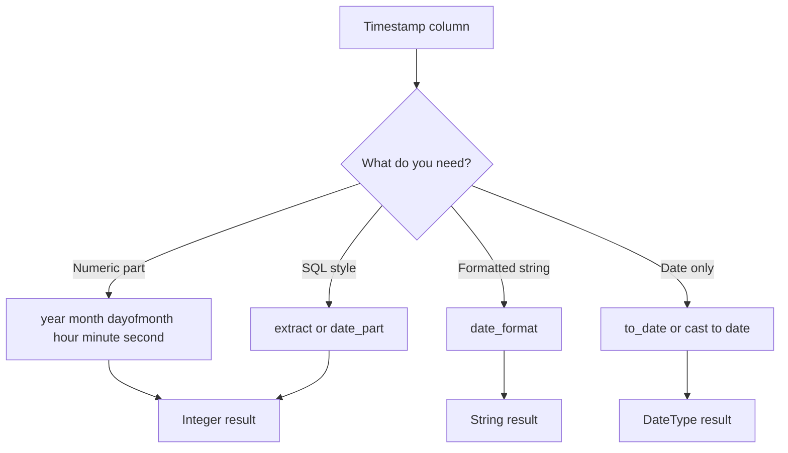

# 2.4.4 How do you extract the year, month, or day from a timestamp?

Use the native timestamp extractor functions. They return integers and stay inside Spark codegen. Avoid UDFs and string splitting.



### Numeric extractor functions

| Part | Scala DataFrame API | SQL | Return type | Range or notes |
|---|---|---|---|---|
| Year | `year(col("ts"))` | `year(ts)` | Integer | Calendar year |
| Month | `month(col("ts"))` | `month(ts)` | Integer | 1 to 12 |
| Day of month | `dayofmonth(col("ts"))` | `dayofmonth(ts)` or `day(ts)` | Integer | 1 to 31 |
| Day of week | `dayofweek(col("ts"))` | `dayofweek(ts)` | Integer | 1 Sunday to 7 Saturday |
| Day of year | `dayofyear(col("ts"))` | `dayofyear(ts)` | Integer | 1 to 366 |
| Quarter | `quarter(col("ts"))` | `quarter(ts)` | Integer | 1 to 4 |
| Hour | `hour(col("ts"))` | `hour(ts)` | Integer | 0 to 23 |
| Minute | `minute(col("ts"))` | `minute(ts)` | Integer | 0 to 59 |
| Second | `second(col("ts"))` | `second(ts)` | Integer | 0 to 59 |
| Week of year | `weekofyear(col("ts"))` | `weekofyear(ts)` | Integer | ISO week rules apply |

### Scala examples

```scala
import org.apache.spark.sql.functions._

val out = df
  .withColumn("y",  year(col("event_ts")))
  .withColumn("m",  month(col("event_ts")))
  .withColumn("d",  dayofmonth(col("event_ts")))
  .withColumn("dow", dayofweek(col("event_ts")))
  .withColumn("doy", dayofyear(col("event_ts")))
  .withColumn("q",  quarter(col("event_ts")))
  .withColumn("h",  hour(col("event_ts")))
  .withColumn("mi", minute(col("event_ts")))
  .withColumn("s",  second(col("event_ts")))
```

### SQL examples

```sql
SELECT
  event_ts,
  year(event_ts)       AS y,
  month(event_ts)      AS m,
  dayofmonth(event_ts) AS d,
  dayofweek(event_ts)  AS dow,
  hour(event_ts)       AS h,
  minute(event_ts)     AS mi
FROM events;
```

### `extract` and `date_part`

Both are SQL style extractors. They return the same parts as the dedicated functions.

```sql
SELECT
  extract(YEAR  FROM event_ts) AS y,
  extract(MONTH FROM event_ts) AS m,
  extract(DAY   FROM event_ts) AS d,
  extract(HOUR  FROM event_ts) AS h,
  date_part('YEAR', event_ts)  AS y2
FROM events;
```

Use `extract` when you want one syntax for many parts. Use dedicated functions when you want the DataFrame API without `expr`.

### `date_format` returns a string

Use `date_format` when you need a formatted string, not a numeric part. It preserves leading zeros.

```scala
df.withColumn("ymd", date_format(col("event_ts"), "yyyy-MM-dd"))
  .withColumn("ym",  date_format(col("event_ts"), "yyyy-MM"))
  .withColumn("hh",  date_format(col("event_ts"), "HH"))
```

| Goal | Function | Result type |
|---|---|---|
| Numeric year | `year(ts)` | Integer |
| Year as string | `date_format(ts, "yyyy")` | String |
| Month with leading zero | `date_format(ts, "MM")` | String |
| Day with leading zero | `date_format(ts, "dd")` | String |
| Combined date string | `date_format(ts, "yyyy-MM-dd")` | String |

Do not use `date_format` for arithmetic or comparisons. It returns a string and prevents numeric or date pushdown.

### Timestamp versus date extraction

`year`, `month`, and `dayofmonth` work on both `TimestampType` and `DateType`. The difference is timezone handling.

| Input type | Extraction behavior |
|---|---|
| `DateType` | No timezone. Calendar date is stable |
| `TimestampType` | Interpreted in the session timezone |
| `TimestampNTZType` | No timezone shift. Stable wall clock value |
| String | Convert first with `to_timestamp` or `to_date` |

If the timestamp is stored as epoch and the session timezone changes, `year`, `month`, and `dayofmonth` can return different values for the same row. Set `spark.sql.session.timeZone` explicitly in jobs that depend on calendar parts.

```scala
spark.conf.set("spark.sql.session.timeZone", "UTC")
```

### Convert string to timestamp first

Do not extract from an unparsed string. Convert with an explicit format.

```scala
val out = df
  .withColumn("ts", to_timestamp(col("ts_str"), "yyyy-MM-dd HH:mm:ss"))
  .withColumn("y", year(col("ts")))
  .withColumn("m", month(col("ts")))
  .withColumn("d", dayofmonth(col("ts")))
```

### Date only extraction

If you only need the date part, use `to_date` or cast. This drops the time and returns `DateType`.

```scala
df.withColumn("event_date", to_date(col("event_ts")))
df.withColumn("event_date", col("event_ts").cast("date"))
```

`date_trunc` is different. It truncates to a unit but keeps a timestamp.

```scala
df.withColumn("month_start", date_trunc("month", col("event_ts")))
```

### Pitfalls

| Pitfall | Effect | Fix |
|---|---|---|
| Using `day` and expecting day of week | Returns day of month | Use `dayofweek` for weekday |
| Assuming Monday is 1 in `dayofweek` | Sunday is 1, Saturday is 7 | Adjust with `((dayofweek(ts) + 5) % 7) + 1` for Monday equals 1 |
| Extracting from string directly | Implicit cast or null | Parse with `to_timestamp` first |
| Ignoring session timezone | Date parts shift across environments | Set `spark.sql.session.timeZone` |
| Using `date_format` for numbers | String comparisons and no numeric pushdown | Use `year`, `month`, `dayofmonth` |
| Using a UDF | Breaks codegen, slower | Use native functions |

### End to end example

```scala
val df = Seq(
  ("2024-03-15 14:30:45", "UTC"),
  ("2024-12-31 23:59:59", "UTC")
).toDF("ts_str", "tz")

val out = df
  .withColumn("ts", to_timestamp(col("ts_str"), "yyyy-MM-dd HH:mm:ss"))
  .withColumn("y",  year(col("ts")))
  .withColumn("m",  month(col("ts")))
  .withColumn("d",  dayofmonth(col("ts")))
  .withColumn("h",  hour(col("ts")))
  .withColumn("ymd", date_format(col("ts"), "yyyy-MM-dd"))
```

| ts_str | y | m | d | h | ymd |
|---|---|---|---|---|---|
| 2024-03-15 14:30:45 | 2024 | 3 | 15 | 14 | 2024-03-15 |
| 2024-12-31 23:59:59 | 2024 | 12 | 31 | 23 | 2024-12-31 |

### Performance notes

- Native extractors are vectorized and codegen friendly.
- `date_format` is also native but returns strings, which cost more memory than integers.
- UDF extraction breaks codegen and adds Python or JVM serialization overhead. Avoid it.
- If you filter by year or month, prefer a range filter on the timestamp column so partition pruning and file skipping can apply.
