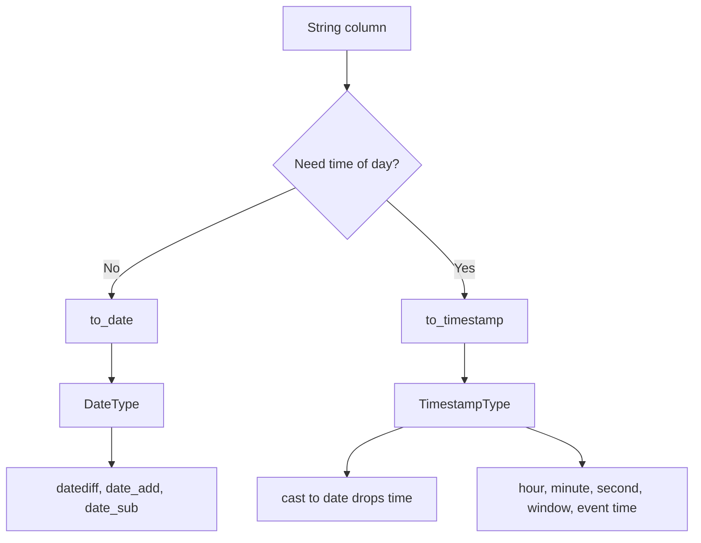

# 2.4.5 What is the difference between to_date() and to_timestamp()?

`to_date` returns a calendar date. `to_timestamp` returns an instant with date and time, interpreted through the session timezone. The choice controls precision, timezone behavior, storage type, and which downstream functions work.



### Core comparison

| Topic | `to_date` | `to_timestamp` |
|---|---|---|
| Return type | `DateType` | `TimestampType` |
| Precision | Day | Microsecond |
| Time portion | Dropped | Preserved |
| Timezone | None. Calendar date | Session timezone applies |
| Default input format | `yyyy-MM-dd` | ISO-like timestamp variants, including time |
| Format argument | Yes, `SimpleDateFormat` pattern | Yes, `SimpleDateFormat` pattern |
| Null on parse failure | Yes, in non-ANSI mode | Yes, in non-ANSI mode |
| ANSI mode parse failure | Throws | Throws |
| Typical use | Partition keys, date arithmetic, `datediff` | Event time, hour or minute extraction, windows |
| Storage footprint | Smaller, days as int | Larger, microseconds as long |
| Function cost | Lower | Slightly higher due to time and timezone parsing |

### Behavior table

| Input string | `to_date(s)` | `to_timestamp(s)` |
|---|---|---|
| `2024-03-15` | `2024-03-15` | `2024-03-15 00:00:00` |
| `2024-03-15 14:30:45` | `2024-03-15` | `2024-03-15 14:30:45` |
| `2024-03-15T14:30:45Z` | `2024-03-15` or null depending on format | Parsed as UTC instant, displayed in session timezone |
| `03/15/2024` with no format | null | null |
| `03/15/2024` with `MM/dd/yyyy` | `2024-03-15` | `2024-03-15 00:00:00` |
| `not-a-date` | null, or throws in ANSI | null, or throws in ANSI |

### Scala examples

```scala
import org.apache.spark.sql.functions._

val out = df
  .withColumn("d",  to_date(col("s"), "yyyy-MM-dd"))
  .withColumn("ts", to_timestamp(col("s"), "yyyy-MM-dd HH:mm:ss"))
  .withColumn("d_from_ts", col("ts").cast("date"))
```

### SQL examples

```sql
SELECT
  to_date(s, 'yyyy-MM-dd')                  AS d,
  to_timestamp(s, 'yyyy-MM-dd HH:mm:ss')    AS ts,
  cast(to_timestamp(s, 'yyyy-MM-dd HH:mm:ss') AS date) AS d_from_ts
FROM t;
```

### Timezone effect

This is the most important difference.

| Scenario | `to_date` | `to_timestamp` |
|---|---|---|
| Date-only string | Stable calendar date | Midnight in session timezone |
| String with offset, session UTC | Date part of the string | Instant converted to UTC |
| String with offset, session Asia/Kolkata | Date part of the string | Instant converted to +05:30, date can shift |
| Cast timestamp to date | Not applicable | Date in session timezone, not original offset |

```scala
spark.conf.set("spark.sql.session.timeZone", "UTC")
// "2024-03-15T23:30:00-05:00" -> timestamp 2024-03-16 04:30:00 UTC
// cast to date -> 2024-03-16
// to_date on the original string -> 2024-03-15
```

Set `spark.sql.session.timeZone` explicitly when date parts must be reproducible across environments.

### Format patterns

| Goal | Pattern | Use |
|---|---|---|
| Date only | `yyyy-MM-dd` | `to_date` |
| US date | `MM/dd/yyyy` | `to_date` |
| Date and time | `yyyy-MM-dd HH:mm:ss` | `to_timestamp` |
| ISO with offset | `yyyy-MM-dd'T'HH:mm:ssXXX` | `to_timestamp` |
| Milliseconds | `yyyy-MM-dd HH:mm:ss.SSS` | `to_timestamp` |
| Compact date | `yyyyMMdd` | `to_date` |

`to_date` accepts a format that includes time tokens, but the result still drops the time. Do not rely on this for precision.

### When to use which

| Requirement | Use |
|---|---|
| Partition by day | `to_date` |
| `datediff`, `date_add`, `date_sub` | `to_date` |
| Month or year extraction only | `to_date`, then `year` or `month` |
| Hour, minute, second extraction | `to_timestamp` |
| Event-time windows | `to_timestamp` |
| Join on exact instant | `to_timestamp` |
| Compare across timezones | `to_timestamp` |
| Reduce storage and shuffle bytes | `to_date` when time is not needed |

### Common pitfalls

| Pitfall | Effect | Fix |
|---|---|---|
| Using `to_date` when time matters | Silent data loss | Use `to_timestamp` |
| Casting timestamp to date across timezones | Date shifts by one day | Set session timezone or parse as date directly |
| Assuming `to_timestamp` keeps original offset | Spark stores an instant, not the offset | Convert explicitly if offset matters |
| Relying on default format | Some strings parse, others become null | Always pass an explicit format |
| Ignoring ANSI mode | Parse failures throw instead of returning null | Use `try_to_date` or `try_to_timestamp` for tolerant parsing |
| Using UDFs for parsing | Breaks codegen, slower | Use native functions |

### Tolerant variants

Use `try_to_date` and `try_to_timestamp` when bad input must return null even under ANSI mode.

```scala
df.withColumn("d",  try_to_date(col("s"), "yyyy-MM-dd"))
  .withColumn("ts", try_to_timestamp(col("s"), "yyyy-MM-dd HH:mm:ss"))
```

### Performance notes

- Both are native and codegen friendly. Neither needs a shuffle.
- `to_timestamp` does more work: time parsing, fractional seconds, and timezone conversion.
- `DateType` is narrower than `TimestampType`. Prefer `to_date` when time is irrelevant to reduce memory, shuffle, and file size.
- If you need both date and timestamp, parse once with `to_timestamp` and derive the date with `cast("date")`, or parse the date separately if timezone shift is unacceptable.
