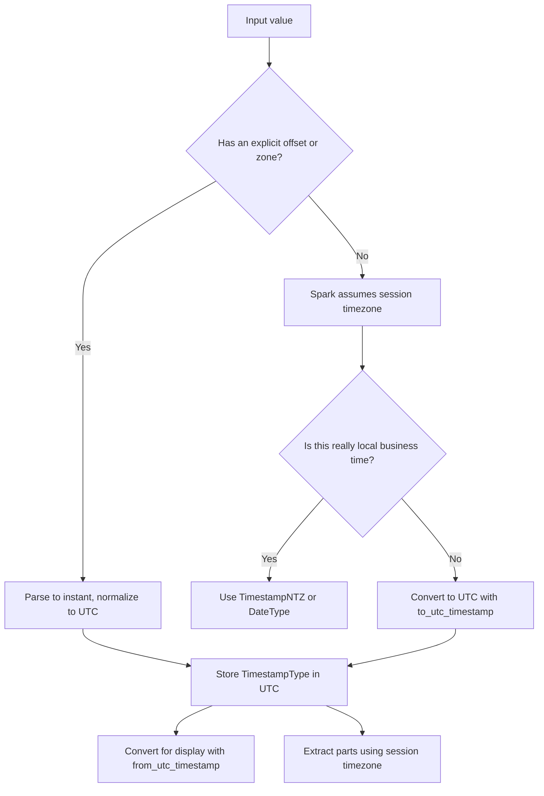

# 2.4.6 How do you handle timezones in PySpark?

Handle timezones by separating three things: the stored value, the session timezone, and the display or extraction timezone. Most timezone bugs come from mixing these three.



### Core model

| Concept | Behavior in PySpark |
|---|---|
| `TimestampType` | Represents an instant. Stored internally as UTC-based microseconds. Display and parsing use the session timezone |
| `TimestampNTZType` | Represents a local date and time with no timezone. No conversion on read or write |
| `DateType` | Calendar date with no time or timezone. Stable across sessions |
| String without offset | Parsed using `spark.sql.session.timeZone` |
| String with offset or `Z` | Parsed as an instant, then displayed in the session timezone |
| Session timezone | Controlled by `spark.sql.session.timeZone`. Default is the JVM system timezone |
| Stored file timestamp | Parquet and Delta store the instant. The reader session timezone controls display |

### Set the session timezone explicitly

Do not rely on the cluster default. Set it in code or in the cluster configuration.

```python
from pyspark.sql import SparkSession

spark = (
    SparkSession.builder
    .config("spark.sql.session.timeZone", "UTC")
    .getOrCreate()
)

spark.conf.set("spark.sql.session.timeZone", "UTC")
```

Use a region-based ID such as `America/Los_Angeles` or `Asia/Kolkata`, not a fixed offset, when daylight saving time matters. Fixed offsets such as `-08:00` do not adjust for DST.

### Parse timestamp strings

Always pass an explicit format when the input is not ISO. A zone-less string is interpreted in the session timezone. A string with an offset is converted to an instant.

```python
from pyspark.sql.functions import col, to_timestamp

df = df.withColumn(
    "ts",
    to_timestamp(col("ts_str"), "yyyy-MM-dd HH:mm:ss")
)

df = df.withColumn(
    "ts_with_offset",
    to_timestamp(col("ts_offset_str"), "yyyy-MM-dd'T'HH:mm:ssXXX")
)
```

| Input string | Session timezone | Resulting instant |
|---|---|---|
| `2024-03-15 10:00:00` | UTC | 10:00 UTC |
| `2024-03-15 10:00:00` | America/New_York | 14:00 UTC |
| `2024-03-15T10:00:00Z` | Any | 10:00 UTC |
| `2024-03-15T10:00:00+05:30` | Any | 04:30 UTC |

### Convert between zones

`from_utc_timestamp` and `to_utc_timestamp` shift the wall-clock representation. They do not attach timezone metadata to the column.

```python
from pyspark.sql.functions import from_utc_timestamp, to_utc_timestamp

# Treat the input as UTC and render it in a target zone
df = df.withColumn(
    "la_time",
    from_utc_timestamp(col("utc_ts"), "America/Los_Angeles")
)

# Treat the input as local time in a source zone and convert to UTC
df = df.withColumn(
    "utc_ts",
    to_utc_timestamp(col("local_ts"), "America/New_York")
)
```

| Function | Interpretation of input | Output wall clock |
|---|---|---|
| `from_utc_timestamp(ts, tz)` | Input is UTC | Target zone local time |
| `to_utc_timestamp(ts, tz)` | Input is local time in `tz` | UTC time |
| `cast("timestamp_ntz")` | Drops timezone semantics | Local date and time, no zone |
| `cast("date")` | Truncates to date in session timezone | Calendar date |

Important: a Spark timestamp does not store the original offset. After parsing `2024-03-15T10:00:00+05:30`, the offset is gone. Only the instant remains. If the original offset matters, store it as a separate string column.

### Extract date parts

`year`, `month`, `dayofmonth`, `hour`, and `date_format` all use the session timezone for `TimestampType`.

```python
from pyspark.sql.functions import year, month, dayofmonth, hour, date_format

df = (
    df.withColumn("y", year(col("ts")))
      .withColumn("m", month(col("ts")))
      .withColumn("d", dayofmonth(col("ts")))
      .withColumn("h", hour(col("ts")))
      .withColumn("local_str", date_format(col("ts"), "yyyy-MM-dd HH:mm:ss"))
)
```

If the same instant must produce the same date across environments, convert to the target zone first, or use `TimestampNTZType` for local business dates. Do not assume `cast("date")` uses the original offset.

### Handle local business time with TimestampNTZ

Use `TimestampNTZType` for values such as store opening time, shift start time, or contractual local time. These values have no timezone and must not shift when the session timezone changes.

```python
from pyspark.sql.functions import col

df = df.withColumn(
    "store_open_local",
    col("open_time_str").cast("timestamp_ntz")
)
```

| Use case | Recommended type |
|---|---|
| Event instant, logs, API timestamps | `TimestampType`, normalized to UTC |
| Local business time without zone | `TimestampNTZType` |
| Calendar date only | `DateType` |
| Original offset is required | `TimestampType` plus a separate offset string column |

### Pandas and Python collection

`toPandas()` and Python UDFs cross a timezone boundary. The driver Python process has its own timezone, and pandas may represent timestamps as timezone-naive or timezone-aware depending on the path.

```python
# Safer: convert to a stable string or UTC before collecting
df.select(
    date_format(col("ts"), "yyyy-MM-dd HH:mm:ss").alias("ts_str")
).toPandas()
```

| Path | Risk | Safer approach |
|---|---|---|
| `toPandas()` on `TimestampType` | Driver timezone and pandas dtype can change representation | Convert to UTC string first |
| Python UDF returning `datetime` | Python timezone may be attached or dropped | Avoid UDFs, use native functions |
| pandas UDF | Arrow timezone handling can differ by version | Normalize to UTC before the UDF |
| `collect()` of timestamps | Python objects may carry driver local timezone | Collect strings or epoch seconds |

### DST and ambiguous times

| Scenario | Behavior | Action |
|---|---|---|
| Spring forward | Local time may not exist | Use region-based zone IDs, validate input |
| Fall back | Local time may be ambiguous | Avoid ambiguous local times or define a resolution policy |
| Fixed offset `-08:00` | No DST adjustment | Use `America/Los_Angeles` if DST matters |
| Date arithmetic | `DateType` is calendar based, no DST | Use dates for day counts |
| Timestamp arithmetic | Elapsed time can be 23 or 25 hours across DST | Compute instants in UTC |

### Common pitfalls

| Pitfall | Effect | Fix |
|---|---|---|
| Relying on default session timezone | Results differ between clusters | Set `spark.sql.session.timeZone` explicitly |
| Parsing zone-less strings without a format | Silent nulls or wrong instant | Use `to_timestamp` with an explicit format |
| Assuming `from_utc_timestamp` attaches a timezone | Later operations still use session timezone | Treat it as a wall-clock shift, not metadata |
| Using `date_format` for comparisons | String comparison, no timestamp pushdown | Compare timestamps, format only for output |
| Casting timestamp to date across zones | Date can shift by one day | Convert to target zone first |
| Using Python UDFs for timezone conversion | Serialization overhead and driver timezone bugs | Use native Spark functions |
| Storing local time in `TimestampType` | Misinterpreted as an instant | Use `TimestampNTZType` or store UTC plus offset |

### End to end pattern

```python
from pyspark.sql.functions import col, to_timestamp, to_utc_timestamp, from_utc_timestamp

spark.conf.set("spark.sql.session.timeZone", "UTC")

df = (
    df
    .withColumn(
        "utc_ts",
        to_utc_timestamp(
            to_timestamp(col("local_ts_str"), "yyyy-MM-dd HH:mm:ss"),
            "America/New_York"
        )
    )
    .withColumn(
        "ist_display",
        from_utc_timestamp(col("utc_ts"), "Asia/Kolkata")
    )
)
```

### Checklist

- Store event instants in UTC.
- Set `spark.sql.session.timeZone` explicitly in every job.
- Use region-based timezone IDs when DST matters.
- Parse zone-less strings with an explicit format.
- Keep the original offset as a separate column if it matters.
- Use `DateType` when time is irrelevant.
- Use `TimestampNTZType` for local business time.
- Avoid Python UDFs for timezone conversion.
- Convert timestamps to UTC strings before `toPandas()` or `collect()`.
- Test spring-forward and fall-back dates.
