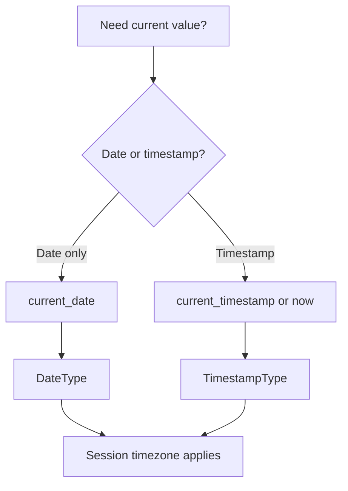

# 2.4.7 How do you get the current system date and timestamp?

Use `current_date()` for the date and `current_timestamp()` for the timestamp. Both are built in, return native types, and evaluate once per query.



### Core functions

| Goal | PySpark | Scala | SQL | Return type |
|---|---|---|---|---|
| Current date | `current_date()` | `current_date()` | `current_date()` | `DateType` |
| Current timestamp | `current_timestamp()` | `current_timestamp()` | `current_timestamp()` | `TimestampType` |
| Current timestamp alias | `now()` | `now()` | `now()` | `TimestampType` |

In SQL, these are niladic. Do not use parentheses in SQL, though Spark tolerates both forms.

```sql
SELECT current_date, current_timestamp, now();
```

### PySpark examples

```python
from pyspark.sql.functions import current_date, current_timestamp, now, col

df = (
    df
    .withColumn("today", current_date())
    .withColumn("now_ts", current_timestamp())
    .withColumn("now_ts2", now())
)
```

### Scala examples

```scala
import org.apache.spark.sql.functions._

val out = df
  .withColumn("today", current_date())
  .withColumn("now_ts", current_timestamp())
```

### Key behavior

| Topic | Behavior |
|---|---|
| Evaluation time | Once per query at planning time, not per row |
| Consistency within a query | All rows get the same value |
| Consistency across queries | Different queries get different values |
| Timezone for `current_timestamp` | Uses `spark.sql.session.timeZone` |
| Timezone for `current_date` | Uses `spark.sql.session.timeZone` |
| Nullability | Non-null |
| Determinism | Non-deterministic across queries |
| Codegen | Native, vectorized, no UDF cost |
| Driver vs executor | Value is computed on the driver and broadcast as a literal |

Because the value is fixed at planning time, a long running job that spans midnight returns the date from when the query started, not the current date per row.

### Set the session timezone

`current_date` and `current_timestamp` both depend on `spark.sql.session.timeZone`. Do not rely on the cluster default.

```python
spark.conf.set("spark.sql.session.timeZone", "UTC")
```

```scala
spark.conf.set("spark.sql.session.timeZone", "UTC")
```

| Session timezone | `current_date` at 2024-03-15 23:30 UTC |
|---|---|
| UTC | 2024-03-15 |
| Asia/Kolkata | 2024-03-16 |
| America/Los_Angeles | 2024-03-15 |

The date can differ for the same instant. Set the zone explicitly for reproducibility.

### Use in filters and joins

```python
from pyspark.sql.functions import current_date, datediff, col

df.filter(datediff(current_date(), col("order_date")) <= 30)
```

```sql
SELECT *
FROM orders
WHERE datediff(current_date, order_date) <= 30;
```

- The value is constant within the query, so the predicate is stable.
- The predicate is not pushdown friendly when it wraps a column in `datediff`. Rewrite as a range filter on `order_date` for partition pruning.

```python
from pyspark.sql.functions import date_sub, current_date

cutoff = date_sub(current_date(), 30)
df.filter(col("order_date") >= cutoff)
```

### Store the value as a column

```python
from pyspark.sql.functions import current_timestamp

df.withColumn("ingest_ts", current_timestamp()) \
  .write.mode("append").parquet("/path")
```

| Pattern | Note |
|---|---|
| `ingest_ts` written by the writer | All rows in the batch share one value |
| Per-row source timestamp | Use the source event time, not `current_timestamp` |
| Retry safety | A retried job writes a new value. Deduplicate by business key if needed |

### Testing and reproducibility

`current_date` and `current_timestamp` are non-deterministic. Tests that assert on them are flaky.

| Test strategy | Approach |
|---|---|
| Inject a fixed value | Pass a `lit` date or timestamp as a parameter |
| Use a clock abstraction | Wrap in a UDF or a function that accepts a date argument |
| Freeze time at the job level | Set a config such as `spark.sql.session.timeZone` and inject `lit` values |
| Assert ranges | Compare against a range instead of an exact value |

```python
from pyspark.sql.functions import lit

def with_clock(df, as_of):
    return df.withColumn("as_of", lit(as_of))
```

### Differences from Python and JVM clocks

| Source | Value |
|---|---|
| `current_timestamp()` | Spark session timezone, driver clock at planning time |
| `datetime.now()` in Python | Driver Python process local timezone, per call |
| `System.currentTimeMillis()` in Scala | Driver JVM clock, per call |
| `time.time()` in Python | Epoch seconds, timezone independent |

Mixing these causes subtle bugs. Keep clock access inside Spark functions so the value is consistent across the query and across executors.

### Common pitfalls

| Pitfall | Effect | Fix |
|---|---|---|
| Relying on default session timezone | Date can shift by one day | Set `spark.sql.session.timeZone` |
| Expecting per-row values | All rows get the same value | Use a source event time column |
| Using `current_timestamp` as an event time | Not the actual event time | Use the source timestamp |
| Long running job spanning midnight | Date is from job start | Re-query or use a source timestamp |
| Testing against the live clock | Flaky tests | Inject a fixed date |
| Using a Python UDF to get the time | Per-row call, codegen broken, driver timezone | Use native functions |
| Using `date_format(current_timestamp(), ...)` for comparisons | String comparison | Compare timestamps directly |
| Writing `current_timestamp` without dedup | Duplicates on retry | Deduplicate by business key |

### End to end example

```python
from pyspark.sql import SparkSession
from pyspark.sql.functions import current_date, current_timestamp, col, date_sub

spark = SparkSession.builder.getOrCreate()
spark.conf.set("spark.sql.session.timeZone", "UTC")

df = spark.range(3).toDF("id")

out = (
    df
    .withColumn("today", current_date())
    .withColumn("now_ts", current_timestamp())
    .withColumn("cutoff", date_sub(current_date(), 30))
)

out.show()
```

| id | today | now_ts | cutoff |
|---|---|---|---|
| 0 | 2024-03-15 | 2024-03-15 10:12:34 | 2024-02-14 |
| 1 | 2024-03-15 | 2024-03-15 10:12:34 | 2024-02-14 |
| 2 | 2024-03-15 | 2024-03-15 10:12:34 | 2024-02-14 |

Every row shares the same value because the function is evaluated once.
