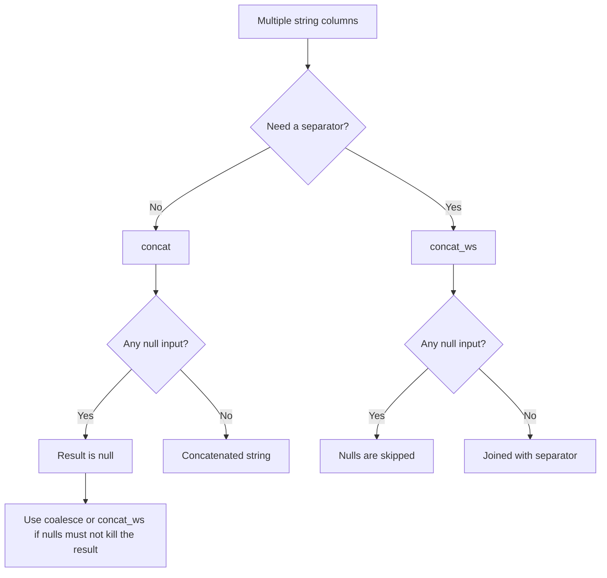

# 2.5.1 How do you concatenate multiple string columns together?

Use `concat` for direct concatenation and `concat_ws` when you need a separator. Both are native, codegen friendly, and avoid UDF overhead. The main decision is null handling.



### Core functions

| Goal | PySpark | Scala | SQL |
|---|---|---|---|
| Join with no separator | `concat(col("a"), col("b"))` | `concat(col("a"), col("b"))` | `concat(a, b)` |
| Join with separator | `concat_ws("-", col("a"), col("b"))` | `concat_ws("-", col("a"), col("b"))` | `concat_ws('-', a, b)` |
| Join many columns | `concat_ws("-", *cols)` | `concat_ws("-", cols: _*)` | `concat_ws('-', a, b, c)` |
| Join array of columns | `concat_ws("-", array(col("a"), col("b")))` | `concat_ws("-", array(col("a"), col("b")))` | `concat_ws('-', array(a, b))` |

### Null behavior table

| Function | Null input behavior | Result when all inputs are null |
|---|---|---|
| `concat(a, b, c)` | Returns `null` if any argument is `null` | `null` |
| `concat_ws(sep, a, b, c)` | Skips `null` arguments | Empty string |
| `concat_ws(sep, array(...))` | Skips `null` elements | Empty string |
| `concat(coalesce(a, lit("")), b)` | Treats null as empty string | Depends on other inputs |

`concat_ws` is usually safer when columns may be null. `concat` is stricter and can silently produce `null` for the whole row.

### Basic examples

PySpark:

```python
from pyspark.sql.functions import col, concat, concat_ws, lit, coalesce

df = (
    df
    .withColumn("full_name", concat(col("first_name"), lit(" "), col("last_name")))
    .withColumn("path", concat_ws("/", col("root"), col("dir"), col("file")))
    .withColumn("safe_name", concat(coalesce(col("first_name"), lit("")),
                                    lit(" "),
                                    coalesce(col("last_name"), lit(""))))
)
```

Scala:

```scala
import org.apache.spark.sql.functions._

val out = df
  .withColumn("full_name", concat(col("first_name"), lit(" "), col("last_name")))
  .withColumn("path", concat_ws("/", col("root"), col("dir"), col("file")))
  .withColumn("safe_name", concat(coalesce(col("first_name"), lit("")),
                                  lit(" "),
                                  coalesce(col("last_name"), lit(""))))
```

SQL:

```sql
SELECT
  concat(first_name, ' ', last_name) AS full_name,
  concat_ws('/', root, dir, file)    AS path,
  concat(coalesce(first_name, ''), ' ', coalesce(last_name, '')) AS safe_name
FROM users;
```

### Non-string inputs

`concat` and `concat_ws` need strings. Cast numbers, dates, and timestamps first.

```python
from pyspark.sql.functions import col, concat_ws

df.withColumn(
    "label",
    concat_ws("_", col("id").cast("string"), col("event_date").cast("string"))
)
```

| Input type | Action |
|---|---|
| Integer or long | `cast("string")` |
| Date | `cast("string")` or `date_format` for a specific pattern |
| Timestamp | `cast("string")` or `date_format` |
| Decimal | `cast("string")` can change scale. Use `format_string` if precision matters |
| Binary | `cast("string")` is not safe. Decode explicitly |

### Separator handling

`concat_ws` always places the separator between non-null values. It does not add a leading or trailing separator for skipped nulls.

| Inputs | `concat_ws("-", a, b, c)` |
|---|---|
| `"x"`, `"y"`, `"z"` | `x-y-z` |
| `"x"`, `null`, `"z"` | `x-z` |
| `null`, `null`, `"z"` | `z` |
| `null`, `null`, `null` | Empty string |
| `"x"`, `""`, `"z"` | `x--z` because empty string is not null |

If empty strings must also be skipped, convert them to null first with `nullif(col("a"), lit(""))`.

```python
from pyspark.sql.functions import col, nullif, concat_ws

df.withColumn(
    "path",
    concat_ws("/", nullif(col("a"), lit("")), nullif(col("b"), lit("")))
)
```

### Many columns

| Approach | Example | Note |
|---|---|---|
| List of columns | `concat_ws("-", *[col(c) for c in cols])` | Clear for dynamic column lists |
| Array | `concat_ws("-", array(*[col(c) for c in cols]))` | Works in PySpark and Scala |
| SQL | `concat_ws('-', a, b, c, d)` | Simple for fixed columns |
| Fold with `concat` | Avoid | Harder to read and null handling is brittle |

Dynamic column list in PySpark:

```python
from pyspark.sql.functions import col, concat_ws

cols = ["a", "b", "c"]
df.withColumn("joined", concat_ws("-", *[col(c) for c in cols]))
```

### Performance notes

- `concat` and `concat_ws` are native and vectorized. They stay inside codegen.
- Avoid Python or Scala UDFs for concatenation. They break codegen and add serialization cost.
- `concat_ws` with an array is still native. It is not slower than passing columns directly.
- Concatenating very wide rows increases string size and shuffle bytes. Project only needed columns before the concat.
- If the result is used only for filtering, consider filtering on the source columns instead of building a large string.
- For fixed-width formatting such as zero padded IDs, use `format_string` or `lpad` instead of manual concatenation.

### Common pitfalls

| Pitfall | Effect | Fix |
|---|---|---|
| Using `concat` with nullable columns | Whole result becomes `null` | Use `concat_ws` or `coalesce` |
| Expecting `concat_ws` to keep nulls | Nulls are skipped | Use `concat` with `coalesce` if nulls must appear |
| Not casting numbers | Type mismatch or implicit cast surprises | Cast to string explicitly |
| Using UDFs | Slower, no codegen | Use native functions |
| Forgetting that empty string is not null | Double separators appear | Use `nullif(col, lit(""))` |
| Concatenating before filtering | Extra string work and shuffle bytes | Filter and select first |
| Using `concat` in a loop | Complex plan, harder to optimize | Use `concat_ws` with a column list |

### End to end example

```python
from pyspark.sql import SparkSession
from pyspark.sql.functions import col, concat_ws, lit, coalesce, concat

spark = SparkSession.builder.getOrCreate()

df = spark.createDataFrame(
    [("John", None, "Doe"), (None, "A.", "Smith"), ("", "", "")],
    ["first", "middle", "last"]
)

out = (
    df
    .withColumn("full_concat", concat(col("first"), lit(" "), col("middle"), lit(" "), col("last")))
    .withColumn("full_ws", concat_ws(" ", col("first"), col("middle"), col("last")))
    .withColumn("full_safe", concat(
        coalesce(col("first"), lit("")), lit(" "),
        coalesce(col("middle"), lit("")), lit(" "),
        coalesce(col("last"), lit(""))
    ))
)

out.show(truncate=False)
```

| first | middle | last | full_concat | full_ws | full_safe |
|---|---|---|---|---|---|
| John | null | Doe | null | John Doe | John  Doe |
| null | A. | Smith | null | A. Smith |  A. Smith |
| empty | empty | empty | `  ` | `  ` | `  ` |

Pick `concat_ws` for clean joins that skip nulls. Pick `concat` with `coalesce` when you need a fixed positional layout.
