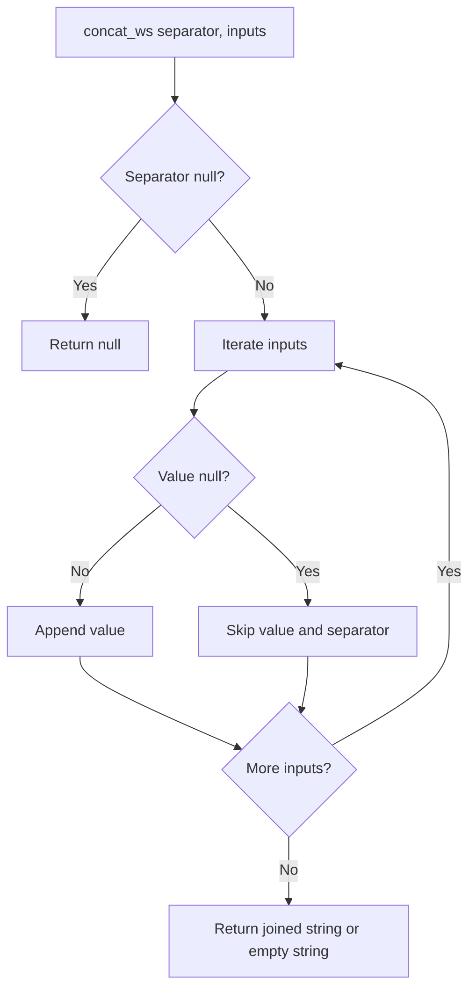

# 2.5.2 What is concat_ws() and how does it handle null values?

`concat_ws` joins string values with a separator. It skips null values and does not add separators for them. This makes it the safer choice when optional columns are involved.



### Signature and usage

| API | Form |
|---|---|
| PySpark | `concat_ws(sep, *cols)` |
| Scala | `concat_ws(sep, cols: _*)` |
| SQL | `concat_ws(sep, expr1, expr2, ...)` |
| Array input | `concat_ws(sep, array(...))` |

```python
from pyspark.sql.functions import col, concat_ws

df.withColumn("path", concat_ws("/", col("root"), col("dir"), col("file")))
```

```scala
import org.apache.spark.sql.functions._

df.withColumn("path", concat_ws("/", col("root"), col("dir"), col("file")))
```

```sql
SELECT concat_ws('/', root, dir, file) AS path FROM t;
```

### Null handling rules

| Rule | Behavior |
|---|---|
| Null input value | Skipped completely |
| Separator placement | Only between non-null values |
| All inputs null | Returns empty string, not null |
| Separator is null | Returns null |
| Empty string input | Not null, so it is included |
| Null array element | Skipped |
| Null array itself | Contributes no elements, result can be empty string |

### Null case table

| Inputs to `concat_ws('-', ...)` | Result |
|---|---|
| `a`, `b`, `c` | `a-b-c` |
| `a`, `null`, `c` | `a-c` |
| `null`, `null`, `c` | `c` |
| `null`, `null`, `null` | empty string |
| `a`, `''`, `c` | `a--c` because empty string is not null |
| separator `null` | `null` |
| `array('a', null, 'b')` | `a-b` |
| `array(null, null)` | empty string |
| null array | empty string when separator is not null |

### Compare `concat` and `concat_ws`

| Topic | `concat(a, b, c)` | `concat_ws('-', a, b, c)` |
|---|---|---|
| Null input | Whole result becomes null | Null value is skipped |
| All null | null | empty string |
| Empty string | Included | Included |
| Separator | Manual, must add `lit()` | Built in |
| Optional fields | Needs `coalesce` | Handles nulls directly |

Use `concat_ws` for names, addresses, paths, and any optional field list. Use `concat` with `coalesce` when a fixed positional layout is required.

### Treat empty strings as null

`concat_ws` skips null but not empty strings. To skip both, convert empty strings to null first.

```python
from pyspark.sql.functions import col, concat_ws, lit, nullif

df.withColumn(
    "joined",
    concat_ws("-", nullif(col("a"), lit("")), nullif(col("b"), lit("")))
)
```

### Type requirements

`concat_ws` expects strings or arrays of strings. Cast other types explicitly.

```python
from pyspark.sql.functions import col, concat_ws

df.withColumn(
    "label",
    concat_ws("_", col("id").cast("string"), col("event_date").cast("string"))
)
```

| Input type | Action |
|---|---|
| Integer, long | `cast("string")` |
| Date | `cast("string")` or `date_format` |
| Timestamp | `cast("string")` or `date_format` |
| Decimal | `cast("string")` may change scale. Use `format_string` if needed |
| Binary | Not safe. Decode explicitly |

### Array form

The array form is native and useful for dynamic column lists.

```python
from pyspark.sql.functions import array, col, concat_ws

cols = ["a", "b", "c"]
df.withColumn("joined", concat_ws("-", array(*[col(c) for c in cols])))
```

```sql
SELECT concat_ws('-', array(a, b, c)) AS joined FROM t;
```

### Common pitfalls

| Pitfall | Effect | Fix |
|---|---|---|
| Assuming nulls keep placeholders | Nulls are skipped | Use `concat` with `coalesce` if placeholders are required |
| Forgetting empty strings | Double separators appear | Use `nullif(col, lit(""))` |
| Passing numbers or dates directly | Type mismatch or implicit cast surprises | Cast to string explicitly |
| Null separator | Whole result is null | Ensure separator is non-null |
| Using a UDF | Slower, breaks codegen | Use native `concat_ws` |
| Concatenating before filtering | Extra string work and shuffle bytes | Filter and select first |

### Performance notes

- `concat_ws` is native and codegen friendly. It does not need a shuffle.
- The array form is also native and not slower than passing columns directly.
- Avoid Python or Scala UDFs for concatenation. They add serialization cost and break codegen.
- Concatenating very wide rows increases string size and shuffle volume. Project only needed columns first.

### End to end example

```python
from pyspark.sql import SparkSession
from pyspark.sql.functions import col, concat_ws

spark = SparkSession.builder.getOrCreate()

df = spark.createDataFrame(
    [("John", None, "Doe"), (None, "A.", "Smith"), (None, None, None)],
    ["first", "middle", "last"]
)

df.withColumn("full", concat_ws(" ", col("first"), col("middle"), col("last"))).show()
```

| first | middle | last | full |
|---|---|---|---|
| John | null | Doe | John Doe |
| null | A. | Smith | A. Smith |
| null | null | null | empty string |
