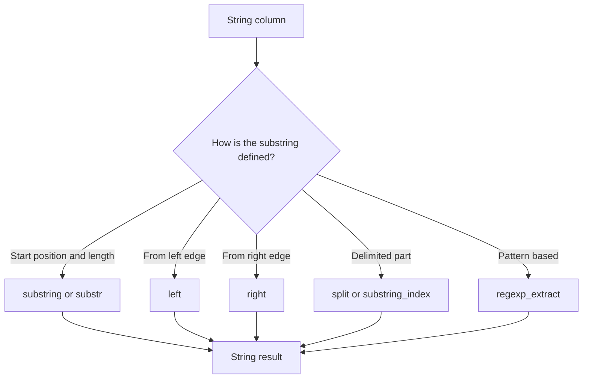

# 2.5.3 How do you extract a substring from a string column?

Use `substring` for position and length. Use `left`, `right`, or `split` when the position is relative to an edge or delimiter. Use `regexp_extract` when the pattern is complex.



### Core functions

| Goal | PySpark | Scala | SQL | Index base |
|---|---|---|---|---|
| Extract by position and length | `substring(col("s"), 2, 3)` | same | `substring(s, 2, 3)` | 1-based |
| Alias for substring | `substr(col("s"), 2, 3)` | same | `substr(s, 2, 3)` | 1-based |
| First n characters | `left(col("s"), n)` | same | `left(s, n)` | From start |
| Last n characters | `right(col("s"), n)` | same | `right(s, n)` | From end |
| Split by delimiter | `split(col("s"), ",")` | same | `split(s, ',')` | Returns array |
| Part before delimiter | `substring_index(col("s"), ",", 1)` | same | `substring_index(s, ',', 1)` | Count from left |
| Regex group | `regexp_extract(col("s"), pat, 1)` | same | `regexp_extract(s, pat, 1)` | Group number |

### `substring` behavior

`substring(str, pos, len)` uses 1-based indexing. The result length is at most `len`.

| Input | Call | Result | Note |
|---|---|---|---|
| `abcdef` | `substring(s, 2, 3)` | `bcd` | Starts at 2, takes 3 |
| `abcdef` | `substring(s, 1, 2)` | `ab` | Starts at 1 |
| `abcdef` | `substring(s, 0, 2)` | `ab` | Position 0 behaves like 1 |
| `abcdef` | `substring(s, -2, 2)` | `ef` | Negative counts from end |
| `abcdef` | `substring(s, 10, 2)` | empty string | Start beyond length |
| `abcdef` | `substring(s, 2, 100)` | `bcdef` | Length beyond remaining |
| `null` | `substring(s, 1, 2)` | `null` | Null propagates |
| `abcdef` | `substring(s, 2, 0)` | empty string | Zero length |
| `abcdef` | `substring(s, 2, -1)` | empty string | Negative length |

### `left`, `right`, and `split`

```python
from pyspark.sql.functions import col, left, right, split, substring_index

df = (
    df
    .withColumn("first3", left(col("s"), 3))
    .withColumn("last3", right(col("s"), 3))
    .withColumn("parts", split(col("s"), ","))
    .withColumn("first_part", split(col("s"), ",")[0])
    .withColumn("before_first_comma", substring_index(col("s"), ",", 1))
    .withColumn("after_last_comma", substring_index(col("s"), ",", -1))
)
```

| Function | Example | Result |
|---|---|---|
| `left("abcdef", 3)` | First 3 | `abc` |
| `right("abcdef", 3)` | Last 3 | `def` |
| `split("a,b,c", ",")` | Array | `["a","b","c"]` |
| `split(...)[0]` | First element | `a` |
| `substring_index("a,b,c", ",", 1)` | Before first delimiter | `a` |
| `substring_index("a,b,c", ",", 2)` | Before second delimiter | `a,b` |
| `substring_index("a,b,c", ",", -1)` | After last delimiter | `c` |

`split` returns an array. Indexing with `[0]` is zero based on the array, not the string. This differs from `substring` 1-based positions.

### Regex extraction

Use `regexp_extract` when the substring depends on a pattern. Group `0` returns the whole match. Groups `1` and higher return capture groups.

```python
from pyspark.sql.functions import col, regexp_extract

df.withColumn("year", regexp_extract(col("s"), r"(\d{4})-\d{2}-\d{2}", 1))
```

| Pattern | Input | Group | Result |
|---|---|---|---|
| `(\d{4})-\d{2}-\d{2}` | `2024-03-15` | 1 | `2024` |
| `\d{4}-(\d{2})` | `2024-03` | 1 | `03` |
| `\d+` | `abc123def` | 0 | `123` |
| `(\d+)-(\d+)` | `10-20` | 2 | `20` |
| No match | `abc` | 1 | empty string |

`regexp_extract` returns an empty string on no match, not null. Check with `length(...) > 0` or use `regexp_extract_all`.

### Null and empty string behavior

| Function | Null input | No match or out of range |
|---|---|---|
| `substring` | `null` | empty string |
| `substr` | `null` | empty string |
| `left` | `null` | empty string if `n` exceeds length |
| `right` | `null` | empty string if `n` exceeds length |
| `split` | `null` | array with empty string |
| `substring_index` | `null` | whole string or empty string depending on delimiter |
| `regexp_extract` | `null` | empty string |

### Performance notes

- `substring`, `left`, `right`, and `substring_index` are native and codegen friendly.
- `split` creates an array. It is native but costs more than a direct substring when only one part is needed.
- `regexp_extract` uses Java regex. It is slower than positional functions and cannot be vectorized as aggressively. Prefer positional functions when possible.
- Avoid UDFs for substring extraction. They break codegen and add serialization cost.
- Project only needed columns before extraction. Extracting from very wide strings increases memory and shuffle bytes.

### Common pitfalls

| Pitfall | Effect | Fix |
|---|---|---|
| Assuming zero-based index in `substring` | Off by one | `substring` is 1-based |
| Using `split(...)[0]` as 1-based | Wrong element | Array index is zero-based |
| Using negative length | Empty string | Ensure `len > 0` |
| Relying on `regexp_extract` no-match as null | Empty string is returned | Check `length(...) > 0` |
| Using regex for fixed positions | Slower | Use `substring` |
| Forgetting null propagation in `substring` | Result is null | Use `coalesce` if needed |
| Splitting large strings repeatedly | Costly | Split once and reuse the array column |

### End to end example

```python
from pyspark.sql import SparkSession
from pyspark.sql.functions import col, substring, left, right, split, substring_index, regexp_extract

spark = SparkSession.builder.getOrCreate()

df = spark.createDataFrame(
    [("2024-03-15",), ("not-a-date",), (None,)],
    ["s"]
)

out = (
    df
    .withColumn("year_pos", substring(col("s"), 1, 4))
    .withColumn("month_pos", substring(col("s"), 6, 2))
    .withColumn("first3", left(col("s"), 3))
    .withColumn("last2", right(col("s"), 2))
    .withColumn("year_re", regexp_extract(col("s"), r"(\d{4})-\d{2}-\d{2}", 1))
)

out.show(truncate=False)
```

| s | year_pos | month_pos | first3 | last2 | year_re |
|---|---|---|---|---|---|
| 2024-03-15 | 2024 | 03 | 202 | 15 | 2024 |
| not-a-date | not- | a- | not | te | empty |
| null | null | null | null | null | null |
