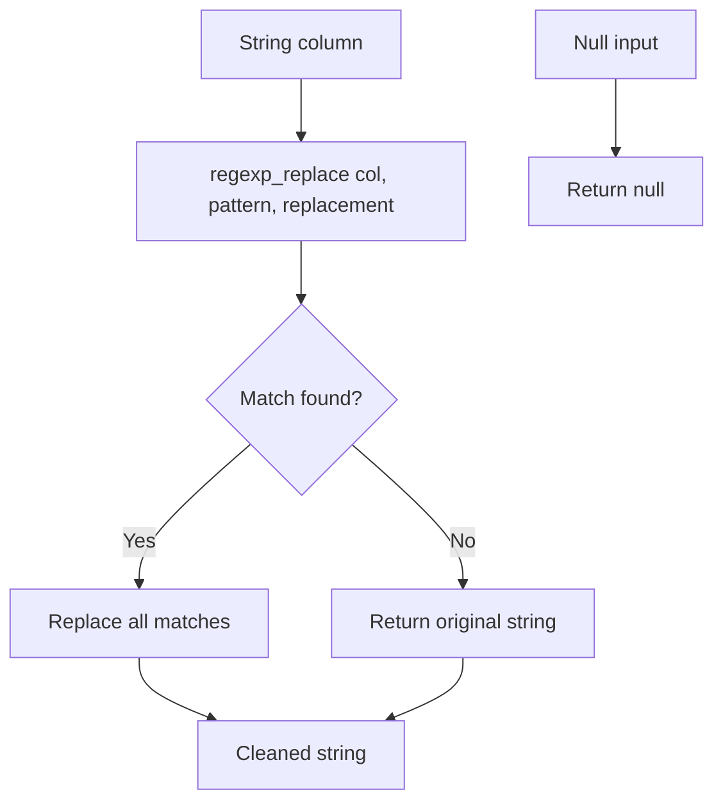

# 2.5.4 How do you use regexp_replace() to clean data?

`regexp_replace` replaces every match of a Java regex pattern with a replacement string. It is the main native tool for pattern based cleaning without a UDF.



### Signature

| API | Form | Parameters |
|---|---|---|
| PySpark | `regexp_replace(col, pattern, replacement)` | `pattern` is a Java regex, `replacement` can reference groups with `$1` |
| Scala | `regexp_replace(col, pattern, replacement)` | Same |
| SQL | `regexp_replace(str, pattern, replacement)` | Same |
| Optional fourth arg | `regexp_replace(col, pattern, replacement, position)` | Spark 3.4+, start position, 1-based |

### Core behavior

| Topic | Behavior |
|---|---|
| Match scope | All matches in the string, not just the first |
| Regex engine | Java `java.util.regex` |
| Group reference | `$1`, `$2` in the replacement string |
| Null input | Returns `null` |
| No match | Returns the original string unchanged |
| Empty pattern | Matches every position. Avoid it |
| Case sensitivity | Case sensitive by default. Use `(?i)` inline flag for case insensitive |
| Return type | String, always. Even if the input was not a string, cast it first |

### Common cleaning patterns

| Goal | Pattern | Replacement | Note |
|---|---|---|---|
| Remove all whitespace | `\s+` | `""` | Removes spaces, tabs, newlines |
| Collapse whitespace to one space | `\s+` | `" "` | Then `trim` the result |
| Remove punctuation | `[^\w\s]` | `""` | Keeps letters, digits, whitespace |
| Keep digits only | `[^0-9]` | `""` | For phone numbers, IDs |
| Keep alphanumeric only | `[^a-zA-Z0-9]` | `""` | Common for keys and codes |
| Remove HTML tags | `<[^>]*>` | `""` | Simple tag stripper |
| Normalize multiple dots | `\.{2,}` | `"."` | Cleanup for version strings or emails |
| Strip currency symbols | `[$€£¥]` | `""` | Remove leading currency markers |
| Remove non-ASCII | `[^\x00-\x7F]` | `""` | Drops accents and emoji |
| Fix repeated separators | `-{2,}` | `"-"` | Slug cleanup |
| Strip leading and trailing spaces | `^\s+\|\s+$` | `""` | Prefer `trim` for this |
| Remove control characters | `[\x00-\x1F\x7F]` | `""` | Removes tabs, nulls, and other controls |
| Normalize line breaks | `\r\n?` | `"\n"` | Standardize CRLF and CR to LF |
| Remove zero width characters | `[\u200B-\u200D\uFEFF]` | `""` | Invisible characters from copy paste |
| Mask digits | `\d` | `"*"` | For logs and PII masking |

### Examples

PySpark:

```python
from pyspark.sql.functions import col, regexp_replace, trim

df = (
    df
    .withColumn("phone_digits", regexp_replace(col("phone"), r"[^0-9]", ""))
    .withColumn("clean_name", trim(regexp_replace(col("name"), r"\s+", " ")))
    .withColumn("no_punct", regexp_replace(col("text"), r"[^\w\s]", ""))
    .withColumn("no_tags", regexp_replace(col("html"), r"<[^>]*>", ""))
    .withColumn("no_ctl", regexp_replace(col("raw"), r"[\x00-\x1F\x7F]", ""))
)
```

Scala:

```scala
import org.apache.spark.sql.functions._

val out = df
  .withColumn("phone_digits", regexp_replace(col("phone"), "[^0-9]", ""))
  .withColumn("clean_name", trim(regexp_replace(col("name"), "\\s+", " ")))
  .withColumn("no_tags", regexp_replace(col("html"), "<[^>]*>", ""))
```

SQL:

```sql
SELECT
  regexp_replace(phone, '[^0-9]', '')      AS phone_digits,
  trim(regexp_replace(name, '\s+', ' '))   AS clean_name,
  regexp_replace(html, '<[^>]*>', '')      AS no_tags
FROM t;
```

### Group references in the replacement

Use `$n` to insert a capture group.

| Goal | Pattern | Replacement |
|---|---|---|
| Reformat date `yyyyMMdd` to `yyyy-MM-dd` | `(\d{4})(\d{2})(\d{2})` | `$1-$2-$3` |
| Swap first and last name | `(\w+),\s*(\w+)` | `$2 $1` |
| Mask middle digits of a card | `(\d{4})\d{8}(\d{4})` | `$1********$2` |
| Add spaces around hyphens | `-` | ` - ` |

```python
df.withColumn("iso_date", regexp_replace(col("d"), r"(\d{4})(\d{2})(\d{2})", "$1-$2-$3"))
```

### Case insensitive matching

Use the inline flag `(?i)` at the start of the pattern. This is portable and does not need a separate function argument.

```python
df.withColumn("clean", regexp_replace(col("s"), r"(?i)error", "ERROR"))
```

### Null and empty string behavior

| Input | Pattern | Replacement | Result |
|---|---|---|---|
| `null` | any | any | `null` |
| `""` | `\s+` | `" "` | `""` |
| `"  a  "` | `\s+` | `" "` | `" a "` |
| `"abc"` | `\d+` | `""` | `"abc"` unchanged |
| `"a1b2"` | `\d` | `""` | `"ab"` |

`regexp_replace` does not trim. Wrap in `trim` when leading or trailing whitespace must go.

### Combine with other functions

| Goal | Combination |
|---|---|
| Clean then trim | `trim(regexp_replace(col, r"\s+", " "))` |
| Clean then lowercase | `lower(regexp_replace(col, r"[^a-zA-Z0-9]", ""))` |
| Clean then length check | `length(regexp_replace(col, r"[^0-9]", ""))` |
| Clean then cast to number | `regexp_replace(...).cast("int")` |
| Clean then validate with regex | `regexp_replace(...).rlike("^[0-9]{10}$")` |

### Performance notes

- `regexp_replace` is native and codegen friendly. It is much faster than a Python UDF.
- Java regex cost scales with string length and pattern complexity. Simple character classes are cheap. Nested quantifiers and lookarounds are expensive.
- Anchored patterns such as `^...$` can reject strings early and reduce cost.
- Avoid catastrophic backtracking patterns such as `(a+)+b` on long strings. They can hang the task.
- Reuse the result. Do not apply the same `regexp_replace` multiple times in a chain. Assign once and reference the column.
- If the pattern is static and used only for trimming, use `trim`, `ltrim`, or `rtrim` instead. They are cheaper than regex.
- For simple literal replacement, use `replace(col, "a", "b")`. It avoids the regex engine.

### Common pitfalls

| Pitfall | Effect | Fix |
|---|---|---|
| Forgetting to escape backslash in Python | Pattern becomes wrong | Use raw strings: `r"\d+"` |
| Using `\d` in SQL string | SQL may need double escaping depending on context | Use `[0-9]` or test with `rlike` |
| Assuming it trims | Leading and trailing spaces remain | Wrap with `trim` |
| Relying on no-match to be null | Original string is returned | Check with `rlike` if null is needed |
| Using `$0` in replacement | Returns the whole match, not empty | Use an empty string for deletion |
| Pattern with unescaped dot | `.` matches any char | Escape as `\.` |
| Catastrophic backtracking | Task hangs | Simplify the pattern, avoid nested quantifiers |
| Applying regex when `replace` works | Slower | Use `replace` for literal strings |
| Case sensitive by default | Mixed case input is missed | Add `(?i)` |
| Very long strings | Regex cost grows | Truncate first or split into columns |

### End to end example

```python
from pyspark.sql import SparkSession
from pyspark.sql.functions import col, regexp_replace, trim, lower

spark = SparkSession.builder.getOrCreate()

df = spark.createDataFrame(
    [("  Alice  Smith  ",), ("(555) 123-4567",), ("<b>Bold</b>",), (None,)],
    ["s"]
)

out = (
    df
    .withColumn("clean_ws", trim(regexp_replace(col("s"), r"\s+", " ")))
    .withColumn("digits",   regexp_replace(col("s"), r"[^0-9]", ""))
    .withColumn("no_tags",  regexp_replace(col("s"), r"<[^>]*>", ""))
    .withColumn("slug",     lower(regexp_replace(col("s"), r"[^a-zA-Z0-9]+", "-")))
)

out.show(truncate=False)
```

| s | clean_ws | digits | no_tags | slug |
|---|---|---|---|---|
| `  Alice  Smith  ` | `Alice Smith` | empty | `  Alice  Smith  ` | `-alice-smith-` |
| `(555) 123-4567` | `(555) 123-4567` | `5551234567` | `(555) 123-4567` | `-555-123-4567` |
| `<b>Bold</b>` | `<b>Bold</b>` | empty | `Bold` | `-b-bold-b-` |
| null | null | null | null | null |

The slug example shows that a leading and trailing separator can appear. Wrap in `trim` with the separator pattern or strip leading and trailing hyphens with a second `regexp_replace(col, r"^-+\|-+$", "")`.
