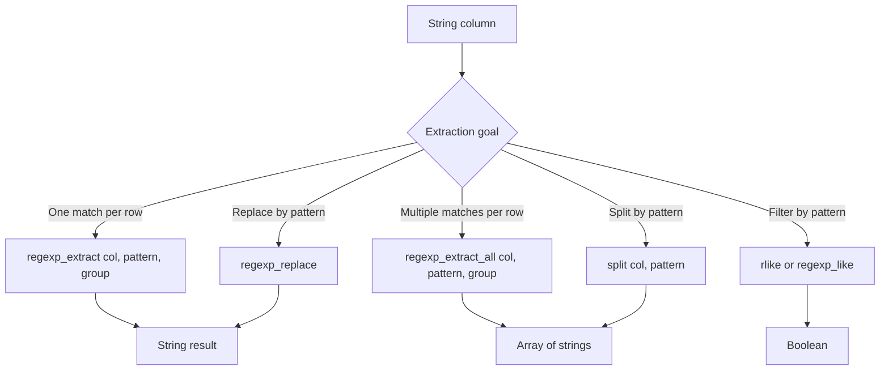

# 2.5.5 How do you extract data using a Regex pattern?

Use `regexp_extract` for one capture group per row, `regexp_extract_all` when a row contains multiple matches, and `rlike` for matching without extraction. All are native Java regex.



### Core functions

| Goal | PySpark | SQL | Return type |
|---|---|---|---|
| Extract first match of group `n` | `regexp_extract(col("s"), pat, n)` | `regexp_extract(s, pat, n)` | String |
| Extract all matches of group `n` | `regexp_extract_all(col("s"), pat, n)` | `regexp_extract_all(s, pat, n)` | Array of strings |
| Test if pattern matches | `col("s").rlike(pat)` | `s rlike pat` or `regexp_like(s, pat)` | Boolean |
| Split by pattern | `split(col("s"), pat)` | `split(s, pat)` | Array of strings |

### `regexp_extract` basics

`regexp_extract(str, pattern, group)` returns the capture group `group` from the first match.

| Group index | Meaning |
|---|---|
| `0` | Whole match |
| `1` | First capture group |
| `2` | Second capture group |
| `n` | Higher groups |
| No capture group and `group > 0` | Empty string, or exception in some versions |

```python
from pyspark.sql.functions import col, regexp_extract

df = (
    df
    .withColumn("year",  regexp_extract(col("s"), r"(\d{4})-\d{2}-\d{2}", 1))
    .withColumn("month", regexp_extract(col("s"), r"\d{4}-(\d{2})-\d{2}", 1))
    .withColumn("whole", regexp_extract(col("s"), r"\d{4}-\d{2}-\d{2}", 0))
)
```

```sql
SELECT
  regexp_extract(s, '(\\d{4})-\\d{2}-\\d{2}', 1) AS year,
  regexp_extract(s, '\\d{4}-(\\d{2})-\\d{2}', 1) AS month
FROM t;
```

### `regexp_extract_all`

Returns an array of every match. Use `explode` or index access to unwrap.

```python
from pyspark.sql.functions import col, regexp_extract_all, explode

df = (
    df
    .withColumn("ids",  regexp_extract_all(col("s"), r"id=(\d+)", 1))
    .withColumn("all_numbers", regexp_extract_all(col("s"), r"\d+", 0))
)

df.select(explode(col("ids")).alias("id")).show()
```

| Input | Pattern | Group | Result array |
|---|---|---|---|
| `id=1 id=2 id=3` | `id=(\d+)` | 1 | `["1","2","3"]` |
| `a1b22c333` | `\d+` | 0 | `["1","22","333"]` |
| `no digits` | `\d+` | 0 | `[]` |
| `null` | any | any | `null` |

### Named groups

Java regex supports named groups with `(?<name>...)`. Spark does not expose the name directly in `regexp_extract`, but you can still use named groups and reference them by index.

```python
# Named groups still map to positional indices
df.withColumn("year", regexp_extract(col("s"), r"(?<year>\d{4})-(?<month>\d{2})", 1))
```

Use named groups in the pattern for readability when the pattern is complex. The group index in the function call is still positional.

### Match behavior table

| Case | `regexp_extract` result |
|---|---|
| Match with group | Captured group as string |
| Match without matching group | Empty string for `group > 0` |
| No match | Empty string |
| Null input | `null` |
| Greedy `.*` | Longest match |
| Lazy `.*?` | Shortest match |
| Multiline input | `.` does not match newline by default. Use `(?s)` for dotall |
| Anchors `^` `$` | Match start and end of whole string by default. Use `(?m)` for per line |

`regexp_extract` returns an empty string on no match, not `null`. This is the biggest source of silent data issues. Filter or convert to null explicitly.

```python
from pyspark.sql.functions import col, regexp_extract, when, length, lit

df = df.withColumn(
    "year",
    when(length(regexp_extract(col("s"), r"(\d{4})", 1)) > 0,
         regexp_extract(col("s"), r"(\d{4})", 1))
    .otherwise(lit(None))
)
```

### `rlike` and `regexp_like`

Use `rlike` for filtering. Use `regexp_like` in SQL when you prefer that name. Both return boolean.

```python
from pyspark.sql.functions import col

df.filter(col("s").rlike(r"^\d{4}-\d{2}-\d{2}$"))
```

```sql
SELECT * FROM t WHERE s RLIKE '^\\d{4}-\\d{2}-\\d{2}$';
SELECT * FROM t WHERE regexp_like(s, '^\\d{4}-\\d{2}-\\d{2}$');
```

| Function | Argument order | Notes |
|---|---|---|
| `rlike` | `str rlike pattern` or `col.rlike(pat)` | Pattern is second |
| `regexp_like` | `regexp_like(str, pattern)` | SQL style, pattern is second |
| `like` | Not regex | Use `%` and `_` wildcards |

Do not confuse `like` and `rlike`. `like` uses SQL wildcards. `rlike` uses Java regex.

### Split by regex

`split` accepts a regex. This is useful when fields are separated by variable whitespace or by a class of characters.

```python
from pyspark.sql.functions import col, split

df.withColumn("parts", split(col("s"), r"\s*[,;]\s*"))
```

| Input | Pattern | Result |
|---|---|---|
| `a, b ; c` | `\s*[,;]\s*` | `["a","b","c"]` |
| `a   b   c` | `\s+` | `["a","b","c"]` |
| `key=value` | `=` | `["key","value"]` |

### Pattern building blocks

| Goal | Pattern |
|---|---|
| Digits | `\d+` or `[0-9]+` |
| Word characters | `\w+` or `[a-zA-Z0-9_]+` |
| Email | `[\w.+-]+@[\w-]+\.[\w.-]+` |
| IPv4 | `\b(?:\d{1,3}\.){3}\d{1,3}\b` |
| Date `yyyy-MM-dd` | `\d{4}-\d{2}-\d{2}` |
| Key value | `(\w+)=([^&\s]+)` |
| URL host | `https?://([^/]+)` |
| Hex color | `#([0-9a-fA-F]{6})` |
| US phone | `\(?(\d{3})\)?[- ]?(\d{3})[- ]?(\d{4})` |

### Case insensitive and inline flags

| Flag | Effect |
|---|---|
| `(?i)` | Case insensitive |
| `(?s)` | Dotall. `.` matches newline |
| `(?m)` | Multiline. `^` and `$` match line boundaries |
| `(?U)` | Unicode character classes |

```python
df.withColumn("err", regexp_extract(col("s"), r"(?i)error:\s*(\w+)", 1))
```

### Null and empty string behavior

| Function | Null input | No match |
|---|---|---|
| `regexp_extract` | `null` | empty string |
| `regexp_extract_all` | `null` | empty array |
| `rlike` | `null` | `false` |
| `split` | `null` | single element array |
| `regexp_replace` | `null` | unchanged |

Because no match returns an empty string for `regexp_extract`, use `rlike` when you only need a match test, and convert empty to null when downstream logic requires it.

### Performance notes

- Regex is compiled per expression. Pattern complexity dominates cost. Character classes and simple quantifiers are cheap. Lookarounds, backreferences, and nested quantifiers are expensive.
- Avoid catastrophic backtracking patterns such as `(a+)+b`. They can hang a task on long input.
- Anchor the pattern when you can. `^...$` lets the engine reject non-matching strings early.
- Prefer `regexp_extract` over `regexp_extract_all` when only the first match matters. The all variant scans the whole string.
- Avoid UDFs for regex. Native functions use codegen.
- Reuse the extracted column. Do not run the same regex multiple times on the same input.
- Apply regex after filtering. Filter on cheaper predicates first to reduce rows reaching the regex.

### Common pitfalls

| Pitfall | Effect | Fix |
|---|---|---|
| Forgetting Python raw strings | `\d` becomes `d` or a bad escape | Use `r"\d+"` |
| Assuming no match returns null | Empty string is returned | Check `rlike` or `length > 0` |
| Group index beyond pattern | Empty string or exception | Match the number of capture groups |
| Unescaped dot | `.` matches any char | Use `\.` for literal dot |
| SQL double escaping | Pattern breaks in SQL | Use `\\d` in SQL strings or `[0-9]` |
| Greedy `.*` grabs too much | Wrong substring | Use `.*?` or narrower classes |
| Case sensitive by default | Mixed case missed | Add `(?i)` |
| Pattern with `^` and `$` on multiline | Only whole string matches | Use `(?m)` |
| Extracting from a huge string | Slow and memory heavy | Truncate or filter first |
| Catastrophic backtracking | Task hangs | Simplify the pattern |

### End to end example

```python
from pyspark.sql import SparkSession
from pyspark.sql.functions import col, regexp_extract, regexp_extract_all, length, when, lit, explode

spark = SparkSession.builder.getOrCreate()

df = spark.createDataFrame(
    [
        ("order 123 amount=45.50",),
        ("order 456 amount=99",),
        ("no data",),
        (None,)
    ],
    ["s"]
)

out = (
    df
    .withColumn("order_id", regexp_extract(col("s"), r"order\s+(\d+)", 1))
    .withColumn("amount",   regexp_extract(col("s"), r"amount=(\d+(?:\.\d+)?)", 1))
    .withColumn("nums",     regexp_extract_all(col("s"), r"\d+", 0))
    .withColumn("order_id_n", when(length(col("order_id")) > 0, col("order_id")).otherwise(lit(None)))
)

out.show(truncate=False)
out.select(explode(col("nums")).alias("n")).show()
```

| s | order_id | amount | nums | order_id_n |
|---|---|---|---|---|
| `order 123 amount=45.50` | `123` | `45.50` | `["123","45","50"]` | `123` |
| `order 456 amount=99` | `456` | `99` | `["456","99"]` | `456` |
| `no data` | empty | empty | `[]` | null |
| null | null | null | null | null |

The `nums` column shows the array form. The `order_id_n` column shows the empty to null conversion so downstream logic can rely on nullability.
