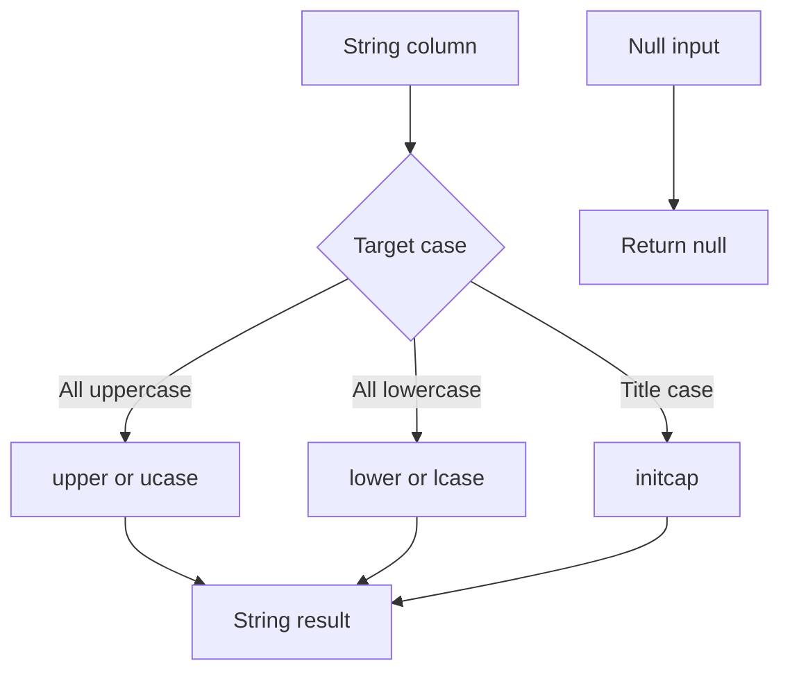

# 2.5.7 How do you change the case of a string (upper, lower, initcap)?

## 2.5.7 How do you change the case of a string (upper, lower, initcap)?

Use `upper` and `lower` for full case conversion. Use `initcap` for title case. All are native, codegen friendly, and locale aware through the JVM.



### Core functions

| Goal | PySpark | Scala | SQL | Return type |
|---|---|---|---|---|
| Uppercase | `upper(col("s"))` | `upper(col("s"))` | `upper(s)` | String |
| Uppercase alias | `ucase(col("s"))` | `ucase(col("s"))` | `ucase(s)` | String |
| Lowercase | `lower(col("s"))` | `lower(col("s"))` | `lower(s)` | String |
| Lowercase alias | `lcase(col("s"))` | `lcase(col("s"))` | `lcase(s)` | String |
| Title case | `initcap(col("s"))` | `initcap(col("s"))` | `initcap(s)` | String |

`upper` and `ucase` are identical. `lower` and `lcase` are identical. Prefer `upper` and `lower` for readability.

### Basic examples

PySpark:

```python
from pyspark.sql.functions import col, upper, lower, initcap

df = (
    df
    .withColumn("u", upper(col("name")))
    .withColumn("l", lower(col("name")))
    .withColumn("t", initcap(col("name")))
)
```

Scala:

```scala
import org.apache.spark.sql.functions._

val out = df
  .withColumn("u", upper(col("name")))
  .withColumn("l", lower(col("name")))
  .withColumn("t", initcap(col("name")))
```

SQL:

```sql
SELECT
  upper(name)   AS u,
  lower(name)   AS l,
  initcap(name) AS t
FROM users;
```

### Behavior table

| Input | `upper` | `lower` | `initcap` |
|---|---|---|---|
| `hello world` | `HELLO WORLD` | `hello world` | `Hello World` |
| `HELLO WORLD` | `HELLO WORLD` | `hello world` | `Hello World` |
| `hELLo wORld` | `HELLO WORLD` | `hello world` | `Hello World` |
| `hello-world` | `HELLO-WORLD` | `hello-world` | `Hello-World` |
| `hello_world` | `HELLO_WORLD` | `hello_world` | `Hello_World` |
| `hello.world` | `HELLO.WORLD` | `hello.world` | `Hello.World` |
| `o'neil` | `O'NEIL` | `o'neil` | `O'Neil` |
| `123abc` | `123ABC` | `123abc` | `123Abc` |
| `abc123def` | `ABC123DEF` | `abc123def` | `Abc123Def` |
| `""` | `""` | `""` | `""` |
| `null` | `null` | `null` | `null` |

### `initcap` word boundary rules

`initcap` uppercases the first letter of each word and lowercases the rest. Word boundaries are any non-alphanumeric character.

| Input | `initcap` | Note |
|---|---|---|
| `hello world` | `Hello World` | Space is a boundary |
| `hello-world` | `Hello-World` | Hyphen is a boundary |
| `hello_world` | `Hello_World` | Underscore is a boundary |
| `hello.world` | `Hello.World` | Dot is a boundary |
| `hello world's` | `Hello World'S` | Apostrophe is a boundary, so `S` is uppercased |
| `mcdonald` | `Mcdonald` | No boundary, only first letter uppercased |
| `123abc` | `123Abc` | Digit is alphanumeric, so letter after digit is uppercased |

The apostrophe behavior is a common surprise. Use `initcap` on data without apostrophes, or post process the result.

### Locale and Unicode behavior

| Topic | Behavior |
|---|---|
| Locale | Uses the JVM default locale for case mapping |
| Turkish `i` problem | `I` and `i` map differently under Turkish locale. `upper("i")` can return `İ` |
| Unicode characters | `upper` and `lower` handle most Unicode, including accented letters |
| German `ß` | `upper("ß")` returns `SS` |
| Combining characters | Case mapping is per code point. Combining marks are not combined |

The locale can change results. On a mixed cluster the JVM default locale might differ. Set it explicitly when case mapping must be reproducible.

```python
# Not settable per session in Spark. Set at the JVM level on the cluster
# -Duser.language=en -Duser.country=US
```

For locale sensitive case conversion, use a UDF with `Locale` set explicitly. This is the only case where a UDF is justified for case conversion.

### Non-string inputs

`upper`, `lower`, and `initcap` require strings. Cast first.

```python
from pyspark.sql.functions import col, upper

df.withColumn("u", upper(col("id").cast("string")))
```

| Input type | Action |
|---|---|
| Integer or long | `cast("string")` |
| Date | `cast("string")` or `date_format` first |
| Timestamp | `cast("string")` or `date_format` first |
| Binary | Not safe. Decode first |

### Null and empty string behavior

| Function | Null input | Empty string |
|---|---|---|
| `upper` | `null` | `""` |
| `lower` | `null` | `""` |
| `initcap` | `null` | `""` |

Null propagates. Wrap in `coalesce` if null must become empty string.

```python
from pyspark.sql.functions import col, upper, coalesce, lit

df.withColumn("u", coalesce(upper(col("s")), lit("")))
```

### Common use cases

| Use case | Approach |
|---|---|
| Normalize keys before join | `lower(col("key"))` on both sides |
| Normalize email addresses | `lower(trim(col("email")))` |
| Display labels | `initcap(col("status"))` |
| Country codes | `upper(col("country_code"))` |
| Case insensitive filter | `lower(col("name")) == lit("alice")` |
| Deduplication | `lower(col("s"))` as a grouping key |
| Slug generation | `lower(regexp_replace(col("title"), r"[^a-zA-Z0-9]+", "-"))` |

### Case insensitive comparison without conversion

For filtering, prefer a case insensitive comparison over converting a column. Converting the column disables pushdown and can prevent partition pruning.

```python
from pyspark.sql.functions import col

df.filter(lower(col("name")) == "alice")        # converts every row
df.filter(col("name").ilike("alice"))           # Spark 3.3+, case insensitive
df.filter(col("name") == "alice")               # only if data is normalized
```

| Approach | Cost | Use when |
|---|---|---|
| `lower(col) == lit(...)` | Converts every row | Data is not normalized and you cannot change it |
| `col.ilike("...")` | Native, but no index pushdown | Small or medium tables |
| Normalize on write | Convert once | You control the data pipeline |
| Store a separate lower column | Extra storage | Frequent case insensitive lookups |

`ilike` was added in Spark 3.3. Check the version before using it.

### Performance notes

- `upper`, `lower`, and `initcap` are native and codegen friendly. They do not need a shuffle.
- `initcap` does more work than `upper` and `lower`. It scans word boundaries.
- Avoid Python or Scala UDFs for case conversion. They break codegen and add serialization cost. The only exception is locale sensitive conversion.
- Converting a column in a join key disables broadcast and hash join optimizations on that column. Normalize both sides at write time instead.
- Converting a column in a filter disables pushdown to the file format. Normalize at write time when possible.
- Chain conversions only when needed. `lower(upper(s))` is redundant and doubles the work.
- `trim` and case conversion are commonly combined. Order does not matter for correctness. Do `trim` first to avoid converting padding.

### Common pitfalls

| Pitfall | Effect | Fix |
|---|---|---|
| Using a UDF | Slower, breaks codegen | Use native functions |
| Assuming `initcap` handles apostrophes as expected | `World'S` instead of `World's` | Post process or avoid apostrophes |
| Ignoring locale | Turkish `i` maps incorrectly | Set JVM locale or use explicit `Locale` in a UDF |
| Converting before filtering | Breaks pushdown | Filter on raw column, or normalize at write |
| Converting join keys per query | Breaks join optimization | Normalize at write time |
| Applying `upper` to a non-string | Error or implicit cast surprise | Cast explicitly |
| Forgetting null propagation | `null` result | Use `coalesce` if needed |
| Chaining `upper(lower(s))` | Redundant work | Use one conversion |
| Using `initcap` on IDs or codes | Changes structure of keys | Only use on display fields |

### End to end example

```python
from pyspark.sql import SparkSession
from pyspark.sql.functions import col, upper, lower, initcap

spark = SparkSession.builder.getOrCreate()

df = spark.createDataFrame(
    [("hello world",), ("HELLO WORLD",), ("o'neil",), ("hello-world",), ("",), (None,)],
    ["s"]
)

out = (
    df
    .withColumn("u", upper(col("s")))
    .withColumn("l", lower(col("s")))
    .withColumn("t", initcap(col("s")))
)

out.show(truncate=False)
```

| s | u | l | t |
|---|---|---|---|
| `hello world` | `HELLO WORLD` | `hello world` | `Hello World` |
| `HELLO WORLD` | `HELLO WORLD` | `hello world` | `Hello World` |
| `o'neil` | `O'NEIL` | `o'neil` | `O'Neil` |
| `hello-world` | `HELLO-WORLD` | `hello-world` | `Hello-World` |
| `""` | `""` | `""` | `""` |
| null | null | null | null |
