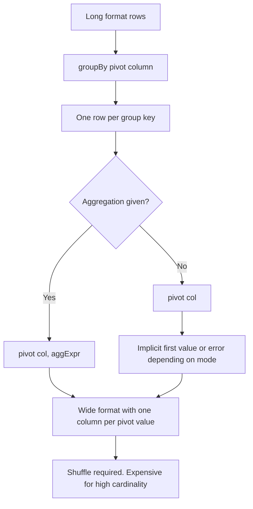

# 2.6.1 What does the pivot() function do?

## 2.6.1 What does the `pivot()` function do?

`pivot()` rotates unique values from one column into new columns. It converts rows into columns. It is always paired with an aggregation, and it requires a shuffle because the new column set is data dependent.



### Mechanics

| Step | What happens |
|---|---|
| 1 | Spark collects distinct values of the pivot column, either from data or from an explicit list |
| 2 | For each distinct value, it creates a new output column |
| 3 | It groups by the remaining columns |
| 4 | It applies the aggregation to each pivot value |
| 5 | Result has one row per group key and one column per pivot value |

### Signature

| API | Form |
|---|---|
| PySpark | `df.groupBy(keys).pivot(pivotCol, values=None).agg(aggExpr)` |
| Scala | `df.groupBy(keys).pivot(pivotCol, values).agg(aggExpr)` |
| SQL | No direct `pivot` keyword. Use conditional aggregation with `sum(case when ...)` or `first(case when ...)` |

Passing `values` is strongly recommended. Without it, Spark scans the pivot column to find distinct values, which is an extra job and makes the schema data dependent.

### Simple example

```python
from pyspark.sql.functions import sum

df.groupBy("region").pivot("quarter").agg(sum("sales")).show()
```

| region | Q1 | Q2 | Q3 | Q4 |
|---|---|---|---|---|
| East | 100 | 120 | 90 | 140 |
| West | 80 | 95 | 110 | 75 |

### With explicit values

```python
df.groupBy("region").pivot("quarter", ["Q1", "Q2", "Q3", "Q4"]).agg(sum("sales"))
```

| Benefit | Why it matters |
|---|---|
| One less job | No scan for distinct values |
| Stable schema | Output columns are known at plan time |
| Faster planning | No dynamic schema resolution |
| Predictable downstream code | Downstream can reference columns by name |

### Pivot without aggregation

| Spark version | Behavior |
|---|---|
| Older | `pivot` without `agg` is allowed and uses `first` |
| Spark 3.4+ | `pivot` without `agg` may error or warn. Always pass an aggregation |
| SQL | Must use explicit conditional aggregation |

Always pass an aggregation. Do not rely on the default.

### Multiple aggregations

Use `agg` with a map or a list of named expressions.

```python
from pyspark.sql.functions import sum, avg, col

df.groupBy("region").pivot("quarter", ["Q1", "Q2"]).agg(
    sum("sales").alias("sum_sales"),
    avg("sales").alias("avg_sales")
)
```

Output columns become `Q1_sum_sales`, `Q1_avg_sales`, `Q2_sum_sales`, `Q2_avg_sales`. Column naming follows the pivot value plus the aggregation alias.

### Column naming

| Pivot value | Aggregation | Output column name |
|---|---|---|
| `Q1` | `sum` | `Q1` |
| `Q1` | `sum(sales)` with alias `s` | `Q1_s` |
| `2024-01-01` | `sum` | `2024-01-01`, quoted in SQL |
| `null` | `sum` | `null` pivot values are not included as a column by default |

Special characters and spaces in pivot values require quoted identifiers in SQL. Prefer clean pivot values.

### Null handling

| Case | Behavior |
|---|---|
| Null pivot value | Not included as a column |
| Null group key | Included as a group row |
| No rows for a pivot value | Column exists with `null` when `values` is passed |
| No rows for a pivot value, dynamic mode | Column does not exist |

Passing `values` guarantees the column exists even if all values are null. That is often more useful than a missing column.

### Why pivot is expensive

| Cost | Cause |
|---|---|
| Shuffle | Grouping by keys and pivot values requires redistributing rows |
| Distinct scan | Extra job when `values` is omitted |
| Schema size | One output column per pivot value |
| High cardinality pivot | Thousands of columns, huge schema, slow optimizer |
| Skew | Uneven group keys or pivot values cause hot partitions |

Pivot is a wide transformation. Treat it as a shuffle boundary.

### High cardinality pivot

| Pivot cardinality | Practical advice |
|---|---|
| Under 100 | Fine. Pass explicit `values` |
| 100 to 1000 | Possible but plan size and column count grow |
| Over 1000 | Avoid pivot. Use conditional aggregation on a filtered subset, or restructure the query |
| Over 10000 | Pivot is not the right tool |

For high cardinality, filter to the values you actually need before pivot, or aggregate upstream so fewer rows reach the pivot.

### SQL equivalent

SQL has no `pivot` keyword. Use conditional aggregation.

```sql
SELECT
  region,
  sum(CASE WHEN quarter = 'Q1' THEN sales END) AS Q1,
  sum(CASE WHEN quarter = 'Q2' THEN sales END) AS Q2
FROM sales
GROUP BY region;
```

This is explicit, predictable, and does not require a distinct scan. For a fixed set of pivot values it is often faster and easier to reason about.

### Unpivot

Spark has no native `unpivot`. Use `stack` in SQL or `array` plus `explode` in the DataFrame API.

```sql
SELECT region, quarter, sales
FROM t
LATERAL VIEW stack(4, 'Q1', Q1, 'Q2', Q2, 'Q3', Q3, 'Q4', Q4) s AS quarter, sales;
```

### Common pitfalls

| Pitfall | Effect | Fix |
|---|---|---|
| Omitting `values` | Extra job, dynamic schema | Pass explicit `values` |
| Pivoting a high cardinality column | Thousands of columns, slow plan | Filter values first or use conditional aggregation |
| Forgetting `agg` | Error or implicit `first` | Always pass an aggregation |
| Assuming column order | Column order is not guaranteed | Reference by name |
| Pivot values with spaces or special chars | SQL identifier issues | Use clean values or quote identifiers |
| Null pivot values | Silently dropped | Handle nulls before pivot |
| Skewed group keys | Long tail task | Pre aggregate or repartition |
| Pivoting in a loop | Repeated shuffles | Combine into one pivot or conditional aggregation |
| Expecting `null` column when value is missing | Column absent in dynamic mode | Pass explicit `values` |

### Performance notes

- Pivot is a shuffle. It groups by the non-pivot columns and distributes rows by pivot value. Cost scales with row count and pivot cardinality.
- Always pass explicit `values`. It removes the distinct scan and stabilizes the plan.
- Filter rows before pivot. Only the pivot values you need should reach the shuffle.
- Pre aggregate upstream when possible. `sum` on already grouped data is cheaper than on raw rows.
- Avoid pivoting wide DataFrames. Select only the needed columns before pivot.
- Avoid pivoting on string columns with many distinct values. Cast or bucket to reduce cardinality.
- If the pivot values are fixed, conditional aggregation is often faster because it does not need the distinct scan and can be planned statically.
- Handle skew before pivot. Repartition by group key if some groups are much larger than others.

### End to end example

```python
from pyspark.sql import SparkSession
from pyspark.sql.functions import sum

spark = SparkSession.builder.getOrCreate()

df = spark.createDataFrame(
    [
        ("East", "Q1", 100), ("East", "Q2", 120), ("East", "Q3", 90),
        ("West", "Q1", 80),  ("West", "Q2", 95),  ("West", "Q3", 110),
        ("East", "Q4", 140), ("West", "Q4", 75),
    ],
    ["region", "quarter", "sales"]
)

out = (
    df
    .groupBy("region")
    .pivot("quarter", ["Q1", "Q2", "Q3", "Q4"])
    .agg(sum("sales"))
)

out.show()
```

| region | Q1 | Q2 | Q3 | Q4 |
|---|---|---|---|---|
| East | 100 | 120 | 90 | 140 |
| West | 80 | 95 | 110 | 75 |

### When to use pivot and when not to

| Situation | Use pivot | Use conditional aggregation |
|---|---|---|
| Small fixed set of pivot values | Yes, clean and short | Also fine |
| Values known only at runtime | Yes, with dynamic mode | Hard to write without codegen |
| High cardinality | No | No, aggregate differently |
| Column names must be stable | Yes, pass explicit `values` | Yes, guaranteed |
| SQL only | No native pivot | Yes |
| Performance critical with fixed values | Comparable | Often faster, no distinct scan |

Pivot is the right tool for a small, known set of values and a clear long to wide reshape. It is the wrong tool for high cardinality or repeated pivots in a loop.
