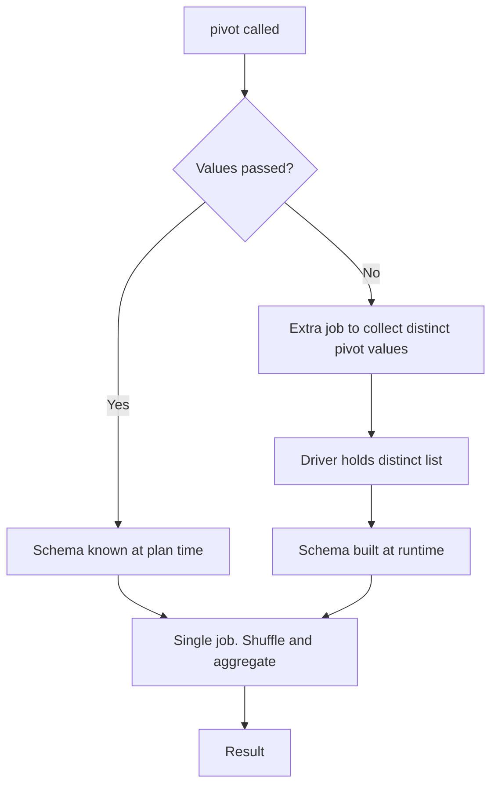

# 2.6.2 Why is passing a list of distinct values to pivot() crucial for performance?

## 2.6.2 Why is passing a list of distinct values to `pivot()` crucial for performance?

Without an explicit value list, Spark must scan the pivot column to discover the distinct values before it can build the output schema. That scan is an extra job, and the schema becomes data dependent.



### Cost comparison

| Aspect | Explicit `values` | No `values` |
|---|---|---|
| Jobs triggered | 1 | 2 |
| Distinct scan | None | Full scan of pivot column |
| Schema timing | Plan time | Runtime after scan |
| Catalyst optimization | Full | Limited until values are known |
| Failure recovery | Deterministic | Restart re scans |
| Empty result set | Columns still exist | Columns missing |
| Null handling | Predictable | Null values silently dropped |
| Downstream stability | Stable column names | Schema may change between runs |

### The distinct scan job

Without `values`, Spark runs a separate job that does roughly:

```sql
SELECT DISTINCT pivot_col FROM input
```

| Property | Effect |
|---|---|
| Full scan | Reads every row of the input to find distinct values |
| Shuffle | Distinct requires redistribution unless the column is already partitioned |
| Driver collection | Distinct values are collected into driver memory |
| Blocking | The main pivot job waits for this to finish |
| Cost scaling | Cost grows with input size and pivot cardinality |

The scan is pure overhead. It produces no output rows that reach the user. It exists only to build the schema.

### Driver memory risk

| Scenario | Risk |
|---|---|
| High cardinality pivot column | Distinct list can be large and collected on the driver |
| Wide strings as pivot values | Each value is a full string in driver memory |
| Combined with other driver state | Driver heap pressure and OOM risk |
| Millions of distinct values | Driver OOM or extremely slow schema build |

Passing explicit `values` removes the collection entirely. The list is a literal in the plan.

### Catalyst and optimizer impact

| Stage | Explicit `values` | No `values` |
|---|---|---|
| Parsing | Plan is complete | Plan has a placeholder |
| Analysis | Schema resolved | Schema deferred |
| Optimization | Full rule set applies | Some rules wait for values |
| Physical planning | Known output width | Output width unknown |
| Execution | Straight to shuffle | Extra job, then replan |

A known schema lets the optimizer push filters, prune columns, and estimate output size. A runtime schema blocks most of that.

### Schema stability

| Run | Data | Explicit `values` | No `values` |
|---|---|---|---|
| 1 | Q1, Q2 | Q1, Q2 columns | Q1, Q2 columns |
| 2 | Q1, Q2, Q3 | Q1, Q2, Q3 columns | Q1, Q2, Q3 columns |
| 3 | Q1 only | Q1, Q2, Q3 columns, Q2 and Q3 null | Q1 column only |

Without `values`, the output schema depends on the data. Downstream code that references `Q3` breaks on run 3. Passing `values` guarantees the column exists with `null`.

### Empty and null behavior

| Case | Explicit `values` | No `values` |
|---|---|---|
| Input has no rows | Columns exist with null | Zero columns beyond group keys |
| Some values absent | Columns exist with null | Columns missing |
| Null pivot values | Not a column | Not a column |
| All rows filtered out | Columns exist | No columns |

Stable output width matters for writes, downstream joins, and schema evolution in Delta or Parquet.

### Failure and retry behavior

| Event | Explicit `values` | No `values` |
|---|---|---|
| Task failure during scan | Scan re runs | N/A |
| Executor loss during scan | Extra job restarts | N/A |
| Driver restart | Plan already complete | Distinct scan re runs |
| Speculative execution | Only main job | Scan and main job both affected |

More jobs means more failure surfaces and more retry time.

### When explicit `values` is not possible

Some pipelines genuinely have runtime dependent pivot values.

| Strategy | Approach |
|---|---|
| Two phase pipeline | Run a distinct query first, cache the list, pass it in the next job |
| Cap cardinality | Filter or bucket pivot values before pivot |
| Conditional aggregation | Generate CASE WHEN expressions from a known list |
| Restructure | Use a long format table with downstream aggregation instead of pivot |

Even in dynamic cases, computing the distinct list once and reusing it beats letting pivot do it every run.

### Practical rule

| Pivot cardinality | Recommendation |
|---|---|
| Under 100 | Always pass explicit `values` |
| 100 to 1000 | Pass explicit `values`. Watch output column count |
| Over 1000 | Do not pivot. Use conditional aggregation or restructure |
| Unknown at write time | Compute distinct once, store, pass on next run |

### Performance notes

- The extra distinct job can double wall clock time on small inputs and add a full scan on large inputs.
- The distinct scan is not free even when the pivot column is partitioned. Distinct still needs a shuffle unless the column is the partition key.
- Column pruning cannot help the scan. It must read the pivot column on every row.
- Passing `values` also lets the optimizer estimate the output schema size, which improves shuffle partition sizing and memory estimates.
- Explicit `values` makes the job idempotent. The same input always produces the same schema.

### End to end example

```python
from pyspark.sql.functions import sum

quarters = ["Q1", "Q2", "Q3", "Q4"]

# Good: one job, stable schema
out = (
    df.groupBy("region")
      .pivot("quarter", quarters)
      .agg(sum("sales"))
)
```

```python
# Avoid: two jobs, runtime schema
out = (
    df.groupBy("region")
      .pivot("quarter")
      .agg(sum("sales"))
)
```

The first version scans the data once. The second scans it once for distinct values and again for the pivot.
