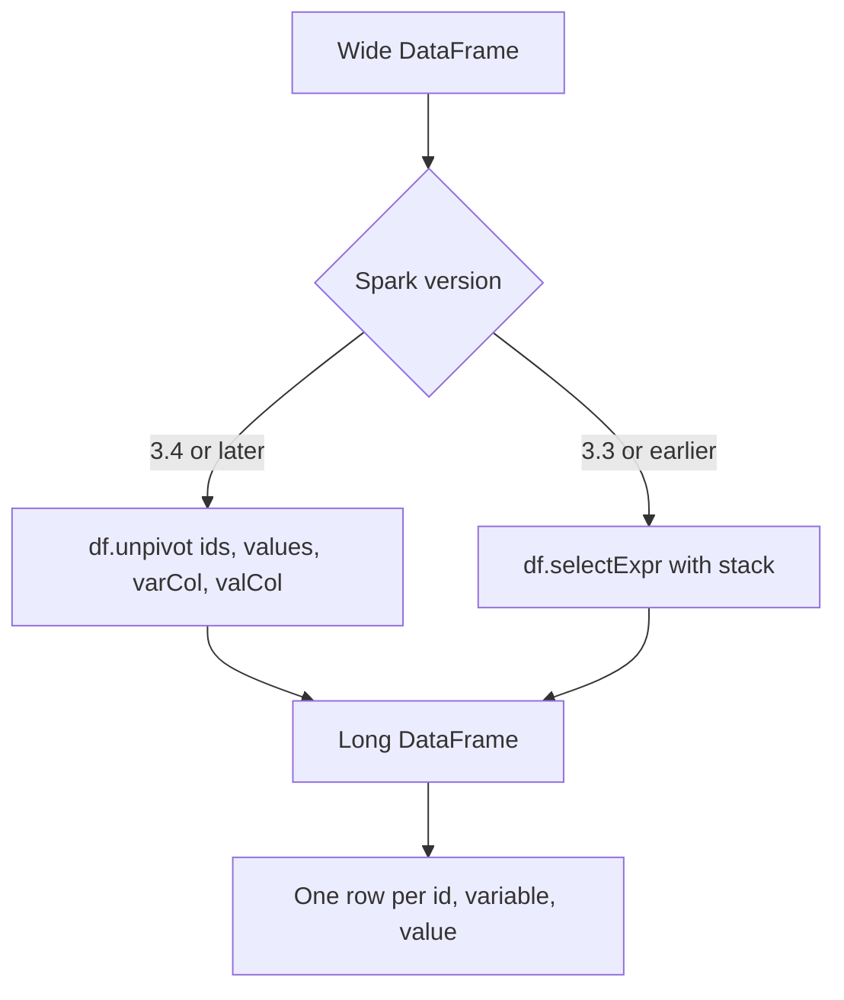

# 2.6.3 How do you unpivot a DataFrame in PySpark?

Use `DataFrame.unpivot()` (Spark 3.4+) or `DataFrame.melt()` as the alias. For older Spark versions or SQL-only workflows, use `stack()` inside `selectExpr`. The native method is preferred because it stays inside the Catalyst optimizer and avoids manual string construction.



### Native `unpivot` signature

| Parameter | Type | Meaning |
|---|---|---|
| `ids` | str, Column, list, tuple | Columns to keep as identifiers |
| `values` | str, Column, list, tuple, or `None` | Columns to unpivot. If `None`, all non-id columns are used |
| `variableColumnName` | str | Name of the column that holds the original column names |
| `valueColumnName` | str | Name of the column that holds the cell values |

The method returns a new DataFrame. It does not mutate the original.

### Basic example

```python
from pyspark.sql import SparkSession

spark = SparkSession.builder.getOrCreate()

df = spark.createDataFrame(
    [(1, 11, 1.1), (2, 12, 1.2)],
    ["id", "int", "double"]
)

out = df.unpivot(
    ids="id",
    values=["int", "double"],
    variableColumnName="var",
    valueColumnName="val"
)

out.show()
```

| id | var | val |
|---|---|---|
| 1 | int | 11.0 |
| 1 | double | 1.1 |
| 2 | int | 12.0 |
| 2 | double | 1.2 |

Notice that `11` became `11.0`. All value columns are cast to a common type.

### `melt` is an alias

`df.melt(...)` has the same signature as `df.unpivot(...)`. Use whichever name is clearer in your codebase. `melt` matches the pandas convention.

### Using `stack` for older Spark versions

`stack(n, name1, col1, name2, col2, ...)` generates `n` rows per input row. Each pair becomes a row with the literal name and the column value.

```python
out = df.selectExpr(
    "id",
    "stack(2, 'int', int, 'double', double) as (var, val)"
)
```

| Property | `stack` | `unpivot` |
|---|---|---|
| Availability | All Spark versions | Spark 3.4+ |
| Syntax | String expression | Typed method |
| Optimizer | Works, but manual | Full Catalyst integration |
| Type coercion | Manual cast may be needed | Automatic common type resolution |
| Readability | Verbose for many columns | Clear parameter names |
| SQL support | Yes, in `SELECT` | Not in SQL directly |

The `n` argument in `stack` must equal the number of column-value pairs. A mismatch causes an error or wrong output.

### Type coercion rules

| Input types | Result type | Note |
|---|---|---|
| `IntegerType` + `LongType` | `LongType` | Numeric promotion |
| `IntegerType` + `DoubleType` | `DoubleType` | Numeric promotion |
| `StringType` + `IntegerType` | No common type | Unpivot fails |
| All same type | That type | No cast |

Cast mismatched columns before unpivot if the types cannot be promoted automatically.

```python
from pyspark.sql.functions import col

df = df.withColumn("int", col("int").cast("string"))
out = df.unpivot("id", ["int", "double"], "var", "val")
```

### `values=None` behavior

When `values` is `None`, all columns not listed in `ids` are unpivoted. This is convenient when the wide schema is known and stable.

```python
out = df.unpivot("id", None, "var", "val")
```

| Scenario | `values=None` | Explicit `values` |
|---|---|---|
| All non-id columns should be unpivoted | Yes | No |
| Only a subset should be unpivoted | No | Yes |
| Schema may gain new columns | New columns are silently included | New columns are ignored |
| Deterministic output schema | Depends on input schema | Fixed by the list |

Pass explicit `values` when the output schema must be stable across schema evolution.

### Null handling

| Case | Behavior |
|---|---|
| Null value in a value column | A row is still produced with `null` in `val` |
| Null in an id column | Preserved in the output |
| All value columns null | Rows with `null` values are produced |
| Empty value list | Error. At least one value column is required |

Unpivot does not skip nulls. Filter before unpivot if null rows must be removed.

### Row multiplication

Unpivot multiplies row count by the number of value columns.

| Input rows | Value columns | Output rows |
|---|---|---|
| 1,000 | 4 | 4,000 |
| 1,000 | 100 | 100,000 |
| 1,000,000 | 50 | 50,000,000 |

Plan for the output size. A wide DataFrame with many value columns can explode in row count and trigger shuffle or spill downstream.

### Performance notes

- `unpivot` is a narrow transformation. It does not require a shuffle by itself.
- The cost is row multiplication. More value columns means more output rows and more downstream work.
- Casting to a common type is done during the unpivot. Mismatched types add cast overhead.
- `stack` with many columns creates a long expression string. Very wide unpivots can hit expression size limits.
- Unpivot before a join or aggregation multiplies the work. Filter and aggregate before unpivot when possible.
- Avoid Python UDFs for unpivoting. Native `unpivot` and `stack` stay inside codegen and the optimizer.

### Common pitfalls

| Pitfall | Effect | Fix |
|---|---|---|
| Mixing incompatible types | Unpivot fails | Cast to a common type first |
| Empty `values` list | Error | Provide at least one column |
| Expecting no nulls | Null rows are produced | Filter before or after |
| Assuming no row growth | Output is much larger | Plan partition count and downstream joins |
| Using `values=None` with evolving schema | New columns appear silently | Pass explicit `values` |
| Using `stack` with wrong `n` | Wrong number of rows or error | Match `n` to the pair count |
| Unpivoting before filtering | Extra rows processed | Filter and aggregate first |
| Forgetting that `melt` is an alias | Duplicate logic in codebase | Pick one name and standardize |

### End to end example

```python
from pyspark.sql import SparkSession
from pyspark.sql.functions import col

spark = SparkSession.builder.getOrCreate()

wide = spark.createDataFrame(
    [("A", 100, 200, 150), ("B", 150, 300, 200)],
    ["product", "north", "south", "east"]
)

long = wide.unpivot(
    ids="product",
    values=["north", "south", "east"],
    variableColumnName="region",
    valueColumnName="sales"
)

long.show()
```

| product | region | sales |
|---|---|---|
| A | north | 100 |
| A | south | 200 |
| A | east | 150 |
| B | north | 150 |
| B | south | 300 |
| B | east | 200 |

The output has three rows per input row because there are three value columns. Downstream aggregations can now group by `region` directly.

### Checklist

- Use `unpivot` on Spark 3.4 or later.
- Use `stack` only when the Spark version does not support `unpivot`.
- Pass explicit `values` when the output schema must be stable.
- Check that value columns share a common type.
- Plan for row multiplication before unpivoting a wide DataFrame.
- Filter and aggregate before unpivot when possible.
- Avoid Python UDFs for reshaping.
