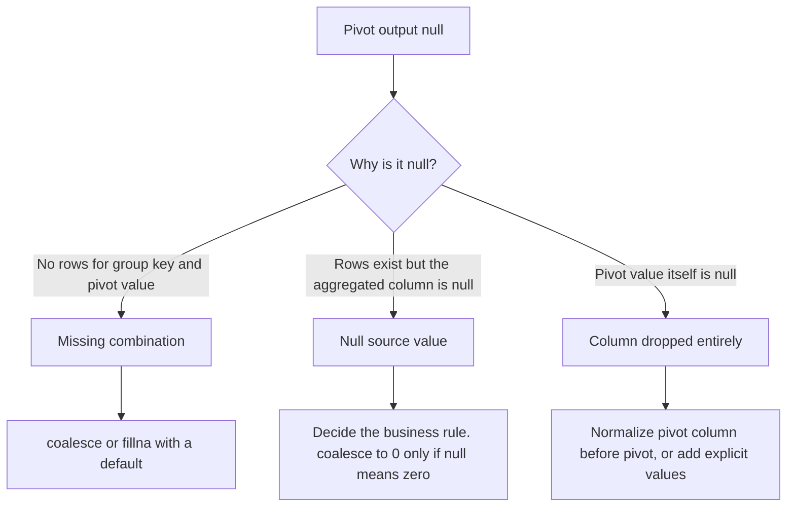

# 2.6.5 How do you handle missing values generated by a pivot operation?

Pivot produces `null` in two different situations. They need different fixes, and mixing them up causes wrong totals.



### Types of nulls

| Type | Cause | Example |
|---|---|---|
| Missing combination | A group key has no row for a pivot value | Region East has no Q4 sales row, so `Q4` is null |
| Null source value | Rows exist, but the aggregated column is null | Q4 row exists with `sales = null`, so `sum` returns null |
| Dropped pivot value | Pivot column value is null | Null quarter rows are not turned into a column |
| Missing column | No `values` list and value absent from data | Column does not exist at all |
| Empty input | No rows after filter | Group keys absent, all pivot columns null or missing |

### Handling strategies

| Strategy | When to use | Code |
|---|---|---|
| Explicit `values` list | Column must exist even if no data | `pivot("q", ["Q1","Q2","Q3","Q4"])` |
| `coalesce` after pivot | Missing combination should be a default | `coalesce(col("Q4"), lit(0))` |
| `fillna` on pivot columns | Many pivot columns need the same default | `df.fillna(0, subset=pivot_cols)` |
| Aggregate with `coalesce` inside | Null source should not poison the aggregate | `sum(coalesce(col("sales"), lit(0)))` |
| Filter nulls before pivot | Null source values must be excluded | `df.filter(col("sales").isNotNull())` |
| Normalize pivot column | Null pivot values must become a real column | `fillna("UNKNOWN", subset=["q"])` |
| Keep nulls | Missing means unknown, not zero | Leave as `null` |

### Distinguish missing combination from null source

These are not the same and must not be collapsed blindly.

| Case | Row exists for combo | Aggregated column null | `sum` result |
|---|---|---|---|
| Missing combo | No | N/A | `null` |
| Null source | Yes | Yes | `null` |
| Zero source | Yes | No, value is 0 | `0` |
| Mixed rows with some nulls | Yes | Some null | `sum` of non-null values |

`sum` ignores nulls inside the group. It returns `null` only when there are no non-null values to sum. So a missing combo and an all-null group both give `null`.

If null source means unknown, keep `null` for missing combos. If null source means zero, coalesce both.

### Guarantee the column exists

Always pass an explicit `values` list. Without it, a missing value means a missing column, and downstream code breaks.

```python
from pyspark.sql.functions import sum

quarters = ["Q1", "Q2", "Q3", "Q4"]
out = df.groupBy("region").pivot("quarter", quarters).agg(sum("sales"))
```

| Without `values` | With `values` |
|---|---|
| Missing value means missing column | Column exists with `null` |
| Schema varies by run | Schema is stable |
| No way to coalesce a missing column | `coalesce` works on every column |

### coalesce per column

Use `coalesce` when the default differs by column, or when only some columns need filling.

```python
from pyspark.sql.functions import col, coalesce, lit

out = out.select(
    "region",
    coalesce(col("Q1"), lit(0)).alias("Q1"),
    coalesce(col("Q2"), lit(0)).alias("Q2"),
    coalesce(col("Q3"), lit(0)).alias("Q3"),
    coalesce(col("Q4"), lit(0)).alias("Q4"),
)
```

### fillna across pivot columns

Use `fillna` when many columns share the same default and type.

```python
pivot_cols = ["Q1", "Q2", "Q3", "Q4"]
out = out.fillna(0, subset=pivot_cols)
```

| Constraint | Note |
|---|---|
| Type match | `fillna(0)` works on integer and long columns |
| Double columns | Use `fillna(0.0)` |
| String columns | Use `fillna("")` or `fillna("UNKNOWN")` |
| Subset required | Do not fill id or group key columns unless intended |
| Mixed types | `fillna` requires a value compatible with each column, or use a dict |

`fillna` with a dict covers mixed types.

```python
out = out.fillna({"Q1": 0, "Q2": 0, "note": ""})
```

### Null pivot values

Null in the pivot column is not turned into a column. The rows are either dropped from the output or aggregated into nothing, depending on the plan. Normalize before pivot.

```python
from pyspark.sql.functions import col, coalesce, lit

df2 = df.withColumn("quarter", coalesce(col("quarter"), lit("UNKNOWN")))
out = df2.groupBy("region").pivot("quarter", ["Q1","Q2","Q3","Q4","UNKNOWN"]).agg(sum("sales"))
```

| Approach | Effect |
|---|---|
| Leave null | Rows silently absent from all pivot columns |
| Coalesce to `UNKNOWN` | Null rows appear in an explicit column |
| Filter nulls out | Null rows excluded deliberately |

### Aggregate inside the pivot

If null source should count as zero, coalesce inside the aggregation. This keeps the fix close to the source and avoids filling every output column.

```python
from pyspark.sql.functions import col, coalesce, lit, sum

out = df.groupBy("region").pivot("quarter", quarters).agg(
    sum(coalesce(col("sales"), lit(0))).alias("sales")
)
```

| Difference | `sum(col)` then `fillna(0)` | `sum(coalesce(col, 0))` |
|---|---|---|
| Missing combo | `null`, then filled to 0 | `null`, still needs fillna |
| Null source | `null`, then filled to 0 | `0` from the aggregate |
| All-null group | `null`, then filled to 0 | `0` |
| Semantics | Fill applied to all nulls | Null source treated as zero at the source |

Neither alone handles both cases. Use explicit `values`, then `fillna` or `coalesce` to cover missing combos. Use `coalesce` inside the aggregate only when null source means zero.

### Count and average nuances

| Aggregation | Missing combo | Null source | Result |
|---|---|---|---|
| `sum` | null | null | null when no non-null values |
| `count` | null | 0 for null rows | 0 only when rows exist and all are null |
| `avg` | null | null | null when no non-null values |
| `first` | null | null | null |
| `min` / `max` | null | null | null |

`count` is the least ambiguous. `count(col)` on a missing combo gives `null`, but on a null-source combo gives `0`. Use `count` when you need to distinguish the two.

### SQL equivalent

```sql
SELECT
  region,
  coalesce(sum(CASE WHEN quarter = 'Q1' THEN sales END), 0) AS Q1,
  coalesce(sum(CASE WHEN quarter = 'Q2' THEN sales END), 0) AS Q2
FROM sales
GROUP BY region;
```

Conditional aggregation makes the default explicit per column and needs no extra fill step.

### Common pitfalls

| Pitfall | Effect | Fix |
|---|---|---|
| Coalescing before pivot | Does not fix missing combos | Coalesce after pivot |
| Coalescing only after pivot with null source | Null source becomes 0 silently | Decide the business rule first |
| Omitting `values` | Missing column, not a null | Pass explicit `values` |
| Using `fillna` on all columns | Group keys and ids get filled | Use `subset` |
| Type mismatch in `fillna` | Error or unexpected cast | Match the column type |
| Assuming `count` returns 0 for a missing combo | Returns null | Pass `values`, then fill |
| Null pivot values | Rows silently dropped | Coalesce pivot column to a label |
| Filling before `count` | Count becomes wrong | Fill only after the aggregate |

### Performance notes

- `coalesce` and `fillna` are narrow transformations. No shuffle.
- Filling every pivot column adds a projection. On wide pivots this is many columns but still cheap.
- `fillna` with a dict builds a per-column expression. Similar cost to manual `coalesce`.
- Prefer explicit `values` over post fill when possible. It moves the guarantee to the plan, not to a projection.
- Avoid filling wide pivot output if only a few columns are consumed downstream. Select the needed columns first.

### End to end example

```python
from pyspark.sql import SparkSession
from pyspark.sql.functions import col, sum, coalesce, lit

spark = SparkSession.builder.getOrCreate()

df = spark.createDataFrame(
    [
        ("East", "Q1", 100),
        ("East", "Q2", 120),
        ("East", "Q2", None),
        ("West", "Q1", 80),
        ("West", None, 50),
    ],
    ["region", "quarter", "sales"]
)

quarters = ["Q1", "Q2", "Q3", "Q4", "UNKNOWN"]

df2 = df.withColumn("quarter", coalesce(col("quarter"), lit("UNKNOWN")))

out = (
    df2.groupBy("region")
       .pivot("quarter", quarters)
       .agg(sum("sales").alias("sales"))
       .fillna(0, subset=quarters)
)

out.show()
```

| region | Q1 | Q2 | Q3 | Q4 | UNKNOWN |
|---|---|---|---|---|---|
| East | 100 | 120 | 0 | 0 | 0 |
| West | 80 | 0 | 0 | 0 | 50 |

The East Q2 value of 120 comes from summing 120 and null, which ignores the null. The Q3 and Q4 columns exist because `values` was passed and are filled to 0. The null quarter row appears under `UNKNOWN` instead of being dropped.
