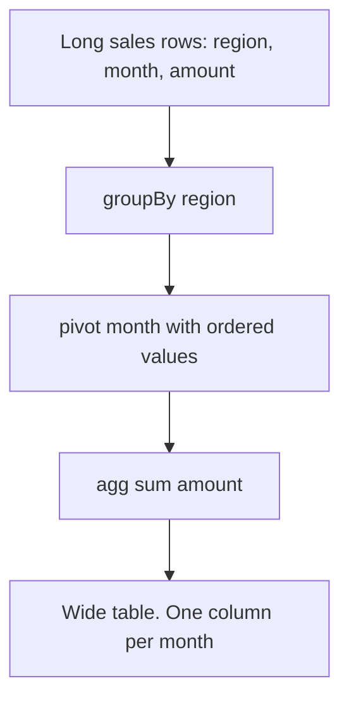

# 2.6.6 Write a snippet to pivot sales data by month.

## 2.6.6 Write a snippet to pivot sales data by month

Pivot the long sales table so each month becomes a column. The main gotcha is month ordering: string month names sort alphabetically, so pass an explicit ordered `values` list.



### Input shape

| region | month | amount |
|---|---|---|
| East | Jan | 100 |
| East | Feb | 120 |
| East | Jan | 50 |
| West | Jan | 80 |
| West | Mar | 95 |

### PySpark

```python
from pyspark.sql import SparkSession
from pyspark.sql.functions import col, sum, coalesce, lit

spark = SparkSession.builder.getOrCreate()

df = spark.createDataFrame(
    [
        ("East", "Jan", 100),
        ("East", "Feb", 120),
        ("East", "Jan", 50),
        ("West", "Jan", 80),
        ("West", "Mar", 95),
    ],
    ["region", "month", "amount"]
)

months = ["Jan", "Feb", "Mar", "Apr", "May", "Jun",
          "Jul", "Aug", "Sep", "Oct", "Nov", "Dec"]

out = (
    df.groupBy("region")
      .pivot("month", months)
      .agg(sum(col("amount")).alias("sales"))
      .fillna(0, subset=months)
      .orderBy("region")
)

out.show()
```

### Scala

```scala
import org.apache.spark.sql.functions._

val months = Seq("Jan","Feb","Mar","Apr","May","Jun",
                 "Jul","Aug","Sep","Oct","Nov","Dec")

val out = df
  .groupBy("region")
  .pivot("month", months)
  .agg(sum(col("amount")).alias("sales"))
  .na.fill(0, months)
  .orderBy("region")
```

### SQL

```sql
SELECT
  region,
  coalesce(sum(CASE WHEN month = 'Jan' THEN amount END), 0) AS Jan,
  coalesce(sum(CASE WHEN month = 'Feb' THEN amount END), 0) AS Feb,
  coalesce(sum(CASE WHEN month = 'Mar' THEN amount END), 0) AS Mar,
  coalesce(sum(CASE WHEN month = 'Apr' THEN amount END), 0) AS Apr,
  coalesce(sum(CASE WHEN month = 'May' THEN amount END), 0) AS May,
  coalesce(sum(CASE WHEN month = 'Jun' THEN amount END), 0) AS Jun,
  coalesce(sum(CASE WHEN month = 'Jul' THEN amount END), 0) AS Jul,
  coalesce(sum(CASE WHEN month = 'Aug' THEN amount END), 0) AS Aug,
  coalesce(sum(CASE WHEN month = 'Sep' THEN amount END), 0) AS Sep,
  coalesce(sum(CASE WHEN month = 'Oct' THEN amount END), 0) AS Oct,
  coalesce(sum(CASE WHEN month = 'Nov' THEN amount END), 0) AS Nov,
  coalesce(sum(CASE WHEN month = 'Dec' THEN amount END), 0) AS Dec
FROM sales
GROUP BY region
ORDER BY region;
```

### Output

| region | Jan | Feb | Mar | Apr | May | Jun | Jul | Aug | Sep | Oct | Nov | Dec |
|---|---|---|---|---|---|---|---|---|---|---|---|---|
| East | 150 | 120 | 0 | 0 | 0 | 0 | 0 | 0 | 0 | 0 | 0 | 0 |
| West | 80 | 0 | 95 | 0 | 0 | 0 | 0 | 0 | 0 | 0 | 0 | 0 |

### Key choices

| Choice | Reason |
|---|---|
| Explicit `months` list | One job instead of two. Stable column order and stable schema |
| `fillna(0, subset=months)` | Missing month becomes 0, not null. Group key columns are untouched |
| `sum(amount)` | Aggregation is required. Spark 3.4+ errors without it |
| `orderBy("region")` | Pivot does not guarantee row order |
| SQL uses `CASE WHEN` | No native `pivot` keyword in Spark SQL |

### Variations

| Need | Change |
|---|---|
| Month as number | Pivot on `month(date_col)` and pass `range(1, 13)` as values |
| Year and month | Add `year` to `groupBy`, or pivot on a `yyyy-MM` string |
| Revenue and count | `agg(sum("amount").alias("rev"), count("*").alias("cnt"))` gives `Jan_rev`, `Jan_cnt`, and so on |
| Nulls instead of zeros | Drop `fillna` |
| Many years of data | Pivot on year, then unpivot and repivot by month, or aggregate with a date bucket |

### Pitfalls specific to monthly pivots

| Pitfall | Effect | Fix |
|---|---|---|
| No `values` list | Columns appear alphabetically and may be missing | Pass explicit ordered list |
| Month names from a locale | Sorting and matching break across locales | Use numeric month or `yyyy-MM` strings |
| Forgetting `fillna` | Empty months show as null | Fill with 0 if zero is the business meaning |
| Pivoting on a raw timestamp | Thousands of distinct values, one column per day | Extract month first with `month()` or `date_format` |
| Pivoting before filtering by year | Columns for every month in all years | Filter to the target year first |
