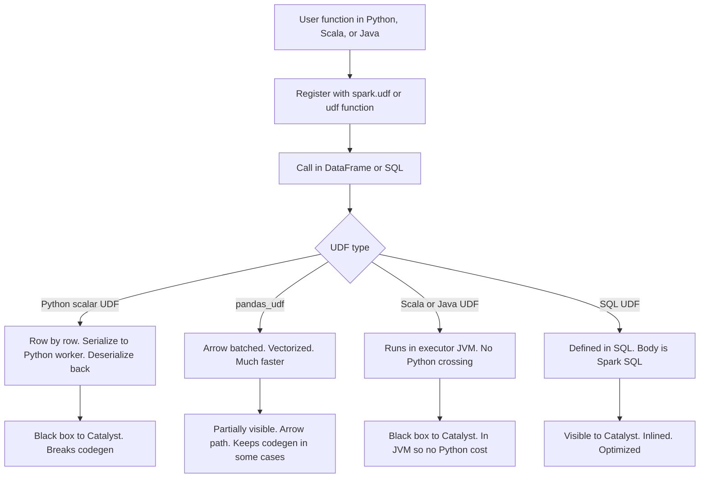
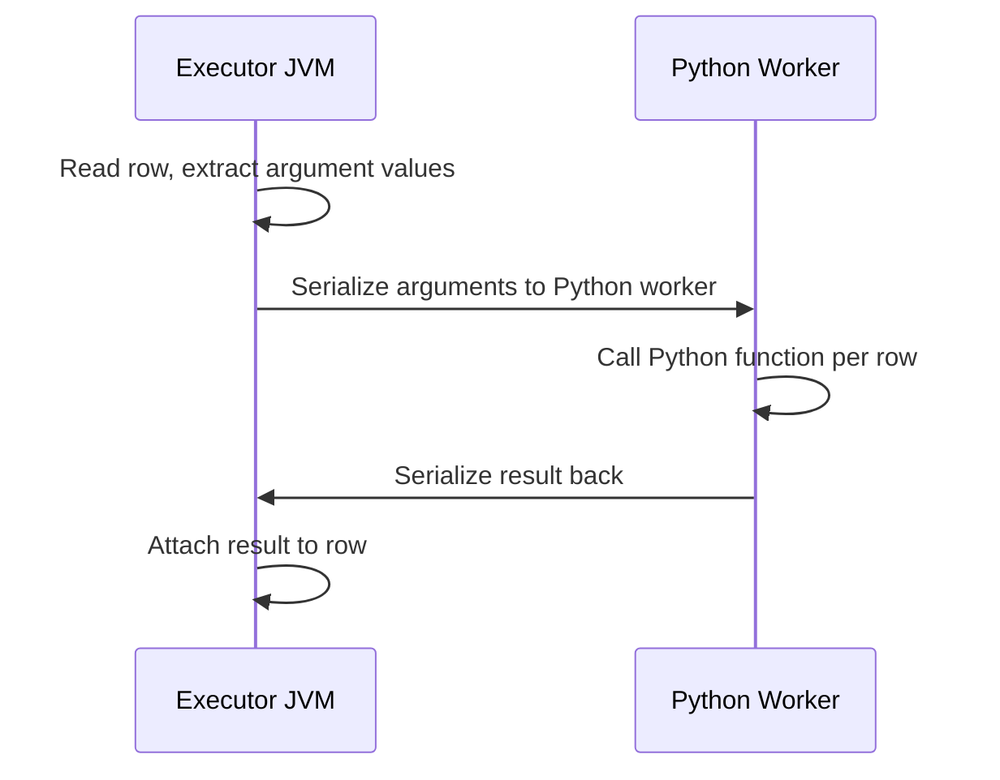

# 2.7.1 What is a UDF (User Defined Function)?

A UDF is a user written function registered with Spark so it can be called inside DataFrame or SQL expressions. It extends Spark with logic that native functions do not cover, but it trades optimizer visibility and vectorization for flexibility.



### What a UDF is

| Aspect | Behavior |
|---|---|
| Definition | A function you write and register so Spark can call it per row or per batch |
| Input | One or more columns, or literals |
| Output | A single value per row for scalar UDFs |
| Registration | `spark.udf.register` for SQL, `udf(...)` for DataFrame API, or `@udf` decorator |
| Invocation | Same as a native function in `select`, `withColumn`, `filter`, or SQL |
| Visibility to Catalyst | Opaque. The optimizer cannot see inside the function body |

### UDF types

| Type | Language | Execution | Performance | Use when |
|---|---|---|---|---|
| Python scalar UDF | Python | Per row, serialize to Python worker | Slow | Prototyping, logic too complex for native functions |
| `pandas_udf` (vectorized) | Python | Arrow batched, per partition | Fast | Python libraries needed (numpy, pandas) on large data |
| Scala or Java UDF | Scala, Java | In executor JVM | Medium to fast | JVM library needed, no Python cost |
| SQL UDF | SQL | Inlined as Spark SQL expression | Fast | Reusable SQL logic |
| UDAF | Any | Aggregate, works on groups | Depends | Custom aggregation not covered by built-ins |
| UDTF | Any | Returns multiple rows per input row | Depends | Explode-like logic |

### Registration

PySpark:

```python
from pyspark.sql.functions import udf, pandas_udf
from pyspark.sql.types import StringType, IntegerType
import pandas as pd

# DataFrame API
def to_upper(s):
    return s.upper() if s else None

to_upper_udf = udf(to_upper, StringType())
df.withColumn("u", to_upper_udf(df.name))

# SQL registration
spark.udf.register("to_upper_sql", to_upper, StringType())
spark.sql("SELECT to_upper_sql(name) FROM t")

# Decorator form
@udf(returnType=IntegerType())
def add_one(x):
    return x + 1 if x is not None else None

# Vectorized pandas UDF
@pandas_udf("string")
def to_upper_vec(s: pd.Series) -> pd.Series:
    return s.str.upper()
```

Scala:

```scala
import org.apache.spark.sql.functions.udf

val toUpper = udf((s: String) => if (s == null) null else s.toUpperCase)
df.withColumn("u", toUpper(col("name")))
```

SQL UDF:

```sql
CREATE OR REPLACE TEMP FUNCTION to_upper_sql(s STRING)
RETURNS STRING
RETURN upper(s);

SELECT to_upper_sql(name) FROM t;
```

### How a Python scalar UDF executes



| Step | Cost |
|---|---|
| Serialize arguments | Per row, per UDF call |
| Cross process boundary | IPC overhead |
| Call Python function | Python interpreter, GIL |
| Serialize result | Per row |
| Skip codegen | Whole projection is interpreted |

The Python worker is reused per partition, but every row still crosses the boundary.

### What UDFs cost

| Cost | Detail |
|---|---|
| Codegen disabled | The whole projection becomes interpreted, not just the UDF |
| Serialization | Every row is serialized to the worker |
| Python interpreter | GIL, slow per-row Python calls |
| Catalyst blindness | No predicate pushdown, no constant folding, no column pruning through the UDF |
| Null handling | Depends on the function. Spark does not short circuit |
| Determinism | Spark assumes non-deterministic unless marked, which can disable some optimizations |

### Native function vs UDF

| Aspect | Native function | UDF |
|---|---|---|
| Codegen | Yes | No (unless pandas_udf with Arrow) |
| Catalyst visibility | Full | None |
| Predicate pushdown | Yes | No |
| Serialization | None | Per row for Python |
| Speed | Fastest | Slowest |
| Portability | Any Spark version | Requires UDF registration |
| Logic expressiveness | Limited to built-ins | Arbitrary |

Always check the native function list first. Many UDF candidates already exist as built-ins: `upper`, `lower`, `trim`, `regexp_replace`, `to_date`, `split`, `concat_ws`, `coalesce`, `when`, `size`, `array_contains`, `transform`, `aggregate`, `filter`, and many more.

### When a UDF is justified

| Case | Justification |
|---|---|
| Proprietary algorithm in a Python library | No native equivalent |
| Complex parsing with a library not in Spark | Library-based |
| Locale sensitive conversion | Locale is not configurable in native functions |
| ML feature engineering with numpy or sklearn | Library-based |
| Legacy logic with many edge cases | Correctness priority over speed |
| Third party SDK call | Not expressible natively |

### When a UDF is not justified

| Case | Native alternative |
|---|---|
| Case conversion | `upper`, `lower`, `initcap` |
| Regex extraction and replace | `regexp_extract`, `regexp_replace` |
| String splitting | `split` |
| Date parsing | `to_date`, `to_timestamp` |
| Date arithmetic | `date_add`, `date_sub`, `datediff` |
| Null handling | `coalesce`, `when`, `nvl` |
| Array operations | `transform`, `filter`, `aggregate`, `exists` |
| Simple conditionals | `when` and `otherwise` |

### pandas_udf is the fast path

Vectorized UDFs use Apache Arrow to batch rows and avoid per-row serialization.

| Aspect | Python scalar UDF | `pandas_udf` |
|---|---|---|
| Batching | Row by row | Batches via Arrow |
| Serialization | Per row pickle | Arrow columnar format |
| Speed | Slow | Much faster, close to native for some workloads |
| API | Plain Python function | Function over `pd.Series` |
| Requires Arrow | No | Yes |
| Spark support | All versions | Spark 2.3+ |

```python
from pyspark.sql.functions import pandas_udf
import pandas as pd

@pandas_udf("double")
def zscore(s: pd.Series) -> pd.Series:
    return (s - s.mean()) / s.std()
```

Use `pandas_udf` whenever the UDF is needed and the workload is row heavy.

### Null handling

| Behavior | Consequence |
|---|---|
| Spark does not skip nulls for the UDF | Your function must handle null |
| Python `None` passed as `None` | Fails on `.upper()` unless you check |
| Null return | Handled as a normal null |
| pandas UDF | `pd.Series` contains `NaN` for nulls |

```python
@udf(returnType=StringType())
def safe_upper(s):
    return s.upper() if s is not None else None
```

### Determinism

| Flag | Meaning |
|---|---|
| `udf(..., deterministic=True)` (default for Python) | Spark may cache and fold repeated calls |
| `udf(..., deterministic=False)` | Forces re-evaluation per call. Use for random, time, or UUID |

```python
import random
from pyspark.sql.functions import udf
from pyspark.sql.types import DoubleType

rand_udf = udf(lambda: random.random(), DoubleType(), useArrow=None)
spark.udf.register("rand_udf", lambda: random.random(), DoubleType(), deterministic=False)
```

### Common pitfalls

| Pitfall | Effect | Fix |
|---|---|---|
| Using a UDF for something native exists | Slower and breaks codegen | Check the function list first |
| Python scalar UDF on large data | Order of magnitude slower than native | Use `pandas_udf` or Scala |
| Null inside the UDF | Task failure | Null check inside the function |
| Not specifying return type | Schema inference or wrong type | Always pass `returnType` |
| Using a UDF in a join key | No broadcast or hash join optimization | Precompute with native functions |
| Using a UDF in a filter | No predicate pushdown | Filter with native expressions first |
| Non-deterministic UDF not marked | Wrong caching or fold | Mark `deterministic=False` |
| Importing Spark context inside the UDF | Serialization error | Use only plain Python, no Spark session |
| Large UDF returning big objects | Memory pressure on executors | Return primitives, not DataFrames |
| UDF inside `pivot` aggregation | Slow and opaque | Use native aggregation where possible |

### End to end example

```python
from pyspark.sql import SparkSession
from pyspark.sql.functions import udf, pandas_udf, col
from pyspark.sql.types import StringType
import pandas as pd

spark = SparkSession.builder.getOrCreate()

df = spark.createDataFrame(
    [("alice",), ("BOB",), (None,), ("",)],
    ["name"]
)

# Scalar UDF, correct null handling
@udf(returnType=StringType())
def title_or_unknown(s):
    if s is None or s.strip() == "":
        return "UNKNOWN"
    return s.strip().title()

# Vectorized equivalent, much faster
@pandas_udf("string")
def title_or_unknown_vec(s: pd.Series) -> pd.Series:
    cleaned = s.fillna("").str.strip()
    return cleaned.where(cleaned != "", "UNKNOWN").str.title()

out = (
    df
    .withColumn("scalar", title_or_unknown(col("name")))
    .withColumn("vector", title_or_unknown_vec(col("name")))
)

out.show()
```

| name | scalar | vector |
|---|---|---|
| alice | Alice | Alice |
| BOB | Bob | Bob |
| null | UNKNOWN | UNKNOWN |
| `""` | UNKNOWN | UNKNOWN |

### Decision checklist

| Question | If yes | If no |
|---|---|---|
| Is there a native function for this? | Use it | Continue |
| Can it be expressed with `when`, `regexp_replace`, `transform`, or `array` functions? | Use those | Continue |
| Is it Python library code? | Use `pandas_udf` | Continue |
| Is it JVM library code? | Use Scala UDF | Continue |
| Is the input small? | Scalar UDF is acceptable | Use `pandas_udf` or Scala |
| Is it used in join, filter, or aggregate keys? | Precompute with native logic | UDF is acceptable |

### Summary

- A UDF extends Spark with user code at the cost of optimizer visibility and codegen.
- Python scalar UDFs are the slowest. `pandas_udf` is the fast Python path.
- Scala and Java UDFs skip the Python bridge.
- SQL UDFs are inlined and visible to Catalyst.
- Always check native functions first.
- Handle nulls inside the UDF.
- Mark non-deterministic UDFs.
- Avoid UDFs in join, filter, or aggregate keys.
