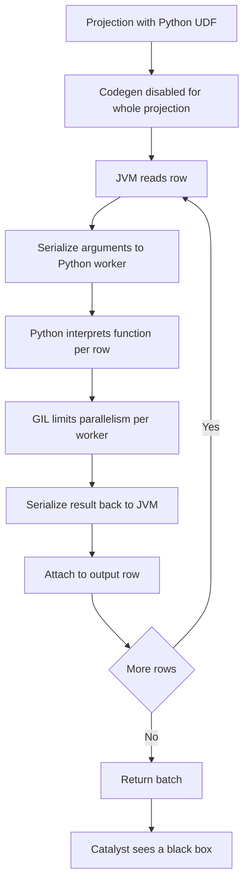
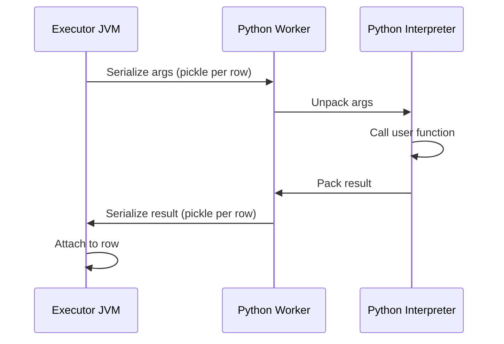

# 2.7.2 Why are standard Python UDFs considered slow in PySpark?

A standard Python UDF runs outside the JVM, in a separate Python worker process, one row at a time. Every row crosses the JVM to Python boundary twice, and the whole projection loses codegen. Each of these costs compounds.



### The five main costs

| Cost | What happens | Why it hurts |
|---|---|---|
| Codegen disabled | The entire projection becomes interpreted, not just the UDF | Native sibling expressions in the same `select` also lose vectorization |
| Row by row IPC | Each row is serialized and sent to the Python worker | Overhead scales with row count, not data size |
| Serialization | Pickle or Arrow per row | CPU and allocation per row |
| Python interpreter and GIL | Python function call per row, one thread per worker | Limited parallelism per worker |
| Catalyst blindness | Optimizer cannot see inside the function | No fold, no pushdown, no pruning through the UDF |

### Codegen loss is the biggest cost

Spark compiles a whole projection into a single Java method. One Python UDF in that projection forces the entire projection back to interpreted row by row evaluation.

| Projection | Codegen | Relative speed |
|---|---|---|
| `select(upper(a), lower(b), trim(c))` | Fully generated | Baseline, fast |
| `select(upper(a), my_udf(b), trim(c))` | Disabled for the entire select | The two native functions also slow down |
| `select(my_udf(a), my_udf(b), my_udf(c))` | Disabled, three UDF calls | Worst case |

Putting a UDF in the same `select` as cheap native functions silently slows down the native functions too. Split the UDF into its own projection only if the extra stage is cheaper than the codegen loss. Usually it is not.

### The serialization boundary



| Step | Cost driver |
|---|---|
| Serialize args | Number of columns read, value size |
| IPC write and read | Pipe or socket per row |
| Unpickle in Python | Python object allocation per row |
| Call function | Python call overhead and GIL |
| Pickle result | Python object allocation per row |
| Unpickle in JVM | JVM object allocation per row |

For 1 million rows, that is 1 million round trips even if each trip is tiny. Fixed overhead per row dominates for small rows.

### Python scalar UDF vs native vs vectorized

| Path | Batching | Boundary crossing | Codegen | Relative speed |
|---|---|---|---|---|
| Native function | Vectorized column | None | Full | 1x |
| `pandas_udf` (Arrow) | Arrow batch, for example 10k rows | Once per batch | Partial | 3x to 10x slower than native on simple ops |
| Python scalar UDF | Per row | Per row | Off | 10x to 100x slower than native |
| Scala UDF | Per row, in JVM | None | Off | 2x to 10x slower than native |

Numbers vary by workload. The ratio is the point. Scalar Python UDF is the slowest path.

### Why the GIL matters

| Worker model | Behavior |
|---|---|
| One Python worker per core | Worker processes run in parallel |
| Within a worker | GIL serializes Python bytecode. Only one thread executes Python at a time |
| UDF doing pure Python work | Fully GIL bound per worker |
| UDF calling C extension that releases GIL (numpy) | Some parallelism within worker |
| `pandas_udf` with Arrow | Batches reduce interpreter overhead and use vectorized C code |

A Python scalar UDF doing string work is almost always GIL bound. Adding executor cores helps only up to the number of Python worker processes.

### Catalyst blindness

| Optimization | Native function | Python UDF |
|---|---|---|
| Constant folding | Yes | No |
| Predicate pushdown | Yes, through expressions | No |
| Column pruning through the expression | Yes | No |
| Filter reorder past the UDF | Allowed | Restricted. Filter cannot pass through |
| Runtime filter generation | Yes | No |
| Reuse exchange and subquery | Yes | Yes |
| Statistic estimation | Uses function cost | Treats as opaque, poor estimates |

Because the optimizer cannot see inside, it cannot prove anything about the result. It cannot push a filter on the UDF result into the source read. The whole partition is processed and filtered afterward.

### Determinism and caching

| Setting | Effect |
|---|---|
| Deterministic UDF (default for Python) | Spark may cache and fold repeated calls in the same expression |
| Non-deterministic UDF | Forced re-evaluation per call. More cost, more plan shuffling |
| Nested UDF calls | Each call is separate. No common subexpression elimination |

### Where the cost shows up in a plan

| Plan element | Symptom |
|---|---|
| `BatchEvalPython` or `ArrowEvalPython` node | The row by row Python bridge |
| Whole `Project` marked not codegen | Neighboring expressions also slow |
| `Filter` above `BatchEvalPython` | Filter applied after UDF, no pushdown |
| Exchange above the UDF | UDF ran before a shuffle. Filter and pre aggregate first |

Check `df.explain("formatted")` for `BatchEvalPython`. Any node with that name is a Python boundary.

### Practical speedups

| Change | Effect |
|---|---|
| Replace UDF with native function | Removes the boundary. Largest win |
| Replace scalar UDF with `pandas_udf` | Arrow batching, big win for vectorizable code |
| Replace with Scala UDF | Removes the Python bridge. Moderate win |
| Filter and pre aggregate before the UDF | Fewer rows cross the boundary |
| Project only needed columns into the UDF | Narrower serialization per row |
| Split UDF into its own select | Keeps native expressions in a codegen projection, usually not worth an extra stage |
| Increase Python worker count | More parallel workers, bounded by cores |
| Avoid the UDF in join and filter keys | Keeps shuffle and pushdown intact |

### End to end comparison

```python
from pyspark.sql import SparkSession
from pyspark.sql.functions import udf, pandas_udf, col, upper
from pyspark.sql.types import StringType
import pandas as pd

spark = SparkSession.builder.getOrCreate()
df = spark.range(1_000_000).withColumn("s", col("id").cast("string"))

# Slow: Python scalar UDF, codegen off, per row bridge
@udf(returnType=StringType())
def up_udf(s):
    return s.upper()

# Fast: native function, fully codegen
native = df.select(upper(col("s")).alias("u"))

# Fast-ish: Arrow batched, no per row bridge
@pandas_udf("string")
def up_vec(s: pd.Series) -> pd.Series:
    return s.str.upper()

vectorized = df.select(up_vec(col("s")).alias("u"))
```

| Path | Plan node | Speed on 1M rows |
|---|---|---|
| `upper` | `Project` with codegen | Fastest |
| `up_vec` | `ArrowEvalPython` | Moderate |
| `up_udf` | `BatchEvalPython` | Slowest |

### Common pitfalls

| Pitfall | Effect | Fix |
|---|---|---|
| UDF alongside native functions in one select | Native functions also lose codegen | Use native functions, or isolate the UDF |
| UDF in a filter | Filter runs after the UDF, full partition processed | Filter natively first, UDF last |
| UDF in a join key | Breaks broadcast and shuffle optimizations | Precompute with native functions |
| Returning large Python objects | Serialization dominates | Return primitives |
| Not marking non-deterministic UDFs | Extra evaluation or wrong caching | Set `deterministic=False` |
| Using scalar UDF for numeric or string work | GIL bound, slow | Use `pandas_udf` or native |
| Very wide rows crossing the boundary | Serialization cost per row grows | Select only needed columns |

### Rule of thumb

- Native function first.
- `pandas_udf` if a Python library is required.
- Scala UDF if a JVM library is required and Python is not.
- Scalar Python UDF only for prototyping, tiny data, or one-off logic with no native equivalent.
- Never put a scalar Python UDF in a join, filter, or aggregate key.
- Never mix it with native functions in a performance critical projection.
