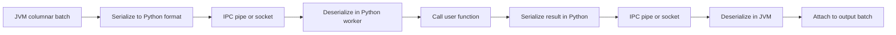
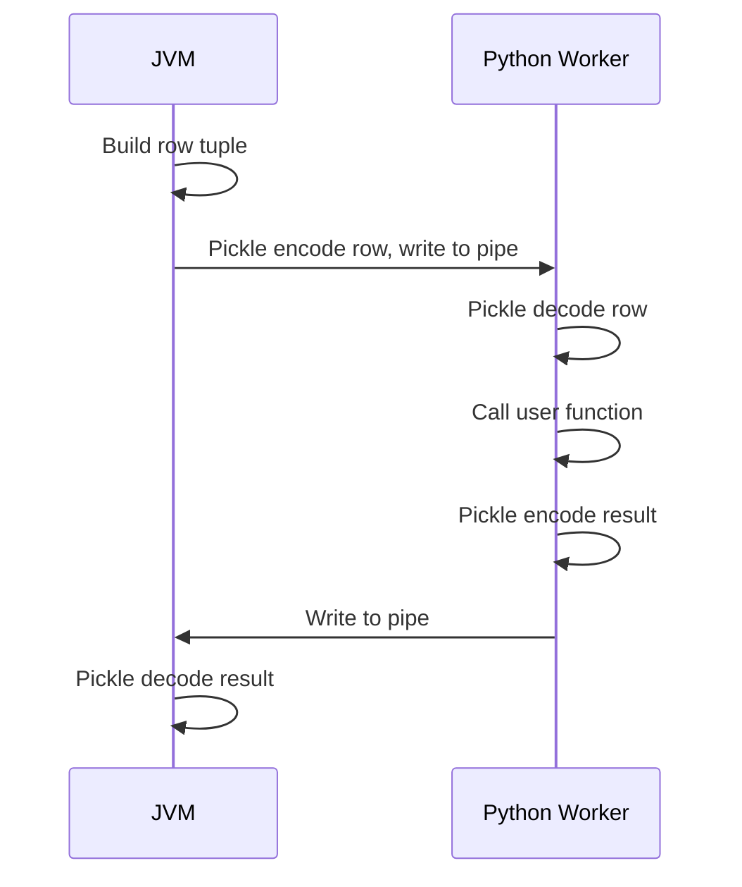
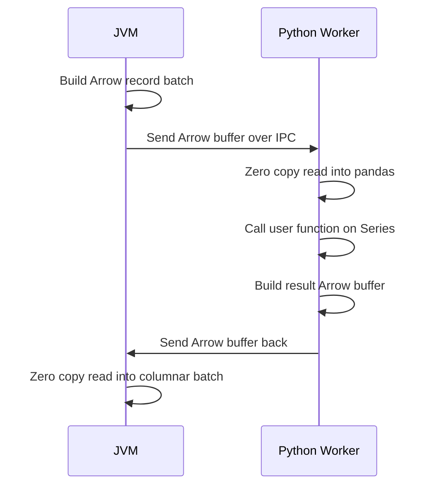

# 2.7.3 Explain the serialization and deserialization overhead of Python UDFs.

A Python UDF crosses the JVM to Python boundary. Every row or batch is serialized on one side, transferred over IPC, and deserialized on the other side. That round trip is pure overhead. The function body is the only useful work, and it is usually the smallest part of the cost.



### Where the overhead lives

| Stage | What happens | Cost driver |
|---|---|---|
| JVM serialize | Encode row or batch into the wire format | Number of columns, value size, row count |
| IPC transfer | Write to pipe, read on the other side | Bytes transferred, syscall count |
| Python deserialize | Unpickle or Arrow read into Python objects | Object allocation, type coercion |
| Function call | User code runs | Function body, GIL |
| Python serialize | Encode result back | Result size, type |
| IPC transfer | Write back to JVM | Bytes transferred |
| JVM deserialize | Decode result, attach to row | Object allocation, type checks |

### Two serialization formats

| Format | Used by | Granularity | Per-row overhead | Notes |
|---|---|---|---|---|
| Pickle | Python scalar UDF | One row at a time | Full per row | Python object graph, slow for wide rows |
| Arrow | `pandas_udf` | One batch at a time | Amortized across batch | Columnar, zero copy where possible |

### Pickle path (scalar UDF)



| Step | Per-row cost | Scales with |
|---|---|---|
| Tuple build | Small | Number of arguments |
| Pickle encode | Moderate | Value size and nesting |
| Pipe write | Small | Byte count |
| Pickle decode | Moderate | Value size |
| Function call | Small | Function body |
| Pickle encode result | Moderate | Result size |
| Pipe read | Small | Byte count |
| Pickle decode result | Moderate | Result size |

Pickle is per row. For 10 million rows, that is 10 million encode and decode cycles in both directions. Even if each cycle is microseconds, the total dominates the function body.

### Arrow path (pandas UDF)



| Property | Arrow | Pickle |
|---|---|---|
| Batch size | Up to `spark.sql.execution.arrow.maxRecordsPerBatch`, default 10000 | 1 |
| Encoding | Columnar buffers | Python object graph |
| Zero copy | Yes for compatible types | No |
| Overhead per row | Amortized across batch | Full |
| Type conversion | Strict, falls back if incompatible | Any picklable object |

### Overhead breakdown by component

| Component | Pickle share | Arrow share | Notes |
|---|---|---|---|
| Serialization | High | Low | Amortized in Arrow |
| IPC transfer | Moderate | Moderate | Bytes dominate, not calls |
| Deserialization | High | Low | Amortized in Arrow |
| Function call | Low | Low | Dominated by body and GIL |
| Object allocation | High | Low | Arrow uses buffers, not objects |

In a scalar UDF, serialization and deserialization dominate. In a vectorized UDF, the function body and any Python level loops inside it dominate.

### What makes serialization expensive

| Factor | Effect |
|---|---|
| Wide rows | More columns to encode per row |
| Nested types | Structs and arrays serialize recursively |
| Large strings | Byte copy dominates |
| Binary columns | Buffer copy, sometimes base64 |
| Many UDF calls per row | Repeated round trips |
| Large result objects | Return path becomes the bottleneck |
| Complex Python objects | Pickle traverses the object graph |
| Type mismatch with Arrow | Fallback to pickle or error |

### What does not help

| Attempt | Why it fails |
|---|---|
| Increasing batch size beyond the limit | The limit is enforced by the Arrow config |
| Caching the worker | Worker is already reused per partition. Per-row cost remains |
| Adding executor cores | Parallelism does not reduce per-row cost |
| Caching the DataFrame | First evaluation still pays the full cost |
| Using `broadcast` for UDF code | Code is small. The data crossing is the cost |
| Narrowing `returnType` | Reduces result size but not argument serialization |

### What does help

| Change | Why it helps |
|---|---|
| Replace UDF with native function | Removes the boundary entirely |
| Replace scalar UDF with `pandas_udf` | Amortizes serialization across a batch |
| Reduce rows before UDF | Filter and pre aggregate first |
| Reduce columns before UDF | Select only the columns the UDF needs |
| Return primitives, not objects | Less to encode |
| Avoid nested types in arguments | Flatter schema is cheaper |
| Increase `maxRecordsPerBatch` | Larger batches amortize better, within memory limits |
| Use Scala UDF | No Python bridge at all |

### Measuring the overhead

| Tool | What it shows |
|---|---|
| `df.explain("formatted")` | `BatchEvalPython` or `ArrowEvalPython` node marks the boundary |
| Spark UI SQL tab | Time spent in the Python eval node |
| Stage task time vs UDF body time | Difference is the boundary overhead |
| `SparkListener` metrics | `PythonUDF` metrics in some versions |
| Manual microbenchmark | Compare UDF against native on the same data |

### Config knobs

| Config | Default | Effect |
|---|---|---|
| `spark.sql.execution.arrow.pyspark.enabled` | `false` in some versions, `true` in others | Enables Arrow for pandas conversion |
| `spark.sql.execution.arrow.maxRecordsPerBatch` | `10000` | Arrow batch size |
| `spark.sql.execution.pythonUDF.arrow.enabled` | version dependent | Arrow path for UDFs |
| `spark.python.worker.reuse` | `true` | Reuses workers, avoids process startup per task |
| `spark.sql.codegen.wholeStage` | `true` | Whole stage codegen. Disabled by Python UDF nodes |

### End to end example

```python
from pyspark.sql import SparkSession
from pyspark.sql.functions import udf, pandas_udf, col
from pyspark.sql.types import StringType
import pandas as pd

spark = SparkSession.builder.getOrCreate()

df = spark.range(5_000_000).withColumn("s", col("id").cast("string"))

@udf(returnType=StringType())
def up_pickle(s):
    return s.upper()

@pandas_udf("string")
def up_arrow(s: pd.Series) -> pd.Series:
    return s.str.upper()

pickle_plan = df.select(up_pickle(col("s"))).explain("formatted")
arrow_plan  = df.select(up_arrow(col("s"))).explain("formatted")
```

| Path | Plan node | Overhead type |
|---|---|---|
| `up_pickle` | `BatchEvalPython` | Per row pickle |
| `up_arrow` | `ArrowEvalPython` | Per batch Arrow |

### Practical rule

- If a UDF is required, `pandas_udf` is the default choice.
- Scalar UDF only for prototyping or tiny data.
- Filter and project before the UDF. Fewer rows and narrower rows means less serialization.
- Return primitives. Do not return dicts, lists, or nested objects.
- Keep UDFs out of join, filter, and aggregate keys.
- Check the plan for `BatchEvalPython`. If it is there, serialization is a cost you are paying.
- When native functions exist, use them. Serialization overhead disappears entirely.
