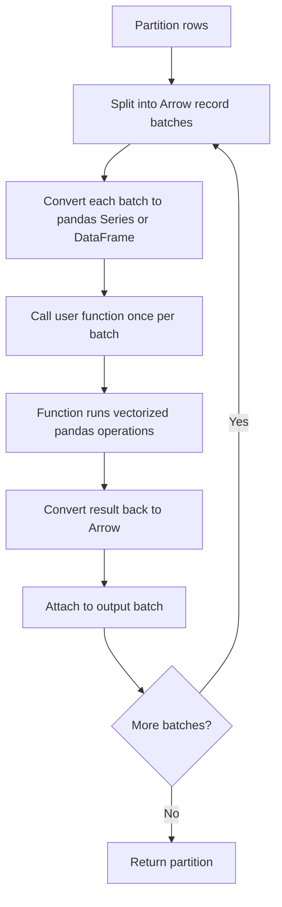

# 2.7.4 What is a Pandas UDF (Vectorized UDF) and how does it improve performance?

A Pandas UDF, now called a vectorized UDF, is a Python function that receives and returns `pandas.Series` or `pandas.DataFrame` objects instead of individual values. Spark batches rows using Apache Arrow and calls the function once per batch rather than once per row.



### Scalar UDF vs Pandas UDF

| Aspect | Scalar Python UDF | Pandas UDF |
|---|---|---|
| Input | One row at a time | A `pd.Series` or `pd.DataFrame` per batch |
| Output | One value per row | A `pd.Series` or `pd.DataFrame` of the same length |
| Serialization | Pickle, per row | Arrow, per batch |
| Boundary crossings | One per row | One per batch |
| Codegen | Fully disabled | Partially preserved via Arrow eval |
| GIL impact | Bound per row | Amortized across batch, vectorized C code |
| Function body | Python loop | Vectorized pandas or numpy |
| Relative speed | Slowest | Close to native for simple operations |
| Plan node | `BatchEvalPython` | `ArrowEvalPython` |

### Plan node difference

| Node | Meaning |
|---|---|
| `BatchEvalPython` | Scalar UDF. Row by row pickle |
| `ArrowEvalPython` | Vectorized UDF. Arrow batches |
| No node | Native function. Full codegen |

Check `df.explain("formatted")` to see which node appears. `ArrowEvalPython` is the vectorized path.

### The three types of Pandas UDF

| Type | Input | Output | Use case |
|---|---|---|---|
| Series to Series | One or more `pd.Series` | One `pd.Series` | Scalar transformation per column |
| Iterator of Series to Iterator of Series | Iterator of `pd.Series` | Iterator of `pd.Series` | Stateful operations across batches |
| Iterator of Series to Iterator of Series of multiple | Iterator of tuples of Series | Iterator of tuples of Series | Multi column stateful |
| Grouped map | `pd.DataFrame` per group | `pd.DataFrame` per group | Group by with arbitrary pandas logic |
| Map | Iterator of `pd.DataFrame` | Iterator of `pd.DataFrame` | Arbitrary map over partitions |

Series to Series is the most common. Grouped map is the most powerful.

### Basic example

```python
from pyspark.sql import SparkSession
from pyspark.sql.functions import pandas_udf, col
import pandas as pd

spark = SparkSession.builder.getOrCreate()

df = spark.range(1_000_000).withColumn("s", col("id").cast("string"))

# Scalar UDF: one row at a time
from pyspark.sql.functions import udf
from pyspark.sql.types import StringType

@udf(returnType=StringType())
def up_scalar(s):
    return s.upper()

# Pandas UDF: one batch at a time, vectorized
@pandas_udf("string")
def up_vec(s: pd.Series) -> pd.Series:
    return s.str.upper()

scalar_out = df.select(up_scalar(col("s")))
vec_out    = df.select(up_vec(col("s")))
```

### Why it is faster

| Improvement | Mechanism |
|---|---|
| Batched IPC | One round trip per batch, not per row |
| Arrow columnar format | Zero copy where types match |
| Vectorized pandas operations | C loops instead of Python loops |
| Amortized GIL | GIL acquired per batch, not per row |
| Less object allocation | Arrow buffers instead of Python objects per value |
| Partial codegen | Arrow eval keeps more of the plan vectorized |
| Reused Python worker | Worker handles many batches per task |

The single biggest win is eliminating the per-row pickle round trip. The second biggest is running pandas or numpy vectorized code, which executes in C.

### Batching config

| Config | Default | Effect |
|---|---|---|
| `spark.sql.execution.arrow.maxRecordsPerBatch` | 10000 | Rows per Arrow batch |
| `spark.sql.execution.arrow.pyspark.enabled` | version dependent | Arrow path for pandas conversion |
| `spark.sql.execution.arrow.pyspark.fallback.enabled` | `true` | Fall back to pickle if Arrow fails |

Larger batches amortize better but need more worker memory. The default of 10000 is a good starting point.

### Null handling

| Topic | Behavior |
|---|---|
| Null values in a Series | Represented as `NaN` or `NaT` depending on dtype |
| Null in integer column | Converted to float because pandas has no nullable int by default |
| Null in string column | `NaN` in object dtype or `pd.NA` in nullable dtype |
| Function must handle nulls | Pandas operations usually propagate them |
| Return with nulls | Allowed. Arrow encodes them |
| Return a different length | Error. Output must match input length |

```python
@pandas_udf("string")
def up_safe(s: pd.Series) -> pd.Series:
    return s.fillna("").str.upper()
```

### Type mapping

| Spark type | pandas dtype |
|---|---|
| `StringType` | `object` or `string` |
| `IntegerType` | `int32` or `float64` if nullable |
| `LongType` | `int64` or `float64` if nullable |
| `DoubleType` | `float64` |
| `BooleanType` | `bool` or `object` if nullable |
| `DateType` | `datetime64[ns]` |
| `TimestampType` | `datetime64[ns]` |
| `ArrayType` | `object` (numpy array elements) |

Strict type checking applies. A mismatch causes an error or a fallback if `fallback.enabled` is true.

### Series to Series example

```python
@pandas_udf("double")
def zscore(s: pd.Series) -> pd.Series:
    return (s - s.mean()) / s.std()
```

| Benefit | Why |
|---|---|
| `mean()` and `std()` are C level | No Python loop |
| One pass per batch | Amortized overhead |
| No per-row Python | GIL released in pandas |

### Multiple Series input

```python
@pandas_udf("double")
def weighted(a: pd.Series, b: pd.Series) -> pd.Series:
    return a * b
```

### Grouped map

The grouped map UDF receives a `pd.DataFrame` per group and returns a `pd.DataFrame` per group. This is the most flexible variant. It supports arbitrary pandas logic including group level operations.

```python
from pyspark.sql.functions import pandas_udf, PandasUDFType

@pandas_udf("id long, value double", PandasUDFType.GROUPED_MAP)
def normalize(pdf: pd.DataFrame) -> pd.DataFrame:
    pdf["value"] = (pdf["value"] - pdf["value"].mean()) / pdf["value"].std()
    return pdf

df.groupBy("group").apply(normalize)
```

| Property | Behavior |
|---|---|
| Input | Full group as a DataFrame |
| Output | DataFrame with the declared schema |
| Row count | Can differ from input |
| Memory | Whole group must fit in worker memory |
| Skew | Large groups cause OOM in the worker |
| Shuffle | Requires a shuffle by group key |

Grouped map is powerful but memory bound. A single huge group can crash the worker.

### Map

The map UDF receives an iterator of DataFrames per partition and returns an iterator of DataFrames. It replaces `mapPartitions` for Python.

```python
from typing import Iterator

@pandas_udf("long")
def plus_one(iterator: Iterator[pd.Series]) -> Iterator[pd.Series]:
    for s in iterator:
        yield s + 1
```

### When to use Pandas UDF

| Case | Use Pandas UDF |
|---|---|
| Python library required (numpy, pandas, sklearn) | Yes |
| Element wise operation with native equivalent | No. Use native |
| Complex per group logic in pandas | Yes, grouped map |
| Stateful operation across batches | Yes, iterator variant |
| Simple math or string operation | No. Use native |
| Join, filter, or aggregate key | No. Precompute natively |

### When not to use

| Case | Native alternative |
|---|---|
| Case conversion | `upper`, `lower` |
| Regex | `regexp_extract`, `regexp_replace` |
| Date math | `date_add`, `datediff` |
| Null handling | `coalesce`, `when` |
| Array operations | `transform`, `filter`, `aggregate` |
| Simple arithmetic | `col("a") + col("b")` |

Pandas UDF is fast but still slower than native. Always check for a native equivalent first.

### Common pitfalls

| Pitfall | Effect | Fix |
|---|---|---|
| Returning a different length | Error | Output length must match input |
| Not handling nulls | `NaN` propagates or causes errors | Use `fillna` or `notna` |
| Integer column becomes float | Unexpected type | Declare nullable or handle `NaN` |
| Grouped map with a huge group | Worker OOM | Pre filter or repartition |
| Using it for trivial operations | Slower than native | Use native functions |
| Arrow disabled | Falls back to pickle path | Enable Arrow in config |
| Type mismatch | Error or silent fallback | Match the declared return type |
| Very large batches | Worker memory pressure | Lower `maxRecordsPerBatch` |

### Performance comparison

| Path | Boundary crossings per 1M rows | Relative speed |
|---|---|---|
| Native function | 0 | 1x |
| Pandas UDF (Series) | ~100 batches | 2x to 5x slower |
| Scalar Python UDF | 1M | 10x to 100x slower |
| Scala UDF | 0 (but codegen off) | 2x to 10x slower |

Pandas UDF sits between native and scalar UDF. For workloads where a Python library is genuinely needed, it is the right tool. For anything native covers, it is still slower than native.

### End to end example

```python
from pyspark.sql import SparkSession
from pyspark.sql.functions import pandas_udf, col, udf
from pyspark.sql.types import DoubleType
import pandas as pd

spark = SparkSession.builder.getOrCreate()
spark.conf.set("spark.sql.execution.arrow.pyspark.enabled", "true")

df = spark.range(1_000_000).withColumn("x", col("id").cast("double"))

# Slow: scalar UDF
@udf(returnType=DoubleType())
def sq_scalar(x):
    return x * x if x is not None else None

# Fast: vectorized pandas UDF
@pandas_udf("double")
def sq_vec(x: pd.Series) -> pd.Series:
    return x * x

# Fastest: native expression
native = df.select((col("x") * col("x")).alias("sq"))
vec    = df.select(sq_vec(col("x")).alias("sq"))
scalar = df.select(sq_scalar(col("x")).alias("sq"))
```

| Path | Plan node | Note |
|---|---|---|
| `col("x") * col("x")` | `Project` with codegen | Native, fastest |
| `sq_vec` | `ArrowEvalPython` | Batched, good |
| `sq_scalar` | `BatchEvalPython` | Per row, slowest |

### Checklist

- Prefer native functions. Use Pandas UDF only when a Python library is required.
- Declare the return schema explicitly. Do not rely on inference.
- Handle nulls inside the function. `NaN` and `pd.NA` behave differently.
- Match the input and output length for Series to Series.
- Watch memory for grouped map. A huge group can crash the worker.
- Enable Arrow in config if it is not already on.
- Check the plan for `ArrowEvalPython`. If you see `BatchEvalPython`, you are on the slow path.
- Keep Pandas UDFs out of join, filter, and aggregate keys.
