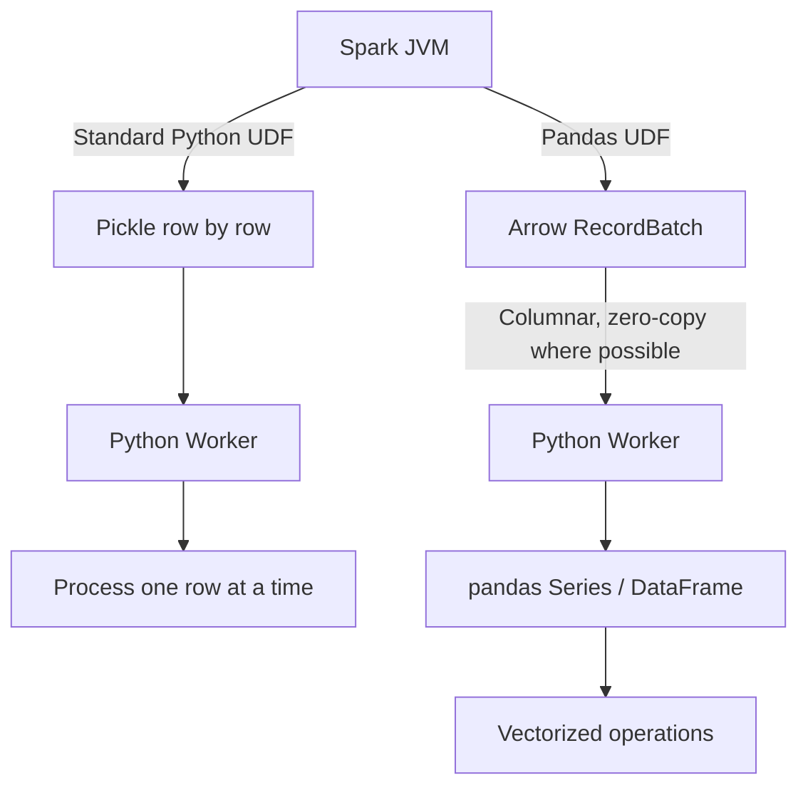

# 2.7.5 What is Apache Arrow and how does it relate to Pandas UDFs?

Apache Arrow is the in-memory columnar data format that makes Pandas UDFs fast. It replaces the row-by-row pickle serialization of standard Python UDFs with batched, columnar data transfer between the JVM and Python workers.



### What Apache Arrow Is

| Property | Description |
|---|---|
| **Core definition** | An in-memory columnar data format used to transfer data efficiently between JVM and Python processes |
| **Design goal** | Eliminate the serialization overhead of row-by-row pickling |
| **Data layout** | Columnar, meaning values of the same column are stored contiguously in memory |
| **Interoperability** | Zero-copy sharing between systems that support the format, including Spark, pandas, and NumPy |
| **Primary use in Spark** | The transport layer for Pandas UDFs (vectorized UDFs) and for `toPandas()` / `createDataFrame()` conversions |

### How Arrow Connects to Pandas UDFs

A Pandas UDF is a vectorized Python UDF that uses Arrow to transfer data between the JVM and Python in columnar batches, then operates on pandas Series or DataFrames inside Python.

The `@pandas_udf` decorator triggers this Arrow-based path. No additional configuration is required in modern Spark versions.

```python
from pyspark.sql.functions import pandas_udf
import pandas as pd

@pandas_udf("double")
def zscore(s: pd.Series) -> pd.Series:
    return (s - s.mean()) / s.std()
```

### The Data Flow: Standard UDF vs. Pandas UDF

The table below contrasts the two paths at the transport level.

| Aspect | Standard Python UDF | Pandas UDF (Arrow) |
|---|---|---|
| **Transport format** | Pickle, per row | Arrow, per columnar batch |
| **Batch size** | 1 row | Up to `spark.sql.execution.arrow.maxRecordsPerBatch` (default 10000) |
| **Boundary crossings** | One per row | One per batch |
| **Zero-copy potential** | None | Yes, for compatible types and non-null data |
| **Plan node** | `BatchEvalPython` | `ArrowEvalPython` |

### What "Zero-Copy" Means (and What It Does Not)

Arrow's columnar layout allows the JVM and Python worker to share the same memory buffers for certain data types and conditions. This avoids the cost of serializing and copying every value.

| Scenario | Zero-copy achievable? | Note |
|---|---|---|
| Primitive numeric columns, no nulls | Yes, in many cases | Buffer can be shared directly |
| Columns with NULL values | Often no | Deep copies may be triggered |
| String columns | Generally no | Variable-length encoding requires copying |
| Nested or complex types | Limited | Support varies by version |

The "zero-copy" promise is real but narrow. In practice, Arrow still delivers a large performance gain by batching and using a columnar format, even when some copying is required.

### Performance Impact of Arrow in Pandas UDFs

| Metric | Standard UDF | Pandas UDF (Arrow) |
|---|---|---|
| **Serialization overhead** | Per row, dominates runtime | Amortized across batches |
| **Vectorization** | None. Python loop per row | Yes. pandas/NumPy C-level operations |
| **GIL impact** | Bound per row | Amortized across batch |
| **Relative speed** | Baseline (slowest) | Up to 5.76x faster than scalar Python UDFs |
| **Memory usage** | High due to Python objects per row | Lower. Columnar buffers instead of objects |

### Arrow Beyond Pandas UDFs

Arrow is also the transport for several other Spark-Python interop paths.

| Feature | Relationship to Arrow |
|---|---|
| `toPandas()` | Uses Arrow for efficient columnar conversion when enabled |
| `createDataFrame(pandas_df)` | Uses Arrow for the reverse conversion |
| `mapInPandas` | Uses Arrow to pass iterator of DataFrame batches |
| `applyInPandas` (grouped map) | Uses Arrow for per-group DataFrame transfer |
| **Arrow-native UDFs** (newer) | Operate directly on `pyarrow.Array` objects, skipping pandas conversion entirely. Benchmarks show ~10% faster and ~40% less memory than Pandas UDFs |

### Key Configuration Knobs

| Config | Default | Effect |
|---|---|---|
| `spark.sql.execution.arrow.pyspark.enabled` | Version dependent | Enables Arrow for `toPandas()` / `createDataFrame()` |
| `spark.sql.execution.arrow.maxRecordsPerBatch` | 10000 | Rows per Arrow batch in Pandas UDFs |
| `spark.sql.execution.arrow.pyspark.fallback.enabled` | `true` | Falls back to non-Arrow path if an error occurs |

### Summary

- Apache Arrow is the columnar in-memory format that Spark uses to move data between the JVM and Python.
- Pandas UDFs depend on Arrow to transfer data in batches instead of row-by-row pickled objects.
- The result is dramatically lower serialization overhead, vectorized execution, and better memory efficiency.
- True zero-copy is limited to specific type and null conditions, but the batching benefit alone makes Arrow the foundation of performant Python UDFs in Spark.
