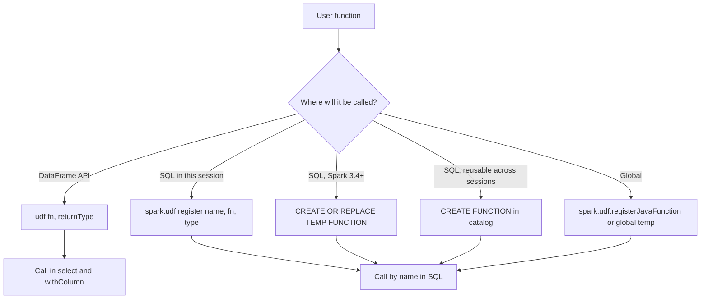

# 2.7.6 How do you register a UDF to be used in Spark SQL?

Registration has three separate concerns: the function body, the return type, and the scope. Spark SQL cannot call a Python or Scala function unless it is registered in the session catalog or the global catalog.



### Registration paths

| Path | Scope | Language | Spark version |
|---|---|---|---|
| `udf(fn, returnType)` | DataFrame API only | Python, Scala | All |
| `spark.udf.register(name, fn, type)` | Session catalog, SQL callable | Python, Scala | All |
| `CREATE OR REPLACE TEMP FUNCTION` | Session catalog, SQL callable | SQL | 3.4+ |
| `CREATE FUNCTION ... USING JAR` | Persistent, metastore | Scala or Java | All |
| `spark.udf.registerJavaFunction` | Session catalog, SQL callable | Scala or Java | All |
| `CREATE FUNCTION` with Python | Persistent | Python | Hive or Unity only, not vanilla Spark |
| Global temp function | Cluster wide | Any | All |

### PySpark session registration

```python
from pyspark.sql import SparkSession
from pyspark.sql.types import StringType, IntegerType

spark = SparkSession.builder.getOrCreate()

def to_upper(s):
    return s.upper() if s is not None else None

# Session scoped, callable from SQL
spark.udf.register("to_upper", to_upper, StringType())

spark.sql("SELECT to_upper(name) FROM t").show()
```

| Argument | Meaning | Notes |
|---|---|---|
| `name` | SQL function name | Case insensitive in SQL |
| `f` | Python function | Plain function, no Spark context inside |
| `returnType` | Spark type | String, Integer, Double, ArrayType, StructType, and so on |
| `deterministic` | Optional, defaults to `True` | Set `False` for random, time, or UUID |

### PySpark with the `udf` wrapper

`udf()` returns a Column expression. It does not register the function in SQL.

```python
from pyspark.sql.functions import udf, col
from pyspark.sql.types import IntegerType

add_one = udf(lambda x: x + 1 if x is not None else None, IntegerType())

df.withColumn("y", add_one(col("x")))
```

| API | Callable from SQL | Callable from DataFrame |
|---|---|---|
| `udf(...)` | No | Yes |
| `spark.udf.register(...)` | Yes | No, unless wrapped again |
| Both, same function | Register once, wrap once | Common pattern for dual use |

Register the same function twice when both SQL and DataFrame use are needed.

```python
add_one_df = udf(lambda x: x + 1 if x is not None else None, IntegerType())
spark.udf.register("add_one", lambda x: x + 1 if x is not None else None, IntegerType())
```

### SQL UDF in Spark 3.4+

`CREATE FUNCTION` defines the function in SQL. The body is a Spark SQL expression, so it is visible to Catalyst and can be inlined.

```sql
CREATE OR REPLACE TEMP FUNCTION to_upper_sql(s STRING)
RETURNS STRING
RETURN upper(s);

SELECT to_upper_sql(name) FROM t;
```

| Property | Behavior |
|---|---|
| Scope | Session or catalog depending on `TEMP` |
| Body language | Spark SQL expression |
| Catalyst visibility | Yes. Inlined into the plan |
| Codegen | Preserved |
| Nesting | Can call other SQL functions and native functions |
| Performance | Close to native. No boundary crossing |

SQL UDFs are the fastest registered UDF form because they are not opaque to the optimizer.

### Persistent functions

A `CREATE FUNCTION` without `TEMP` goes into the catalog and persists across sessions.

```sql
CREATE FUNCTION analytics.to_upper_sql(s STRING)
RETURNS STRING
RETURN upper(s);
```

| Requirement | Note |
|---|---|
| Database must exist | `CREATE DATABASE IF NOT EXISTS analytics` first |
| Metastore | Hive metastore, Unity Catalog, or another catalog backend |
| Permissions | The session user must have `CREATE FUNCTION` rights |
| Versioning | `CREATE OR REPLACE` overwrites. No built-in versioning |

Use persistent functions for shared business logic. Use session functions for ad hoc work.

### JVM UDF registration

Register a Java or Scala class by name. The class must extend `org.apache.spark.sql.api.java.UDFn`.

```scala
spark.udf.registerJavaFunction(
  "to_upper_jvm",
  "com.example.ToUpper",
  org.apache.spark.sql.types.StringType
)
```

| Requirement | Note |
|---|---|
| Class on classpath | Include the jar with `--jars` or `spark.jars` |
| Implements `UDF1`, `UDF2`, ... | Match the number of arguments |
| `call` method | The actual logic |
| Return type | Passed to the registration call |
| No Python bridge | Runs in the executor JVM |

This path avoids the Python boundary and is a common way to get JVM library access without a Scala build in the app.

### PySpark pandas UDF registration

`pandas_udf` can also be registered for SQL.

```python
from pyspark.sql.functions import pandas_udf
import pandas as pd

@pandas_udf("string")
def to_upper_vec(s: pd.Series) -> pd.Series:
    return s.str.upper()

spark.udf.register("to_upper_vec", to_upper_vec)
```

| Aspect | Note |
|---|---|
| Arrow path | Used automatically when the type allows |
| Plan node | `ArrowEvalPython` in SQL plans |
| Return type | Taken from the decorator, not the register call |
| Registration call | `register` accepts the wrapped function |

### Return types

The return type is mandatory for `spark.udf.register`. Missing it or passing the wrong type gives wrong results or errors.

| Python return | Spark type | Note |
|---|---|---|
| `str` | `StringType()` | Most common |
| `int` | `IntegerType()` | `LongType()` if range exceeds int |
| `float` | `DoubleType()` | `FloatType()` only if precision allows |
| `bool` | `BooleanType()` | |
| `datetime.date` | `DateType()` | |
| `datetime.datetime` | `TimestampType()` | Timezone depends on session |
| `list` | `ArrayType(elementType)` | Element type must match |
| `dict` | `MapType(keyType, valType)` | |
| Named tuple or dict | `StructType([...])` | Field names and types must match |
| `None` return | Any nullable type | Spark handles null |

Wrong return types cause silent coercion, nulls, or task failures. Always pass an explicit type.

### Null handling

| Case | Behavior |
|---|---|
| Null argument | Spark passes `None` to the function |
| No null check | `AttributeError` and task failure |
| Return `None` | Encoded as null |
| Type declared non-nullable | Some Spark versions still allow null returns |

Guard against nulls inside the function. Spark does not skip null rows for UDFs.

```python
def safe_upper(s):
    if s is None:
        return None
    return s.upper()

spark.udf.register("safe_upper", safe_upper, StringType())
```

### Determinism

| Setting | Use |
|---|---|
| `deterministic=True` (default for Python) | Spark may fold and cache repeated calls |
| `deterministic=False` | Force per-call evaluation |

```python
import random
from pyspark.sql.types import DoubleType

spark.udf.register(
    "rand_val",
    lambda: random.random(),
    DoubleType(),
    deterministic=False
)
```

Non-deterministic functions used in a plan must be marked. Otherwise the optimizer may reuse a cached result and produce identical values across rows.

### Scope and lifetime

| Scope | Registration | Lifetime |
|---|---|---|
| Session | `spark.udf.register` | Until the session ends |
| Temp function | `CREATE OR REPLACE TEMP FUNCTION` | Until the session ends |
| Persistent function | `CREATE FUNCTION` in a database | Until dropped |
| Global temp | `spark.udf.register` on `global_temp` | Until the application ends |
| Built-in function | Override with the same name | Session only |

Registering a function with a name that matches a built-in shadows the built-in. This is allowed but confusing. Use a distinct name.

### Drop and inspect

| Action | Command |
|---|---|
| List functions in current database | `SHOW FUNCTIONS` |
| Describe a function | `DESCRIBE FUNCTION name` |
| Drop a temp function | `DROP TEMPORARY FUNCTION name` |
| Drop a persistent function | `DROP FUNCTION db.name` |
| Drop from PySpark | `spark.catalog.dropTempFunction(name)` |
| Drop persistent from PySpark | `spark.catalog.dropGlobalTempView` is different. Use `DROP FUNCTION` in SQL |

```python
spark.catalog.dropTempFunction("to_upper")
```

### Common pitfalls

| Pitfall | Effect | Fix |
|---|---|---|
| Missing return type | Error or wrong type | Always pass an explicit type |
| Wrong return type | Silent coercion or nulls | Match the actual return values |
| Not handling null | Task failure | Null check inside the function |
| Registering with a name that shadows a built-in | Confusing behavior | Use a distinct name |
| Using `udf()` and expecting SQL access | `udf()` does not register | Use `spark.udf.register` |
| Using `spark.udf.register` in `withColumn` | Returns None, not a Column | Use `udf()` for DataFrame, `register` for SQL |
| Non-deterministic function not marked | Reused values across rows | `deterministic=False` |
| Importing Spark context inside the function | Serialization error | Plain Python only inside the function |
| Relying on a temp function in a new session | Not found | Use persistent `CREATE FUNCTION` |
| Closing the session and reusing the name | Old definition gone | Re-register on session start |

### End to end example

```python
from pyspark.sql import SparkSession
from pyspark.sql.functions import udf, col
from pyspark.sql.types import StringType, IntegerType

spark = SparkSession.builder.getOrCreate()

def clean_name(s):
    if s is None:
        return "UNKNOWN"
    return s.strip().title()

# DataFrame API
clean_df = udf(clean_name, StringType())

# SQL API, same function
spark.udf.register("clean_name", clean_name, StringType())

df = spark.createDataFrame([("alice",), ("  bob ",), (None,)], ["name"])

df.withColumn("clean_df", clean_df(col("name"))).show()

spark.sql("SELECT clean_name(name) AS clean_sql FROM t").show()
```

| name | clean_df | clean_sql |
|---|---|---|
| alice | Alice | Alice |
| `"  bob "` | Bob | Bob |
| null | UNKNOWN | UNKNOWN |

### Checklist

- Use `spark.udf.register` for SQL, `udf()` for DataFrame.
- Register both if both are needed.
- Always pass an explicit return type.
- Handle nulls inside the function.
- Mark non-deterministic functions with `deterministic=False`.
- Prefer `CREATE FUNCTION` in SQL for reuse across sessions.
- Use a name that does not shadow a built-in.
- Drop temp functions when no longer needed.
- Keep the function body plain. No Spark context, no module level state.
