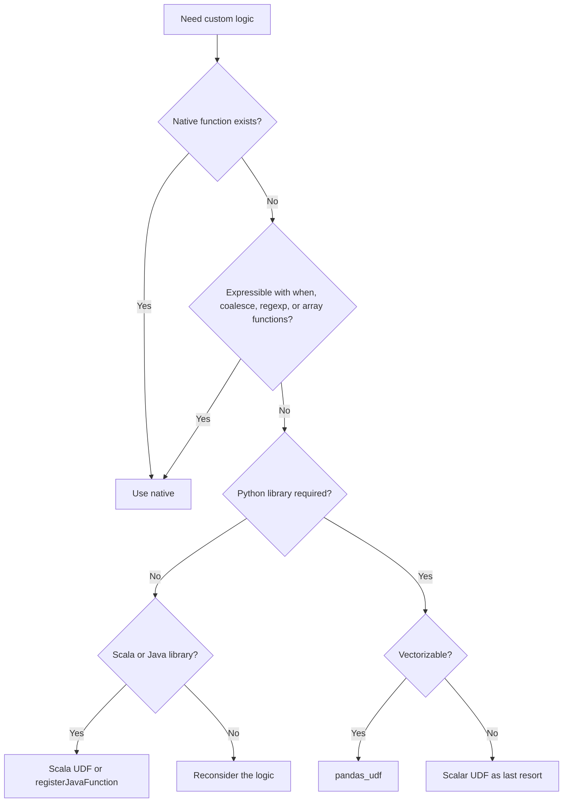

# 2.7.7 When should you avoid using a UDF entirely?

Avoid a UDF whenever a native function, expression, or SQL construct produces the same result. A UDF is the last resort, not the first tool. The cost is codegen loss, optimizer blindness, serialization, and slower execution.



### Hard rules

| Rule | Reason |
|---|---|
| Never in a join key | Breaks broadcast and shuffle hash join. Precompute natively |
| Never in a filter predicate | Disables pushdown. Full partition processed then filtered |
| Never in a partition or bucketing column | Breaks pruning and file skipping |
| Never in a group by or aggregate key | Forces shuffle on an opaque expression |
| Never alongside native functions in a hot projection | Native siblings also lose codegen |
| Never for logic that exists as a built-in | Slower than native by 10x to 100x |
| Never inside `pivot` aggregation if native works | Slower and opaque |
| Never for null coalescing | Use `coalesce`, `nvl`, `when` |
| Never for case conversion | Use `upper`, `lower`, `initcap` |
| Never for regex | Use `regexp_extract`, `regexp_replace`, `rlike` |
| Never for date math | Use `date_add`, `date_sub`, `datediff`, `add_months` |
| Never for JSON parsing | Use `from_json`, `get_json_object`, `json_tuple` |

### Native function coverage

Check these before writing a UDF. Most UDF candidates already exist.

| Need | Native function |
|---|---|
| Case conversion | `upper`, `lower`, `initcap`, `ucase`, `lcase` |
| Trim | `trim`, `ltrim`, `rtrim`, `btrim` |
| String search | `instr`, `locate`, `position` |
| String length | `length`, `char_length`, `octet_length` |
| Substring | `substring`, `substr`, `left`, `right` |
| Split | `split`, `substring_index` |
| Replace | `replace`, `regexp_replace`, `translate` |
| Regex extract | `regexp_extract`, `regexp_extract_all` |
| Regex test | `rlike`, `regexp_like`, `regexp` |
| Concatenate | `concat`, `concat_ws` |
| Pad | `lpad`, `rpad` |
| Repeat | `repeat` |
| Reverse | `reverse` |
| Format string | `format_string`, `printf` |
| Case insensitive match | `ilike` (Spark 3.3+) |
| Null handling | `coalesce`, `nvl`, `nvl2`, `nullif`, `ifnull` |
| Conditionals | `when`, `otherwise`, `if`, `case` |
| Casting | `cast`, `try_cast` |
| Date parse | `to_date`, `to_timestamp`, `try_to_date` |
| Date math | `date_add`, `date_sub`, `datediff`, `add_months`, `last_day`, `next_day` |
| Date extract | `year`, `month`, `dayofmonth`, `hour`, `minute`, `second`, `quarter`, `dayofweek` |
| Date truncate | `date_trunc`, `trunc` |
| Format date | `date_format` |
| Current time | `current_date`, `current_timestamp`, `now` |
| Timezone | `from_utc_timestamp`, `to_utc_timestamp` |
| Array build | `array`, `array_repeat`, `sequence` |
| Array access | `element_at`, `size`, `array_contains`, `array_position` |
| Array transform | `transform`, `filter`, `aggregate`, `exists`, `forall` |
| Array flatten | `flatten`, `array_distinct`, `array_sort`, `sort_array` |
| Array set ops | `array_intersect`, `array_union`, `array_except` |
| Map build | `map`, `map_from_arrays`, `map_from_entries` |
| Map access | `element_at`, `map_keys`, `map_values`, `map_entries` |
| Struct build | `struct`, `named_struct` |
| Struct access | `col("s.field")`, `getField` |
| JSON | `from_json`, `to_json`, `get_json_object`, `json_tuple`, `schema_of_json` |
| Hash | `md5`, `sha1`, `sha2`, `crc32`, `hash`, `xxhash64` |
| Encode and decode | `encode`, `decode`, `base64`, `unbase64` |
| Random | `rand`, `randn` |
| Math | `abs`, `ceil`, `floor`, `round`, `sqrt`, `pow`, `log`, `exp` |
| Trig | `sin`, `cos`, `tan`, `asin`, `acos`, `atan`, `atan2` |
| Bitwise | `&`, `\|`, `^`, `~`, `shiftleft`, `shiftright` |
| Type checks | `isnull`, `isnotnull`, `isnan` |
| Approximate | `approx_count_distinct`, `percentile_approx` |
| Window | `row_number`, `rank`, `dense_rank`, `lag`, `lead`, `ntile`, `cume_dist` |
| Window frames | `sum`, `avg`, `min`, `max` over `rowsBetween` or `rangeBetween` |
| Higher order | `transform`, `filter`, `aggregate`, `zip_with`, `map_filter`, `map_zip_with` |

This is a partial list. Check the Spark SQL functions page for the full set in your version.

### Use case table: avoid or use

| Requirement | Avoid UDF | Use instead |
|---|---|---|
| Convert case | Yes | `upper`, `lower` |
| Trim whitespace | Yes | `trim`, `regexp_replace` |
| Extract digits | Yes | `regexp_replace(col, "[^0-9]", "")` |
| Parse date | Yes | `to_date`, `to_timestamp` |
| Add days | Yes | `date_add`, `date_sub` |
| Days between dates | Yes | `datediff` |
| Extract year from timestamp | Yes | `year` |
| Current date | Yes | `current_date` |
| Split CSV field | Yes | `split` |
| Concatenate names | Yes | `concat_ws` |
| Null to default | Yes | `coalesce` |
| Conditional value | Yes | `when` |
| Cast type | Yes | `cast`, `try_cast` |
| JSON extract | Yes | `from_json`, `get_json_object` |
| Array transform | Yes | `transform`, `filter` |
| Array dedup | Yes | `array_distinct` |
| Array sort | Yes | `array_sort` |
| Map lookup | Yes | `element_at`, `col("m.key")` |
| Hash a value | Yes | `md5`, `sha2`, `xxhash64` |
| Random number | Yes | `rand`, `randn` |
| Round or floor | Yes | `round`, `ceil`, `floor` |
| Absolute value | Yes | `abs` |
| Window rank | Yes | `row_number`, `rank` |
| Window lag or lead | Yes | `lag`, `lead` |
| Approximate distinct count | Yes | `approx_count_distinct` |
| Regex replace | Yes | `regexp_replace` |
| Regex extract | Yes | `regexp_extract` |
| Regex filter | Yes | `rlike`, `regexp_like` |
| Locale sensitive conversion | No | Justified UDF |
| Proprietary algorithm | No | Justified UDF |
| Third party SDK call | No | Justified UDF |
| ML feature with sklearn | No | Justified `pandas_udf` |
| Numeric library not in Spark | No | Justified `pandas_udf` |

### Pattern replacements

Many UDFs can be rewritten as native expressions. These are common shapes.

| UDF shape | Native rewrite |
|---|---|
| `if x is null then default else x` | `coalesce(x, lit(default))` |
| `if cond then a else b` | `when(cond, a).otherwise(b)` |
| `if x in (a, b, c)` | `col("x").isin(a, b, c)` |
| `x.strip().upper()` | `upper(trim(col("x")))` |
| `x.split(",")[0]` | `split(col("x"), ",")[0]` |
| `x.replace("-", "")` | `regexp_replace(col("x"), "-", "")` |
| `re.sub(r"[^0-9]", "", x)` | `regexp_replace(col("x"), "[^0-9]", "")` |
| `re.search(pattern, x).group(1)` | `regexp_extract(col("x"), pattern, 1)` |
| `re.match(pattern, x)` | `col("x").rlike("^" + pattern)` |
| `x[:3]` | `substring(col("x"), 1, 3)` |
| `x[-3:]` | `right(col("x"), 3)` |
| `len(x)` | `length(col("x"))` |
| `x + y` | `col("x") + col("y")` |
| `abs(x)` | `abs(col("x"))` |
| `x ** 2` | `col("x") * col("x")` or `pow(col("x"), 2)` |
| `math.log(x)` | `log(col("x"))` |
| `datetime.now()` | `current_timestamp()` |
| `date.today()` | `current_date()` |
| `x + timedelta(days=7)` | `date_add(col("x"), 7)` |
| `(end - start).days` | `datediff(col("end"), col("start"))` |
| `x.strftime("%Y-%m")` | `date_format(col("x"), "yyyy-MM")` |
| `[y for y in x if cond]` | `filter(col("x"), lambda y: cond)` |
| `[f(y) for y in x]` | `transform(col("x"), lambda y: f(y))` |
| `sum(y for y in x)` | `aggregate(col("x"), lit(0), lambda acc, y: acc + y)` |
| `any(cond)` | `exists(col("x"), lambda y: cond)` |
| `all(cond)` | `forall(col("x"), lambda y: cond)` |
| `set(x)` | `array_distinct(col("x"))` |
| `sorted(x)` | `array_sort(col("x"))` |
| `dict(zip(k, v))` | `map_from_arrays(col("k"), col("v"))` |
| `json.loads(x)["field"]` | `get_json_object(col("x"), "$.field")` |
| `json.loads(x)` with schema | `from_json(col("x"), schema)` |
| `hashlib.md5(x)` | `md5(col("x"))` |
| `uuid.uuid4()` | `uuid()` (Spark 3.3+) |
| `random.random()` | `rand()` |

### Architectural reasons to avoid UDFs

| Reason | Detail |
|---|---|
| Portability | UDFs lock the pipeline to Spark and to a specific registration |
| Testability | UDFs need a Spark session to test. Native expressions can be unit tested as SQL |
| Governance | Persisted UDFs require catalog permissions and versioning |
| Debugging | The plan shows `BatchEvalPython`, hiding the logic from `explain` |
| Cost visibility | The optimizer cannot estimate UDF cost. Statistics degrade |
| Schema evolution | UDF return types are declared, but not checkable at parse time |
| Cross engine | Trino, BigQuery, Snowflake do not understand Spark UDFs. A pipeline using UDFs cannot be ported |

### Cases where a UDF is justified

| Case | Why native cannot do it |
|---|---|
| Locale sensitive case conversion | Native functions use the JVM default locale only |
| Proprietary or licensed algorithm | Not in Spark. Not in open source |
| Machine learning feature using sklearn, numpy | Model inference is not a SQL expression |
| Parsing a format not covered by native functions | Example: custom EDI or proprietary binary |
| Third party SDK call (geocoding, address validation) | External service call |
| Complex stateful logic across rows | Native functions are stateless |
| Numerical methods needing iteration | Native has `aggregate`, but only for simple folds |
| Cross column logic with dynamic schema | Hard to express with `when` on a variable column set |

Even in these cases, prefer `pandas_udf` over scalar, and Scala UDF over Python when possible.

### Comparison table

| Approach | Native | SQL UDF | Scala UDF | `pandas_udf` | Scalar Python UDF |
|---|---|---|---|---|---|
| Codegen | Full | Full | Off | Partial | Off |
| Predicate pushdown | Yes | Yes | No | No | No |
| Serialization | None | None | None | Batched Arrow | Per row pickle |
| Relative speed | 1x | ~1x | 2x to 10x slower | 2x to 5x slower | 10x to 100x slower |
| Portability | Any Spark | Any Spark | Spark + JVM jar | Spark + Python | Spark + Python |
| Testing without Spark | Yes, as SQL | Yes, as SQL | Needs Spark | Needs Spark | Needs Spark |

### Decision checklist

| Question | If yes | If no |
|---|---|---|
| Is there a native function for this? | Use it. Done | Continue |
| Can it be expressed with `when`, `coalesce`, `regexp`, `array`, or `struct` functions? | Use those. Done | Continue |
| Is it a join, filter, or aggregate key? | Precompute natively or restructure. Done | Continue |
| Is it in a performance critical projection? | Isolate it or rewrite. Done | Continue |
| Is a Python library genuinely required? | Use `pandas_udf` | Continue |
| Is a JVM library genuinely required? | Use a Scala UDF or `registerJavaFunction` | Continue |
| Is the input tiny, one off, prototyping? | Scalar UDF acceptable | Continue |
| Still no native equivalent? | Scalar UDF as last resort | Reconsider the logic |

### Common anti patterns

| Anti pattern | Symptom | Fix |
|---|---|---|
| UDF for `upper` or `trim` | `BatchEvalPython` node in plan | Replace with native |
| UDF in a `filter` | Filter runs after the UDF, full partition processed | Filter natively, UDF last or removed |
| UDF in a join key | No broadcast join, huge shuffle | Precompute natively |
| UDF returning a struct built by hand | Slow and brittle | Use `struct` or `named_struct` |
| UDF for date extraction | Codegen off | Use `year`, `month`, `dayofmonth` |
| UDF for regex extraction | Slower than native | Use `regexp_extract` |
| UDF wrapping a single library call | Often replaceable | Check the library. Many have Spark bindings |
| UDF that returns `None` on every row | Schema inference wrong | Check the function. Wrong return type |
| Registered UDF shadowing a built-in | Confusing behavior | Rename |
| UDF in a hot loop over a DataFrame | Many UDF calls per row | Rewrite as one expression |

### End to end comparison

```python
from pyspark.sql import SparkSession
from pyspark.sql.functions import udf, col, upper, trim, regexp_replace
from pyspark.sql.types import StringType

spark = SparkSession.builder.getOrCreate()
df = spark.range(1_000_000).withColumn("s", col("id").cast("string"))

# Bad: UDF for logic that is entirely native
@udf(returnType=StringType())
def clean(s):
    if s is None:
        return ""
    return s.strip().upper().replace("-", "")

bad = df.select(clean(col("s"))).explain("formatted")

# Good: same logic, fully native, full codegen
good = (
    df.select(
        regexp_replace(upper(trim(col("s"))), "-", "").alias("clean")
    )
    .explain("formatted")
)
```

| Path | Plan node | Codegen | Speed |
|---|---|---|---|
| `clean` UDF | `BatchEvalPython` | Off | Slowest |
| Native chain | `Project` only | Full | Fastest |

The native version is shorter, faster, testable as SQL, and portable. The UDF version offers nothing.

### Summary

- Avoid a UDF whenever a native function or expression produces the same result.
- Avoid a UDF in join, filter, partition, and aggregate keys unconditionally.
- Avoid a UDF alongside native functions in a hot projection.
- Avoid a UDF for logic that is a one line rewrite with `when`, `coalesce`, `regexp`, or array functions.
- Use `pandas_udf` only when a Python library is genuinely required.
- Use a Scala UDF only when a JVM library is genuinely required.
- Keep scalar Python UDFs for prototyping or tiny data.
- When the logic is not native, ask first whether the pipeline can be restructured. Often the real fix is a better data model, not a faster UDF.
