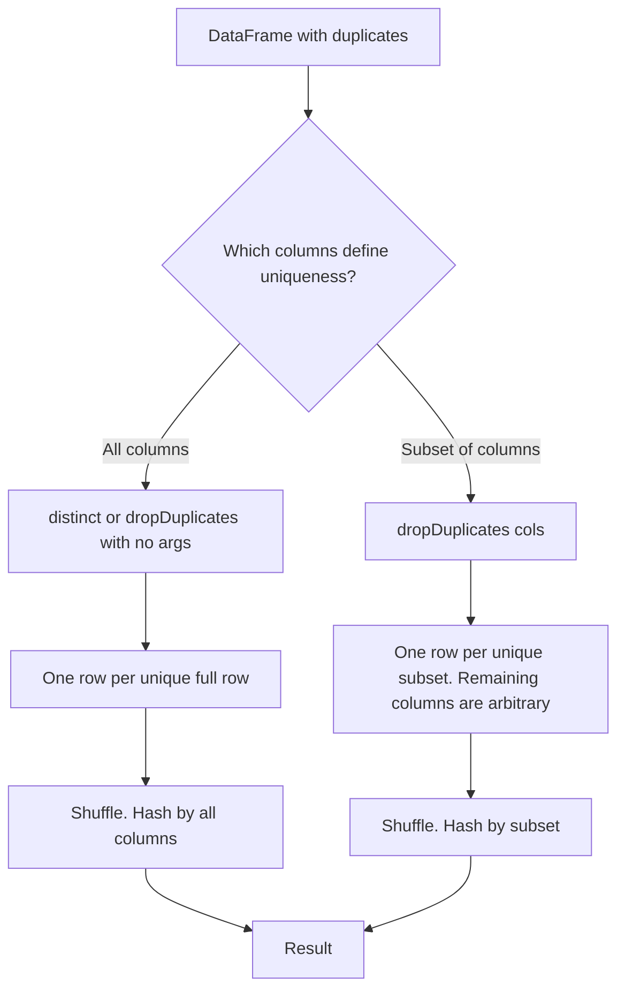

# 2.8.1 What is the difference between dropDuplicates() and distinct()?

Both remove duplicate rows and both require a shuffle. The difference is scope: `distinct()` always considers every column, while `dropDuplicates()` can be limited to a subset of columns.



### Core comparison

| Topic | `distinct()` | `dropDuplicates(cols)` |
|---|---|---|
| Columns considered | All columns | Only the listed columns |
| Signature | `df.distinct()` | `df.dropDuplicates(["a", "b"])` |
| Equivalent to | `dropDuplicates()` with no args | Not expressible with `distinct()` |
| Which row survives a duplicate group | Any one. Not deterministic | Any one. Not deterministic |
| Deterministic result | Set of unique rows is deterministic | Kept row per key is not deterministic |
| Shuffle | Yes | Yes |
| Null handling | Nulls treated as equal | Nulls treated as equal within subset |
| Empty args | All columns | All columns, same as distinct |
| Return type | Same schema | Same schema, no column reduction |

### Behavioral examples

```python
from pyspark.sql import SparkSession

spark = SparkSession.builder.getOrCreate()

df = spark.createDataFrame(
    [
        (1, "a", 100),
        (1, "a", 200),
        (2, "b", 300),
        (2, "b", 300),
    ],
    ["id", "name", "amount"]
)
```

| Call | Result rows | Note |
|---|---|---|
| `df.distinct()` | 3 rows | `(1, "a", 100)` and `(1, "a", 200)` both kept because `amount` differs |
| `df.dropDuplicates()` | 3 rows | Same as distinct |
| `df.dropDuplicates(["id", "name"])` | 2 rows | One row per id and name pair. `amount` is arbitrary |

The subset version is the reason `dropDuplicates` exists. It answers the question "one row per key", not "one row per full row".

### Which row survives with a subset

Spark keeps one row per subset key. Which row is not guaranteed.

| Scenario | Behavior |
|---|---|
| All rows in the group identical | Same result regardless |
| Rows differ in other columns | Arbitrary. Ties are not broken by row order, partition, or file order |
| Rerun on the same data | May produce a different kept row |
| Rerun after repartition | May produce a different kept row |
| Small differences in input | May produce a different kept row |

Do not rely on which row is kept. If a specific row must survive, use `row_number` with an explicit ordering.

### Deterministic dedup with `row_number`

When the kept row matters, order by a column and take the first.

```python
from pyspark.sql.functions import col, row_number
from pyspark.sql.window import Window

w = Window.partitionBy("id", "name").orderBy(col("amount").desc())

dedup = (
    df.withColumn("rn", row_number().over(w))
      .filter(col("rn") == 1)
      .drop("rn")
)
```

| Approach | Kept row | Deterministic | Cost |
|---|---|---|---|
| `distinct` | Same row | Not relevant, rows are identical by definition | One shuffle |
| `dropDuplicates(subset)` | Arbitrary | No | One shuffle |
| `row_number` filter | The one with max or min by the order key | Yes | One shuffle plus sort |

Use `dropDuplicates` when any row is acceptable. Use `row_number` when a rule decides which one.

### Null handling

Both treat nulls as equal values during dedup.

| Row A | Row B | Deduped? |
|---|---|---|
| `(1, null)` | `(1, null)` | Yes, duplicates |
| `(null, "a")` | `(null, "a")` | Yes, duplicates |
| `(null, null)` | `(null, null)` | Yes, duplicates |
| `(1, null)` | `(1, "a")` | No, different |

This matches SQL group by semantics for nulls. Do not assume nulls are always distinct.

### Physical plan differences

| Aspect | `distinct` | `dropDuplicates(subset)` |
|---|---|---|
| Plan node | `HashAggregate` with grouping by all columns, or `Aggregate` with `first` | `HashAggregate` or `Aggregate` grouping by subset, `first` on other columns |
| Hash keys | All columns | Subset columns |
| Widening | None | Other columns must be aggregated, usually `first` |
| Cost | Hash on all columns. Wider rows means more hashing | Hash on fewer columns, but still carries wide rows through |
| Optimizer rewrite | `distinct` on all columns is `dropDuplicates()` | Same rewrite in reverse |

Both plans read all rows, shuffle by the grouping key, and keep one row per group.

### Performance

| Factor | `distinct` | `dropDuplicates(subset)` |
|---|---|---|
| Shuffle volume | All columns serialized | All columns serialized, because the row is carried |
| Hash cost | All columns | Subset columns, cheaper |
| Skew risk | Depends on data | Higher when subset has low cardinality and all rows for a key land on one task |
| Memory | One row per group | One row per group, wide rows are heavy |

Neither is free. Both are wide transformations. Cost scales with row count and row width.

### When to use which

| Need | Use |
|---|---|
| True duplicate rows, all columns identical | `distinct` |
| One row per business key | `dropDuplicates(subset)` |
| Any surviving row is acceptable | `dropDuplicates(subset)` |
| Specific surviving row required | `row_number` with ordering |
| Dedup before join | `dropDuplicates(subset)` on the join key |
| Dedup after a join explosion | `dropDuplicates(subset)` on the intended key |
| Dedup after `union` of identical schemas | `distinct` |
| Inspect whether full row duplication exists | `distinct` and compare `count` |

### Common pitfalls

| Pitfall | Effect | Fix |
|---|---|---|
| Assuming `dropDuplicates(subset)` keeps the latest or first row | Arbitrary row survives | Use `row_number` with ordering |
| Assuming `distinct` is cheaper than `dropDuplicates` | Both shuffle the full row | Compare plans, do not assume |
| Using `dropDuplicates` after a join without a key | Same as distinct | Pass the intended key |
| Using `distinct` on a DataFrame with many columns | Hashing all columns is expensive | Project needed columns first |
| Treating null as distinct | Nulls dedupe together | Confirm the business rule |
| Expecting stable output order | Order is not guaranteed | `orderBy` if order matters |
| Running dedup before filtering | Extra rows to shuffle | Filter first |
| Deduping after a wide shuffle | Wide rows move through the shuffle | Project and filter first |

### End to end example

```python
from pyspark.sql import SparkSession
from pyspark.sql.functions import col, count

spark = SparkSession.builder.getOrCreate()

df = spark.createDataFrame(
    [
        (1, "a", 100),
        (1, "a", 200),
        (2, "b", 300),
        (2, "b", 300),
        (3, None, 400),
        (3, None, 500),
    ],
    ["id", "name", "amount"]
)

full_distinct = df.distinct()
by_key        = df.dropDuplicates(["id", "name"])
```

| Result | Rows | Reason |
|---|---|---|
| `full_distinct` | 4 | Only `(2, "b", 300)` collapses. The rest differ in `amount` |
| `by_key` | 3 | One per `id` and `name` pair. `amount` is arbitrary |

### Rule of thumb

- `distinct` is `dropDuplicates()` with all columns.
- `dropDuplicates(cols)` is the tool when uniqueness is defined by a key, not by the full row.
- Neither guarantees which row survives when rows differ in non-key columns.
- Use `row_number` when the surviving row matters.
- Filter and project before dedup. Both are full shuffles.
