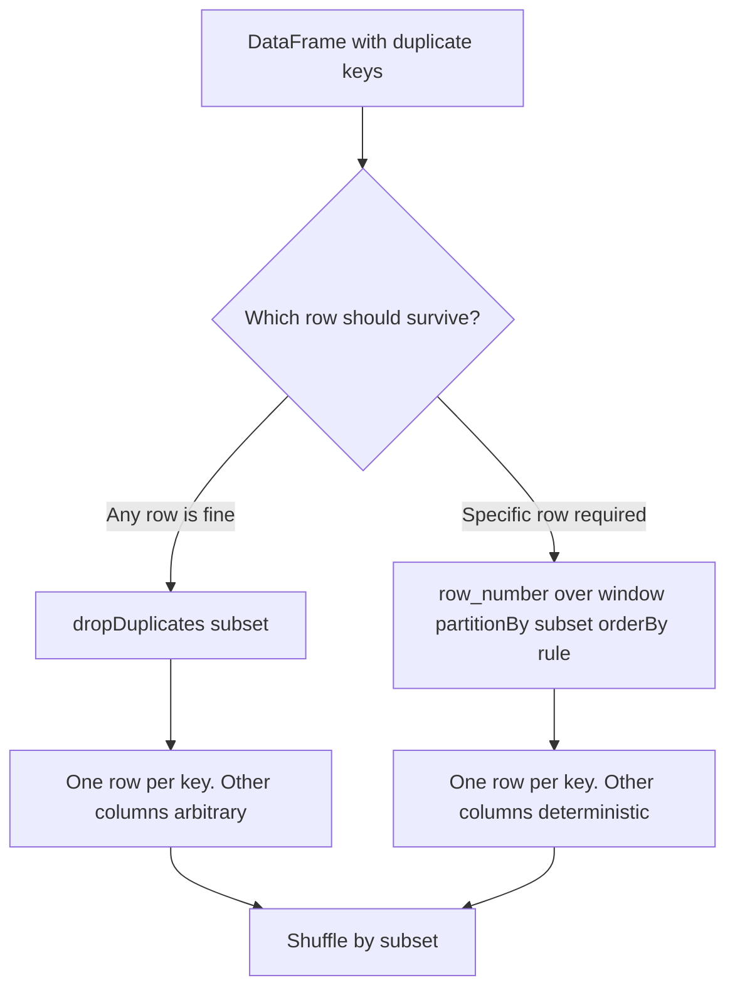

# 2.8.2 How do you drop duplicates based on a specific subset of columns?

## 2.8.2 How do you drop duplicates based on a specific subset of columns?

Pass the subset to `dropDuplicates`. Spark keeps one row per unique combination of those columns. Which row survives is arbitrary unless you add an explicit ordering.



### PySpark

```python
from pyspark.sql import SparkSession

spark = SparkSession.builder.getOrCreate()

df = spark.createDataFrame(
    [
        (1, "a", 100),
        (1, "a", 200),
        (2, "b", 300),
        (2, "b", 300),
    ],
    ["id", "name", "amount"]
)

dedup = df.dropDuplicates(["id", "name"])
```

### Scala

```scala
val dedup = df.dropDuplicates("id", "name")
```

### SQL

Spark SQL has no `dropDuplicates` keyword. Use one of these forms.

```sql
-- If only the subset columns are needed
SELECT DISTINCT id, name
FROM t;

-- If other columns are needed, arbitrary row per key
SELECT id, name, first(amount) AS amount
FROM t
GROUP BY id, name;
```

For a deterministic row per key, use `row_number`.

```sql
SELECT id, name, amount
FROM (
  SELECT
    id, name, amount,
    row_number() OVER (PARTITION BY id, name ORDER BY amount DESC) AS rn
  FROM t
) x
WHERE rn = 1;
```

### Method comparison

| Method | Keeps other columns | Deterministic | Notes |
|---|---|---|---|
| `dropDuplicates(["id","name"])` | Yes | No | Any row per key survives |
| `SELECT DISTINCT id, name` | No | Yes | Only subset columns |
| `GROUP BY id, name` with `first` | Yes | No | Arbitrary row per key |
| `row_number` filter | Yes | Yes | Order rule decides the survivor |

### Which row survives

| Case | `dropDuplicates(subset)` behavior |
|---|---|
| All rows in group identical | Same result every run |
| Rows differ in other columns | Arbitrary row survives |
| Rerun on same data | May keep a different row |
| Repartition before dedup | May keep a different row |
| Need latest or highest value | Use `row_number` with `orderBy` |

Spark has no `keep="first"` or `keep="last"` option. Use `row_number` when the survivor matters.

### Deterministic dedup with `row_number`

```python
from pyspark.sql.functions import col, row_number
from pyspark.sql.window import Window

w = Window.partitionBy("id", "name").orderBy(col("amount").desc())

dedup = (
    df.withColumn("rn", row_number().over(w))
      .filter(col("rn") == 1)
      .drop("rn")
)
```

| Goal | Order by |
|---|---|
| Keep highest amount | `orderBy(col("amount").desc())` |
| Keep lowest amount | `orderBy(col("amount").asc())` |
| Keep latest timestamp | `orderBy(col("updated_at").desc())` |
| Keep earliest row | `orderBy(col("created_at").asc())` |
| Tie break | Add a second column to `orderBy` |

### Null handling

Nulls are treated as equal values within the subset.

| Row A | Row B | Duplicate under subset |
|---|---|---|
| `(1, null)` | `(1, null)` | Yes |
| `(null, "a")` | `(null, "a")` | Yes |
| `(1, null)` | `(1, "a")` | No |
| `(null, null)` | `(null, null)` | Yes |

If null should not group, replace nulls with a sentinel before dedup or filter them out first.

### Performance notes

- `dropDuplicates(subset)` is a shuffle. It groups by the subset key.
- All columns are carried through the shuffle, not just the subset. Wide rows cost more.
- Project only needed columns before dedup when possible.
- Filter before dedup. Fewer rows means less shuffle.
- Low cardinality subsets cause skew. Many rows land on one task.
- High cardinality subsets spread better but produce more groups.
- `row_number` adds a sort per partition. It is more expensive than `dropDuplicates` but deterministic.

### Common pitfalls

| Pitfall | Effect | Fix |
|---|---|---|
| Assuming the latest row survives | Arbitrary row kept | Use `row_number` with `orderBy` |
| Deduping after a join without a key | Same as distinct | Pass the intended key |
| Passing a wide subset | Expensive hashing | Use only the business key |
| Deduping before filtering | Extra rows shuffled | Filter first |
| Expecting stable output order | Order is not guaranteed | `orderBy` after dedup |
| Treating null as distinct | Nulls dedupe together | Normalize nulls first |
| Using `distinct` on subset columns only | Other columns lost | Use `dropDuplicates(subset)` |
| Running dedup repeatedly | Repeated shuffles | Dedup once and persist if reused |

### End to end example

```python
from pyspark.sql import SparkSession
from pyspark.sql.functions import col, row_number
from pyspark.sql.window import Window

spark = SparkSession.builder.getOrCreate()

df = spark.createDataFrame(
    [
        (1, "a", 100, "2024-01-01"),
        (1, "a", 200, "2024-01-03"),
        (2, "b", 300, "2024-01-02"),
        (2, "b", 300, "2024-01-02"),
    ],
    ["id", "name", "amount", "updated_at"]
)

# Any row per key
any_row = df.dropDuplicates(["id", "name"])

# Latest row per key
w = Window.partitionBy("id", "name").orderBy(col("updated_at").desc())

latest = (
    df.withColumn("rn", row_number().over(w))
      .filter(col("rn") == 1)
      .drop("rn")
)
```

| Method | Rows | Survivor |
|---|---|---|
| `dropDuplicates(["id","name"])` | 2 | Arbitrary row for id 1 |
| `row_number` with latest `updated_at` | 2 | `(1, "a", 200, "2024-01-03")` for id 1 |

### Rule of thumb

- Use `dropDuplicates(["key1", "key2"])` when any row per key is acceptable.
- Use `row_number` when a rule decides the survivor.
- Use `SELECT DISTINCT` only when other columns are not needed.
- Filter and project before dedup. Both methods shuffle.
- Never assume Spark keeps the first or last row.
