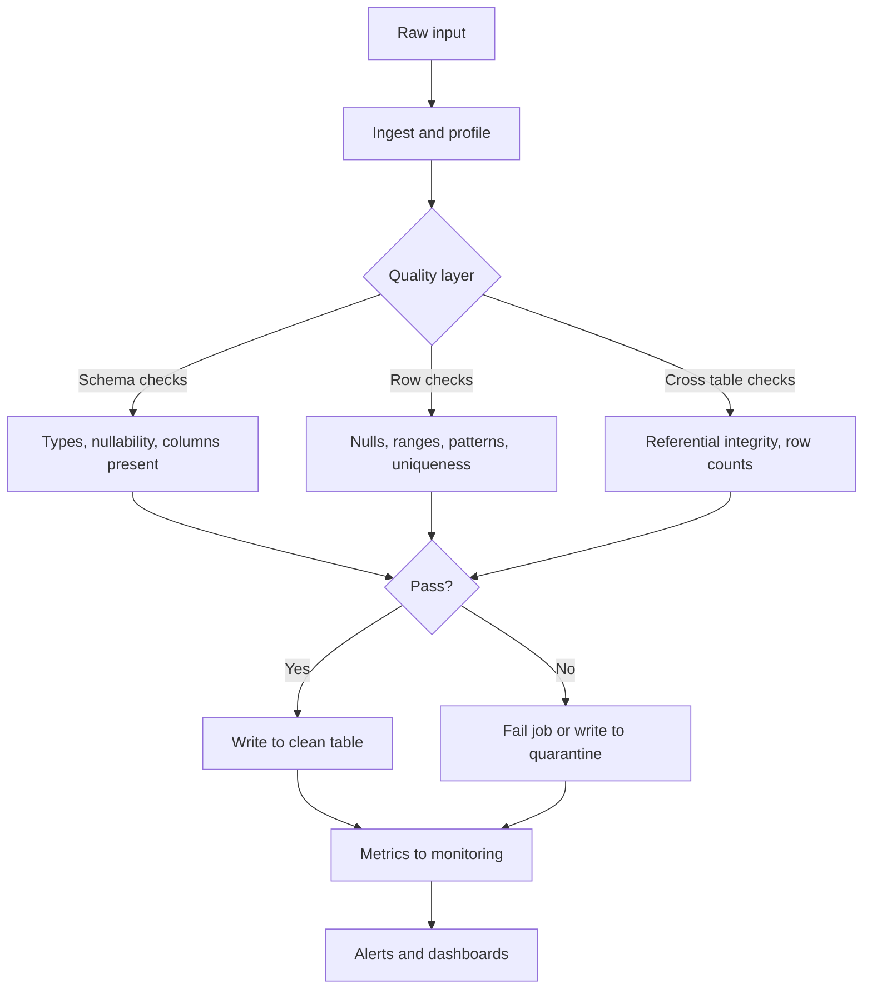

# 2.8.3 How do you implement data quality checks?

## 2.8.3 How do you implement data quality checks?

Data quality checks in Spark fall into two layers: assertions on the current batch (fail or quarantine) and monitoring over time (metrics and alerts). Most teams need both.



### Check categories

| Category | Question | Native tool |
|---|---|---|
| Schema | Are the expected columns present with the right types? | `df.schema`, `df.columns` |
| Completeness | Are required fields non-null? | `filter(col.isNull).count` |
| Uniqueness | Is the key unique? | `groupBy(key).count.filter(count > 1)` |
| Range | Are values within expected bounds? | `filter(col < min or col > max)` |
| Pattern | Do strings match the expected format? | `rlike`, `regexp_like` |
| Referential | Do foreign keys exist in the parent table? | `left_anti` join |
| Row count | Is the volume within expected bounds? | `df.count` compared to baseline |
| Distribution | Are categories and skew within limits? | `groupBy().count()`, `approxQuantile` |
| Freshness | Is the data recent enough? | `max(updated_at)` vs `current_timestamp` |
| Duplicate rows | Are full rows duplicated? | `df.count` vs `df.distinct.count` |

### Pattern 1: Aggregation checks in one pass

Run all row level checks in a single pass over the DataFrame. Avoid one job per check.

```python
from pyspark.sql.functions import col, count, when, sum as _sum, min as _min, max as _max

checks = df.agg(
    count("*").alias("total_rows"),
    _sum(when(col("id").isNull(), 1).otherwise(0)).alias("id_nulls"),
    _sum(when(col("amount") < 0, 1).otherwise(0)).alias("negative_amount"),
    _sum(when(~col("email").rlike(r"^[^@\s]+@[^@\s]+\.[^@\s]+$"), 1).otherwise(0)).alias("bad_email"),
    _min("amount").alias("min_amount"),
    _max("amount").alias("max_amount"),
)
```

| Check | Column | Rule |
|---|---|---|
| `id_nulls` | `id` | Must be 0 |
| `negative_amount` | `amount` | Must be 0 |
| `bad_email` | `email` | Must be 0 or under a threshold |
| `min_amount` / `max_amount` | `amount` | Must be within business bounds |

One job, one scan, all metrics. This is the cheapest way to run row level checks.

### Pattern 2: Uniqueness check

```python
from pyspark.sql.functions import col, count

dupes = (
    df.groupBy("order_id")
      .count()
      .filter(col("count") > 1)
)

dupe_count = dupes.count()
if dupe_count > 0:
    raise ValueError(f"{dupe_count} duplicate order_id values")
```

| Approach | Cost | Use when |
|---|---|---|
| `groupBy(key).count().filter(> 1).count()` | One shuffle | Key must be unique |
| `df.count() != df.distinct().count()` | Two jobs, one full shuffle | Full row uniqueness |
| `df.select("key").distinct().count() == df.count()` | One shuffle plus two counts | Cheaper than full row distinct |

`groupBy` is the cheaper and more informative option because it tells you which keys are duplicated.

### Pattern 3: Referential integrity with `left_anti`

Check that every foreign key exists in the parent table.

```python
orphans = (
    child.select("customer_id").distinct()
         .join(parent.select("customer_id").distinct(), "customer_id", "left_anti")
)
orphan_count = orphans.count()
```

| Join type | Meaning |
|---|---|
| `left_anti` | Rows in the left with no match on the right |
| `left_semi` | Rows in the left with a match on the right |

`left_anti` is the clean way to find orphans without a `filter(isNull)` on a left join.

### Pattern 4: Schema checks

```python
from pyspark.sql.types import StringType, LongType

expected = {
    "order_id": LongType(),
    "customer_id": LongType(),
    "email": StringType(),
}

actual = dict(df.dtypes)
missing = [c for c in expected if c not in actual]
wrong_type = [c for c, t in expected.items() if c in actual and actual[c] != t.__class__.__name__.lower()]

if missing or wrong_type:
    raise ValueError(f"missing={missing}, wrong_type={wrong_type}")
```

| Check | Method |
|---|---|
| Columns present | `set(expected) - set(df.columns)` |
| Types match | Compare `df.dtypes` to the expected schema |
| Nullability | Compare `df.schema[c].nullable` |
| Extra columns | Allowed or rejected depending on policy |

`df.dtypes` returns lowercase type names such as `bigint`, `string`, `double`. Compare against those, not against `LongType()` class names.

### Pattern 5: Row count and freshness

```python
from pyspark.sql.functions import col, max as _max, current_timestamp, datediff

stats = df.agg(
    _max("updated_at").alias("latest_ts")
).collect()[0]

age_days = (df.select(datediff(current_timestamp(), col("latest_ts"))).first()[0])
if age_days > 1:
    raise ValueError(f"data is {age_days} days stale")
```

| Metric | Threshold example |
|---|---|
| Row count vs yesterday | Within 20 percent |
| Latest timestamp age | Under 24 hours |
| Null ratio on a key | Under 1 percent |

Store historical baselines to compare. A check with no baseline only detects the most extreme failures.

### Pattern 6: Quarantine instead of fail

Fail fast is correct for critical pipelines. For high volume ingestion, split rows into clean and bad.

```python
from pyspark.sql.functions import col, when

is_valid = (
    col("id").isNotNull()
    & (col("amount") >= 0)
    & col("email").rlike(r"^[^@\s]+@[^@\s]+\.[^@\s]+$")
)

good = df.filter(is_valid)
bad  = df.filter(~is_valid)

good.write.mode("append").saveAsTable("orders_clean")
bad.withColumn("reject_reason", when(col("id").isNull(), "null_id")
                                  .when(col("amount") < 0, "negative_amount")
                                  .otherwise("bad_email")
).write.mode("append").saveAsTable("orders_rejects")
```

| Strategy | When |
|---|---|
| Fail the job | Critical keys, financial data, regulatory data |
| Quarantine | High volume, recoverable bad rows, downstream can tolerate partial data |
| Warn only | Low risk fields, monitoring only |

Compute the validity predicate once. Do not re-evaluate it per branch if the expression is expensive.

### Pattern 7: Reusable checks via SQL

Build a check table and evaluate with SQL. This keeps rules out of code and testable.

```sql
CREATE OR REPLACE TEMP VIEW v_orders AS SELECT * FROM orders;

SELECT 'id_nulls' AS check_name, count(*) AS failures
FROM v_orders WHERE id IS NULL
UNION ALL
SELECT 'negative_amount', count(*)
FROM v_orders WHERE amount < 0
UNION ALL
SELECT 'bad_email', count(*)
FROM v_orders WHERE NOT email RLIKE '^[^@\\s]+@[^@\\s]+\\.[^@\\s]+$';
```

| Benefit | Note |
|---|---|
| Rules are data, not code | Can be stored in a table and versioned |
| Portable | Same SQL runs in any Spark job |
| Testable | Run against fixtures |
| Cost | One query per check unless combined |

Combine all checks into a single `agg` when performance matters. The `UNION ALL` form runs a full scan per branch.

### Frameworks

| Framework | Language | Strengths | Weaknesses |
|---|---|---|---|
| Deequ | Scala, Python wrapper | Scalable checks, constraint suggestions, metrics store | Heavy, JVM oriented |
| Great Expectations | Python | Rich expectation library, docs, data docs | Driver heavy, not Spark native |
| Soda Core | Python and SQL | Simple SodaCL syntax, Spark and Databricks support | Smaller library than Great Expectations |
| Custom native checks | Any | No dependency, full control | You build and maintain the library |
| Delta Live Tables expectations | SQL and Python | Native to DLT, quarantine built in | DLT only |

Choose a framework when the number of checks is large or rules are owned by non engineers. Native checks are fine for a small, focused set.

### Deequ example

```python
from pydeequ.checks import Check, CheckLevel
from pydeequ.verification import VerificationSuite, VerificationResult

check = (
    Check(spark, CheckLevel.Error, "orders")
    .isComplete("id")
    .isUnique("order_id")
    .isNonNegative("amount")
    .isContainedIn("status", ["NEW", "PAID", "SHIPPED"])
)

result = VerificationSuite(spark).onData(df).addCheck(check).run()
result_df = VerificationResult.checkResultsAsDataFrame(spark, result)
```

| Deequ feature | Detail |
|---|---|
| Completeness | Null ratio per column |
| Uniqueness | Distinct count vs row count |
| Compliance | Value in a set, regex match |
| Distribution | Histograms, quantiles |
| Anomaly detection | Compares against historical metrics |
| Constraint suggestion | Proposes checks from a sample |

### Delta Live Tables expectations

DLT has first class expectations with three actions: warn, drop, or fail.

```sql
CREATE OR REFRESH STREAMING TABLE orders_clean (
  CONSTRAINT valid_id EXPECT (id IS NOT NULL) ON VIOLATION DROP ROW,
  CONSTRAINT positive_amount EXPECT (amount > 0),
  CONSTRAINT valid_email EXPECT (email RLIKE '^[^@]+@[^@]+$') ON VIOLATION FAIL UPDATE
)
AS SELECT * FROM raw_orders;
```

| Clause | Behavior |
|---|---|
| No clause | Warn. Row is kept, metric recorded |
| `ON VIOLATION DROP ROW` | Row is dropped |
| `ON VIOLATION FAIL UPDATE` | Update fails |
| No `ON VIOLATION` | Warn and count |

### Metrics and monitoring

| Metric | Store | Alert on |
|---|---|---|
| Row count | Time series table | Deviation from baseline |
| Null ratio per key column | Time series table | Above threshold |
| Distinct count per dimension | Time series table | Drop or spike |
| Bad row count by reason | Quarantine table | Above threshold |
| Freshness age | Time series table | Above SLA |
| Schema hash | Time series table | Change detected |

Write check results to a table so trends are visible. A check that runs but does not record results cannot detect slow drift.

### Performance notes

- Combine row level checks into one `agg`. One scan, many metrics.
- Avoid `count` per check on the same DataFrame. Each `count` re scans.
- Cache the DataFrame if multiple checks or branches will read it.
- Uniqueness and referential checks require a shuffle. Scope them to the key columns only.
- `left_anti` on a distinct key is cheaper than on the full table.
- Quarantine splits cause two writes. Filter once with a validity predicate and branch.
- Schema checks are free. They do not read data.
- Freshness and row count checks are cheap aggregations. Use them on every batch.
- Do not run expensive distribution checks on every batch. Sample or run on a schedule.

### Common pitfalls

| Pitfall | Effect | Fix |
|---|---|---|
| One job per check | Many scans of the same data | Combine into one `agg` |
| No baseline for row count | Misses slow volume drops | Store historical counts |
| Fail on warn level issues | Pipeline blocks on minor issues | Distinguish warn and error levels |
| Quarantine without reason column | Cannot diagnose | Add a `reject_reason` column |
| Checking after a wide join | Checks run on exploded rows | Check before joins |
| Nulls counted only with `isNull` | Misses empty strings | Add `trim(col) == ""` checks |
| Regex checks with backtracking | Slow on large data | Anchor patterns, test on samples |
| Schema check compares class names | Wrong comparison | Compare `df.dtypes` lowercase names |
| Checks not recorded | No trend visibility | Write results to a metrics table |
| Quarantine table grows unbounded | Storage and cost | Add retention or compaction policy |

### End to end example

```python
from pyspark.sql import SparkSession
from pyspark.sql.functions import col, count, when, sum as _sum, max as _max, current_timestamp
from pyspark.sql.types import LongType, StringType, DoubleType

spark = SparkSession.builder.getOrCreate()

def run_checks(df, expected_schema, key, numeric_col, min_val, max_val, pattern_col, pattern):
    # Schema check, no data read
    actual = dict(df.dtypes)
    for name, typ in expected_schema.items():
        if actual.get(name) != typ:
            raise ValueError(f"schema mismatch on {name}: expected {typ}, got {actual.get(name)}")

    # Row checks in one pass
    row = df.agg(
        count("*").alias("total"),
        _sum(when(col(key).isNull(), 1).otherwise(0)).alias("key_nulls"),
        _sum(when((col(numeric_col) < min_val) | (col(numeric_col) > max_val), 1).otherwise(0)).alias("out_of_range"),
        _sum(when(~col(pattern_col).rlike(pattern), 1).otherwise(0)).alias("pattern_fail"),
        _max("updated_at").alias("latest"),
    ).collect()[0]

    # Uniqueness check
    dupes = df.groupBy(key).count().filter(col("count") > 1).count()

    errors = {
        "key_nulls": row["key_nulls"],
        "out_of_range": row["out_of_range"],
        "pattern_fail": row["pattern_fail"],
        "duplicate_keys": dupes,
    }
    failures = {k: v for k, v in errors.items() if v and v > 0}
    if failures:
        raise ValueError(f"quality failures: {failures}")

    return row["total"], row["latest"]
```

| Check | Cost | Scope |
|---|---|---|
| Schema | Free | No data read |
| Row checks | One scan | Full table |
| Uniqueness | One shuffle | Key columns |
| Freshness | Included in row checks | Aggregation |

### Checklist

- Define the expected schema and validate it first. It is free.
- Combine row level checks into one `agg`. Avoid one job per check.
- Check uniqueness with `groupBy(key).count().filter(> 1)`.
- Check referential integrity with `left_anti`.
- Choose fail or quarantine per pipeline. Do not mix silently.
- Add a `reject_reason` column to the quarantine table.
- Record all check results to a metrics table for trend visibility.
- Compare row counts and freshness against historical baselines.
- Use a framework when the number of rules or their owners grows beyond code review.
- Filter and project before checks. Do not check after a join explosion.
