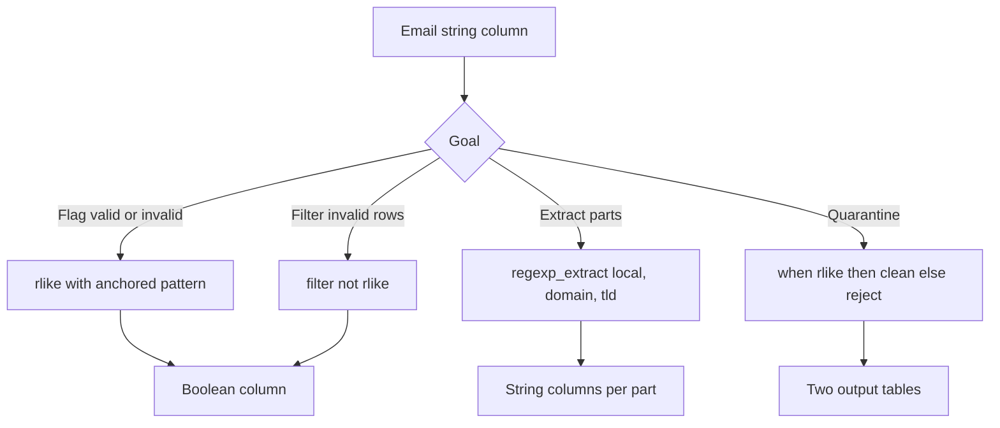

# 2.8.4 How do you use regex to validate if an email column is formatted correctly?

Use `rlike` for a boolean flag or `regexp_extract` when you need the matched parts. Anchor the pattern with `^` and `$` so partial matches do not pass. Regex validates format only. It cannot confirm the address exists.



### Basic validation

PySpark:

```python
from pyspark.sql.functions import col, when, lit

EMAIL_RE = r"^[A-Za-z0-9._%+-]+@[A-Za-z0-9.-]+\.[A-Za-z]{2,}$"

df = df.withColumn("email_valid", col("email").rlike(EMAIL_RE))
```

Scala:

```scala
import org.apache.spark.sql.functions._

val emailRe = "^[A-Za-z0-9._%+-]+@[A-Za-z0-9.-]+\\.[A-Za-z]{2,}$"
val out = df.withColumn("email_valid", col("email").rlike(emailRe))
```

SQL:

```sql
SELECT
  email,
  email RLIKE '^[A-Za-z0-9._%+-]+@[A-Za-z0-9.-]+\\.[A-Za-z]{2,}$' AS email_valid
FROM users;
```

### Pattern breakdown

| Part | Regex | Meaning |
|---|---|---|
| Start anchor | `^` | Match must start at position 0 |
| Local part | `[A-Za-z0-9._%+-]+` | Letters, digits, dot, underscore, percent, plus, hyphen |
| At sign | `@` | Literal |
| Domain labels | `[A-Za-z0-9.-]+` | Letters, digits, dot, hyphen |
| Dot before TLD | `\.` | Escaped literal dot |
| TLD | `[A-Za-z]{2,}` | At least two letters |
| End anchor | `$` | Match must end at the last character |

Without `^` and `$`, `rlike` matches a substring. `"abc not-an-email xyz"` would pass a non-anchored pattern.

### Anchoring comparison

| Pattern | Input | Match |
|---|---|---|
| `[\w.]+@[\w.]+\.[a-z]{2,}` | `abc user@example.com xyz` | true, substring matched |
| `^[\w.]+@[\w.]+\.[a-z]{2,}$` | `abc user@example.com xyz` | false, whole string required |
| `^[\w.]+@[\w.]+\.[a-z]{2,}$` | `user@example.com` | true |

Always anchor. Substring matches are the most common regex validation bug.

### Case sensitivity

The local part is technically case sensitive, the domain is not. In practice, lowercase everything.

```python
from pyspark.sql.functions import lower, trim, col

df = df.withColumn("email_norm", lower(trim(col("email"))))
```

| Step | Reason |
|---|---|
| `trim` | Removes accidental whitespace before validation |
| `lower` | Normalizes case so the pattern stays simple |
| `rlike` | Validates the normalized value |

Normalizing before validation makes the pattern smaller and the result reproducible across sources.

### Null and empty handling

`rlike` returns `null` on null input and `false` on empty string. Do not confuse the two.

| Input | `rlike(pat)` | Note |
|---|---|---|
| `null` | `null` | Not false. Branch logic must handle it |
| `""` | `false` | Empty string fails |
| `"   "` | `false` | Whitespace fails |
| `"user@example.com"` | `true` | Valid |

```python
from pyspark.sql.functions import col, when, lit

df = df.withColumn(
    "email_status",
    when(col("email").isNull(), lit("missing"))
    .when(~col("email").rlike(EMAIL_RE), lit("invalid"))
    .otherwise(lit("valid"))
)
```

### Filtering invalid rows

```python
invalid = df.filter(col("email").isNotNull() & ~col("email").rlike(EMAIL_RE))
valid   = df.filter(col("email").rlike(EMAIL_RE))
```

| Filter | Behavior |
|---|---|
| `col("email").rlike(pat)` | Keeps only valid. Drops nulls silently |
| `~col("email").rlike(pat)` | Keeps only invalid. Drops nulls silently |
| `col("email").isNotNull() & ~col("email").rlike(pat)` | Keeps invalid non null rows explicitly |

Nulls never satisfy `rlike` and never satisfy its negation. State null policy explicitly.

### Quarantine pattern

```python
from pyspark.sql.functions import col, when

EMAIL_RE = r"^[A-Za-z0-9._%+-]+@[A-Za-z0-9.-]+\.[A-Za-z]{2,}$"

is_valid = col("email").isNotNull() & col("email").rlike(EMAIL_RE)

clean = df.filter(is_valid)
bad   = df.filter(~is_valid).withColumn(
    "reject_reason",
    when(col("email").isNull(), "email_missing").otherwise("email_invalid")
)

clean.write.mode("append").saveAsTable("users_clean")
bad.write.mode("append").saveAsTable("users_rejects")
```

| Output | Content |
|---|---|
| `users_clean` | Valid emails only |
| `users_rejects` | Null or malformed emails, with a reason column |

### Extracting parts

Use `regexp_extract` to split local part, domain, and TLD.

```python
from pyspark.sql.functions import regexp_extract

EMAIL_PARTS = r"^([A-Za-z0-9._%+-]+)@([A-Za-z0-9.-]+)\.([A-Za-z]{2,})$"

df = (
    df.withColumn("local",  regexp_extract(col("email"), EMAIL_PARTS, 1))
      .withColumn("domain", regexp_extract(col("email"), EMAIL_PARTS, 2))
      .withColumn("tld",    regexp_extract(col("email"), EMAIL_PARTS, 3))
)
```

| Input | local | domain | tld |
|---|---|---|---|
| `user@mail.example.com` | `user` | `mail.example` | `com` |
| `a.b+c@x.io` | `a.b+c` | `x` | `io` |
| `invalid` | empty | empty | empty |

`regexp_extract` returns an empty string on no match. Combine with `rlike` to distinguish empty from invalid.

### Strictness levels

Regex can be more or less strict. Stricter patterns reject more valid but unusual addresses.

| Level | Pattern | Accepts | Rejects |
|---|---|---|---|
| Minimal | `^[^@\s]+@[^@\s]+$` | Most real addresses | Obvious junk |
| Standard | `^[A-Za-z0-9._%+-]+@[A-Za-z0-9.-]+\.[A-Za-z]{2,}$` | Common addresses | Missing TLD, spaces |
| Stricter domain | `^[A-Za-z0-9._%+-]+@([A-Za-z0-9-]+\.)+[A-Za-z]{2,}$` | Multi label domains only | Single label domains |
| Very strict TLD | `^[...]@([A-Za-z0-9-]+\.)+[A-Za-z]{2,63}$` | TLD length bounded | Overly long TLD |

RFC 5322 fully compliant email regex is huge and slower. For data validation, the standard pattern is enough. Full compliance rejects some real addresses and accepts some unusable ones.

### Additional checks worth combining

| Check | Expression | Reason |
|---|---|---|
| No consecutive dots | `not col("email").rlike(r"\.\.")` | `a..b@x.com` is invalid |
| No leading or trailing dot in local | `not col("email").rlike(r"^\.\|\.@")` | `.a@x.com` and `a.@x.com` invalid |
| Domain has at least one dot | `col("email").rlike(r"@[^@]+\.[^@]+$")` | Rejects `user@localhost` |
| Length limit | `length(col("email")) <= 254` | RFC 5321 limit |
| Local part limit | `length(regexp_extract(col("email"), r"^([^@]+)", 1)) <= 64` | RFC 5321 limit |

```python
from pyspark.sql.functions import col, length

is_valid = (
    col("email").isNotNull()
    & col("email").rlike(r"^[A-Za-z0-9._%+-]+@([A-Za-z0-9-]+\.)+[A-Za-z]{2,63}$")
    & ~col("email").rlike(r"\.\.")
    & (length(col("email")) <= 254)
)
```

### Why regex is not enough

| Limitation | Reason |
|---|---|
| Address exists | Regex cannot verify the mailbox |
| Domain resolves | No DNS lookup in regex |
| Disposable email | Domain is syntactically valid but temporary |
| Role accounts | `admin@`, `noreply@` are valid but often unwanted |
| Unicode local part | Regex may reject valid international addresses |
| Quoted local part | Rare but valid, standard pattern rejects it |

Regex is a format gate, not a validity gate. Follow with a domain allowlist or blocklist, and a verification step if existence matters.

### Performance notes

- `rlike` is native and codegen friendly. It does not shuffle.
- Anchored patterns reject non-matching strings early. Better than scanning the whole string.
- Avoid nested quantifiers such as `([A-Za-z]+)+` which can cause catastrophic backtracking.
- Prefer character classes over alternation for hot paths. `[A-Za-z0-9]` is faster than `(a|b|c|...)`.
- Validate on the normalized value. `trim` and `lower` are cheap and shrink the regex.
- Filter on the validity flag before expensive downstream work. Do not propagate invalid rows.
- The full RFC 5322 regex is slow and enormous. Do not use it for row level validation on large data.

### Common pitfalls

| Pitfall | Effect | Fix |
|---|---|---|
| Missing `^` and `$` | Substring matches pass | Anchor the pattern |
| Unescaped `.` | Matches any char | Use `\.` |
| Unescaped `@` in some contexts | Rare but possible issues | Escape if needed |
| Not handling null | Branch logic mishandled | Check `isNotNull` first |
| Using `~rlike` and assuming it captures nulls | Nulls pass both sides | State null policy explicitly |
| Overly strict pattern | Rejects valid addresses | Use the standard pattern |
| RFC 5322 pattern on large data | Slow | Use standard pattern plus extra checks |
| Double escaping in SQL | Pattern breaks | Use `\\d` in SQL, or avoid backslashes |
| Not trimming | Leading space fails validation | `trim` first |
| Regex only | Accepts `noreply@`, `test@` | Add domain checks |

### End to end example

```python
from pyspark.sql import SparkSession
from pyspark.sql.functions import col, trim, lower, length, regexp_extract, when

spark = SparkSession.builder.getOrCreate()

df = spark.createDataFrame(
    [
        ("alice@example.com",),
        ("BOB@Example.COM",),
        ("carol@sub.example.co.uk",),
        ("bad@@example.com",),
        ("no-at-sign",),
        ("",),
        (None,),
    ],
    ["email"]
)

EMAIL_RE = r"^[A-Za-z0-9._%+-]+@([A-Za-z0-9-]+\.)+[A-Za-z]{2,63}$"

out = (
    df.withColumn("email_norm", lower(trim(col("email"))))
      .withColumn(
          "status",
          when(col("email_norm").isNull() | (length(col("email_norm")) == 0), "missing")
          .when(~col("email_norm").rlike(EMAIL_RE), "invalid")
          .otherwise("valid")
      )
      .withColumn("local", regexp_extract(col("email_norm"), r"^([^@]+)@", 1))
      .withColumn("domain", regexp_extract(col("email_norm"), r"@([^@]+)$", 1))
)

out.show(truncate=False)
```

| email | email_norm | status | local | domain |
|---|---|---|---|---|
| `alice@example.com` | `alice@example.com` | valid | alice | example.com |
| `BOB@Example.COM` | `bob@example.com` | valid | bob | example.com |
| `carol@sub.example.co.uk` | `carol@sub.example.co.uk` | valid | carol | sub.example.co.uk |
| `bad@@example.com` | `bad@@example.com` | invalid | bad | `@example.com` |
| `no-at-sign` | `no-at-sign` | invalid | empty | empty |
| `""` | `""` | missing | empty | empty |
| null | null | missing | empty | empty |

### Checklist

- Anchor with `^` and `$`.
- Escape literal dots as `\.`.
- Normalize with `trim` and `lower` before validation.
- Decide null policy explicitly. Use `when` on `isNotNull`.
- Use the standard pattern plus extra checks for consecutive dots and length.
- Do not use the full RFC 5322 pattern for row level validation.
- Use `regexp_extract` when parts are needed, not for validation alone.
- Combine with domain allowlist or blocklist when existence or type matters.
- Regex validates format, not deliverability. Document that.
