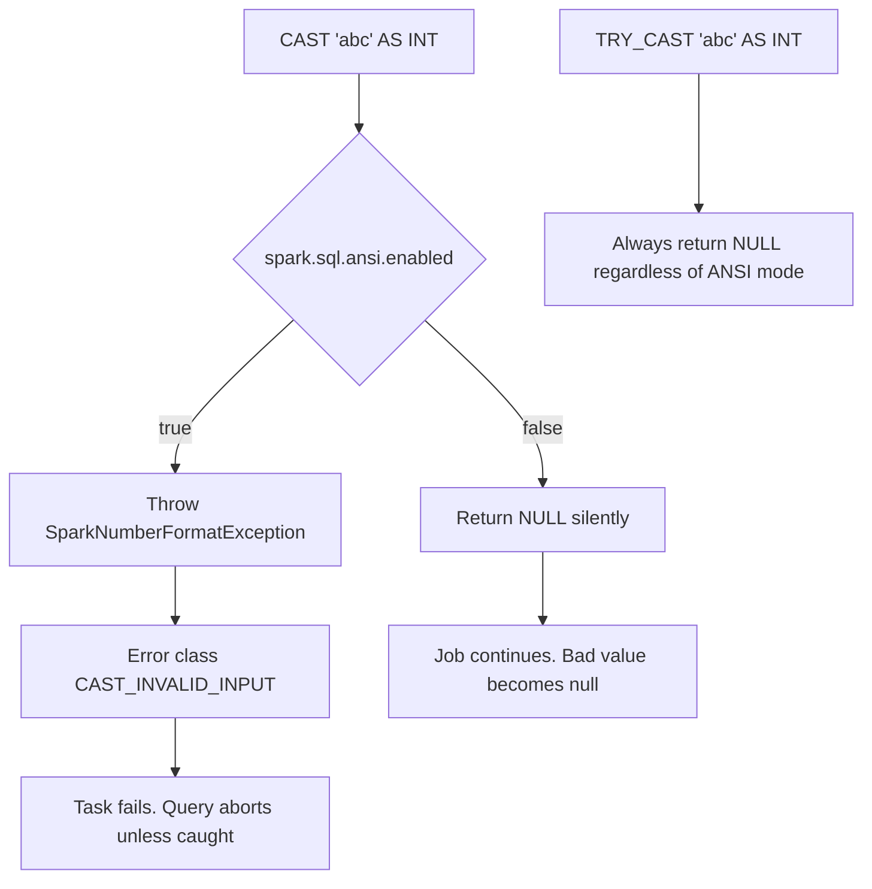

# 2.8.5 What happens when you cast a string abc to an IntegerType?

Casting the string `"abc"` to `IntegerType` does not always produce the same result. It depends entirely on `spark.sql.ansi.enabled`.



### Behavior matrix

| Setting | Expression | Result |
|---|---|---|
| ANSI off (legacy, Spark 3.x default) | `cast(col("s"), "int")` | `null` |
| ANSI on (Spark 4.0+, some platforms) | `cast(col("s"), "int")` | `SparkNumberFormatException` |
| ANSI on or off | `try_cast(col("s"), "int")` | `null` |
| ANSI off | `col("s").cast("int")` in PySpark | `null` |
| ANSI on | `col("s").cast("int")` in PySpark | Exception |
| Any mode | `cast(null as int)` | `null` |
| Any mode | `cast("123" as int)` | `123` |

### ANSI off: silent null

With ANSI disabled, Spark treats an invalid cast as an unparseable value and returns `null` for that row. The query does not fail. Other rows continue normally.

```sql
SET spark.sql.ansi.enabled = false;
SELECT CAST('abc' AS INT) AS v;
```

| v |
|---|
| null |

This is the legacy Hive-compatible behavior. It is dangerous for data pipelines because a malformed value becomes a silent null. Downstream aggregations such as `sum`, `avg`, or `count` will ignore the null or produce wrong results, and no error is raised.

### ANSI on: exception

With ANSI enabled, an invalid string cast throws a runtime exception. The task fails and the query aborts unless the error is handled upstream.

```sql
SET spark.sql.ansi.enabled = true;
SELECT CAST('abc' AS INT) AS v;
```

The error is:

```
org.apache.spark.SparkNumberFormatException: [CAST_INVALID_INPUT]
The value 'abc' of the type "STRING" cannot be cast to "INT"
because it is malformed. Correct the value as per the syntax,
or change its target type. Use try_cast to tolerate malformed
input and return NULL instead.
```

The error class is `CAST_INVALID_INPUT`. The message itself points to `try_cast` as the safe alternative.

ANSI mode is disabled by default in Spark 3.x, but it is enabled by default in Spark 4.0 and later, and in some managed platforms. This is the most common cause of jobs that worked before suddenly failing after an upgrade.

### try_cast: null without exception

`try_cast` is identical to `cast` with ANSI on, except it returns `null` instead of throwing when the value cannot be converted. It works the same way regardless of the ANSI setting.

```sql
SELECT TRY_CAST('abc' AS INT) AS v;
```

| v |
|---|
| null |

`try_cast` is the correct tool when malformed values are expected and should be tolerated without failing the job. It was added in Spark 3.2.0.

### Null input is not an invalid cast

A `null` string is not `"abc"`. Casting `null` to `IntegerType` returns `null` in every mode, ANSI on or off. No exception is raised for null input.

| Input | ANSI off | ANSI on |
|---|---|---|
| `null` | `null` | `null` |
| `""` (empty string) | `null` | `CAST_INVALID_INPUT` exception |
| `"abc"` | `null` | `CAST_INVALID_INPUT` exception |
| `"123"` | `123` | `123` |
| `" 123 "` | `123` in many versions | `123` in many versions |
| `"123.0"` | `null` | `CAST_INVALID_INPUT` exception |
| `"123abc"` | `null` | `CAST_INVALID_INPUT` exception |

Empty string and `"abc"` both fail in ANSI mode. Null does not.

### Overflow is a separate error

`"abc"` is malformed. A numeric string that exceeds the `IntegerType` range is a different failure.

```sql
SELECT CAST('2147483648' AS INT);
```

| Mode | Error class | Meaning |
|---|---|---|
| ANSI on | `CAST_OVERFLOW` | Value is numeric but too large for int |
| ANSI off | `null` or wrapped value depending on version | Silent overflow |

Do not confuse `CAST_INVALID_INPUT` with `CAST_OVERFLOW`. The fix for overflow is a wider type or `try_cast`. The fix for invalid input is data cleaning or `try_cast`.

### PySpark DataFrame API

```python
from pyspark.sql.functions import col

df = df.withColumn("n", col("s").cast("int"))
```

This is an explicit cast and follows the ANSI setting. In PySpark, `cast` and `astype` are the same operation.

To force null on invalid input regardless of the cluster setting, use `try_cast` in SQL or handle the logic explicitly.

```python
from pyspark.sql.functions import col, when, expr

df = df.withColumn(
    "n",
    when(col("s").rlike(r"^-?\d+$"), col("s").cast("int")).otherwise(None)
)
```

This validates the string with `rlike` before casting. It avoids the exception in ANSI mode and makes the null outcome explicit in non-ANSI mode.

### Implicit cast versus explicit cast

The behavior above is for an explicit `CAST` or `Column.cast`. Implicit coercion in comparisons and arithmetic can behave differently and is governed by separate type coercion rules.

| Operation | Behavior |
|---|---|
| `CAST(s AS INT)` | Explicit. Follows `spark.sql.ansi.enabled` |
| `s + 1` where `s` is string | Implicit coercion. In ANSI mode, string to numeric coercion may be disallowed entirely |
| `s = 1` where `s` is string | Implicit coercion. ANSI on changes comparison semantics |
| `INSERT` into an int column from a string | Store assignment rules. `spark.sql.storeAssignmentPolicy` controls this, independent of ANSI cast behavior |

Do not assume the cast behavior applies to implicit coercion. Check the store assignment policy separately when writing to tables.

### Why ANSI off is risky

| Risk | Detail |
|---|---|
| Silent nulls | `"abc"` becomes `null` with no warning |
| Wrong aggregates | `sum`, `avg`, `count` ignore nulls, producing misleading metrics |
| No error visibility | Bad data passes through the pipeline undetected |
| Hard to debug | The failure surfaces far downstream from the source |
| Inconsistent across versions | A Spark upgrade to 4.0 flips the default and breaks the job |

ANSI on turns a silent corruption into a loud failure. That is usually the better trade for production pipelines.

### Practical guidance

| Situation | Action |
|---|---|
| You control the data and it is clean | Use `cast` with ANSI on so bad data fails fast |
| You expect some malformed values | Use `try_cast` and filter or quarantine nulls |
| You need identical behavior across versions | Use `try_cast` explicitly. Do not rely on the cluster default |
| You are migrating to Spark 4.0 | Audit every explicit cast on string columns before the upgrade |
| You need to validate before casting | Use `rlike` or `regexp_extract` first, then cast |
| You need a default for bad values | `coalesce(try_cast(col("s"), "int"), lit(0))` |

### End to end example

```python
from pyspark.sql import SparkSession
from pyspark.sql.functions import col, expr, coalesce, lit

spark = SparkSession.builder.getOrCreate()

df = spark.createDataFrame(
    [("123",), ("abc",), ("",), (None,), ("2147483648",)],
    ["s"]
)

# Depends on ANSI setting
try:
    df.withColumn("n", col("s").cast("int")).show()
except Exception as e:
    print("cast failed:", type(e).__name__)

# Always safe, returns null on bad input
df.withColumn("n", expr("try_cast(s as int)")).show()

# Safe with a default
df.withColumn(
    "n",
    coalesce(expr("try_cast(s as int)"), lit(0))
).show()
```

| s | `cast` ANSI off | `cast` ANSI on | `try_cast` | `try_cast` plus coalesce |
|---|---|---|---|---|
| `"123"` | 123 | 123 | 123 | 123 |
| `"abc"` | null | exception | null | 0 |
| `""` | null | exception | null | 0 |
| null | null | null | null | 0 |
| `"2147483648"` | null or wrapped | `CAST_OVERFLOW` exception | null | 0 |

### Summary

- `"abc"` is not a number. Spark cannot represent it as an integer.
- ANSI off returns `null` silently.
- ANSI on throws `SparkNumberFormatException` with error class `CAST_INVALID_INPUT`.
- `try_cast` returns `null` in every mode and never throws for malformed input.
- Null input returns null in every mode. Empty string does not.
- Overflow is a separate error class, `CAST_OVERFLOW`.
- Do not rely on the cluster default. Use `try_cast` or validate with `rlike` when the behavior must be predictable.
