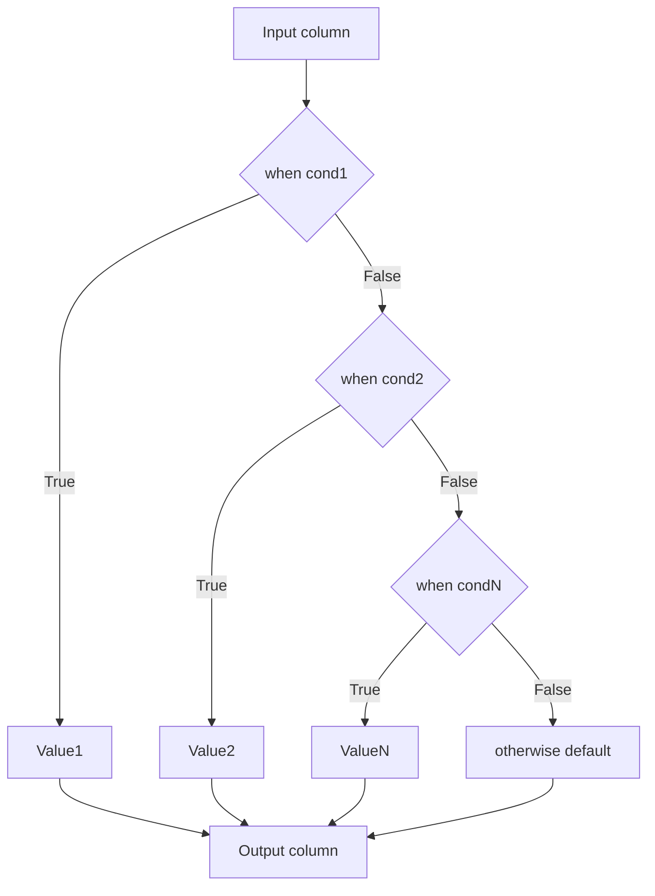

# 2.8.6 How do you replace bad data with a default value using when().otherwise()?

## 2.8.6 How do you replace bad data with a default value using `when().otherwise()`?

`when(condition, value).otherwise(default)` is a native conditional expression. It stays inside codegen, supports chained branches, and returns the first matching branch. Use it to normalize, clean, or replace invalid rows with a fallback.



### Core rules

| Rule | Behavior |
|---|---|
| Evaluation order | Top to bottom. First true branch wins |
| No `when` match and no `otherwise` | Returns `null` |
| No `when` match and `otherwise` present | Returns `otherwise` value |
| `when` condition is `null` | Treated as false, moves to next branch |
| Return type | Common type across all branches. Casting may occur |
| Codegen | Native, vectorized, no UDF cost |
| Shuffle | None. Narrow transformation |

### Basic syntax

PySpark:

```python
from pyspark.sql.functions import col, when, lit, coalesce

df = df.withColumn(
    "status",
    when(col("amount") < 0, lit("NEGATIVE"))
    .when(col("amount").isNull(), lit("MISSING"))
    .otherwise(lit("OK"))
)
```

Scala:

```scala
import org.apache.spark.sql.functions._

val out = df.withColumn(
  "status",
  when(col("amount") < 0, lit("NEGATIVE"))
    .when(col("amount").isNull(), lit("MISSING"))
    .otherwise(lit("OK"))
)
```

SQL:

```sql
SELECT
  CASE
    WHEN amount < 0    THEN 'NEGATIVE'
    WHEN amount IS NULL THEN 'MISSING'
    ELSE 'OK'
  END AS status
FROM t;
```

### Condition to default mapping

| Condition | Bad data replaced with |
|---|---|
| `col("x").isNull()` | Default for missing value |
| `col("x") < 0` | Default for negative values |
| `col("x") > max` | Default for out of range |
| `trim(col("x")) == ""` | Default for empty string |
| `~col("s").rlike(pattern)` | Default for bad format |
| `~col("s").isin(valid_set)` | Default for unknown category |
| `expr("try_cast(s as int)").isNull()` | Default for unparseable string |

### Null replacement

The most common case. `when` plus `isNull` or `coalesce`.

```python
from pyspark.sql.functions import col, when, lit, coalesce

# when plus otherwise
df.withColumn("name", when(col("name").isNull(), lit("UNKNOWN")).otherwise(col("name")))

# coalesce is shorter and faster for single null replacement
df.withColumn("name", coalesce(col("name"), lit("UNKNOWN")))
```

| Method | Use when |
|---|---|
| `coalesce` | Only nulls need replacing. No condition logic |
| `when().otherwise()` | Multiple conditions or non-null bad values |
| `fillna` | Many columns share the same default and type |

`coalesce` is preferred for pure null replacement. It is one expression, not a chain, and the optimizer handles it well.

### Empty string and whitespace

Empty strings are not null. Detect them explicitly.

```python
from pyspark.sql.functions import col, trim, length, when, lit

df.withColumn(
    "name",
    when(
        col("name").isNull() | (length(trim(col("name"))) == 0),
        lit("UNKNOWN")
    ).otherwise(col("name"))
)
```

| Input | Result |
|---|---|
| `"Alice"` | `"Alice"` |
| `""` | `"UNKNOWN"` |
| `"   "` | `"UNKNOWN"` |
| `null` | `"UNKNOWN"` |

`length(col) == 0` is more efficient than `col == ""` when the string is wide. Use `length(trim(col))` to catch whitespace only.

### Numeric range replacement

```python
from pyspark.sql.functions import col, when, lit

df.withColumn(
    "amount",
    when((col("amount") < 0) | (col("amount") > 1_000_000), lit(0))
    .when(col("amount").isNull(), lit(0))
    .otherwise(col("amount"))
)
```

| Input | Result |
|---|---|
| `-50` | `0` |
| `2_000_000` | `0` |
| `null` | `0` |
| `150` | `150` |

Chain the null check first if null should be treated separately from out of range, since null comparisons return null, which `when` treats as false.

### Regex validation with fallback

```python
from pyspark.sql.functions import col, when, lit

EMAIL_RE = r"^[A-Za-z0-9._%+-]+@[A-Za-z0-9.-]+\.[A-Za-z]{2,}$"

df.withColumn(
    "email",
    when(
        col("email").isNull() | ~col("email").rlike(EMAIL_RE),
        lit("unknown@example.com")
    ).otherwise(col("email"))
)
```

| Input | Result |
|---|---|
| `"alice@example.com"` | `"alice@example.com"` |
| `"bad"` | `"unknown@example.com"` |
| `null` | `"unknown@example.com"` |

`~col.rlike(pat)` returns `null` on null input, which `when` treats as false. Add the explicit `isNull` check.

### Cast with fallback

Use `try_cast` in the condition and cast in the branch. This works with ANSI on or off.

```python
from pyspark.sql.functions import col, when, lit, expr

df.withColumn(
    "n",
    when(expr("try_cast(s as int)").isNotNull(), expr("try_cast(s as int)"))
    .otherwise(lit(0))
)
```

| Input `s` | Result `n` |
|---|---|
| `"123"` | `123` |
| `"abc"` | `0` |
| `""` | `0` |
| `null` | `0` |

Calling `try_cast` twice evaluates it twice. Use a subquery or a temporary column if it is expensive.

```python
from pyspark.sql.functions import col, when, lit, coalesce, expr

df.withColumn("_parsed", expr("try_cast(s as int)")) \
  .withColumn("n", coalesce(col("_parsed"), lit(0))) \
  .drop("_parsed")
```

### Categorical replacement

Map unknown categories to a default.

```python
from pyspark.sql.functions import col, when, lit

VALID = ["NEW", "PAID", "SHIPPED"]

df.withColumn(
    "status",
    when(col("status").isin(VALID), col("status")).otherwise(lit("UNKNOWN"))
)
```

| Input | Result |
|---|---|
| `"NEW"` | `"NEW"` |
| `"CANCELLED"` | `"UNKNOWN"` |
| `null` | `"UNKNOWN"` |

`isin` with a null input returns `null`, treated as false, so null goes to `otherwise`. This is convenient here.

### Type coercion

Branches must produce a common type. Spark promotes types automatically.

| Branch 1 | Branch 2 | Result type | Note |
|---|---|---|---|
| `IntegerType` | `LongType` | `LongType` | Widening |
| `IntegerType` | `DoubleType` | `DoubleType` | Widening |
| `IntegerType` | `lit(null)` | `IntegerType` | Nullable |
| `StringType` | `IntegerType` | Error or implicit cast | Not compatible |
| `DateType` | `StringType` | Error | Cast the string to date first |

Cast branches explicitly when in doubt.

```python
from pyspark.sql.functions import col, when, lit

df.withColumn(
    "n",
    when(col("n").isNull(), lit(0).cast("bigint")).otherwise(col("n").cast("bigint"))
)
```

### Chained conditions order matters

Conditions are evaluated top to bottom. First match wins.

```python
from pyspark.sql.functions import col, when, lit

# BROKEN: null check is last, never reached for null input
df.withColumn(
    "band",
    when(col("x") < 0, lit("LOW"))
    .when(col("x") > 100, lit("HIGH"))
    .when(col("x").isNull(), lit("MISSING"))
    .otherwise(lit("MID"))
)
```

| Input `x` | Result | Why |
|---|---|---|
| `-5` | `LOW` | First match |
| `50` | `MID` | No match, otherwise |
| `150` | `HIGH` | Second match |
| `null` | `MID` | `null < 0` is `null`, treated as false. `null isNull` is true, so `MISSING` wins |

The null check works here only because it comes before `otherwise`. If it were after a condition that null could satisfy, it would be unreachable. Put the null check first when null needs its own branch.

### Detecting and recording bad data

Replace with a default and record the reason in a separate column.

```python
from pyspark.sql.functions import col, when, lit, length

reason = (
    when(col("amount").isNull(), lit("null_amount"))
    .when(col("amount") < 0, lit("negative_amount"))
    .when(col("email").isNull() | ~col("email").rlike(EMAIL_RE), lit("bad_email"))
    .otherwise(lit(None))
)

clean = df.withColumn(
    "amount_clean",
    when(col("amount").isNull() | (col("amount") < 0), lit(0)).otherwise(col("amount"))
).withColumn("reject_reason", reason)
```

| Row | amount_clean | reject_reason |
|---|---|---|
| valid row | amount | null |
| null amount | 0 | null_amount |
| negative amount | 0 | negative_amount |

This pattern keeps the clean data and the reason side by side for audit and metrics.

### when vs coalesce vs fillna

| Tool | Strength | Limitation |
|---|---|---|
| `coalesce` | Cheapest for null replacement | Only nulls. No conditions |
| `when().otherwise()` | Arbitrary conditions and branches | Verbose for many conditions |
| `fillna` | Applies one default to many columns | Same default per type, no conditions |
| `na.replace` | Replaces specific values | No condition logic |
| `try_cast` | Safe cast, null on failure | Null only, no default |

| Need | Use |
|---|---|
| Only nulls, one column | `coalesce` |
| Nulls, many columns, same default | `fillna` |
| Out of range values | `when().otherwise()` |
| Regex validation | `when().otherwise()` with `rlike` |
| Safe cast with default | `try_cast` plus `coalesce` |
| Multiple conditions | Chained `when()` |

### Performance notes

- `when().otherwise()` is native and codegen friendly. No shuffle, no UDF.
- Evaluate the condition once. Avoid repeating an expensive expression across branches.
- If a condition is reused, compute it once as a temporary column and reference it.
- `coalesce` is cheaper than `when(x.isNull(), y).otherwise(x)` for simple null replacement.
- `fillna` is a single expression internally. Use it when many columns share the same default.
- Chain `when` when conditions are mutually exclusive. Do not nest `when` inside `when` unless the logic requires it.
- Project only the needed columns before branching. Wide rows in the expression are slower.

### Common pitfalls

| Pitfall | Effect | Fix |
|---|---|---|
| No `otherwise` | Unmatched rows become `null` | Always add `otherwise` |
| Null check placed after other conditions | Unreachable branch | Put null checks early |
| Comparing null with `==` | Returns `null`, not true | Use `isNull()` |
| Empty string not caught | `""` passes as valid | Check `length(trim(col)) == 0` |
| Incompatible branch types | Error or unexpected cast | Cast branches to a common type |
| `try_cast` called twice | Double evaluation | Compute once, then coalesce |
| Using a UDF for simple conditions | Slower, breaks codegen | Use native `when` |
| Repeated expensive condition | Multiple evaluations | Precompute as a temporary column |
| Forgetting `otherwise` on a chain ending with a boolean | Returns null for unmatched | Add explicit `otherwise` |

### End to end example

```python
from pyspark.sql import SparkSession
from pyspark.sql.functions import col, when, lit, trim, length, coalesce

spark = SparkSession.builder.getOrCreate()

df = spark.createDataFrame(
    [
        ("alice@example.com", 100),
        ("bad-email", 50),
        ("bob@example.com", -10),
        (None, None),
        ("", 200),
    ],
    ["email", "amount"]
)

EMAIL_RE = r"^[A-Za-z0-9._%+-]+@[A-Za-z0-9.-]+\.[A-Za-z]{2,}$"

clean = (
    df
    .withColumn(
        "email_clean",
        when(
            col("email").isNull() | (length(trim(col("email"))) == 0) | ~col("email").rlike(EMAIL_RE),
            lit("unknown@example.com")
        ).otherwise(col("email"))
    )
    .withColumn(
        "amount_clean",
        coalesce(
            when((col("amount") >= 0) & (col("amount") <= 1_000_000), col("amount")),
            lit(0)
        )
    )
)

clean.show(truncate=False)
```

| email | amount | email_clean | amount_clean |
|---|---|---|---|
| `alice@example.com` | 100 | `alice@example.com` | 100 |
| `bad-email` | 50 | `unknown@example.com` | 50 |
| `bob@example.com` | -10 | `bob@example.com` | 0 |
| null | null | `unknown@example.com` | 0 |
| `""` | 200 | `unknown@example.com` | 200 |

The `amount` branch uses `coalesce` around a `when`. `when` returns `null` when the condition is false, and `coalesce` supplies the default. This is a compact pattern for range replacement.

### Checklist

- Always add `otherwise` unless `null` is the intended default.
- Put null checks early in the chain if null needs its own branch.
- Use `isNull()` not `== null`.
- Detect empty strings with `length(trim(col)) == 0`.
- Cast branches to a common type when Spark cannot promote automatically.
- Prefer `coalesce` for pure null replacement.
- Prefer `try_cast` plus `coalesce` for string to numeric casts.
- Precompute repeated conditions as temporary columns.
- Add a `reject_reason` column when the replacement reason matters downstream.
