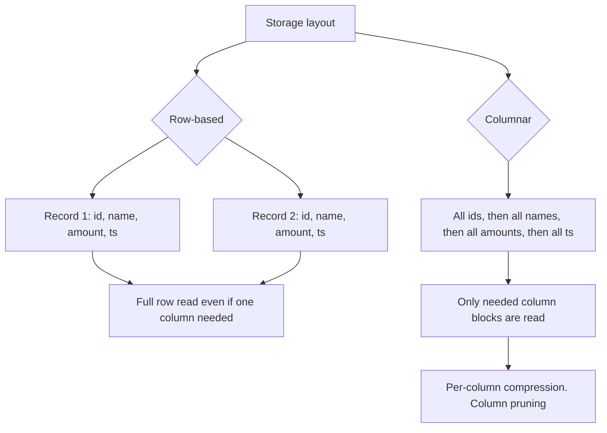

# 2.9.1 What is the difference between row-based and columnar formats?

## 2.9.1 What is the difference between row-based and columnar formats?

Row-based formats store all fields of a record together. Columnar formats store all values of a field together. The layout determines compression ratio, scan cost, predicate pushdown, and which engine is fast on which workload.

### Physical layout

| Layout | On disk | Example |
|---|---|---|
| Row | Each record is contiguous | `(1,alice,100)(2,bob,50)(3,carol,75)` |
| Columnar | Each column is contiguous | `id:1,2,3` then `name:alice,bob,carol` then `amount:100,50,75` |

| Layout | Best for | Weakness |
|---|---|---|
| Row | Whole-record reads, single-record writes, OLTP | Reading one column reads all columns |
| Columnar | Analytical scans, aggregations, wide tables | Writes rewrite whole row groups. Point updates are expensive |

### Core comparison

| Topic | Row-based | Columnar |
|---|---|---|
| Physical adjacency | Values of a row are adjacent | Values of a column are adjacent |
| Read pattern | Read full row | Read column chunks |
| Column pruning | None. All columns read even if one is selected | Yes. Unread columns are skipped |
| Compression | Moderate. Mixed types in a row | High. Same type per block compresses well |
| Compression codecs | Snappy, gzip, lzo, deflate | Snappy, zstd, gzip, delta, dictionary, run length |
| Encoding | Generic byte encoding | Dictionary, run length, delta, bit packing |
| Predicate pushdown | Row group or block level only | Column stats, min max per block, skip whole blocks |
| Vectorized read | No | Yes. Batch of values per column |
| Point update | Possible with append or overwrite | Costly. Rewrite row group |
| Schema evolution | Possible but rigid | Easy. Add columns with null default |
| Typical engines | OLTP databases, log files, message queues | Analytical engines, warehouses, Spark |

### Examples of each

| Row-based | Columnar |
|---|---|
| CSV | Parquet |
| JSON | ORC |
| Avro | Arrow (in memory) |
| SequenceFile | CarbonData |
| Line delimited text | Delta Lake and Iceberg base files (Parquet) |
| MySQL, PostgreSQL heap files | Redshift, BigQuery, Snowflake internals |

### Read cost comparison

Assume a 100 column table with 1 billion rows, and a query reads 3 columns.

| Format | Bytes read | Relative cost |
|---|---|---|
| CSV row-based | All 100 columns | High. Full table scan |
| Parquet columnar | 3 columns | Low. Roughly 3 percent of the data |
| Parquet with predicate pushdown | 3 columns, only matching row groups | Very low. Skips blocks by min max stats |

Column pruning is the single biggest win for analytics. It is the reason Parquet and ORC dominate in Spark.

### Compression

| Factor | Row-based | Columnar |
|---|---|---|
| Value homogeneity per block | Low. Mixed types in a row | High. Same type in a column block |
| Dictionary encoding | Rare | Common for low cardinality strings |
| Run length encoding | Rare | Common for sorted or repeated values |
| Delta encoding | Rare | Common for timestamps and sorted numbers |
| Compression ratio | 1x to 3x typical | 5x to 20x typical, sometimes more |
| Decompression cost | Per row | Per column block, vectorized |

Columnar compression is not just smaller. It is faster to decompress because the codec works on homogeneous blocks and the reader processes batches.

### Predicate pushdown

| Level | Row-based | Columnar |
|---|---|---|
| File level | Stats in some formats such as Parquet footer, ORC footer | Same |
| Row group level | Parquet row group stats | Same |
| Block level | Usually none | Parquet page stats, ORC stripe and index stats |
| Bloom filter | Not standard | Parquet and ORC support column bloom filters |
| Skipping granularity | Coarse | Fine. Skip individual row groups or pages |

The result is that a filtered query on a columnar format can read a fraction of the file, while a row-based format reads everything or at best skips whole files.

### Vectorized execution

| Property | Row-based | Columnar |
|---|---|---|
| Read into memory | Row objects | Columnar batches |
| CPU cache efficiency | Poor. Mixed types per cache line | Good. Same type per cache line |
| SIMD potential | Limited | High. Tight loops over primitive arrays |
| Spark integration | Must deserialize rows | Native vectorized reader |

Spark's Parquet and ORC readers are vectorized. CSV and JSON readers are row based. That is a large part of the performance gap in Spark.

### Write and update cost

| Operation | Row-based | Columnar |
|---|---|---|
| Append | Cheap. Append at the end | Cheap. New file or new row group |
| Point update | In place possible | Rewrite the whole row group |
| Delete | In place possible | Rewrite or tombstone |
| Wide row insert | Natural | Must buffer all columns |
| Many small writes | Natural | Inefficient. Small files hurt columnar formats |

Columnar is a poor fit for OLTP. Spark is not an OLTP engine, so this rarely matters. Delta Lake and Iceberg handle updates by rewriting files, not in place.

### When row-based wins

| Case | Reason |
|---|---|
| Streaming ingestion | Appending whole records is natural |
| Small files and frequent writes | Row layout avoids row group overhead |
| Full row reads | Reading all columns is equally expensive in both |
| Human readable interchange | CSV and JSON are easy to inspect and debug |
| Narrow tables with two or three columns | Column pruning gains are small |
| Write once, read whole row later | No analytical pattern to exploit |

### When columnar wins

| Case | Reason |
|---|---|
| Analytical scans with column pruning | Reads only needed columns |
| Aggregations over a few columns | Column blocks are homogeneous and vectorized |
| Wide tables | Pruning cost grows with width |
| Filtered reads with min max or bloom filter | Skips blocks and files |
| Compression sensitive workloads | Smaller files mean less IO |
| Repeated scans of the same data | Caching decompressed columns is effective |

### Spark specific behavior

| Format | Layout | Spark reader | Notes |
|---|---|---|---|
| Parquet | Columnar | Vectorized | Default analytical format |
| ORC | Columnar | Vectorized | Hive ecosystem |
| Delta Lake | Parquet under the hood | Vectorized | Adds transaction log |
| Iceberg | Parquet or ORC under the hood | Vectorized | Adds table metadata |
| Avro | Row-based | Row | Common for ingestion |
| CSV | Row-based | Row | Common for interchange, not for analytics |
| JSON | Row-based | Row | Nested data, costly to parse |
| SequenceFile | Row-based | Row | Legacy |

### Practical rule

| Workload | Format |
|---|---|
| Bronze raw ingestion from external systems | CSV, JSON, Avro as received |
| Silver cleaned tables read repeatedly | Parquet, Delta, or Iceberg |
| Gold aggregates and marts | Parquet, Delta, or Iceberg |
| Frequent updates and deletes | Delta or Iceberg |
| Streaming sink | Delta or Parquet with small file compaction |
| Interchange with humans or other systems | CSV or JSON, then convert |

### Common pitfalls

| Pitfall | Effect | Fix |
|---|---|---|
| Storing analytics data as CSV | No pruning, no vectorized read, large files | Convert to Parquet |
| Many small Parquet files | Row group overhead, metadata bloat | Compact to 128 MB to 1 GB files |
| Assuming Parquet is always faster | Small files, wide scans, or full row reads negate the gain | Match format to access pattern |
| Row-based format with 200 columns | Every query reads all columns | Convert to columnar |
| Columnar format for OLTP style updates | Full row group rewrite per update | Use Delta or Iceberg with merge, or row-based store |
| Ignoring compression codec | Larger files, slower IO | Use zstd or snappy. Benchmark per workload |
| Not using predicate pushdown | Full scan despite Parquet | Filter on columns with stats, avoid casting filtered columns |

### Summary

- Row-based layout favors full record reads and frequent writes.
- Columnar layout favors analytical reads, pruning, and compression.
- Spark reads Parquet and ORC with vectorized columnar readers.
- Spark reads CSV, JSON, and Avro with row based readers.
- The main columnar benefits are column pruning, block skipping, and per-column compression.
- Choose the format based on access pattern, not on novelty.
- Use Delta or Iceberg when updates and deletes are required on top of columnar files.
