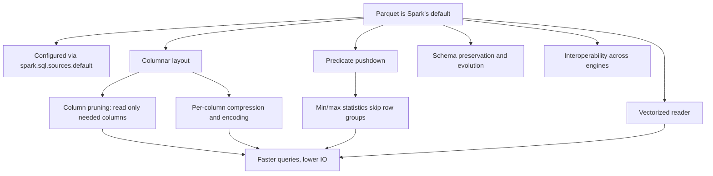

# 2.9.2 Why is Parquet the default and preferred file format for PySpark?

Parquet is the default and preferred file format in PySpark because it is a columnar format that is deeply integrated with Spark's optimizer, enabling column pruning, predicate pushdown, and efficient compression. It is a foundational storage format for analytics workloads.

### Default Configuration

PySpark uses Parquet for all read and write operations when no format is specified. This is controlled by the Spark configuration `spark.sql.sources.default`, which defaults to `"parquet"`.

| Setting | Value |
|---|---|
| `spark.sql.sources.default` | `parquet` |
| Behavior | `spark.read.load()` and `df.write.save()` use Parquet |
| Changeable | Yes, for example to `orc` or `delta` |

When you write a DataFrame without specifying a format, you get Parquet. This is why "the default file format is Parquet when you use Spark’s DataFrame or Dataset API".

### Performance Advantages

Parquet's columnar layout is the primary driver of its performance. Spark reads only the columns required by a query, skipping the rest entirely. This is critical for wide tables and aggregation-heavy workloads.

| Feature | Effect |
|---|---|
| Column pruning | Only needed columns are read from disk |
| Predicate pushdown | Min/max statistics skip entire row groups that cannot match a filter |
| Vectorized reader | Data is read in batches, improving scan throughput |
| Per-column compression | Same-type values compress better, reducing IO |

The combination of these features yields "faster runtimes, higher scan throughput, reduced disk I/O, and lower cost of operation" compared to row-based formats.

### Compression and Encoding

Parquet uses column-specific encoding and compression. Because each column contains values of the same type, compression schemes such as dictionary encoding, run-length encoding, and delta encoding are highly effective. This reduces both storage size and the bytes that must be read from disk.

| Aspect | Benefit |
|---|---|
| Encodings | Dictionary, run-length, delta, bit packing |
| Compression codecs | Snappy, gzip, zstd |
| Typical reduction | 5x to 20x or more vs uncompressed row data |
| Impact | Smaller files, faster reads |

### Schema Handling

Parquet preserves the schema of the data, including nested structures such as structs, arrays, and maps. Unlike CSV, which requires inference and can misread types, Parquet stores type information alongside the data.

Parquet also supports schema evolution. You can start with a simple schema and add columns over time. Spark can merge schemas from multiple Parquet files that have different but compatible structures.

| Feature | Behavior |
|---|---|
| Schema preserved | Yes, with types and nesting |
| Schema evolution | Add columns, merge compatible schemas |
| Null handling | Explicit null tracking, optimized storage |

### Interoperability and Ecosystem

Parquet is an open, widely adopted format. It is the default storage layer for analytics in Apache Spark, Apache Hive, Snowflake, BigQuery, Amazon Athena, Databricks, Trino, and Presto, all reading and writing the same on-disk format. This makes Parquet files portable across engines without conversion.

| Engine | Parquet support |
|---|---|
| Apache Spark | Native, optimized |
| Apache Hive | Native |
| Databricks | Native |
| Snowflake | External tables |
| BigQuery | External tables |
| Trino / Presto | Native |
| Amazon Athena | Native |

### Spark Integration

Parquet is highly optimized within Spark SQL. Spark includes a dedicated vectorized Parquet reader and leverages Parquet's statistics for query planning and pushdown. This level of integration is not present for every format.

| Integration point | Benefit |
|---|---|
| Vectorized reader | Batch reads, faster scans |
| Statistics pushdown | Row group skipping |
| Schema reconciliation | Handles Hive metastore compatibility |
| Aggregate pushdown | MIN, MAX, COUNT can be pushed to Parquet |

### Comparison with Other Formats

| Format | Layout | Default in Spark | Analytics performance |
|---|---|---|---|
| Parquet | Columnar | Yes | High |
| ORC | Columnar | No | High, Hive-oriented |
| CSV | Row | No | Low, no pruning |
| JSON | Row | No | Low, parsing overhead |
| Avro | Row | No | Low, ingestion-oriented |

ORC is also columnar and offers similar pruning and compression. Parquet is preferred in the Spark ecosystem because it is the default, is highly optimized within Spark, and has broader cross-engine adoption in cloud data platforms.

### Summary

- Parquet is the default because `spark.sql.sources.default` is set to `parquet`.
- Its columnar layout enables column pruning, which is the largest performance win for analytics.
- Predicate pushdown via min/max statistics skips unnecessary data.
- Per-column compression and encoding reduce storage and IO.
- Schema preservation and evolution make it robust for changing pipelines.
- Open interoperability across engines prevents vendor lock-in.
- Spark's internal reader is vectorized and tightly integrated with the optimizer.
- While ORC is a capable alternative, Parquet is the established default and the most broadly compatible columnar choice in the Spark ecosystem.
