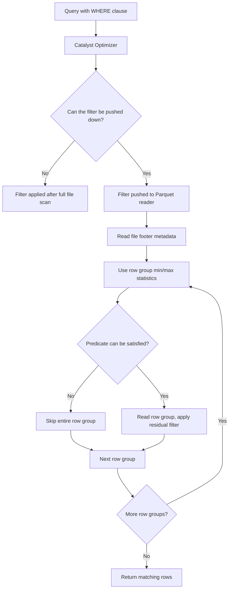

# 2.9.3 Explain Parquet's predicate pushdown and filter pushdown capability.

Parquet's predicate pushdown and filter pushdown are related but distinct optimization techniques. **Filter pushdown** moves a filter predicate from the query plan down into the Parquet reader. **Predicate pushdown** goes a step further by using metadata stored inside the file to skip entire blocks of data without ever reading them.

### Core Mechanism

### Filter Pushdown vs. Predicate Pushdown

| Aspect | Filter Pushdown | Predicate Pushdown |
|---|---|---|
| **Definition** | The filter expression is passed to the data source reader instead of being applied after the scan | The data source uses file metadata (statistics, indexes) to skip data blocks that cannot match the filter |
| **Granularity** | Row level within a scanned block | Row group, page, or file level |
| **Requires statistics?** | No. The reader evaluates the filter on the data it reads | Yes. Min/max, null counts, or bloom filters are required |
| **What it saves** | CPU cost of evaluating the filter in the Spark engine | I/O and decompression cost of reading irrelevant data |
| **Spark config** | `spark.sql.parquet.filterPushdown` (default `true`) | Enabled through the same filter pushdown framework |

The two work together. Filter pushdown makes the Parquet reader aware of the predicate. Predicate pushdown lets the reader use metadata to avoid reading data that cannot satisfy that predicate.

### How Parquet Stores Statistics

Parquet writes metadata at multiple levels. The most important for predicate pushdown are **row group statistics**.

| Metadata Level | What is stored | Granularity |
|---|---|---|
| **File footer** | Schema, row group list, offsets | Whole file |
| **Row group** | Min/max per column, null count, distinct count | Default ~128 MB chunk |
| **Page** | Min/max per column, null count | ~1 MB page (Spark 3.2+ with Parquet 1.12) |
| **Bloom filter** | Probabilistic membership test for equality predicates | Per column chunk |

Row group statistics are the primary mechanism. For a filter like `WHERE amount > 1000`, the Parquet reader checks the `amount` column's min/max statistics for each row group. If the row group's `max(amount) <= 1000`, the entire row group is skipped without reading its data.

### Spark's Pushdown Behavior

Spark's Parquet reader converts Catalyst filter expressions into Parquet filter predicates. The conversion follows specific rules.

| Operator | Pushed Down? | Notes |
|---|---|---|
| `=`, `<`, `<=`, `>`, `>=`, `<=>` | Yes | Simple comparisons against literals |
| `IS NULL`, `IS NOT NULL` | Yes | Uses null count statistics |
| `IN` | Yes | Pushed as a set of OR clauses up to `spark.sql.parquet.pushdown.inFilterThreshold` (default 10) |
| `AND` | Partially | Conjunctive predicates are split. Each part is pushed down independently if possible |
| `OR` | Whole expression only | Cannot be partially pushed down. Pushed only if the entire OR is convertible |
| Non-deterministic expressions | No | Cannot be evaluated on metadata |
| UDFs | No | Opaque to the reader |
| Predicates on partition columns | No | Partition pruning handles these separately |

Predicates on non-nullable columns are pushed down. Predicates on nullable columns are also supported in modern Spark versions, using null count statistics.

### What Predicate Pushdown Can and Cannot Skip

| Scenario | Can skip? | Reason |
|---|---|---|
| `amount > 1000`, row group max is 500 | Yes | Statistics prove no match |
| `amount > 1000`, row group min is 2000 | No, but filter is redundant | All rows match. Still must read |
| `amount > 1000`, row group min 500, max 2000 | No | Possible matches exist. Must read and filter |
| `name = 'alice'`, no bloom filter, random data | Unlikely | Min/max of a string column is often unhelpful for equality |
| `name = 'alice'`, bloom filter enabled | Yes, if bloom filter rejects | Bloom filter membership test |
| `amount + tax > 1000` | No | Expression cannot be mapped to raw column statistics |

### Performance Impact

Predicate pushdown is most effective when the filter is **selective** and the data has **natural ordering** on the filtered column.

| Factor | Impact |
|---|---|
| **Selectivity** | High selectivity (few matching rows) yields larger skips |
| **Data ordering** | Clustered or sorted data makes min/max statistics effective |
| **Row group size** | Smaller row groups mean finer skip granularity but more metadata overhead |
| **Column cardinality** | Low cardinality columns compress well and benefit more from dictionary and bloom filtering |
| **Filter type** | Equality on high-cardinality columns benefits most from bloom filters. Range predicates benefit from min/max |
| **I/O type** | Skipping row groups is especially valuable on object storage (S3, GCS), where avoiding a read avoids network transfer |

Reported speedups range from **10x to 100x** for highly selective queries that eliminate unnecessary I/O and decompression.

### Configuration Knobs

| Config | Default | Effect |
|---|---|---|
| `spark.sql.parquet.filterPushdown` | `true` | Master switch for Parquet filter pushdown |
| `spark.sql.parquet.pushdown.inFilterThreshold` | `10` | Maximum `IN` list size that is pushed as OR clauses |
| `parquet.bloom.filter.enabled#column` | `false` | Enables bloom filter for a specific column at write time |
| `parquet.task.side.metadata` | `true` | Must be `false` for full filter pushdown in some Spark versions |

### Common Pitfalls

| Pitfall | Effect | Fix |
|---|---|---|
| UDF in the filter | Pushdown disabled entirely | Rewrite with native expressions |
| Casting the filtered column | Statistics cannot be used | Filter on the raw column type |
| Filtering on a partition column | Handled by partition pruning, not Parquet pushdown | Ensure partition columns are not redundantly filtered |
| `OR` across columns | Only pushed if fully convertible | Split into separate queries or use `IN` where possible |
| Very large `IN` lists | Fallback to non-pushed evaluation above threshold | Increase `inFilterThreshold` carefully or use a join |
| Random data in filtered column | Min/max statistics are useless | Cluster or sort the data, or enable bloom filters |
| Many small row groups | Metadata overhead negates skip benefits | Compact files to 128 MB to 1 GB |

### Summary

- **Filter pushdown** moves the predicate into the Parquet reader.
- **Predicate pushdown** uses Parquet metadata (row group min/max, null counts, bloom filters) to skip data that cannot match.
- Row group statistics are the primary mechanism. Page-level statistics and bloom filters provide finer granularity in newer Spark versions.
- Pushdown works best for selective queries on ordered or clustered data.
- It is most impactful on object storage, where skipped reads avoid network transfer.
- Keep filters native, avoid casting filtered columns, and compact small files to maximize the benefit.
