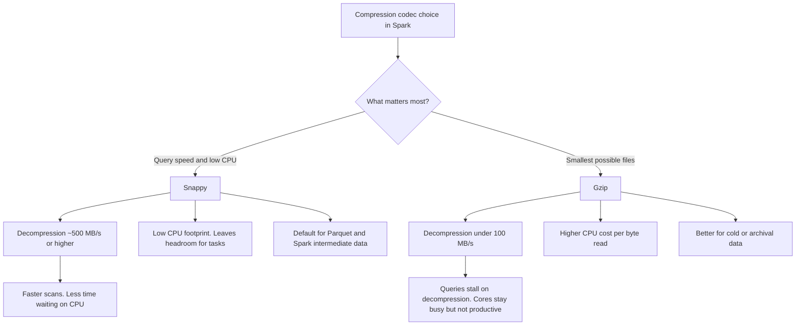

# 2.9.4 What are the benefits of using Snappy compression over Gzip in Spark?

The core benefit of Snappy over Gzip in Spark is **decompression speed**. Spark queries on large datasets quickly become **decompression-bound** with Gzip, while Snappy keeps the CPU free for actual query processing.

### The Spark-specific reason Snappy became the default

Apache Spark changed the default Parquet codec from Gzip to Snappy in version 2.0.0 for a concrete reason documented in **SPARK-14482**:

- **Gzip decompression** measured **under 100 MB/s** on a single core.
- **Snappy decompression** measured **around 500 MB/s** on a single core.

When a Spark job scans hundreds of gigabytes or terabytes, Gzip turns every task into a decompression bottleneck. The CPU is working, but it is working on decompression instead of filtering, joining, and aggregating. Snappy removes that bottleneck.

### Head-to-head performance comparison

The table below combines benchmark figures from Parquet compression studies and the Spark issue tracker. Absolute numbers vary by data and hardware, but the ratios are consistent.

| Metric | Snappy | Gzip | Practical meaning for Spark |
|---|---|---|---|
| Compression speed | ~720 MB/s | ~85 MB/s | Snappy writes and shuffles data much faster |
| Decompression speed | ~1200 MB/s | ~320 MB/s | Snappy scans are not decompression-bound |
| Core decompression throughput | ~500 MB/s | Under 100 MB/s | The gap Spark explicitly cited when changing the default |
| Compression ratio | ~58 percent of original size | ~42 percent of original size | Gzip saves roughly 30 percent more storage |
| CPU usage | ~12 percent | ~28 percent | Snappy leaves more CPU for Spark tasks |
| Read-side CPU | Lower | Roughly 2x Snappy on reads | Gzip makes queries CPU-heavy |

### Splittability and parallelism

This is a separate advantage that is often overlooked.

| Codec | Splittable on its own | Splittable inside Parquet or ORC |
|---|---|---|
| Snappy | No, but container formats make it splittable | Yes. Parquet row groups and ORC stripes are independent units |
| Gzip | No | Yes inside Parquet, but each Gzip stream is still slow to decompress |

A raw Gzip file cannot be split across tasks. A 10 GB Gzip file is read by one task on one core, regardless of cluster size. Snappy inside Parquet avoids this because Parquet splits work by row group, and each row group decompresses independently.

For Spark workloads that already use Parquet, splittability is handled by the format. The remaining difference is decompression speed, and that is where Snappy wins decisively.

### CPU trade-off

Gzip is not "bad". It is a deliberate trade: smaller files in exchange for more CPU.

| Workload characteristic | Snappy fits better | Gzip fits better |
|---|---|---|
| Data is read frequently (hot data) | Yes. Decompression is cheap | No. Every read pays the decompression penalty |
| Data is read rarely (cold or archival) | No. Larger files cost more storage | Yes. Smaller files save storage |
| Query scans large volumes | Yes. Decompression-bound queries are the main risk | No. Scans stall on decompression |
| Storage cost is the dominant constraint | No. Snappy files are larger | Yes. Gzip saves roughly 30 percent space |
| Network transfer of files is expensive | No. Larger files mean more bytes moved | Yes. Smaller files reduce transfer cost |
| Cluster has spare CPU but limited IO | Gzip can use CPU to reduce bytes read | Yes |
| Cluster is CPU-constrained | Yes. Low CPU footprint | No. Gzip competes with tasks for CPU |

The general rule that emerges from these trade-offs is that **Snappy is better for hot data that is queried often, while Gzip is better for cold data that is stored long term**. Spark is usually a hot-data engine, which is why Snappy is the default.

### Compression ratio is not the goal in Spark

A smaller file is only better if reading it is not slower. In Spark, the bottleneck is often CPU, not disk or network.

| Scenario | What limits speed | Does a smaller file help? |
|---|---|---|
| Full table scan of a hot dataset | Decompression CPU | No. Gzip makes it worse |
| Selective query with Parquet predicate pushdown | Rows actually read | Marginally. Fewer bytes, but decompression is still slower |
| Shuffle write and read | Serialization and network | Snappy writes faster and reads faster. Gzip saves bytes but adds CPU |
| Archival storage with rare reads | Storage cost | Yes. Gzip is the better choice |
| Object storage with per-byte cost | Bytes transferred | Gzip can reduce cost, but only if reads are infrequent |

Snappy wins for the common Spark pattern: repeated scans of large, active datasets. Gzip wins for the uncommon pattern: write once, read rarely, and pay for storage.

### Practical guidance

- **Use Snappy for Parquet, ORC, and shuffle data.** It is the default for a reason. It keeps scans fast and CPU available for real work.
- **Use Gzip only when storage or transfer cost outweighs query speed.** Archival tables, cold partitions, and data exported to cheaper storage are valid cases.
- **Do not choose Gzip for raw text files that Spark must read.** A single large Gzip file limits the read to one task and destroys parallelism.
- **Do not assume Snappy is always faster end to end.** On very small files, the difference is negligible. On very cold data, Gzip's smaller size may reduce IO enough to offset slower decompression.
- **Benchmark with the real workload.** The ratios above are representative, not universal. A quick `spark.read.parquet(...).filter(...).count()` on both codecs on a sample of your data settles the question faster than any general rule.
