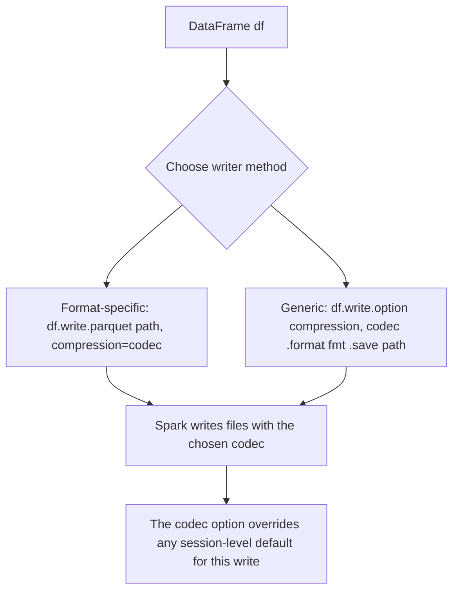

# 2.9.6 How do you write a DataFrame with a specific compression codec?

You specify a compression codec when writing a DataFrame by passing the `compression` option to the writer, either directly as an argument to format-specific methods like `parquet()` and `orc()`, or via the generic `.option("compression", "<codec>")` method before calling `.save()`.



### Format-Specific Writers (Recommended)

The cleanest approach is to use the dedicated writer method for your target format and pass `compression` as a keyword argument. This is explicit and reads well.

**Parquet**

The `compression` parameter overrides `spark.sql.parquet.compression.codec` for this write only.

```python
df.write.parquet("/path/to/output", compression="zstd")
```

Supported codecs for Parquet: `none`, `uncompressed`, `snappy`, `gzip`, `lzo`, `brotli`, `lz4`, `lz4_raw`, `zstd`.

**ORC**

The `compression` parameter overrides `orc.compress` and `spark.sql.orc.compression.codec`.

```python
df.write.orc("/path/to/output", compression="zlib")
```

Supported codecs for ORC: `none`, `snappy`, `zlib`, `lzo`. Some platforms also list `zstd`, `lz4`, and `brotli`.

**CSV and JSON**

Both `csv()` and `json()` accept a `compression` argument.

```python
df.write.csv("/path/to/output", compression="gzip")
df.write.json("/path/to/output", compression="bzip2")
```

Supported codecs for CSV and JSON: `none`, `bzip2`, `gzip`, `lz4`, `snappy`, `deflate`.

### Generic Option Method

If you prefer a format-agnostic style, or if you are using `.save()` with a `format`, use `.option("compression", "<codec>")`.

```python
df.write \
  .option("compression", "zstd") \
  .format("parquet") \
  .save("/path/to/output")
```

This works for Parquet, ORC, CSV, and JSON. The accepted codec names are the same as listed for each format above. The option is passed down to the underlying writer and overrides any session default.

### Important Considerations

| Aspect | Detail |
|---|---|
| **Overrides session default** | The per-write `compression` option takes precedence over session-level settings like `spark.sql.parquet.compression.codec` for that single write operation |
| **Case insensitive** | Codec names are case insensitive. `"GZIP"` and `"gzip"` are equivalent |
| **Default behavior** | If you omit `compression`, Spark uses the session default for that format. For Parquet, the default is `snappy` in most Spark versions. For ORC, the default varies (often `zlib` or `zstd`) |
| **Write-time only** | Compression is applied when writing. Spark automatically detects and decompresses files when reading, regardless of the codec used |
| **File size and performance** | Codec choice affects storage size and read/write speed. For analytical workloads, `snappy` is the typical default because it balances compression ratio with fast decompression. `zstd` offers a better compression ratio at moderate CPU cost. `gzip` compresses more but is slower to decompress and can bottleneck scans |
| **Splittability** | In formats like Parquet and ORC, compression is applied within blocks, so the overall file remains splittable regardless of codec. For raw text formats like CSV or JSON written as a single file, codecs like `gzip` produce non-splittable output, limiting read parallelism |

### End-to-End Example

```python
from pyspark.sql import SparkSession

spark = SparkSession.builder.getOrCreate()
df = spark.range(1_000_000).toDF("id")

# Parquet with zstd, overriding the session default for this write
df.write.parquet("/tmp/parquet_zstd", compression="zstd", mode="overwrite")

# ORC with zlib, overriding the session default for this write
df.write.orc("/tmp/orc_zlib", compression="zlib", mode="overwrite")

# CSV with gzip using the generic option method
df.write.option("compression", "gzip").csv("/tmp/csv_gzip", mode="overwrite")

# JSON with bzip2 using the direct argument
df.write.json("/tmp/json_bzip2", compression="bzip2", mode="overwrite")
```

### Summary

- Use the format-specific writer method (`parquet`, `orc`, `csv`, `json`) and pass `compression` directly for the clearest code.
- Use `.option("compression", "<codec>")` before `.save()` when you need a generic, format-agnostic approach.
- The per-write option overrides the session-level default for that format.
- Codec names are case insensitive and format support varies slightly.
- Compression is transparent on read. Spark detects and decompresses automatically.
- Choose the codec based on the trade-off between file size, write speed, and read (decompression) speed for your workload.
